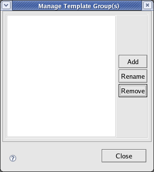
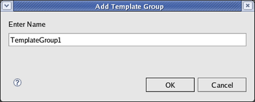
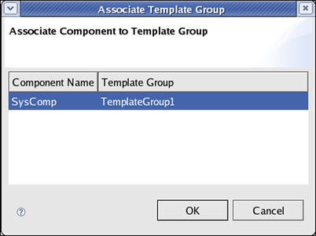

Chapter 10: Creating and Using Template Groups
==============================================
This chapter provides information about creating and using the template groups to generate the source code. The source code is 
built using the default templates that is in C language. You can also create source codes in C++ language.

**Key Topics:**

* Creating Template Group
* Using Template Groups
* Modifying Template Groups

Creating Template Group
-----------------------
The template groups are created using the **Manage Template Group(s)** window. You can also use the default template. After creating 
the template group, it appears in the **Clovis Workspace** pane.

1. From the **Clovis** menu, click **Manage Template Groups** or click the icon from the toolbar to open the **Manage Template Group(s)** 
   window.

2. Click **Add** to add a new template group. The window is displayed.

3. Enter a name for the template group and click **OK**. The name is displayed in the **Manage Template Group(s)** window and it is 
   available under the **templates** folder in the **Clovis Workspace** Pane.

   Click **Rename** to rename the selected template group.

   Click **Remove** to remove the selected template group.

Using Template Groups
---------------------
After you have completed creating the template group, you can assign it to the various SA Forum components in the Component Editor. 
By default, the default template group is associated to the components. You can also associate the user defined template group.

To assign the template group to the SA Forum component:

1. From the Clovis menu, click **Associate Template Group** or click the icon on the toolbar. The **Associate Template Group** window 
   displays all the SA Forum components in the **Component Editor** to which you can assign the template group.

2. Select the template group from the list and click **OK**. The template group is assigned to the SA Forum component.

Modifying Template Groups
-------------------------
After creating template groups, you can customize the template groups per model as well as per application. All the templates will 
be availabe under **templates** folder. If you want to use the modified template files for entire model, modify the template files 
which are under **templates/default**. If you want to use the modified template files for any one of the application, modify the 
template files which are under **templates/<TemplateGroupName>**.

**templates** folder contains two type of templates:

* **python** template files
* **.c** and **.h** files.

Most of the python template files have two type of template **static** and **runtime**. **static** python templates are simply copied in some 
of the **.c** or **.h** files through python script at the time of code generation. **static** python templates are looks like:

.. code-block:: py3

    headerTemplate = Template(
        """
        \ ClRcT clProvRead(CL_OM_PROV_CLASS* pThis, ClHandleT txnHandle, ClProvTxnDataT* pProvTxnData) { 
            ClRcT rc = CL_OK; 
            return rc; 
        } 
        """
    )

**runtime** python templates are copied in some of the **.c** or **.h** files with some modifications through python script. 
Modifications will happen based on some **xml** entries. **runtime** python templates are looks like:

.. code-block:: py3

    headerTemplate = Template(
        """
        \ ClRcT cl${compName}${res}ProvRead(CL_OM_PROV_CLASS* pThis, ClHandleT txnHandle, ClProvTxnDataT* pProvTxnData) { 
            ClRcT rc = CL_OK; 
            return rc; 
        } 
        """
    )

Values for compName and res will be substituted through python script at the time of code generation.

All the **.c** and **.h** files will be copied to **app/<CompName>** folder at the time of code generation.

Adding Application Code Blocks
^^^^^^^^^^^^^^^^^^^^^^^^^^^^^^
If you want to use same **TemplateGroup** for multiple applications and also you want to write some apllication code in generated 
source files, identify the blocks in **template(s)** which you will modify after generating the source. Insert this tag in each blocks:

.. code-block:: py3

    # ---BEGIN_APPLICATION_CODE---

    # ---END_APPLICATION_CODE--

or

.. code-block:: c

    /* ---BEGIN_APPLICATION_CODE--- */

    /* ---END_APPLICATION_CODE--- */

This code blocks will be used to identify the user code. After generating source you can use this blocks to add your application 
code. Next time when you generate source all the code with in the blocks will be moved in to newly generated code.
