Chapter 11: Defining IDL
========================
This chapter provides information about creating the IDL XML file that is used to generate marshalling and unmarshalling code for 
communication between two or more components.

The OpenClovis Interface Definition Language (IDL) is a library used by all components to communicate efficiently with other 
components. Using IDL, OpenClovis ASP services can communicates across different endian and mixed mode (32-bit and 64-bit 
architecture) machines.

IDL generated code is a wrapper over RMD and supports RMD functionality to provide communication across components. RMD consists of 
an engine which provides the ability to invoke methods from one component to another component. By defining an IDL, the XML file is 
created which is read by the Python script and the C code is generated. The created XML file is located in your workspace and the 
generated C code is located in the <projectarea_directory>/<model_name>/src/app/idl folder. You can customize this XML file for 
your specific requirements.

Each component may define a set of operations associated with it. The RMD calls are defined through the functions defined in the 
component. The component from where the call or request is invoked is called the source and the component that receives the request 
is called the destination. When a remote call is invoked, the RMD sends a message to the destination using the underlying IOC 
transport layer. The component that receives the request invokes the function that is being requested.

Components can expose different types of services. Services of one component are grouped under service group. Each service has a 
operation group that logically separates the functions of a service. Hence, to define an IDL, you have to create the service group 
list that consists of services, operation groups, and the associated arguments. You can also create the data types required for the 
arguments such as structures, unions, and enumerations.

**Key Topics:**

* Defining Service Group List
* Creating User Defined Data Types

Defining Service Group List
---------------------------
A Service Group List comprises the following:

* Service Groups
* Services
* Operation Groups
* Operations

To define the Service Groups:

1. From the **Clovis** menu, select **Remote Method Definitions** or press **Shift+Ctrl+I** on the keyboard. The **RMD** window is 
   displayed. In this window, you can specify the services for each component.

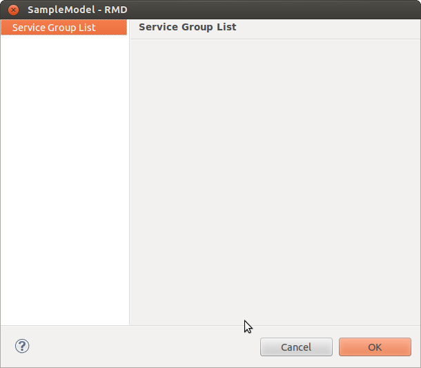

2. Right-click **Service Group** List and select **New** to create a new service group. Select the service group from the drop-down 
   list.

This list displays the list of service group provided for all the components.

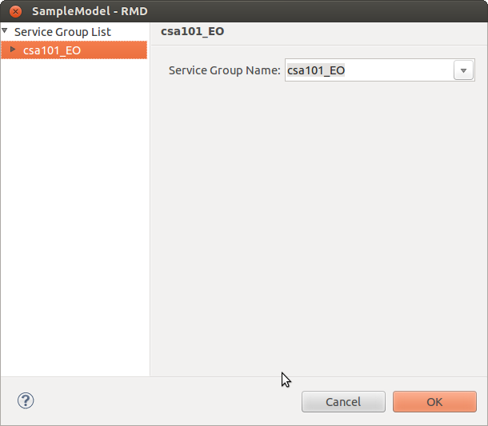

3. Double-click the newly created service group to display the **Service List**. Right-click and select **New**.

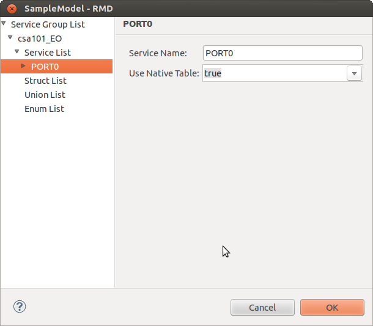

Enter the following information:

* **Service Name:** This is the name of the service in which the operations of the service resides. Enter a valid C identifier.
* **Use Native Table:** If a component is providing service to other component(s), the native (default) table is used. Select **true** 
  or **false** from the drop-down list. If you set this to **true** , the default table is used. If it is set to **false** , another 
  table is generated automatically by IDL. This is typically used when the response message is sent by invoking an operation on a 
  caller.

4. Double-click the created service to display the **Operation Group List**. Right-click and select **New** to create a new operation 
   group.

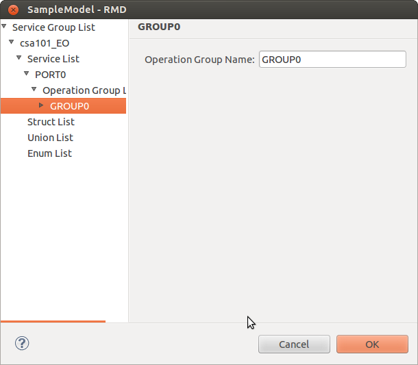

Enter the following information:

* **Operation Group Name:** This is the name for the operation group that consists of the functions. You can define more than one 
  operation group to logically separate the functions for a service. Enter a valid C identifier.

5. Double-click the created operation group to display the **Operation List**. Right-click and select **New** to specify the 
   operations or functions.

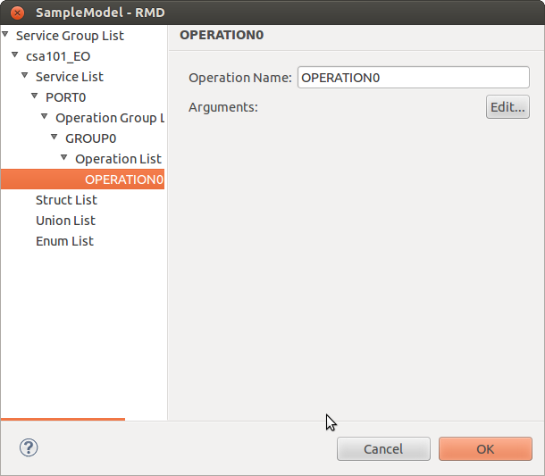

Enter the following information:

* **Operation Name:** Name for the operation or function associated with the component to which RMD calls can be made. Enter a valid 
  C identifier.
* **Arguments:** Click **Edit** to enter the argument details for the operation. Argument is similar to a data member. Argument details 
  consists of the input or output parameters associated with this operation. The **Argument Details** window is displayed. Click 
  **New** to create a new argument.

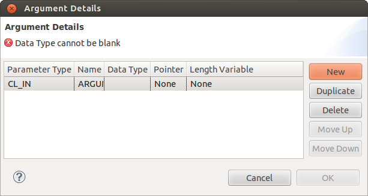

Enter the following information:

* **Parameter Type:** Type of the parameter for the argument. Select the parameter type from the list. The options available are:

  * CL_IN: This argument parameter is an input to the operation.
  * CL_OUT: This argument parameter is used to return the value back to the caller.
  * CL_INOUT: This argument parameter is an input to the operation and is also used to return the value back to the caller.

* **Name:** Name of the argument. Enter a valid C identifier.
* **Data Type:** Data type for the argument. Select the data type from the list.

  The pre-defined data types available are:

  * ClInt8T
  * ClUint8T
  * ClInt16T
  * ClUint16T
  * ClInt32T
  * ClUint32T
  * ClInt64T
  * ClUint64T
  * ClCharT

  .. note::
    You can also have user defined data types like Structures, Unions, or Enumerations. For information about creating user-defined 
    data types, see Creating User Defined Data Types section. After you create the user-defined data type, they will appear in this 
    drop-down list.

* **Pointer:** If the argument is of pointer type, select the level of indirection. The available options are:

  * None
  * Single
  * Double

  .. note::
    All CL_OUT type of argument must be either single or double pointer. CL_IN or CL_INOUT argument type cannot be a double pointer.

* **Length Variable:** If the argument is of the pointer type, select another argument that contains the length of the data pointed 
  by this argument. The default value is **None**. If you create other arguments, they appear in this list.

  .. note::
    You can specify the Length Variable when the argument type is a single pointer or when the argument type is CL_OUT and is a 
    double pointer. If the argument is of the pointer type and length variable is **None** , the length of the data pointed is of the 
    defined data type within the argument.

6. Click **OK**. The **Arguments Details** window closes.

7. Click **OK**. The IDL is saved and the XML file is located in the **idl** folder in your workspace.

Creating User Defined Data Types
--------------------------------
IDL uses XDR representation to Marshall application data while transferring it to another component. Therefore, IDL requires the 
application to specify the data structures to be transferred through RMD, so that it can generate XDR functions required to 
marshal/un-marshal these data structures. Marshaling is the process of converting the native data to XDR format and un-marshaling 
is retrieving the data back to native format. You can define the following user-defined types for each component:

* Structures
* Unions
* Enumerations

Defining Structures
^^^^^^^^^^^^^^^^^^^
Structures are similar to structures in C. Therefore, every defined structure is composed of data members. You can define two 
structures separately and embed one inside another as a data member.

You can define structures in the **RMD** window. Right-click on the **Struct List** tand select **New**. **STRUCT0** is created by 
default under **Struct List**.

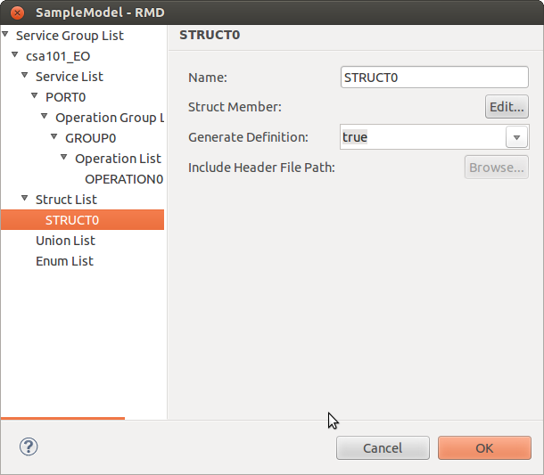

Enter the following information:

* **Name:** This is the user-defined structure name. Enter a valid C identifier. When you rename the structure, the new name replaces the default name on the left pane.
* **Struct Member:** Click **Edit** to specify the data member details. The **Data Member Details** window is displayed. Click **New** 
  to enter a new data member.

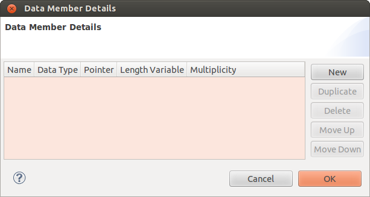

Enter the following information:

1. **Name:** Name of the data member of the structure. Enter a valid C identifier.

2. **Data Type:** Data type of the structure member. This can be a pre-defined data type or a user-defined type. Select the data 
   type from the drop-down list. It is the your responsibility to ensure that there are no circular inclusions. Circular inclusions 
   occur when two or more user-defined data types include each other in their respective definitions in such a way that it creates 
   a cyclic dependency among st the involved user-defined data types.

3. **Pointer:** Select the value from combo-box to specify whether the structure member is a pointer or not. When Single is selected, 
   it means that the data member is a pointer to the specified data type. The options available are:

   * None
   * Single

4. **Length Variable:** If the structure member is not a pointer, select None. Otherwise, select the name of the other member in 
   this structure that contains the length of the data pointed by this member. This attribute should be specified only if the pointer 
   type is set to Single. This attribute specifies which data member in the structure will contain the number of elements being 
   pointed to. When none is specified for a pointer type data member, it is assumed that a single element is being pointed to.

5. **Multiplicity:** Defines the number of elements in the array. Used only if the attribute is an array. This attribute must not be 
   specified along with the pointer attribute.

   Click **OK**. The data member details are saved and the Data Member Details window closes.

   * **Generate Definition:** Select this option to specify the definition for the user-defined data type. If you select **true**, 
     **Include Header File Path** option is disabled and definition will be generated during code generation. If set to **false**, 
     you must provide the path for the **.h** file that has the definition.
   * **Include Header File Path:** Click **Edit** to include the path. Specify the path for appropriate **.h** file and click **OK**. 
     If you select **Generate Definition** as false, then you must provide the path.

   Click **OK**. The structure is created.

Defining Union
^^^^^^^^^^^^^^
These are defined similar to structures. The difference is in terms of the interpretation and generation.

You can define unions in the **RMD** window. Right-click on the **Union List** and select **New** to create a new union. **UNION0** 
is created by default under **Union List**.

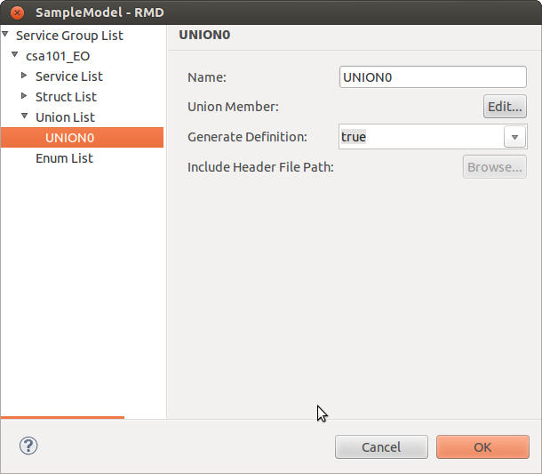

Enter the following information:

* **Name:** This is the union name. Enter a valid C identifier. When you rename the union, the new name replaces the default name 
  on the left pane.
* **Union Member:** Click **Edit** to specify the data member details. The **Data Member Details** window is displayed.

Enter the following information:

* **Name:** Name of the data member of the union. Enter a valid C identifier.
* **Data Type:** Data type of the union member. This can be a pre-defined data type or a user-defined type. Select the data type 
  from the drop-down list. It is the your responsibility to ensure that there are no circular inclusions. Circular inclusions occur 
  when two or more user-defined data types include each other in their respective definitions in such a way that it creates a cyclic 
  dependency among est the involved user-defined data types.
* **Pointer:** Select the value from combo-box to specify whether the union member is a pointer or not. When **Single** is selected, 
  it means that the data member is a pointer to the specified data type. The options available are:

  * None
  * Single

* **Length Variable:** If the union member is not a pointer, select **None**. Otherwise, select the name of the other member in this 
  union that contains the length of the data pointed by this member. This attribute should be specified only if the pointer type is 
  set to **Single**. This attribute specifies which data member in the union will contain the number of elements being pointed to. 
  When none is specified for a pointer type data member, it is assumed that a single element is being pointed to.
* **Multiplicity:** Defines the number of elements in the array. Used only if the attribute is an array. This attribute must not be 
  specified along with the pointer attribute.

Click **OK**. The data member details are saved and the Data Member Details window closes.

* **Generate Definition:** Select this option to specify the definition for the user defined data type. If you select **true**, 
  **Include Header File Path** option is disabled and definition will be generated during code generation. If set to **false**, you 
  must provide the path for the **.h** file that has the definition.
* **Include Header File Path:** Click **Edit** to include the path. Specify the path for appropriate **.h** file and click **OK**. 
  If you select **Generate Definition** as false, then you must provide the path.

Click **OK**. The union is created.

Defining Enumeration
^^^^^^^^^^^^^^^^^^^^
Enumerations are similar to enums in C. You can define enumerations in the **RMD** window. Right-click on the **Enum List** and 
select **New** to create a new enum. **ENUM0** is created by default under **Enum List**.

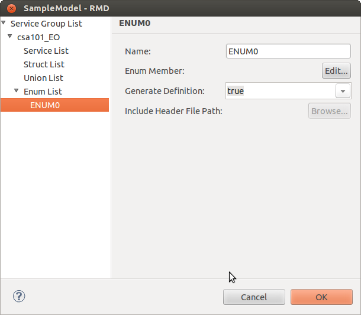

Enter the following information:

* **Name:** This is the enumeration name. Enter a valid C identifier.
* **Enum Member:** Click **Edit**. **The Enum Member Details** window is displayed. Click **New** to create new enumeration data member.

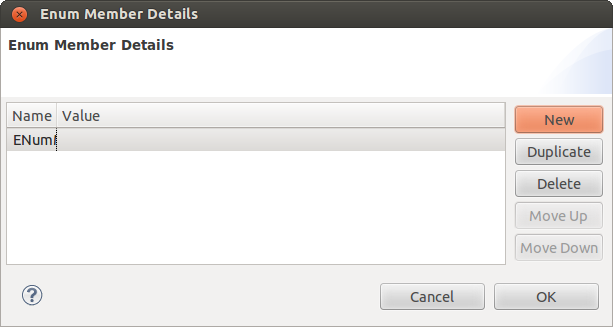

Enter the following:

1. **Name:** Name of the data member of the enum. Enter a valid C identifier.

2. **Value:** Value for the data member. Click **OK**. The data member details are saved and the **Enum Member Details** window closes.

  * **Generate Definition:** Select this option to specify the definition for the user defined data type. If you select **true**, 
    **Include Header File Path** option is disabled and definition will be generated during code generation. If set to **false**, 
    you must provide the path for the **.h** file that has the definition.
  * **Include Header File Path:** Click **Edit** to include the path. Specify the path for the appropriate **.h** file and click 
    **OK**. If you select **Generate Definition** as false, then you must provide the path.

Click **OK**. The enumeration is created.
