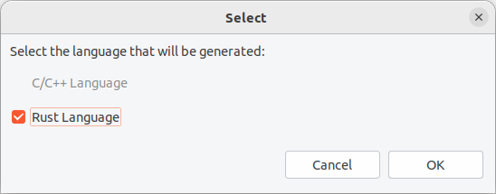
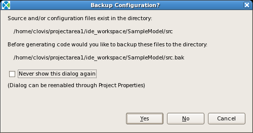
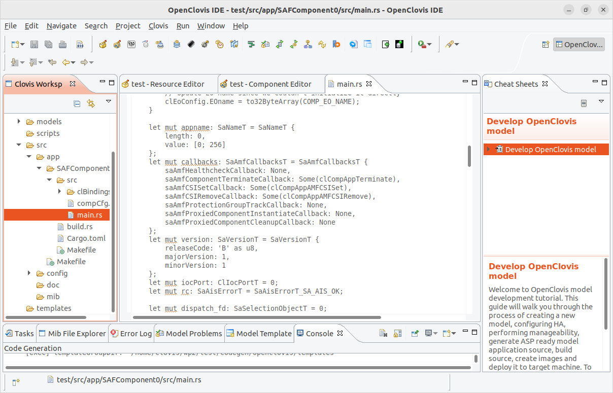
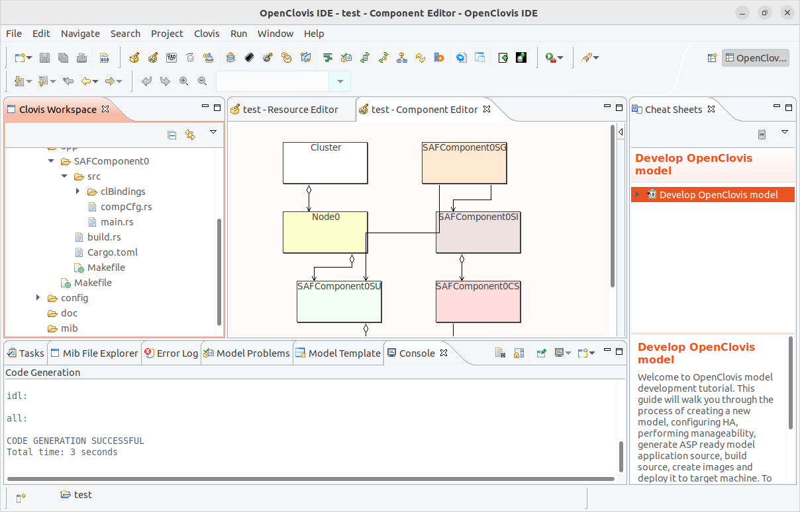
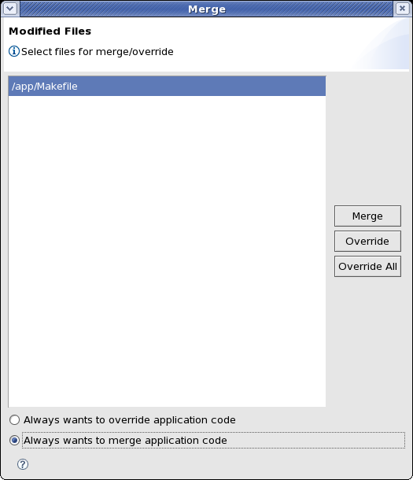

Chapter 12: Generating Source Code
==================================
This chapter provides information about generating the source code after you have completed building the model.

To generate the code, in the **OpenClovis IDE** window, from the **Project** menu, click **Generate Source**. We supports 2 types 
of sources: **C** and **Rust**. So, the dialog in which you must choose the programming language you'd like shows:

On successful generation of the source code, a message is printed on the **Console** pane at the bottom of the **OpenClovis IDE** 
window.

.. image:: ../../images/ideguide/Clovis-code-console.png

The generated source code is located at <projectarea_directory>/<model_name>/src directory. The projectarea_directory is specified 
in the **Clovis System Project** window.

As source code is generated it is copied, along with various configuration files from the IDE model to the ASP model. Although not 
recommended, you may have made some manual changes to these ASP configuration files. You may also have made changes to generated 
source code outside of the prescribed begin/end application code blocks. The process of generating code will overwrite these changes. 
The IDE provides you an opportunity to backup these files before they are overwritten during code generation. Depending on your 
project settings you may see the following dialog.

* **Yes:** Backs up the existing source and configuration files into the directory specified and then proceeds with code generation.
* **No:** Proceeds with code generation without backing up the source and configuration files.
* **Cancel:** Stops code generation without making any changes.
* **Never show this dialog again:** Selecting this check-box will persist the selection made with the Yes or No buttons as a project property and always use this option when generating source code.

.. note::
    Only one backup version of a project's directory directory is maintained.

    If you have selected Never show this dialog again but want to now change the backup mode you can do this through the Project 
    Property dialog. See the section Setting Project Properties.

If **Rust** was selected, the main source file in **Rust** (main.rs) will be generated as below:

And the workspace (on the left window) is like this:

Merging User Application Code
-----------------------------
When you generate the code for the model which already has the user code, IDE will find the diff for generated code with existing 
user code and display the list of modified files in the **Merge** window.

* **Merge:** Select files in the list and click Merge button. All user code placed within the following blocks will be moved into 
  the newly generated code.

  .. code-block:: c

    ---BEGIN_APPLICATION_CODE---

    ---END_APPLICATION_CODE---

* **Override:** Select files in the list and click **Override** button. all user code will be overridden by generated code.
* **Override All:** This will override all the user code.
* **Always wants to override application code:** Select this option if you want to override application code every time.
* **Always wants to merge application code:** Select this option if you want to merge application code every time.

SNMP auto code genaration
-------------------------
If you have SNMP sub-agent in your model and you want to use SNMP auto code generation, before generating source code you need to 
enter MIB directories location and module name in **SNMP Properties Dialog** for SNMP sub-agent component. For more information, see 
Setting SNMP sub-agent Properties section in **Chapter 7**, Setting Component Properties.
