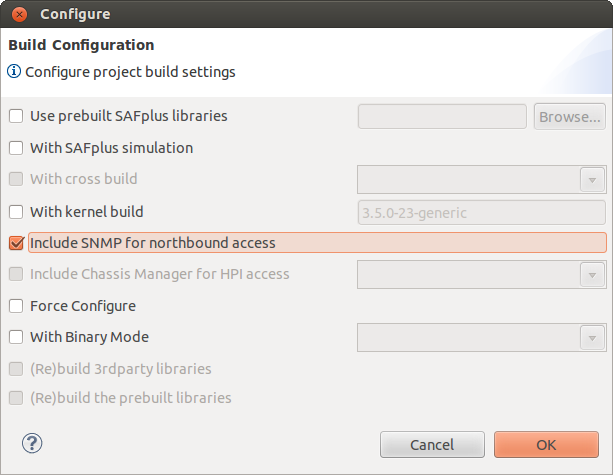
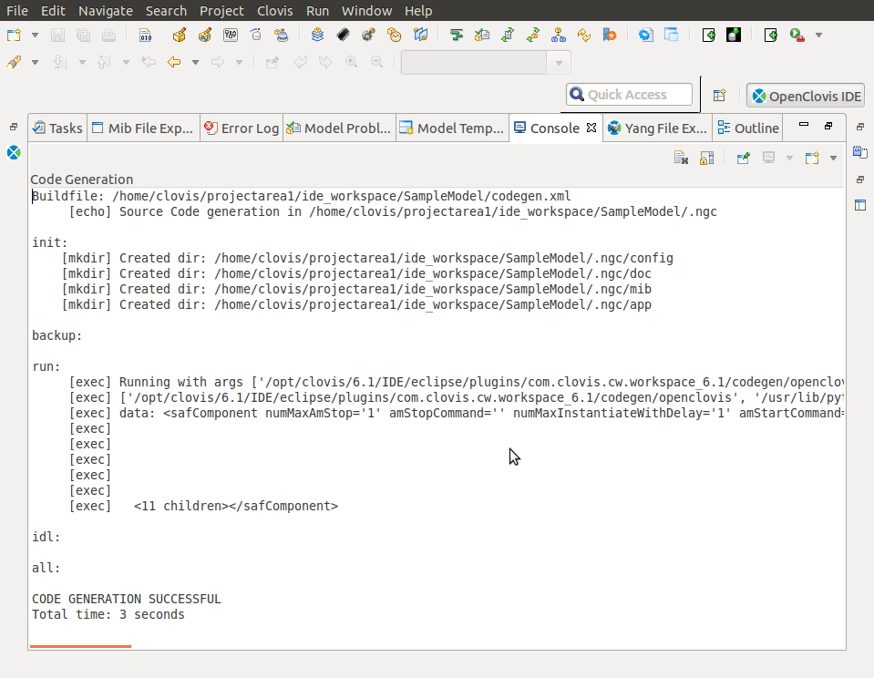

Chapter 13: Building the Project
================================
Building the project takes the generated source code files and uses them to build the project executable file. This executable is 
located in the target folder in the **<projectarea_directory>/<model_name>/src** directory. To build the project select the **Project** 
> **Build Project** menu item. The **Build Configuration** dialog appears.

Enter the following information:

* **Use pre build SAFPlus:** Select this checkbox to use prebuilt ASP libraries. When checked the field to the right will become 
  enabled. This field holds the location of the pre build SAFPlus libraries. To get more information about pre-building ASP 
  libraries, see OpenClovis SDK User Guide.
* **With cross build:** Select this check box to build the code for another CPU. Also select the CPU from the drop-down list.

  .. note::
    This option is only available if you have installed cross-build tool chains during the installation process.

* **With Kernel build:** Select this check box to build the code for another Kernel version. Also, specify the CPU in the text box.
* **Include SNMP for North Bound Access:** Select this checkbox to include SNMP libraries. If you do not include SNMP build, it 
  does not build the SNMP server in ASP and the SNMP agent in the model. If your model has SNMP dependencies, then this should be 
  turned on to compile and link with the installed SNMP utilities.
* **Include Chassis Manager for HPI Access:** Select this checkbox to include Chassis Manager (CM) component. This is used to build 
  ASP for an ATCA environment where there is a Shelf Manager that communicates through the Hardware Platform Interface (HPI).

  Select an option from the drop-down menu. The options available are radisys and openhpi.

  .. note::
    The **Include Chassis Manager for HPI Access** checkbox is only enabled if a Platform Support Package is installed within the 
    project's configured SDK location.

* **Force Configure:** Select this check box to forcefully configure the project before build.

Click **OK** to build the project.

When complete a build output message is printed on the **Console** pane at the bottom of the **OpenClovis IDE** window.

.. note::
    Project building and image generation (explained in the following section) can also be accomplished from the Linux command line. 
    For more information on the command line based process, see the respective sections of the **OpenClovis SDK User Guide** : Building 
    ASP and ASP-based Systems and Deploying and Running OpenClovis ASP on a Target System.
