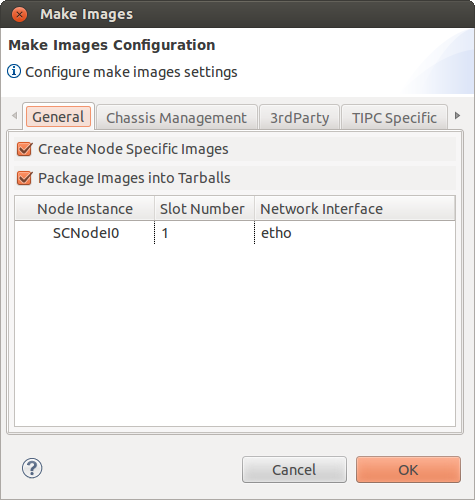
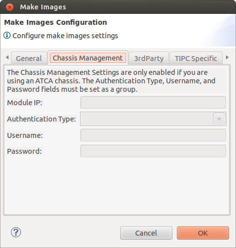
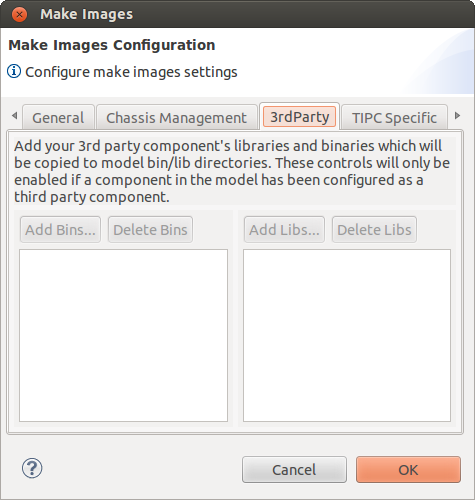
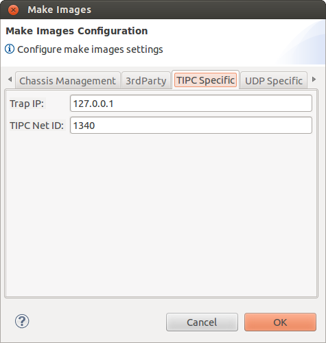
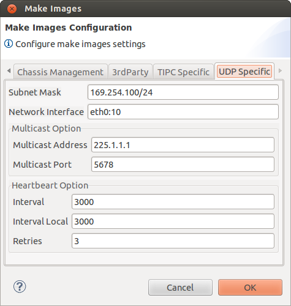
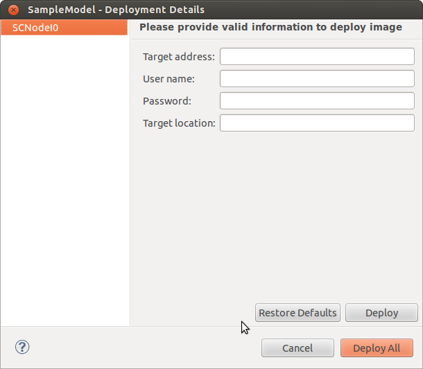
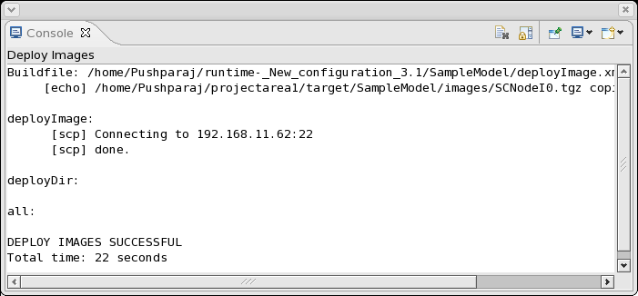

Chapter 14: Making Project Images
=================================
Making project images takes the project executable that was created during build project and packages it for deployment in a 
specific environment. To make the project images select the **Project > Make Images** menu item. The **Make Images Configuration** 
dialog appears with three tabs.

**General** tab is used to indicate information about the environment on which the images will be deployed. This information is used 
to tailor the images to run on that environment.

* **Create Node Specific Images:** This check box indicates whether to create node specific images or single image for all nodes.
* **Package Images into Tarballs:** This check box indicates whether to package the images into tarballs.
* **Node Instance Information:** This table contains a row for each node instance that was defined in the model. The values in the 
  rows are used to specify how the node instance will be deployed on the ASP cluster.

  * **Node Instance:** This read-only field displays the name of the node instance.
  * **Slot Number:** This value represents the slot in the chassis on which the node instance will run. This field is a drop down 
    list of slot numbers. The values in this list are determined by the 'Number of slots' field in the Chassis Resource Details 
    dialog in the Resource Editor.
  * **Network Interface:** This value indicates the port on the target blade that the node instance will use to communicate to other 
    blades in the chassis.

**Chassis Management** tab is used to indicate how the nodes in the ASP cluster will communicate with the chassis management module 
if the project has been set to include chassis management for HPI access during the build process.

.. note::
    These fields will be disabled if the project is not configured to include chassis management.

* **Module IP:** This value is the IP address of the target chassis management module. Required if the project is configured to 
  include chassis management.
* **Authentication Type:** This value indicates the method of authentication that will be used when logging into the chassis 
  management module. This field contains a drop-down list of values.
* **Username:** This value represents the user name of the acount that will be used when logging into the chassis management module.
* **Password:** This value represents the password of the acount that will be used when logging into the chassis management module.

**3rdParty** tab is used to add bin and lib files for the 3rd party components. These added files will be included in final images.

.. note::
    These controls be only enabled if a component in the model has been configured as a 3rd party component.

* **Add Bins...:** This control is used to add 3rd party component's binary files.
* **Delete Bins:** This control is used remove the binary files from existing List.
* **Add Libs...:** This control is used to add 3rd party component's library files.
* **Delete Libs:** This control is used remove the library files from existing List.

**TIPC Specific:** Inter process communication

* **Trap IP:** This value specifies where the SNMP sub-agent will send traps at runtime. This field is optional but if specified 
  must be a valid IP address.
* **TIPC Net ID:** This value represents a unique identifier used by TIPC to set up interprocess communication across the deployed 
  OpenClovis ASP cluster. This is an unsigned 32-bit integer, and should be unique for every model that is deployed. This will allow 
  multiple models/clusters to run within the same network LAN without interference.

**UDP Specific:** This Provides Transport Layer Facility

.. note::
    Image generation can also be accomplished from the Linux command line. For more information on the command line based process, 
    see the section **Deploying and Running OpenClovis ASP** on a Target System in **OpenClovis SDK User Guide**

Deploy Project Images
---------------------
Deploy Project Images takes the tarred and non-tarred images and deploy in to the target machines. To deploy the images select the 
Project > Deploy Images menu item. The Deploy Images dialog appears.

Enter the following information for each node:

* **Target address:** IP address of target machine.
* **User name:** User name for the target machine.
* **Password:** Password for the corresponding User name.
* **Target location:** Directory location to deploy the image.

Click **Deploy** to deploy the images.

When complete a deploy output message is printed on the Console pane at the bottom of the OpenClovis IDE window.

.. note::
    To deploy all the available images click **Deploy All**.

.. note::
    Deploy Image can also be accomplished from the Linux command line. For more information on the command line based process, see 
    the section **Deploying and Running OpenClovis ASP on a Target System** in **OpenClovis SDK User Guide**.
