Chapter 15: XML Representation of the Model
===========================================
The OpenClovis IDE helps you to build the Clovis Information Model (IM) and subsequently generate code and configuration files. The 
information required by the IDE is stored in well-defined XML files which conform to a published schema. This document describes 
the organization and content of these XML files which are part of the OpenClovis project that can be read by the IDE. This document 
along with the XML schemas should provide you with the insight into creating a project and populating the corresponding XML files.

**Key Topics:**

* Overview
* File Organization
* File Specification

.. note::
    This document does not describe the individual XML attributes/elements that go into the files. For information about the 
    configurable fields, refer to the relevant chapters within this guide.

Overview
--------
The Model for an IDE project is stored in XML files in an open and well-defined format. The OpenClovis IDE is able to import any 
project model that conforms to the schema and organization of the project files as described in this chapter. These files can be 
generated by you using any tool of your choice and you can subsequently import and manipulate the project through the IDE.

.. note::
    It is your responsibility to ensure that the information contained in the files is consistent and valid. There should not be any 
    incorrect references or erroneous information in the files as this will lead to incorrect behavior of the IDE as well as failure 
    to import the model.

The schema for all the project XML files is also provided in .xsd form with comments to help you in creating the XML files.

.. note::
    If you need to store your project in the version control system (example, SCM), the complete project workspace directory has to 
    be stored. The relevant project XML files are explained in the later part of this chapter.

File Organization
-----------------
The organization of the set of project files for each individual project must be as shown in Figure Directory Organization.

.. note::
    If you have used another tool to create the project, you need to import your project into OpenClovis IDE.

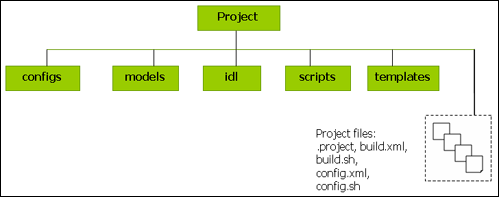

The information is provided in different files in different directories as illustrated in Figure Directory Organization.

* **Directory:** <Project root>
* **FileName:** .project

This is a mandatory file for each project and must be present.

A sample .project file is as shown in Figure Sample .project File.

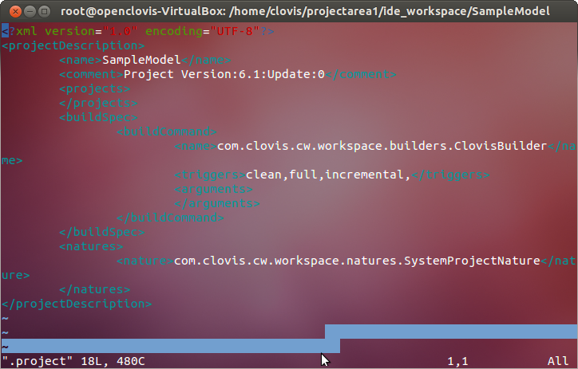

**Directory:** models

* Resource Configuration
* Component Configuration
* Alarm Configuration
* Component Resource
* Association Resource
* Alarm Association

**Directory:** configs

* AMF Instance Configuration
* ASP Component Configuration
* Node Admission Control Configuration
* IOC Configuration
* GMS Configuration
* EO Profile Definition
* EO Configuration
* Node Instance Configuration

**Directory:** idl

* RMD Configuration

**Others:** The following files and directories are typically updated when the project (after import) is updated through the IDE. 
You do not have to populate these files.

* scripts
* templates
* config.xml, config.sh, build.xml, build.sh

File Specification
------------------
This section provides information about each XML file that is part of the project and describes its role in the model.

.. note::
    The model requires configuring an unique rdn string for the entities defined in alarm, resource and component configuration files.

The sample XML files are provided for the following:

* Resource Configuration
* Component Configuration
* Model Map Information
* AMF Instance Configuration
* RMD Configuration
* ASP Component Configuration
* Node Admission Control Configuration
* GMS Configuration
* Log Service Configuration
* Node Instance Configuration
* EO Profile Definition
* EO Profile Configuration

.. note::
    The sample XML files provided as illustrations in this section do not reflect the exact contents of the files. Only relevant 
    parts of the XML files are provided here.

Resource Configuration
^^^^^^^^^^^^^^^^^^^^^^
**File Name:** resourcedata.xml

This file specifies the resource information. This primarily consists of a single Chassis type resource along with three types of 
resources:

* Node Hardware Resource (typically represents a blade type)
* Hardware Resource
* Software Resource For each of the resource classes, you can specify:
* Private Attributes
* Provisioning Attributes
* Alarms In addition to the Node Hardware Resource and Hardware Resource classes, you can specify and associate device objects. 
  These classes are connected by containment (composition) and inheritance relationships.

A sample resourcedata.xml file is shown in the following illustration.

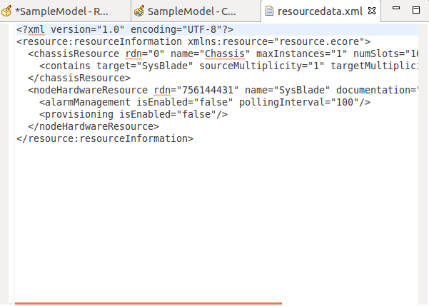

Component Configuration
^^^^^^^^^^^^^^^^^^^^^^^
**File Name:** componentdata.xml

This file contains information about all the component classes and their mutual relationships:

* Node
* Service Unit
* Component

In case of SAF component - it additionally contains EO information

* Service Group
* Service Instance
* Component Service Instance For each of the entities, you can specify the values of the attributes.

A sample componentdata.xml file is shown in the illustration.

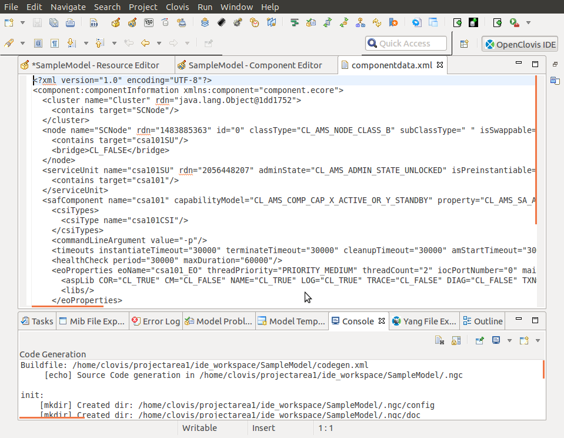

Model Map Information
^^^^^^^^^^^^^^^^^^^^^
The model map file contains information that provides a mapping association between entities defined in two different model files. 
Currently, there are two categories of model map files.

Component Resource Association
""""""""""""""""""""""""""""""
**File Name:** component_resource_map.xml

This file provides information about the association between SAF component and resource classes. For each SAF component, you can 
specify the list of resources that are associated with it. The SAF component and resource classes have to be defined in the 
component data and resource data files.

A sample component_resource_map.xml file is shown in the following illustration.

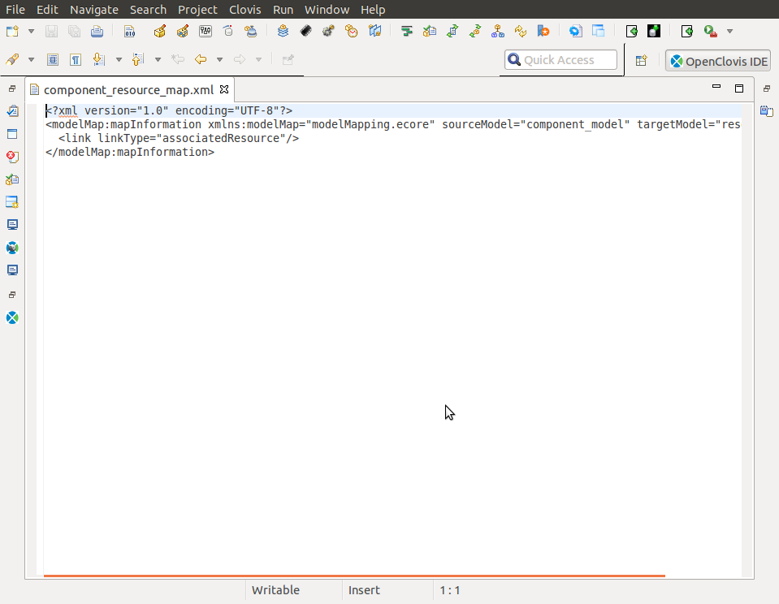

Resource Alarm Association
""""""""""""""""""""""""""
**File Name:** resource_alarm_map.xml

This file provides information about the association of alarms with resource classes. For each resource class, you can specify the 
set of alarms associated with the resource. Also for each associated alarm, you can define the generation and suppression rule. The 
alarm and resource classes have to be defined in the component data and resource data files.

A sample resource_alarm_map.xml file is shown in the following illustration.

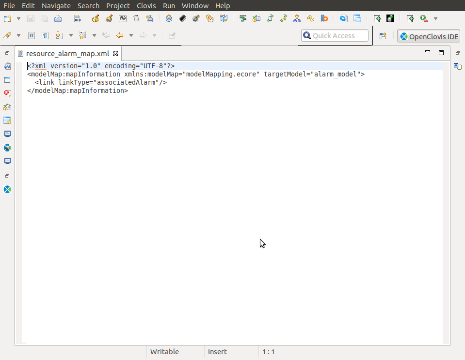

AMF Instance Configuration
^^^^^^^^^^^^^^^^^^^^^^^^^^
**File Name:** clAmfConfig.xml

This file contains information about AMF instances in the deployment. The complete deployment configuration in terms of the node 
instances, SU instances, and component instances is specified along with the information about SG, SI, and CSI instances.

A sample clAmfConfig.xml file is shown in the following illustration.

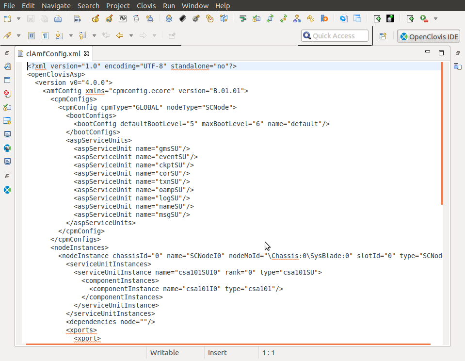

RMD Configuration
^^^^^^^^^^^^^^^^^
**File Name:** server_idl_interface.xml

This file contains information about all the services to be provided by all the EOs in the system. For each of the EO, you can 
provide information about the corresponding ports, groups, services, and the expected arguments for the ports. If any of the 
arguments is user-defined, they must also be specified in this file.

A sample server_idl_interface.xml file is shown in the following illustration.

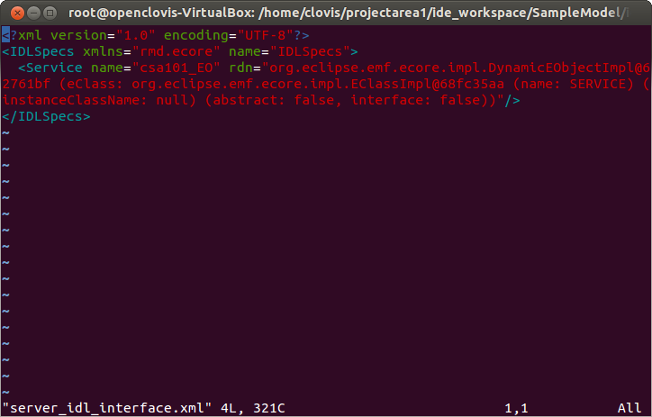

ASP Component Configuration
^^^^^^^^^^^^^^^^^^^^^^^^^^^
**File Name:** compileconfigs.xml

This file contains various configuration parameters for ASP components like COR, IOC, and so on.

A sample compileconfigs.xml file is shown in the following illustration.

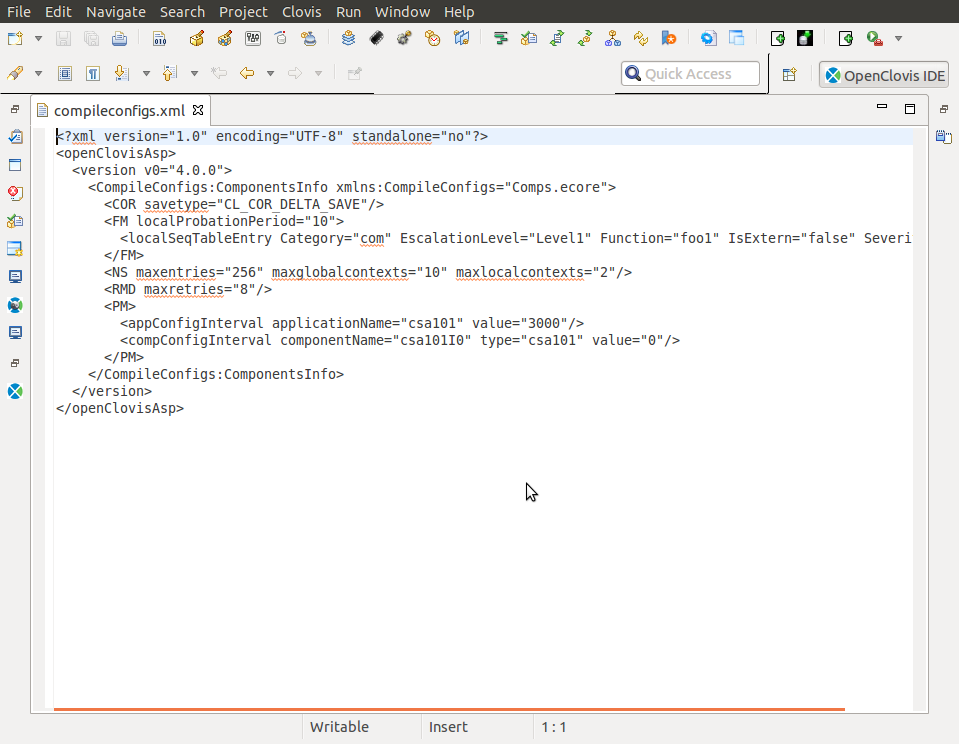

Node Admission Control Configuration
^^^^^^^^^^^^^^^^^^^^^^^^^^^^^^^^^^^^
**File Name:** clSlotInfo.xml

This file contains information to be used in Node Admission Control. For each slot, you should provide a list of Node Type classes 
that should be allowed in that slot. The Node Type classes should match those configured in the componentdata.xml file. Also, the 
number of slots should match the number of slots provided for the Chassis resource in the resourcedata.xml file.

A sample clSlotInfo.xml file is shown in the following illustration.

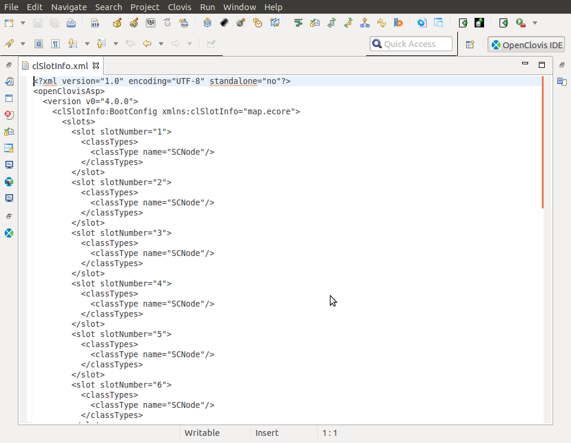

GMS Configuration
^^^^^^^^^^^^^^^^^
**FileName:** clGmsConfig.xml

This file contains information to be consumed by the Group Membership Service.

A sample clGmsConfig.xml file is shown in the following illustration.

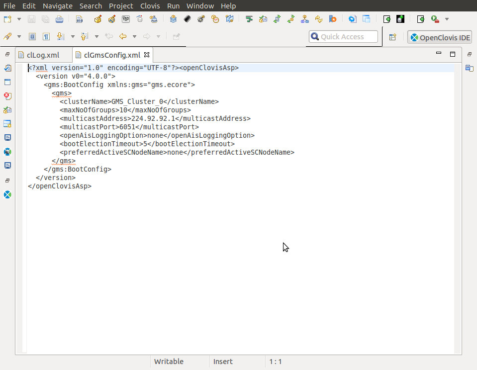

Log Service Configuration
^^^^^^^^^^^^^^^^^^^^^^^^^
**FileName:** clLog.xml

This file contains the configuration of the common log service parameters, and the config parameters of the perennial and 
pre-created log streams.

A sample clLog.xml file is shown in the following illustration.

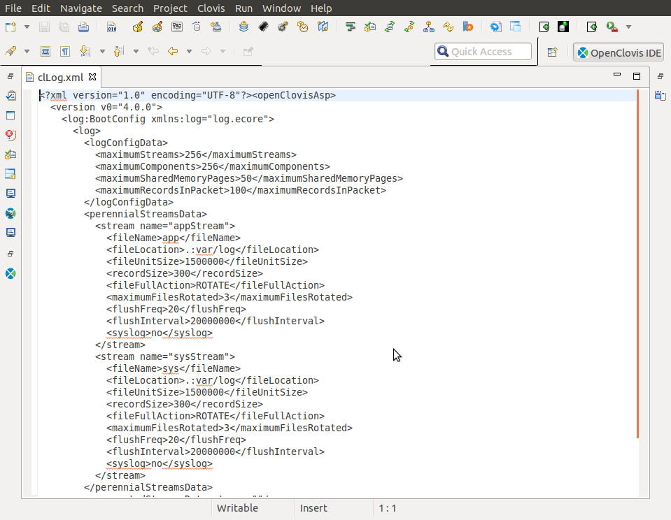

Node Instance Configuration
^^^^^^^^^^^^^^^^^^^^^^^^^^^
**File names(s):** Node Instance Name_rt.xml

For each node instance configured in the clAmfConfig.xml file, there must be a file of the form <Node Instance Name>_rt.xml . This file contains information about the following:

* The component instances that will be running on that node instance.
* For each component instances, the MOIDs of the resource instances that they are managing.

A sample GigeNode0_rt.xml file is shown in the following illustration.

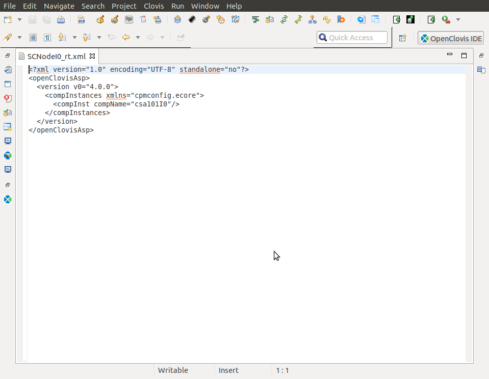

EO Profile Definition
^^^^^^^^^^^^^^^^^^^^^
**FileName:** clEoDefinitions.xml

This file contains various memory profiles that can be defined by the user. This include:

* Heap Configuration
* Buffer Configuration
* Memory Configuration

A sample clEoDefinitions.xml file is shown in the following illustration.

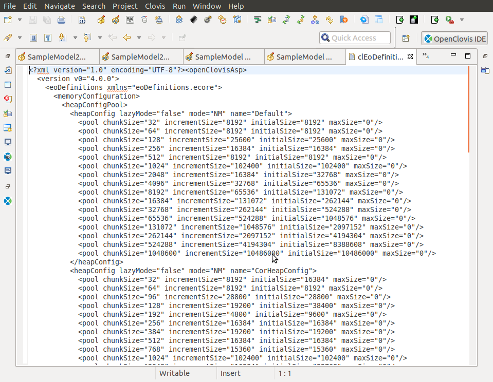

EO Profile Configuration
^^^^^^^^^^^^^^^^^^^^^^^^
**FileName:** clEoConfig.xml

This file contains the information which applies specific memory configurations to each Execution Object for all the SA Forum 
Components defined in the componentdata.xml file. Additionally, it contains memory configurations for all the ASP components.

A sample clEoConfig.xml file is shown in the following illustration.

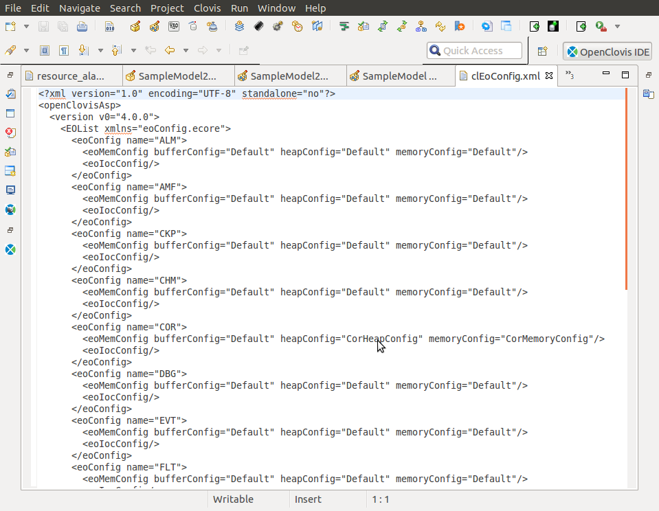
