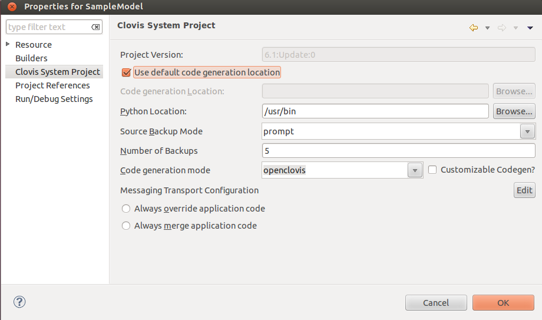
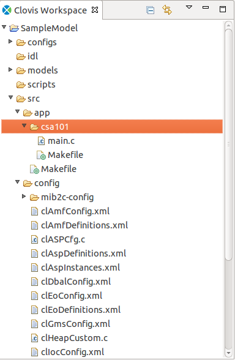
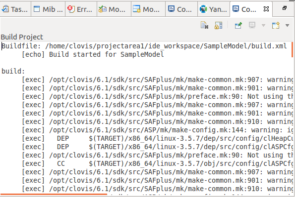

Chapter 16: Creating and Building openSAF Project in IDE
========================================================
This chapter provides information about how to create and build the **openSAF** project.

Creating openSAF Project
------------------------
Creating **openSAF** model is similar like creating **OpenClovis** project except **Code generation mode** option in the Project 
Properties page. By default IDE maintains **Code generation mode** option as **openclovis**. So to change this option, in the 
**OpenClovis IDE** window, from the **Project** menu, click **Properties** and change **Code generation mode** value to **openSAF**.

Generating Source for openSAF Project
-------------------------------------
This chapter provides information about generating the source code after you have created **openSAF** project.

To generate the code, in the **OpenClovis IDE** window, from the **Project** menu, click **Generate Source**. On successful generation, 
the source code tree looks like this:

The generated source code is located at <projectarea_directory>/<model_name>/src/openSAF directory. The projectarea_directory is 
specified in the **Clovis System Project** window.

Building openSAF Project
------------------------
To build the project select the **Project > Build Project** menu item. When complete a build output message is printed on the 
Console pane at the bottom of the **OpenClovis IDE** window.

After building you can find the image opensaf_app_bundle.tgz inside directory:

.. code-block:: text

    <projectarea_directory>/<model_name>/src/openSAF
