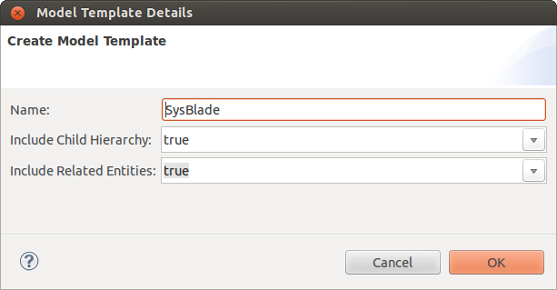
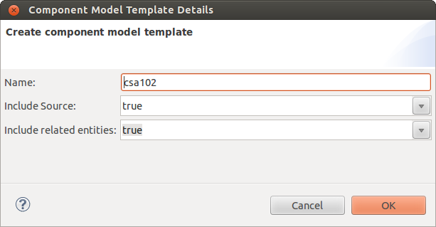
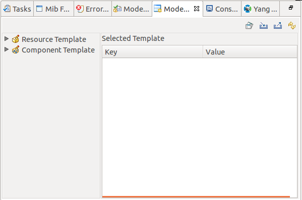
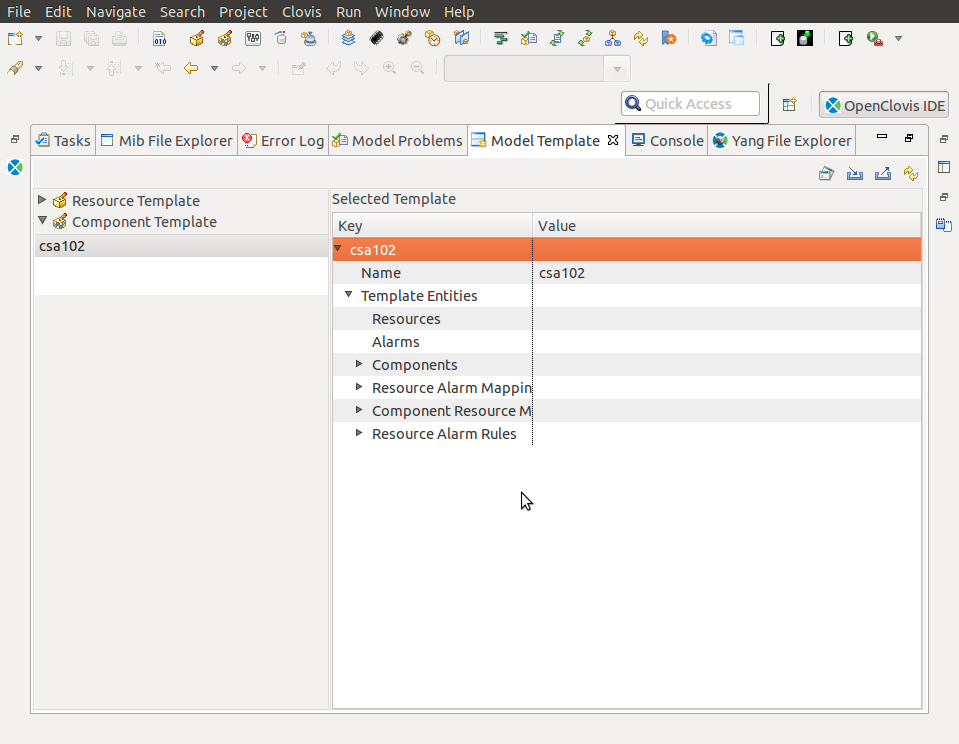
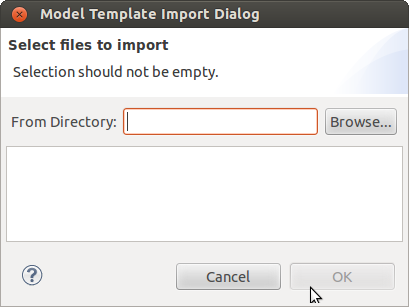
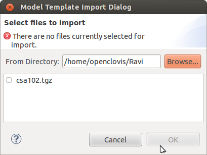
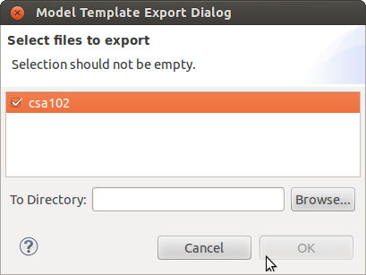
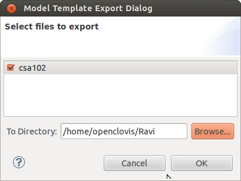

Chapter 17: Model Templates
===========================
This chapter provides information about Model Templates feature provided by OpenClovis IDE. You can select resources from the 
Resource Editor / components from the Component Editor and save them as custom templates. These templates appear in the **Model 
Template** tab. These templates can be reused for creating resource tree in the Resource Editor / component tree in the Component 
Editor for other projects in the same workspace.

**Key Topics:**

* Creating Model Template
* Using Model Template
* Importing Model Template
* Exporting Model Template
* Refreshing Model Template View

Creating Model Template
-----------------------
User can create model template for entities in Resource editor as well as Component Editor. Model template created with the entities 
in Resource Editor is referred to as Resource Model Template. While Model Template created with the entities in Component Editor is 
referred to as Component Model Template or Application. How to create both the types of model templates is explained below.

Resource Model Template
^^^^^^^^^^^^^^^^^^^^^^^
To create a Resource Model Template:

1. In the **Resource Editor**, right-click on a resource and select **Create Model Template....** The **Model Template Details** 
dialog box is displayed.

2. Enter the following information:

* **Name:** This is the name of the model template which is by default selected as corresponding resource name.
* **Include Child Hierarchy:** Select **true** or **false**. If you select **true**, all the child resources for the selected 
  resource are also included as part of the template.
* **Include Related Entities:** Select **true** or **false**. If you select **true**, the alarms associated with the selected 
  resource are saved as part of the template.

3. Click **OK**. The **Model Template Details** dialog box closes and the created template appears in the **Model Template** view 
   under the **Resource Template** tab.

Component Model Template (Application Template)
^^^^^^^^^^^^^^^^^^^^^^^^^^^^^^^^^^^^^^^^^^^^^^^
To create a Component Model Template:

1. In the **Component Editor**, ctrl+click entities which are made to be part of the template. Now right-click on any of the selected 
   entities and select **Create Model Template....** The **Model Template Details** dialog box is displayed.

2. Enter the following information:

* **Name:** This is the name of the model template which is by default selected as one of the selected entities’ name.
* **Include Source:** Select **true** or **false**. If you select **true**, source code for that component/application is also 
  included as part of the template.
* **Include Related Entities:** Select **true** or **false**. If you select **true**, the resources associated with the selected 
  components and the alarms associated with those resources are saved as part of the template.

3. Click **OK**. The **Model Template Details** dialog box closes and the created template appears in the **Model Template** view 
   under the **Component Template** tab.

Using Model Template
--------------------
You can use the saved model templates inside another model. To use the model template:

1. In the **Model Template** view, expand **Resource Template** or **Component Template** tab and select the template that you need 
   to use. The selected template is displayed under **Selected Template**.

2. User can see the complete structural details for the model template under the **Selected Template**. This shows components, 
   resources and alarms which are part of the model template, their internal structure and mapping information for them.

3. Click Uses the **Model Template** icon inside tool bar at the top right corner of the **Model Template** view. All the components, 
   resources and alarms which are part of the model template are copied into the model of the currently selected project along with 
   their mappings. Entities for the selected model template are displayed in the **Resource Editor** or **Component Editor** depending 
   on the type of the template. If any of the entities of model template is already present in the model then validation will capture 
   this and corresponding message is displayed to user.

Importing Model Template
------------------------
To import a Model Template:

1. In the **Model Template** tab, click Imports the **Model Template** icon. The **Model Template Import** Dialog box is displayed.

2. Click **Browse** and specify the directory from which you need to import. The location of the files is displayed in **From Directory** 
   and all the available model template file(s) under that directory are displayed in the box.

3. Select the files that you want to import.
4. Click **OK**. The selected file(s) are imported.

Exporting Model Template
------------------------
To export a Model Template:

1. In the **Model Template** tab, click **Exports the Model Template** icon. The **Model Template Export Dialog** box displays all 
   the templates that are part of the model.

2. Select the file(s) that you need to export. Click **Browse** and specify directory to where you need to export the file(s). The 
   location of the file(s) is displayed in **To Directory**.

3. Click **OK**. The file(s) are exported to the specified location

Refreshing Model Template View
------------------------------
To refresh the **Model Template** view, click the **Refreshes the Model Template View** icon at the top-right corner of the **Model 
Template** tab. This synchronizes the model template view with file system.
