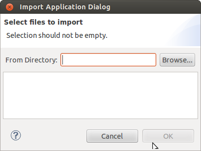
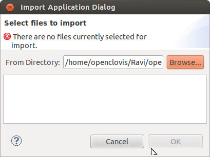

Chapter 18: Application Import/Export
=====================================
This chapter provides information about Application Import/Export feature provided by OpenClovis IDE. Please refer Importing Model 
Template and Exporting Model Template in the previous chapter on **Model Template** to get the detailed information for this feature.

Here we will discuss express import application support available for the user who wants to use the application provided by 
OpenClovis or created by themselves directly into the IDE model. This is a functional combo of Importing model template and using 
it into the IDE model.

To express import an application:

1. Select **Import Applications...** option from top level clovis menu or from the tool bar. The **Import Application Dialog** box 
   is displayed.

2. Click **Browse** and specify the directory from which you need to import. The location of the files is displayed in **From Directory** 
   and all the available application file(s) under that directory are displayed in the box.

3. Select the files that you want to import.

4. Click **OK**. The selected file(s) are imported. All the components, resources and alarms which are part of the application are 
   copied into the model of the currently selected project along with their mappings. Entities for the selected model template are 
   displayed in the **Component Editor**. If any of the entities of application is already present in the model then validation will 
   capture this and corresponding message is displayed to user.
