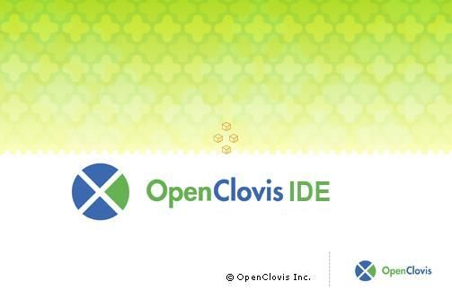
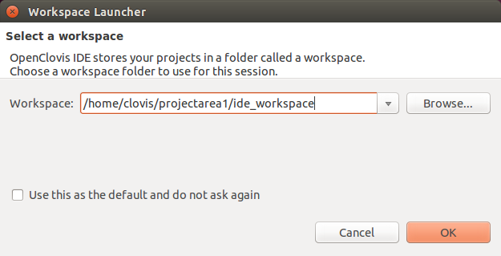
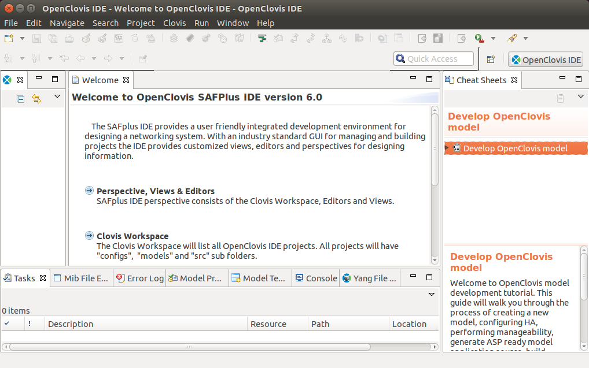
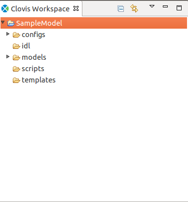
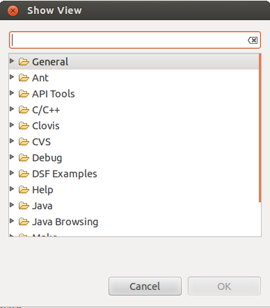

Chapter 2: Getting Started
==========================

This chapter provides information to launch and access IDE, create a workspace, and a new project.

**Key Topics:**

* Creating Project Area
* Launching OpenClovis IDE and setting Up My Workspace
* Creatin OpenClovis IDE Project
* Setting Project Properties

Creating Project Area
---------------------
After installation, create a new project area at /home/clovis/projectarea1 by executing the command:

.. code:: bash

    <install_dir>/6.1/sdk/bin/cl-create-project-area /home/clovis/projectarea1

This will prepare /home/clovis/projectarea1 for use with the OpenClovis IDE and SDK.

A project area allows you to create and develop one or more system models with the required ASP-based components. The project area 
can hold multiple models and you can switch between these models. All the models in the same project area share the same ASP source 
tree,there by any modifications to the ASP source tree, are re-used across all the projects that are available in the project area.

After creating a new project area, you can create one or more system models with the required ASP based components.

Launching OpenClovis IDE and Setting Up My Workspace
----------------------------------------------------
You launch the **OpenClovis IDE** from the command line. If you chose to create symbolic links during installation you can simply 
enter **cl-ide** from any directory. If you did not create symbolic links during installation you can either:

* Add the installation directory to the shells search path and then launch the IDE. For example with a bash shell,

  .. code-block:: console

    # export PATH=$PATH:$install_dir/6.1/sdk//bin 
    # cl-ide

* Or execute the command

  .. code-block:: console

    # <install_dir>/6.1/sdk/bin/cl-ide

The splash screen for SAFplus Platform IDE is displayed

The **Workspace Launcher** window is displayed

Enter the location of the workspace and click OK. The value in this field will de- fault to the ide_workspace directory below the 
last project area that was created

Using the cl-create-project-area command. If you wish to use a differ- ent workspace then select the ide_workspace directory under 
any other valid project area.

.. note::
    To set the selected workspace as the default, select the Use this as the default and do not ask again checkbox.

If the error **Workspace already in use** is displayed when launching the OpenClovisIDE check the processes that are running. If the 
Eclipse process is running, then terminate the Eclipse process and re-launch OpenClovis IDE.

Understanding My Workspace
^^^^^^^^^^^^^^^^^^^^^^^^^^
The **Clovis Workspace** pane displayed on the left side of the **OpenClovis IDE** window lists the projects that belong to that workspace 
in an alphabetical order. It also displays the defaul tfolders and files that are generated for every project. The generated files 
include OpenClovis configuration files, UI model files, templates, and scripts.

.. caution::
    These files MUST NOT be modified as this may lead to unexpected result and the model may become invalid.

The Open Clovis configuration files are not visible in the general project view.

Initially, when you create a project, only the **templates** and **idl** folders are displayed in the **Clovis Workspace pane**. After the code 
generation step the src folder is also displayed. To display the other folders, click the arrow on the top right-corner of the 
**Clovis Workspace** pane and select Filters. The **Navigator Filters** dialog box is displayed. Clear the checkboxes for the folders that 
you need to view and click **OK**. If you clear all the checkboxes, then the folders shown in Figure OpenClovis IDE Workspace is 
displayed in the **Clovis Workspace** pane.

Viewing My Workspace
^^^^^^^^^^^^^^^^^^^^
To view the workspace:

* From the **Window menu**, click **Show View**, and then click **Other**. The Show View dialog box is displayed.
* Type the name in the text box or double-click **Clovis** and select **Clovis Workspace**.
* Click **OK**. The Clovis Workspace pane is displayed.

Creating OpenClovis IDE Project
-------------------------------
To you create a project, you can start with a blank project or specify the resources and components using the wizard. If you start 
with a blank project, you need to use the **Resource Editor** and **Component Editor Palettes** to create your resources and components. 
The Wizard helps you to kick start a project by creating standard sets of objects based on the entry of a few key pieces of 
information.

To create a new OpenClovis IDE project:

1. From the **File** menu, point to **New**, and then click Project.... The **New Project Wizard** is displayed.

   .. image:: ../../images/ideguide/New_Project_Wizard.png

2. Type **Clovis System Project** in the text box or double-click **Clovis**, select **Clovis System Project**, and then click **Next**. The **Clovis 
   System Project** window is displayed.

   .. image:: ../../images/ideguide/Clovis_System_Project.png

3. Enter the following information:

   * **Project name:** Name for your project.

     .. note::
        Do not use spaces or special characters for the project name. The project name can be alphanumeric, but cannot start with a 
        number. Select **Use default** to retain the default location of the project, or enter the location of the project contents.

   * **SDK Location:** Enter the location where the OpenClovis SDK was installed. This field is automatically filled if IDE is 
     installed as part of OpenClovis SDK installation. This is usually **<installed_directory>/6.1/sdk**.

   * **Project Area Location:** Enter the location where the generated source code. and install images will be written. This field is 
     automatically filled If IDE is installed as part of OpenClovis SDK installation.

     .. note::
        Usualy this location will be created before start the IDE by using **cl-create-project-area** script. If not **cl-ide** script 
        should create this location.

   * **Python Location:** This is the path of the python binary location that will help OpenClovis IDE in generating the code. 
     Python 2.4.1 is required to be installed in the required location before using OpenClovis IDE to generate code. Python is 
     usually located in **/usr/bin** folder. If Python is installed as part of OpenClovis SDK installation, then it is located at 
     **<installation_directory>/buildtools/bin**.

   * **Code generation mode:** Select the code generation mode. Default value for this field is openclovis.

   At any point from here on forward you can click Finish to create the project using the information that you have entered so far. 
   If you choose to do this before getting to the end of the wizard you will need to create resources and components manually 
   through the Resource and Component editors.

4. Click **Next** to specify the types and number of blades in your system. The **Add New Blade Type** window is displayed. Click **Add** to 
   add a new blade type and enter it's details.

   .. image:: ../../images/ideguide/Add_New_Blade_Type.png

   * **Blade Type:** Type of the blade. Select the type of the blade from the **dropdown** list.
   * **Blade Name:** Name for the blade type. This name must be unique within the model.
   * **NumberofBlades:** Number of blades of this type that will be present. For information about blade types refer to the Glossary.

5. Click **Next** to specify the SAF node types in the system. The **Add New SAF Node Type** window is displayed. Click **Add** to add 
   a new **SAF node type** and enter it's details.

   .. image:: ../../images/ideguide/Add_New_SAF_Node_Type.png

6. Enter the following information:

   * **Node Name:** Name of the node type. This name must be unique within the model.
   * **Node Class:** Type of class to which the new node type belongs. Select one of the following options from the drop-down list:

     * **System Controller:** Select System Controller if this node type will act as a System Controller.
     * **Payload** Select Payload if this node type will act as a worker node, typically running application code.

   For information about node and node class refer to the Glossary

7. Click **Next** to specify the **SAF service types** for the system. The **Specify Program Names window** is displayed. Click 
   **Add** to add a new program (SAF Service Type) and enter it’s details.

   .. image:: ../../images/ideguide/SAF_Service_Type_Name.png

8. Enter the following information:

   * **Node Type:** The type of node on which the program will run. Select from the list of node types defined on the previous page.
   * **Program Name:** Name of the program being defined. All elements of the SAF Service Type (service unit, service group, etc.) will be derived from this name.

9. Click **Finish**. The **Resource** and **Component Editors** display the specified blades and nodes along with their resources and components.

The **Clovis Workspace** pane lists the new project, its associated files, and directories. In this case,Sample Model is the name 
of the project. You can open and close projects in the **Clovis Workspace** by right-clicking and choosing **Close/Open** from the 
**Clovis Workspace** context menu.

Setting Project Properties
--------------------------
To set the properties for the project:

1. From the **Project** menu, choose **Properties** or right-click on the project and select **Properties**.
2. Select **Clovis System Project**. The Clovis System Project pane is displayed on the right-side.

   .. image:: ../../images/ideguide/Properties-System_-clovis-Project.png

3. Enter the following information:

   * **Project Version:** This is the version number of the project. This field is not editable.
   * **Code generation Location:** Location where you want to generate the source for your model.
   * **Python Location:** This is the path of the python binary location. Python is required by the OpenClovis IDE to generate code. 
     Python is usually located in /usr/bin or in <sdk-dir>/build tools/bin if installed during ASP installation.

   .. note::
        If you have specified the **SDK, Project Area, and Python location** while creating a new project,they will appear in the **SDK 
        Location,Project Area Location**, and **Python Location** fields in the **Clovis System Project** window. If not, you need to 
        specify these locations in this window before you generate the code.

   * **Source Backup Mode:** This option is used to indicate whether or not to backup the project's existing source directory when 
     new source code is generated. If the directory is not backedup then any manual changes that have been made to source files 
     outside of the prescribed begin/end application code blocks or changes made to configuration files will be overwritten. The 
     possible values for this option are Always,Never,and Prompt. Prompt will ask the user each time that source code is generated.
   * **Number of Backups:** This option indicates how many number of source code back up should be preserved. Number should between 
     1 and 100. Default is 5.
   * **Code generation mode:** This option is used to select code generation option. IDE will generate the code with OpenClovis APIs 
     If selected value is openclovis

   .. note::
        IDE will not support code merging if a user switches between SAF and OpenClovis API code generation

   * **Always override application code:** Select this if you always want to overwrite existing model code with the code generated 
     by the IDE. Note that with this setting you will lose any customization that you have made to IDE generated files.
   * **Always merge application code:** Select this if you always want to merge newly generated source code with the existing model 
     code. With this setting all code between the predefined begin/end application code blocks will be preserved during code generation.

4. Click **OK**. The properties for the project are set.
