Chapter 3: Understanding the User Interface
===========================================
This chapter provides information about the OpenClovis IDE work environment and helps you familiarize with its features.

**Key Topics:**

* Using Menu Bar
* Using Tool Bar
* Using OpenClovis Context Menu
* Using OpenClovis IDE Editor
* Viewing the Outline Plane
* Using Tasks,MIB File Explorer View, Error Log, Model Problems,Model template and Console Panes
* Adding New Blade Type
* Adding New Node
* Importing MIB Objects
* Migrating Project

Using Menu Bar
--------------
The **Clovis** menu and **Project** menu is available on the menu bar. Both the menu options can also be accessed using the 
right-click menu on a project listed under OpenClovis IDE Workspace.

Clovis Menu
^^^^^^^^^^^
the Clovis Menu appear as

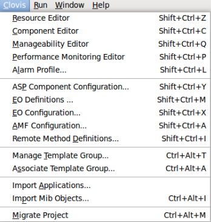

The options available are:

* **Resource Editor:** Use this option to display the Resource Editor.
* **Component Editor:** Use this option to display the Component Editor.
* **Manageability Editor:** Use this option to display the Manageability Editor.
* **Performance Monitoring Editor:** Use this option to display the Performance Monitoring Editor.
* **Alarm Profile:** Use this option to create alarm profiles required for your model.
* **ASP Component Configuration:** Use this option to specify the configuration parameters for the various ASP components.
* **EO Definitions:** Use this option to create the Memory configuration profiles.
* **EO Configuration:** Use this option to assign the memory configuration profiles to the various ASP and user-defined components.
* **AMF Configuration:** Use this option to specify the Availability Management Framework (AMF) parameters.
* **Remote Method Definitions:** Use this option to define the Interface Definition Language (IDL) and the user-defined data types.
* **Manage Template Group:** Use this option to create the template groups.
* **Associate Template Group:** Use this option to associate the template group(s) to the components.
* **Import Applications:** Use this option to import applications into IDE model.
* **Import Mib Objects:** Use this option to import a MIB file allowing the defined components to be used in the model.
* **Migrate Project:** Use this option to migrate a project created under an older version of the IDE to the current version.

Project Menu
^^^^^^^^^^^^
The Project menu is as shown.

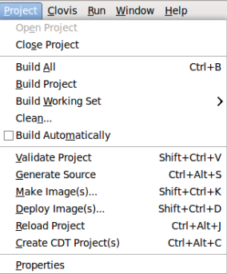

The options available are:

* **Open Project:** Use this option to open the selected project.
* **Close Project:** Use this option to close the selected project.
* **Build All:** Use this option to build the final project executable file for all the projects.
* **Build Project:** Use this option to build the final project executable file for the selected project.
* **Clean:** Use this option to clean the selected project before building the executable.
* **Validate Project:** Use this option to check the selected model for errors.
* **Generate Source:** Use this option to generate sourc code for the selected model.
* **Make Image(s):** Use this option to create deployment images of the model.
* **Deploy Image(s):** Use this option to deploy the images created with previous option.
* **Reload Project:** Use this option to reload the project from disk.
* **Create CDT Project(s):** Use this option to create CDT projects for each applications.
* **Properties:** Use this option to specify the properties for the selected project.

Using Tool Bar
--------------
The add-on icons for the OpenClovis platform are as shown

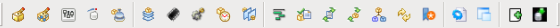

Using OpenClovis Context Menu
-----------------------------
To display the OpenClovis context menu, right-click on a project in the Clovis Workspace pane. The OpenClovis context menu is displayed.

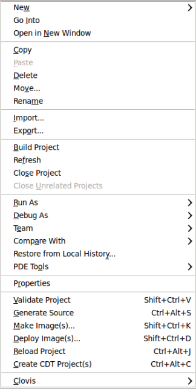

It has the following OpenClovis-related options

* **New:** Select the Project option to create a new OpenClovis project.
* **Go Into:** Goes to the next level of the project hierarchy.
* **Open in New Window:** Opens the selected resource in a new window.
* **Copy:** Places a copy of the selection on the clipboard.
* **Paste:** Inserts resources from the clipboard to the Clovis Workspace.
* **Delete:** Removes the current selection from the Workspace.
* **Move:** Moves resources from one Work bench location to another(for example, from one project to another project).
* **Rename:** Renames the selected resource.
* **Import:** Launches a wizard that allows you to import the following into the Clovis Workspace

  * Archive File
  * Checkout projects from CVS
  * Existing Project into Workspace
  * External Features
  * External Plug-ins and Fragments
  * File system
  * Preferences Team
  * Project Set

* **Export:** Launches a wizard that allows you to export the following from the Clovis Workspace (see note below):

  * Ant Build Files
  * Archive File
  * Deployable features
  * Deployable plug-ins and fragments
  * Eclipse Product
  * File system
  * JAR file
  * Java doc
  * Preferences
  * Team Project Set

* **Build Project:** Builds the project.
* **Refresh:** Refreshes the contents of the Clovis Workspace.
* **Close Project:** Closes a project.
* **Properties:** Displays a window showing all the property details of the current selection, such as path, type, location, and 
  last modified.
* **Validate Project:** Validates the project. Generate Source: Generates the source code for the project.
* **Make Image(s):** Use this option to create deployment images of the model.
* **Deploy Image(s):** Use this option to deploy the images created with previous option.
* **Reload Project:** Reload the project if any changes are done to the model files.
* **Create CDT Project(s):** Use this option to create CDT projects for each applications.
* **Clovis:** This cascading menu has various options which are inherent to OpenClovis IDE.

The other menu items like Team, Debug As, Run As, and so on are not applicable to OpenClovis IDE.

.. note::
    If the selected project is older than the current version of IDE then all the clovis specific options are disabled in menu bar 
    and toolbar except 'Migrate Project'. You must migrate the project to the latest version in order to use all the clovis specific 
    options in menu bar and toolbar.

.. note::
    When using the Export utility you may encounter an error indicating that resources are out of sync. To avoid this problem you need 
    to configure the work space to refresh automatically. Do this by going to the 'Window | Preferences...'' dialog, navigating to the 
    'General -> Works pace' pane, and clicking the check box titled 'Refresh automatically'. After applying this setting you should 
    not longer receive the error

Using OpenClovis IDE Editors
----------------------------
OpenClovis IDE has editors that allow you to model the resources and components. The editors are: 

* Resource Editor
* Component Editor
* Manageability Editor
* Performance Monitoring Editor

Resource and Component editors support scalable views of the class models to improve usability if you create a large model. All the 
objects are arranged row by row. The position for each object is based on the parent position. For example, if the parent object is 
placed in the first row, the child object is placed in the second row. Connection points for all edges will be rearranged based on 
the location of the source and target objects.

You can automatically arrange all the objects in the editors to provide a better layout. To do this, right-click in the Resource 
Editor or Component Editor, and click **Auto Arrange**. The objects are re-arranged

You can also collapse or expand the child objects that belong to a parent object. To collapse the child objects, right-click on the 
object and select **Collapse**. To expand the child objects, right-click on the object and click **Expand**.

In the Resource Editor you can create managed resources that are not related to any given blade or node and are directly linked to 
the chassy. For example, a distributed system consisting of many blades has some provisioned information that is system-wide and 
requires access from applications that reside on many blades.

Using Resource Editor
^^^^^^^^^^^^^^^^^^^^^
The **Resource Editor** is automatically displayed for a newly created project. A **Resource Editor**, by default, has a Chassis as a 
resource and helps you to:

* Model the physical resources existing on a system.
* Drag and drop(or use keyboard shortcut)to create all the resources to be managed using UML notations.
* Double-click a resource to define its properties.
* Specify the attributes Provisioning, Chassis Management, and so on.
* Use a set of default, tailor-made resources in a Palette.
* Use relation connectors to define the relationship between the resources.

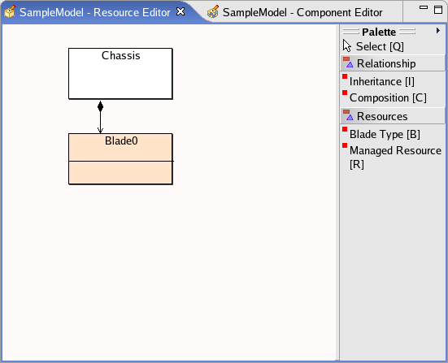

Resource Editor Palette
"""""""""""""""""""""""
The **Resource Editor** Palette is displayed on the right side of the **Resource Editor** pane, when you select the **Resource Editor** tab. 
This Palette helps you to model there sources and define the relationship between there sources. The Palette comprises the following 
options with the keyboard shortcuts specified in brackets.

* **Relationship**

  * Inheritance [Shift + I]
  * Composition [Shift + C]

* **Resources**

  * Blade Type [Shift + B]
  * Managed Resource [Shift + R]

Space makes the editor go back to the Select mode.

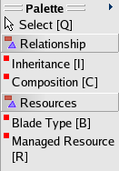

The following table provides the representation of the various resource objects in UML in the Resource Editor.

+---------------------+-----------------------------------------------------------+
| Resource Object UML | Representation                                            |
+=====================+===========================================================+
| Blade Type          | .. image:: ../../images/ideguide/IDE_Blade0.png           |
+---------------------+-----------------------------------------------------------+
| Managed resource    | .. image:: ../../images/ideguide/IDE_ManagedResource0.png |
+---------------------+-----------------------------------------------------------+

**Relationships:**

* **Inheritance relationship** indicates that one resource is created from another and therefore contains certain common features with 
  the parent resource. Inheritance links generalized classes to their specializations. To create **inheritance** relationship between 
  resources, click **Inheritance** in the Palette (or use keyboard shortcut) and create connection from one resource to another resource 
  to inherit the pre-defined properties. The derived resource inherits only the attributes and not the alarms.

* **Composition relationship** is a relationship where one resource consists or contains the other resource. To create **Composition** 
  relationship, click **Composition** in the Palette (or use keyboard shortcut) and create connection from one resource to another 
  resource. From a Physical perspective, a Chassis contains Blade Types that in turn, may contain Managed Resources.

Creating a Resource
"""""""""""""""""""
You can create resources using the **Resource Editor Palette** or the **Add New Blade** wizard. To create a resource using the Resource 
Editor Palette:

#. Click any Resource in the Palette.
#. Drag the cursor onto the Resource Editor area. The cursor has an additional rectangle and + symbol,indicating that you are ready to 
   create a Resource class model in Editor.
#. Drop the object in the Resource Editor area. The object is displayed in the Editor. You can specify the name and set the properties 
   for the resource by double clicking on it or by doing right click on it and selecting Properties.

Using Component Editor
^^^^^^^^^^^^^^^^^^^^^^
The **Component Editor** is automatically opened for a newly created project. **Component Editor** is primarily designed to cater to 
SAForum specifications and helps you to:

* Define a logical view between all resources that are modeled in the Resource Editor.
* Make associations with the defined resources.

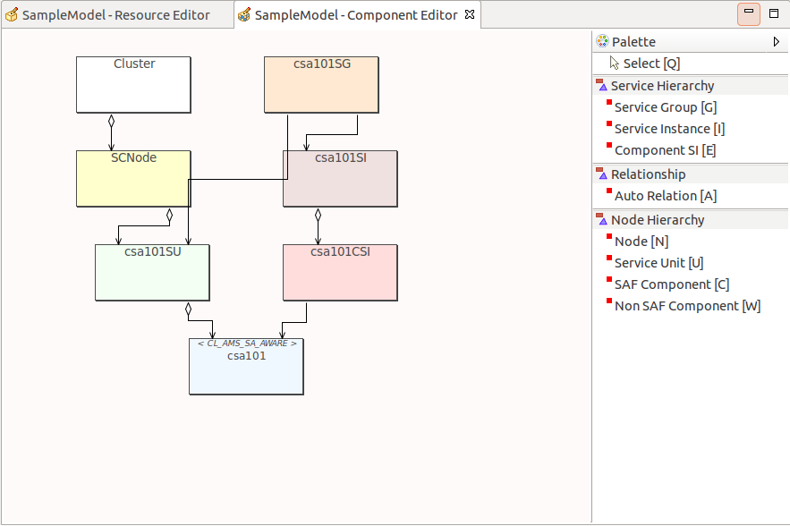

The Component Editor by default always contains a Cluster. A Cluster is the entire system, containing multiple nodes.

A component is the smallest logical entity on which a fault recovery can be performed. The component could be a process, many processes or hardware. It represents a set of resources to the Availability Management Framework (AMF). The resources represented by the component encapsulate specific application functionality. This set can include hardware resources, software resources, or combinations of the two.

In the Clovis Workspace, a component is classified as a SA Forum Component or a Non-SA Forum Component.

Component Editor Palette
""""""""""""""""""""""""
The **Component Editor Palette** is displayed on the right side of the **Component Editor** pane. This Palette helps you to model 
the components and define the relationship between the components.

To add an object (Node, SU, or Component) to the Component Editor, click the object in the palette and drag and drop (or use keyboard 
shortcut) the object in the **Component Editor** pane.

The Palette comprises the following options with the keyboard shortcuts specified in brackets:

* Relationship

  * **Auto Relation [Shift + A]:** drops a relationship edge between the components based on the type.

* Node Hierarchy

  * **Node [Shift + N]:** is the logical representation of a physical node.
  * **Service Unit [Shift + U]:** is a logical entity that aggregates a set of components combining their individual functionalities 
    to provide a higher level service.
  * **SAF Component [Shift + C]:** is the smallest logical entity on which the Availability Management Framework performs error 
    detection and isolation, recovery, and repair.
  * **Non-SAF Component[Shift+W]:** are components that do not register directly with the Availability Management Framework. These 
    components can be either Proxied or Non-Proxied depending on how they are associated with other objects in the editor. See 
    Setting Non-SA Forum Component Details for more details.

* Service Hierarchy

  * **Service Group [Shift + G]:** is a logical entity that groups one or more service units to provide service availability for a 
    particular set of service instances.
  * **Service Instance [Shift + I]:** is the aggregation of component service instances.
  * **Component Service Instance [Shift + E]:** represents the workload that the Availability Management Framework can dynamically 
    assign to a component.

.. note::
    Assigning multiple name value pairs same CSI type will not be possible with current IDE.

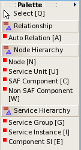

The following table provides the UML representation of the various component objects in the Component Editor:

+----------------------------+--------------------------------------------------------------------+
| Component Object           | UML Representation                                                 |
+============================+====================================================================+
| Node                       | .. image:: ../../images/ideguide/IDE_Node0.png                     |
+----------------------------+--------------------------------------------------------------------+
| Service Unit               | .. image:: ../../images/ideguide/IDE_ServiceUnit0.png              |
+----------------------------+--------------------------------------------------------------------+
| SA Forum Component         | .. image:: ../../images/ideguide/IDE_SAF_Aware_Component0.png      |
+----------------------------+--------------------------------------------------------------------+
| Non-SA Forum Component     | .. image:: ../../images/ideguide/IDE_Non_SAF_Aware_Component0.png  |
+----------------------------+--------------------------------------------------------------------+
| Service Group              | .. image:: ../../images/ideguide/IDE_ServiceGroup0.png             |
+----------------------------+--------------------------------------------------------------------+
| Service Instance           | .. image:: ../../images/ideguide/IDE_ServiceIntance0.png           |
+----------------------------+--------------------------------------------------------------------+
| Component Service Instance | .. image:: ../../images/ideguide/IDE_ComponentServiceInstance0.png |
+----------------------------+--------------------------------------------------------------------+

Creating a Component
""""""""""""""""""""
You can create components using the **Component Editor Palette** or the **Add New Node** wizard.

To create a component using the **Component Editor Palette**:

#. Click any component in the **Palette**.
#. Drag the cursor onto the **Component Editor** area. The cursor has an additional rectangle and + symbol, indicating that you are 
   ready to create a Component in Editor.
#. Drop the object in the **Component Editor**. The object is displayed in the Editor.

You can specify the name and set the properties for the component by double clicking on it or by doing right click on it and 
selecting Properties.

Using Manageability Editor
^^^^^^^^^^^^^^^^^^^^^^^^^^
This editor helps you to associate whole/part of **MIB** to Componet. Also **IDE** will automatically creates instances for the associated resources.

To open **Manageability Editor**, click **Clovis -> Manageability Editor**.

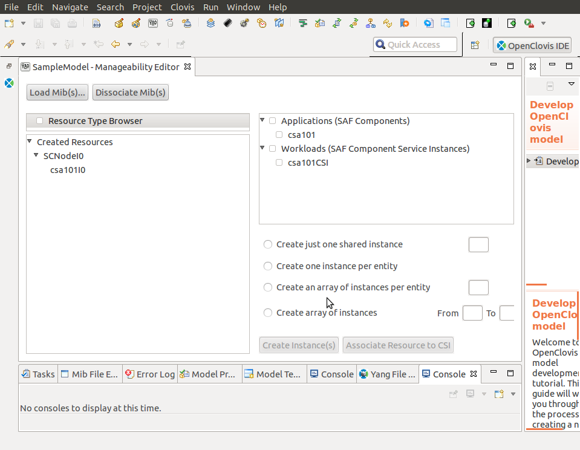

Manageability Editor has Resource Type Browser, Created Resources tabs:

* **Resource Type Browser** helps you to Load MIBs and view Loaded MIBs in hierarchical tree also helps to select whole or part of MIBs.
* **Created Resources** helps you to view already created resources.

Associating Resources with Component
""""""""""""""""""""""""""""""""""""

1. Select a particular node/individual resource in the **Resource Type** Browser on left pane (this resource and all children are 
   selected). Also, you may shift-click to select multiple resources.
2. Select a particular Component or multiple Components in the right pane. Again, you may shift click to select multiple Components.
3. Select either Create instance or Create group of instances radio button, and fill out the array of instances if desired. If you 
   fill out **Create array of instances per entity** as 10, You'll be creating resource instance :1 :2 :3 :4...... :10.

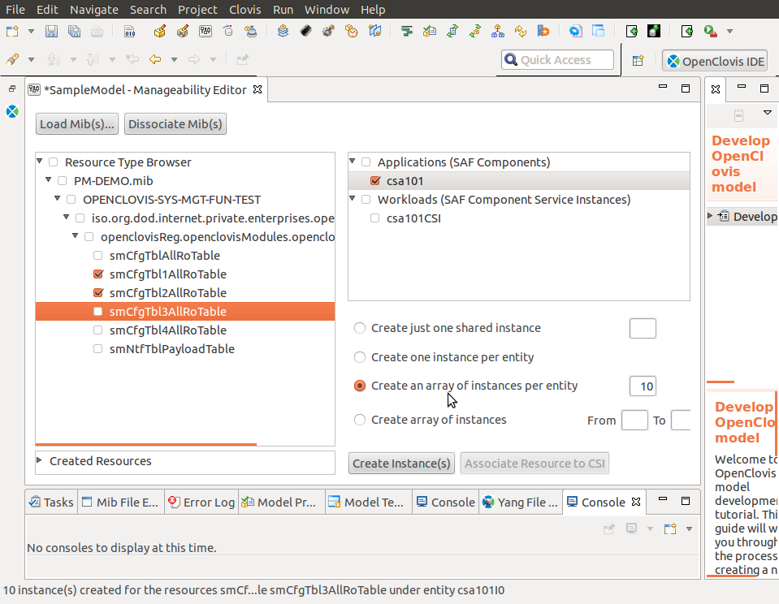

4.Click **Create Instance(s)** button.

Every selected resource will be instantiated (multiple times if a range or multiple instances are specified),in every selected 
component. If you then open up the Created Resources tree,You'll be able to see these newly instantiated resources. Also You'll be 
able to see the created resource instances in the right pane by selecting resource type in Created Resources tree.

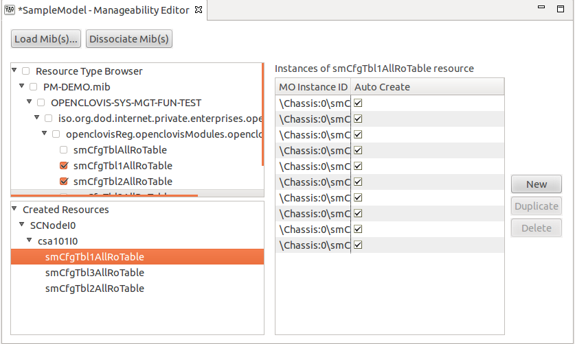

Using Performance Monitoring Editor
^^^^^^^^^^^^^^^^^^^^^^^^^^^^^^^^^^^
The **Performance Monitoring Editor** can be opened/displayed by selecting **Performance Monitoring Editor** option from **Clovis** Menu or 
**ToolBar**. It can also be launched with keyboard shortcut **Shift+Ctrl+P**.

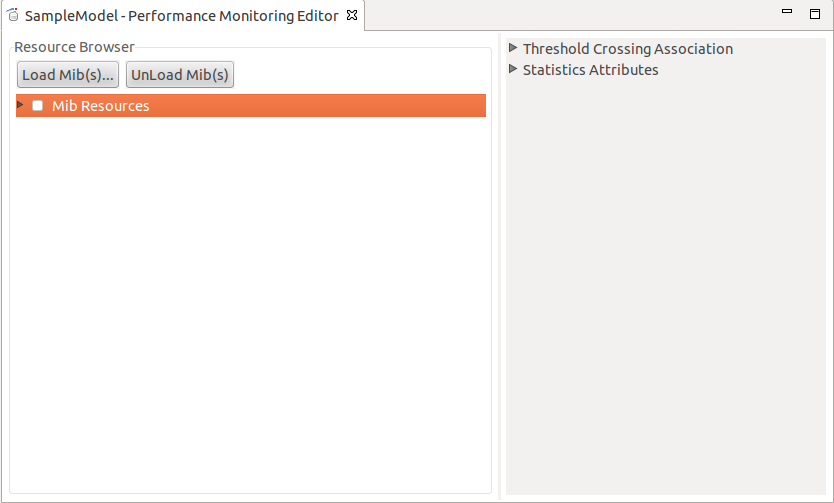

It has Resource Browser,Threshold Crossing Association and Statistics Attributes sections and helps you to:

* Browse multiple Mib files with Resource Browser.
* Perform alarm association,view already configured alarms and remove alarm association with Threshold Crossing Association.
* Configure lower bound, upper bound and severity for alarm association with Threshold Crossing Association.
* Mark/Unmark various statistics such as **Cached, Persistent** and **PM** for attributes.
* Configure **PM Reset Value** for bunch of PM attributes.

Resource Browser
""""""""""""""""
The Resource Browser allows to browse resources and attributes from mib files. User can select/deselect resources/attributes from 
resource browser for various PM configurations. There is a check box provided for each resource/attribute to check them. If user 
selects/deselects some entry then all the child entries are selected/deselected automatically. User can check multiple 
resources/attributes to do similar configuration for them in bulk.

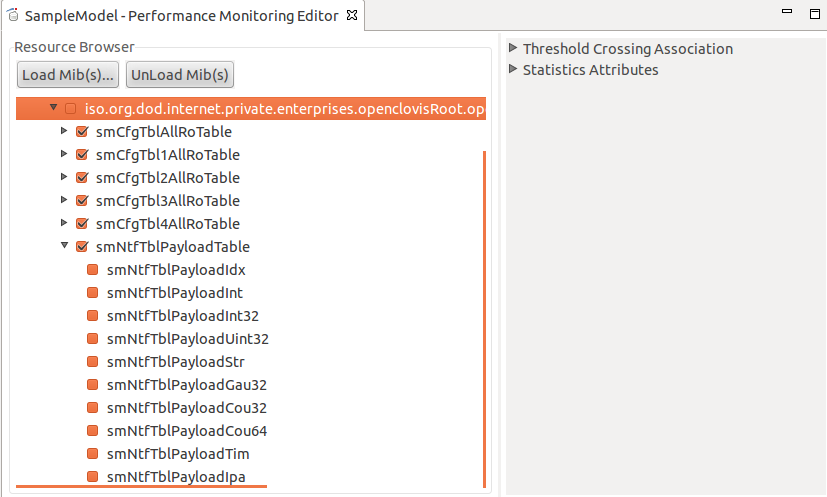

* Load Mib(s): allows to load mib into the resource browser. Clicking on it, File selection dialog opens up. Select the mib file, 
  you want to open up with the resource browser. All the resources/attributes from the mib are shown in the resource browser.
* UnLoad Mib: will unload the selected mib. All the resources/attributes of the mib will be removed from the resource browser.

Threshold Crossing Association
""""""""""""""""""""""""""""""
The Threshold Crossing Association allows user to configure alarms for attributes. It also allows to see the already configured 
alarm for particular attribute.

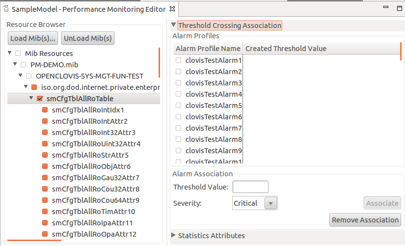

* **Alarm Profiles:** This will show all the alarm profiles available for the model. There is a check box provided with each alarm 
  profile name. User can select the check box to configure that particular alarm to the attributes selected from the resource browser. User can select only a single alarm from this list. When user selects a new alarm then earlier selection is automatically cleared.
* **Alarm Association:** This section allows to configure various parameters for alarm association, associate alarm and remove alarm association.

  * **Associate:** This will associate the selected alarm from the alarm profile list to the selected attributes from the resource 
    browser. The same alarm will also be configured for the parent resource of the selected attribute.

    * **Threshold Value:** Specifies the Threshold for the alarm association.
    * **Severity:** Specifies the severity for the alarm. Available options are Critical, Major, Minor and Warning.

  * **Remove Association:** This will remove the association for the selected alarm from the selected attributes. (For already 
    associated alarms)

Statistics Attributes
"""""""""""""""""""""
The Statistics Attribute section allows user to configure various attribute statistics and configure PM Reset Value.

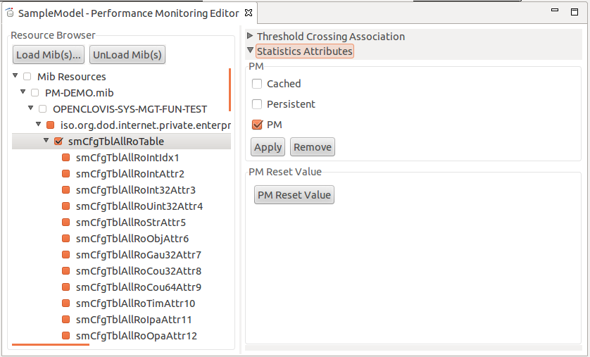

* **PM:** User can mark the selected attributes as Cached, Persistent and/or PM by selecting the statistics and licking Apply. User can 
  unmark the statistics in the same way by clicking Remove.
* **PM Reset Value:** To configure the Reset value, select the bunch of PM attributes from the same resource for which you want to 
  configure the reset value. Click on PM Reset Value button. This will show up all the the possible attributes that can be configured 
  as Reset value for that bunch of attributes. Select any attribute from the displayed attributes and click on Apply. Confirmation 
  message is given after the PM Reset Value is configured.

Viewing the Outline Pane
------------------------
The Outline pane represents the hierarchical relationships of the resources and the components on the respective tabs.

To open the outline pane:

1. From the **Window menu**, point to **Show View**, and click **Other**. The **Show View dialog** box is displayed.

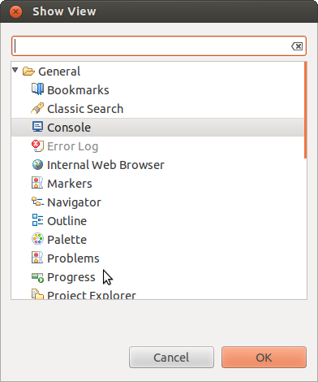

2. Click General, select **Outline**, and then click **OK** or type Outline in the text box. The **Outline pane** is displayed.

  .. note::
    To restore the default display of OpenClovis IDE, from the **Window menu**, select **Reset Perspective**.

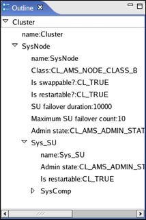

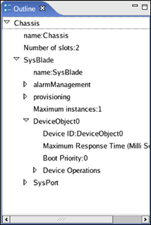

Using Tasks, MIB File Explorer View, Error Log, Model Problems, Model Template, and Console Panes
-------------------------------------------------------------------------------------------------
At the bottom of the **OpenClovis IDE** window, by default, the following panes are displayed:

* Tasks
* MIB File Explorer
* Error Log
* Model Problems
* Model Template
* Console

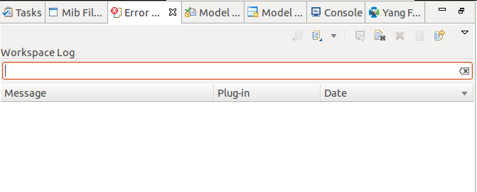

Tasks
^^^^^
The **Tasks** pane is not used within the OpenClovis IDE functionality.

MIB File Explorer
^^^^^^^^^^^^^^^^^
MIB File Explorer is a utility used to load multiple MIBs in a sequence in the model.

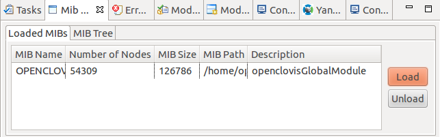

MIB File Explorer has two tabs:

* **Loaded MIBs:** This tab is used to load external 3rd party MIBs or Clovis MIBs into the model and subsequently use its attributes 
  for the model. To load a MIB,click Load. Select some MIB files. **Loaded MIBs** Tab will display following information for the Loaded 
  MIB files:

  * MIB Name: Name of the MIB.
  * Number of Nodes: Number of nodes in the MIB.
  * MIB Size: Size of the MIB.
  * MIB Path: Path from where the MIB is imported.
  * Description: Description of the MIB. Click Unload to unload the MIB.

* **MIB Tree:** This tab helps to expand the loaded MIB in the form of a tree structure.

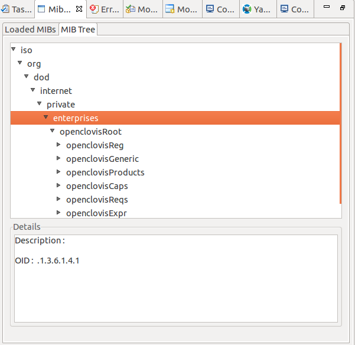

The MIB tree is a structure that groups MIB objects in a hierarchy and uses an abstract syntax notation to define manageable objects. 
Each item on the tree is assigned a number, which creates the path to objects in the MIB. This path of numbers is called the Object 
Identifier (OID). Each object is uniquely and unambiguously identified by the path of numeric values.

If you close the **MIB File Explorer** pane,you can display it again. To dot his,from the Window menu, point to **Show View** , and then 
click **Other**. The **Show View** dialog box is displayed. Double-click **Clovis**, select **MIB File Explorer**, and then click **OK**.

Error Log
^^^^^^^^^
The **Error Log** pane maintains a log of all the errors that are encountered while modeling. These errors are raised by Eclipse platform 
and the OpenClovis IDE. These may be errors due to problems in Eclipse or errors detected by OpenClovis IDE during modeling.

Model Problems
^^^^^^^^^^^^^^
The **Model Problems** pane displays the errors warnings as you model the project. To resolve the error, right-click on the error 
message, point to **Auto Correction Options** , and then select the required correction to be performed. OpenClovis IDE resolves the 
error automatically.

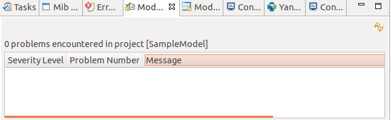

To view the error details, right-click on the error message, and click **Details**. The **Problem Details** window is displayed. It 
provides the details about the error message and the solution for the problem to resolve the error.

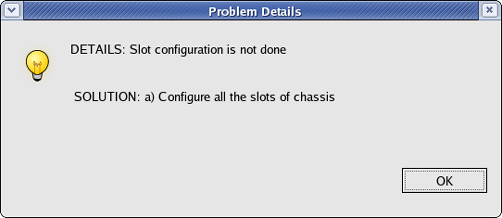

.. note::
    For some error messages, the **Auto Correction Option** is not available. In this case, you have to resolve the error manually as 
    per the solution provided in the **Problem Details** window.

Double-clicking on the error message highlights the object causing the error or displays the dialog where you need to fix the error.

If you close the **Model Problems** pane, you can display it again. To do this, from the **Window menu**, point to **Show View** , 
and then click **Other**. The **Show View** dialog box is displayed. Double-click **Clovis**, select **Model Problems**, and then 
click **OK**. Refresh the pane to view the updated list of errors.

Model Template
^^^^^^^^^^^^^^
You can select resources from the Resource Editor / components(applications) from the Component Editor and save them as custom 
templates. These templates appear in the **Model Template** tab. These templates can be reused for creating resource or component trees 
inside IDE Editor for other projects.

A view is provided for you to manage the model templates and see its structure. To view the structure, select the template from the 
view and its structure appears under **Selected Template**. All available templates are shown as a list in left hand side portion of the 
view.

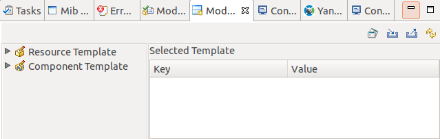

You can perform the following:

* Use the Model Template
* Import Model Template
* Export Model Template
* Refresh Model Template

View For more information, see Chapter Model Templates.

Console
^^^^^^^
The Console pane is activated when you perform certain actions on the project (e.g. generating code,building the project, etc.) It 
displays diagnostic information about the progress of the action and displays warnings and errors if they occur. Finally it displays 
the success or failure of the action.

.. image:: ../../images/ideguide/IDE_DeployConsolePane.png

If you close the **Console** pane, you can display it again. To do this, from the **Window** menu, point to **Show View**, and then 
click **Other**. **The Show View dialog box** is displayed. Double-click **Basic**, select **Console**, and then click **OK**.

Adding New Blade Type
---------------------
You can use the **Add New Blade Type** wizard to add a blade type along with the managed resources that it is composed of. To do this:

1. Right-click on the **Resource Editor** and select **Add New Blade Type**. The **Add New Blade Type** wizard is displayed.

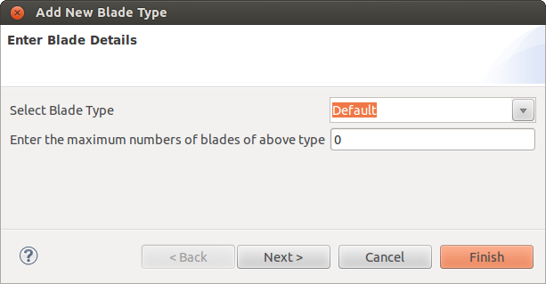

2. Enter the information for the following:

* **Select Blade Type:** Select the type of the blade from the drop-down list.
* **Enter maximum numbers of blades of the above type:** Number of blades of the selected type to be added to the Resource Editor.

3. Click **Next**. The **Enter System Details** window is displayed.

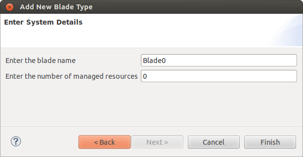

4. Enter the following information:

* **Enter the blade name:** Name of the new blade type.
* **Enter the number of managed resources:** Number of resources belonging to the blade.

5. Click **Finish**. The added resource appears in the **Resource Editor**.

Adding New Node
---------------
You can add a node, specify the number of SA aware components, and associate resources to the components using the **Add New Node** 
wizard. To do this:

1. Right-click on the **Component Editor** and select **Add New Node**. The **Add New Node** wizard is displayed.

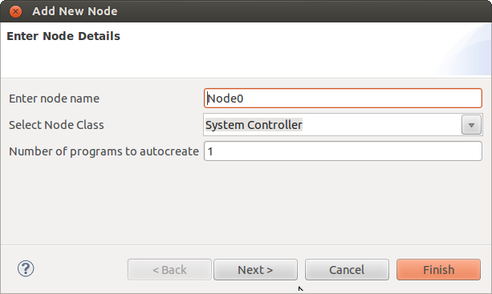

2. Enter the information for the following:

* **Enter Node Name:** Name of the new node.
* **Select Node Class:** Type of class to which the new node belongs.
* **Number of programs to auto create:** Enter the number of programs (SAF Service Types) to create for this new node.

3. Click *Next*. The **Associate Resources to the components** window is displayed. The specified number of SA Forum components are 
   listed for which resources need to be associated.

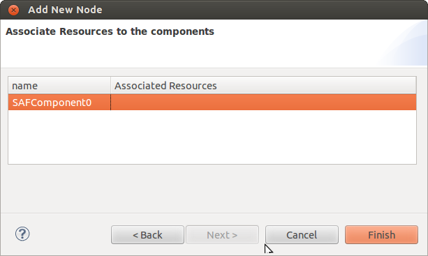

4. Enter the information for the following:

* **Name:** Enter the root name of the SAF Service Type. This name will be used for the created component and also as the root for all of 
  the associated SAF entities (Service Group, Service Unit, etc.).

5. Set focus to the Associated Resources column and click **Edit**. The **Associate Resources** window is displayed.

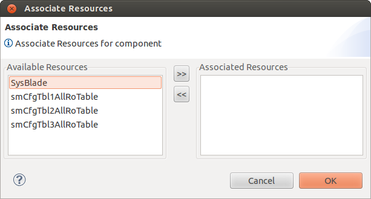

6. Select the resources for the component and click >> to move them under **Selected Resources**.
7. Click **OK** and then click **Finish**. The new node and any defined programs appear in the **Component Editor**.

Importing MIB Objects
---------------------
You can import MIB objects as resource classes. You can load a MIB and then select appropriate tables for import.

To import a MIB Object, from the **Clovis** menu, select **Import Mib Objects** or click the **Import Mib Objects** icon on the toolbar. The 
**Select MIB Objects** dialog box is displayed.

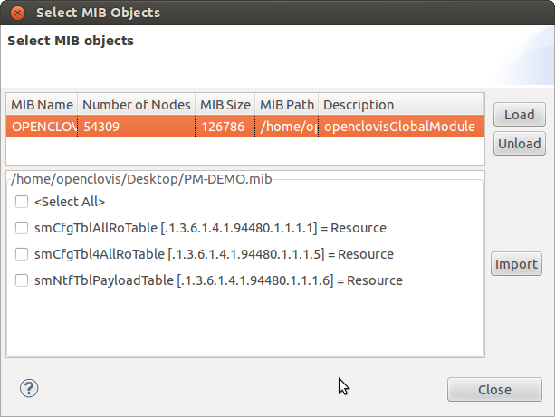

Click **Load** to load external 3rd party MIBs or Clovis MIBs into the model and subsequently use its attributes for the model.

Click **Unload** to unload the MIB.

Select tables and notifications in the lower pane of the dialog and click **Import** to load the selected MIB objects into the model.

.. note::
    If the MIB is dependent on other MIBs, they must be present in the same directory or else error occurs. After the selection is 
    done, the tables become software resource classes with provision-able attributes corresponding to the table columns. All 
    scalars are consolidated into a separate SW resource class. Each notification in the MIB will be imported as alarm. The 
    imported MIB objects are grouped together in the Resource Editor in a virtual container for ease of use.

Migrating Project
-----------------
When a new version of the IDE is released you can migrate your existing projects to this new version. The IDE detects the version 
of the existing project and transforms the internal structures to conform with the new version. It also provides an option to 
create a backup of the project while performing the migration.

To migrate a project, from **Clovis** menu, click **Migrate Project** or click on the **Migrate Project** icon on the toolbar. 
The **Migrate Project** dialog box is displayed.

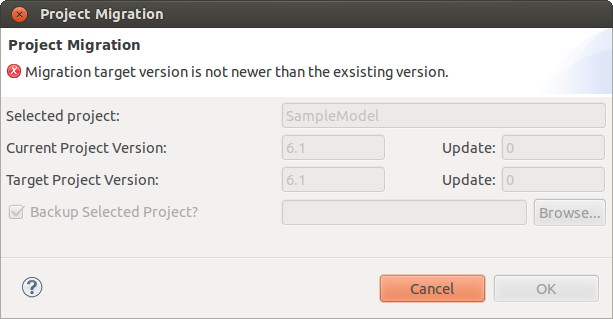

The information is displayed by default for the following fields:

* **Selected Project:** The project that will be migrated.
* **Current Project Version:** The version of project to be migrated.
* **Target Project Version:** The version to which the project will be migrated.
* **Backup the selected project?:** Select this check box if you need to create a backup of the project that you will be migrating. 
  The Browse button and accompanying text box will become enabled allowing you to select the location where the backup should be 
  created.

.. note::
    If you wish to revert back to the backup version at a later time you should use the project import functionality to import the 
    backed up model into the work space.

Click **OK**. The project is migrated to the current version.
