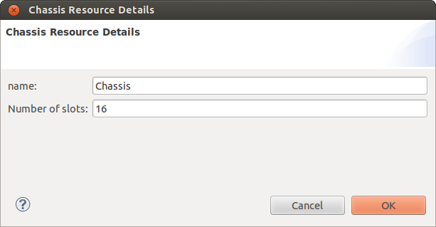
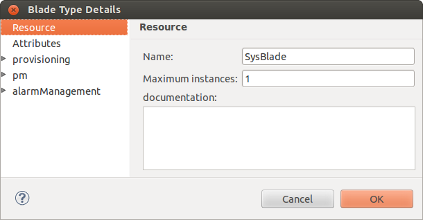
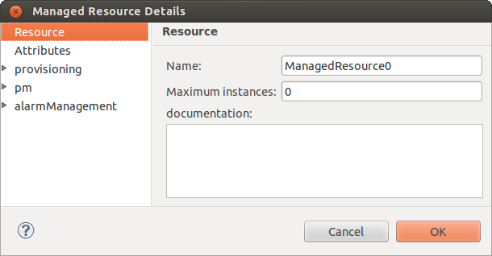
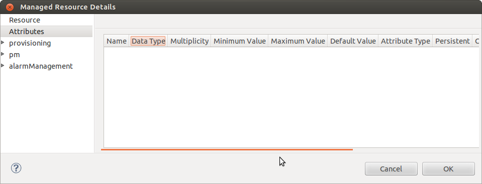
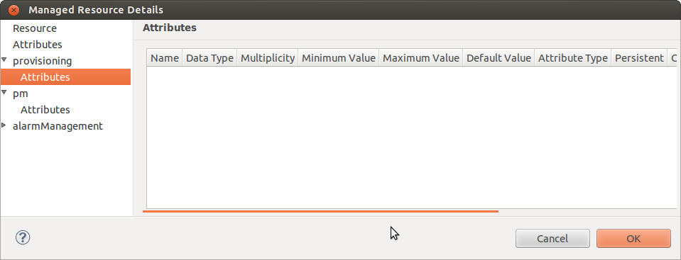
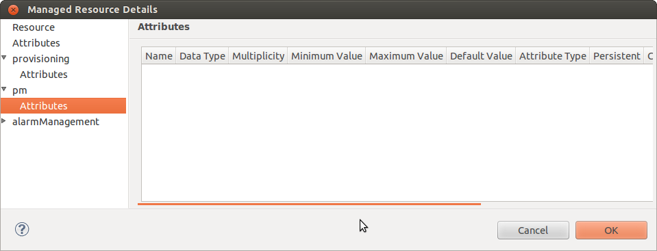
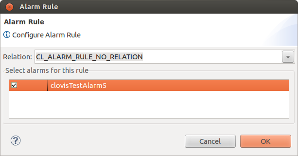

Chapter 4: Setting Resource Properties
======================================
This chapter provides information about the properties that you can specify for the chassis, node hardware, hardware, and software 
resources in the Resource Editor.

Key Topics:

* Setting Chassis Properties
* Setting Blade Type and Managed Resource Properties

For information about creating a resource, see Chapter **Understanding the User Interface**.

Setting Chassis Properties
--------------------------
To set the properties for the Chassis:

1. Right-click on the Chassis resource and select **Properties** or double-click the Chassis resource. The **Chassis Resource Details** 
   window is displayed.

2. Enter the following information:

* **Name:** Name for the Chassis.
* **Number of slots:** Number of slots present in the chassis.

3. Click **OK**. The properties are saved.

Setting Blade Type and Managed Resource Properties
--------------------------------------------------
To set the properties for a resource, right-click on the resource and select **Properties** or double-click the resource. The **Blade 
Type Details** or **Managed Resource Details** window is displayed depending on the resource selected.

The following illustrations show the **Blade Type Details** and **Managed Resource Details** windows.

You can perform the following for a Blade Type or Managed Resource:

* Specifying Resource Details
* Specifying Resource Attributes
* Specifying Provisioning Attributes
* Specifying Pm Attributes
* Enabling and Associating Alarms

.. note::
    All the screens in this chapter are provided for a Managed Resource. If you are setting the properties for a Blade Type, the 
    window title displays **Blade Type Details**.

Specifying Resource Details
^^^^^^^^^^^^^^^^^^^^^^^^^^^
The **Resource** is selected, by default, in the **Resource Details** window.

Enter the following information:

* **Name:** Name of the resource.
* **Maximum Instances:** Maximum instances of this resource. By default, the value is 1.
* **Documentation:** Enter any required information.

Specifying Resource Attributes
^^^^^^^^^^^^^^^^^^^^^^^^^^^^^^
To specify the attributes for a resource:

1. In the **Resource Details** window, click **Attributes** on the left-side. The **Attributes** pane is displayed on the right-side. 
   This pane lists all the attributes that are defined for any resource. Click **New** to create a new attribute.

2. Enter the following information:

* **Name:** Name of the attribute.
* **Date Type:** Data type of the attribute. The options available are:

  * Int8
  * Uint8
  * Int16
  * Uint16
  * Int32
  * Uint32
  * Int64
  * Uint64

  The following data types are SNMP supported data types, and are used in SNMP Import.

  * OCTET STRING
  * Gauge32
  * Counter32
  * Counter64
  * TimeTicks
  * IpAddress
  * NetworkAddress
  * Opaque
  * UTF8String
  * BITS
  * IA5String
  * TruthValue
  * DisplayString
  * INTEGER
  * OBJECT IDENTIFIER

* **Multiplicity:** Defines the number of elements in the array. Used only if the attribute is an array.
* **Minimum and Maximum Value:** This represents the range of values that can be used for the attributes. You can set a value within 
  this range during runtime configuration for the attribute.
* **Default Value:** Define a default value between the range of min and max values. This default value is assigned to the 
  corresponding attribute during system start up.
* **Attribute Type:** This represents if the attribute is configurable or transient attribute (also called run-time attribute.) The 
  options available are:

  * Config
  * Run-time Configurable attributes are attributes whose value can be set. Transient attributes are attributes whose value changes at run-time 
    and are read-only attributes. The value of the transient attribute is not stored in COR but is get/set from the component that owns 
    this attribute. For more information on configuration and transient attributes, refer **OpenClovis SDK User Guide**.

* **Persistent:** Select this checkbox to specify if the attribute needs to be persisted.
* **Cached:** Select this checkbox to specify if the attribute needs to be cached.
* **Imported:** Indicates whether the attribute is imported from an external MIB file or not. When you import an external MIB file, a tick mark appears in the checkbox. The imported attributes are used as the node attributes. They cannot be modified by the user.
* **Writable:** Select this checkbox to specify if the attribute is writable.
* **Initialized:** Select this checkbox if the attribute needs to be initialized.

3. Click **Duplicate** to create a duplicate attribute.

  .. note::
    Duplicity is applicable to all fields except the name. The name of the attribute must be unique.

4. Click **Delete** to delete a selected attribute.

5. Click **Move Up** to move the attribute up.

6. Click **Move Down** to move the attribute down.

7. Click **Import** to import attributes from any pre-defined MIB.

  .. note::
    Do not import the notification type objects from the MIB. OpenClovis IDE does not validate the type of objects being imported 
    and an error is displayed.

Specifying Provisioning Attributes
^^^^^^^^^^^^^^^^^^^^^^^^^^^^^^^^^^
To specify provisioning attributes perform the following steps:

1. Double-click provisioning on the left-side and click Attributes. The Attributes pane lists all the provisioning attributes for a 
   given resource. Click New to add a new provisioning attribute.

2. Enter the following information:

* **Name:** Name of the attribute.
* **Type:** Indicates the data type of the attribute. The options available are:

  * Int8
  * Uint8
  * Int16
  * Uint16
  * Int32
  * Uint32
  * Int64
  * Uint64

  The following data types are SNMP supported data types, and are used in SNMP Import.

  * OCTET STRING
  * Gauge32
  * Counter32
  * Counter64
  * TimeTicks
  * IpAddress
  * NetworkAddress
  * Opaque
  * UTF8String
  * BITS
  * IA5String
  * TruthValue
  * DisplayString
  * INTEGER

* **Multiplicity:** Defines the number of elements in the array. Used only if the attribute is an array.
* **Minimum and Maximum Value:** This represents the range of values that can be used for the attributes. You can set a value within 
  this range during runtime configuration for the attribute.
* **Default Value:** User defines a default value between the range of min and max values. This default value is assigned to the 
  corresponding attribute during system start up.
* **Attribute Type:** This represents if the attribute is configurable or transient attribute. The options available are:

  * Config
  * Run-time Configurable attributes are attributes whose value can be set. Transient attributes are attributes whose value changes 
    at run-time and are read-only attributes. The value of the transient attribute is not stored in COR but is get/set from the 
    component that owns this attribute. For more information on configuration and transient attributes, refer **OpenClovis SDK User 
    Guide**.

* **Persistent:** Select this checkbox to specify if the attribute needs to be persisted.
* **Cached:** Select this checkbox to specify if the attribute needs to be cached.
* **Imported:** Indicates whether the attribute is imported from an external MIB file or not. When you import an external MIB file, 
  a tick mark appears in the checkbox. The imported attributes are used as the node attributes. They cannot be modified by the user.
* **Writable:** Select this checkbox to specify if the attribute is writable.
* **Initialized:** Select this checkbox to specify if the attribute needs to be initialized.

Specifying Pm Attributes
^^^^^^^^^^^^^^^^^^^^^^^^
To specify pm attributes perform the following steps:

1. Double-click **pm** on the left-side and click **Attributes**. The **Attributes** pane lists all the pm attributes for a given 
   resource. Click **New** to add a new pm attribute.

2. Enter the following information:

* **Name:** Name of the attribute.
* **Type:** Indicates the data type of the attribute. The options available are:

  * Int8
  * Uint8
  * Int16
  * Uint16
  * Int32
  * Uint32
  * Int64
  * Uint64

  The following data types are SNMP supported data types, and are used in SNMP Import.

  * OCTET STRING
  * Gauge32
  * Counter32
  * Counter64
  * TimeTicks
  * IpAddress
  * NetworkAddress
  * Opaque
  * UTF8String
  * BITS
  * IA5String
  * TruthValue
  * DisplayString
  * INTEGER

* **Multiplicity:** Defines the number of elements in the array. Used only if the attribute is an array.
* **Minimum and Maximum Value:** This represents the range of values that can be used for the attributes. You can set a value within 
  this range during runtime configuration for the attribute.
* **Default Value:** User defines a default value between the range of min and max values. This default value is assigned to the 
  corresponding attribute during system start up.
* **Attribute Type:** This represents if the attribute is configurable or transient attribute. The options available are:

  * Config
  * Run-time Configurable attributes are attributes whose value can be set. Transient attributes are attributes whose value changes 
    at run-time and are read-only attributes. The value of the transient attribute is not stored in COR but is get/set from the 
    component that owns this attribute. For more information on configuration and transient attributes, refer **OpenClovis SDK User 
    Guide**.

* **Persistent:** Select this checkbox to specify if the attribute needs to be persisted.
* **Cached:** Select this checkbox to specify if the attribute needs to be cached.
* **Imported:** Indicates whether the attribute is imported from an external MIB file or not. When you import an external MIB file, 
  a tick mark appears in the checkbox. The imported attributes are used as the node attributes.They cannot be modified by the user.
* **Writable:** Select this checkbox to specify if the attribute is writable.
* **Initialized:** Select this checkbox to specify if the attribute needs to be initialized.

Associating Alarms
^^^^^^^^^^^^^^^^^^
You have to define the alarms in the **Alarm Profile** window and then associate them to a resource and specify the generation rule 
for the alarm. For information about defining alarms, see **Chapter 6 Defining Alarm Profiles**. Association refers to associating 
the defined alarms to a particular resource. After associating the alarms to the resources, the generation rule has to be specified 
for the alarm to be generated.

To associate pre-defined alarms to a resource:

1. In the **Resource Details** window, double-click **alarm Management** and select **Associate Alarms**. The **Associate Alarms** 
   pane is displayed on the right-side.

   .. image:: ../../images/ideguide/Associate-alarms.png

   The alarms that are defined in the **Alarm Profile** window are listed under **Available Alarms** area.

2. Select the alarms that are applicable to this resource and click **Add** to move them under **Selected Alarms** for this resource.

   .. note::
        Two alarms with the same probable cause cannot be associated to the same resource.

   * **Add:** This associates an alarm from the existing list to a resource.
   * **Delete:** This disassociates an alarm with a resource.
   * **GenRule:** Click this button to create a rule that defines the condition under which the selected rule will be generated. An 
     alarm that does not have a Generation Rule associated with it will never be raised.
   * **Suppress Rule:** Click this button to create a rule that defines the condition under which the selected alarm will be suppressed.

  For information about configuring the alarm rule, refer Configure Alarm Rule section.

  Corresponding to the application that is managing the resource, the code for the associated alarms are generated in the 
  cl<component_name>alarm-MetaStruct.c file located in the <projectarea_directory>/<model_name>/src/app/<component_name>/ directory.

Configure Alarm Rule
""""""""""""""""""""
After you select the alarms that are to be associated with the resources you have to specify the alarm rule for the alarms to be 
raised/suppressed. The alarm rule can be a generation or a suppression rule. An alarm cannot be generated, if the alarm rule is not 
specified. Generation rule provides a mechanism to specify constraints on generation of alarms. Suppression rule specifies 
constraints on the suppression of alarms.

You can also specify a generation rule to model dependencies between alarms. A generation rule specifies the following:

* Alarm to be generated
* Dependent alarms
* Condition that has to be satisfied for the alarm to be generated. This condition is specified as a logical relationship between the dependent alarms.

A suppression rule specifies the following:

* Alarm to be suppressed
* Dependent alarms
* Condition that needs to be satisfied for the alarm to be suppressed. This condition is specified as a logical relationship between 
  the dependent alarms.

An alarm rule can have a maximum of four alarms in an Alarm rule. An alarm rule can either have logical OR or logical AND operators 
but not both.

You can configure alarms in the **Associate Alarms** window.

Select the alarm for which you need to configure the generation rule/suppression rule and click **GenRule** or **SuppressRule**. 
The **Alarm Rule** dialog box is displayed.

From the **Relation** drop-down list, select the relation. Three relations are available:

* CL_ALARM_RULE_NO_RELATION
* CL_ALARM_RULE_LOGICAL_OR
* CL_ALARM_RULE_LOGICAL_AND

Select the alarm(s) for which you need to apply the generation rule and click **OK**.

If you choose **CL_ALARM_RULE_NO_RELATION**, then you need to check only one of the alarms present under **Select alarms for this rule**. 
This alarm is the same alarm for which the generation rule/suppression rule is applied, that is the alarm that you selected under 
**Selected Alarms** while associating the alarms (in Figure Associate Alarms).

However, if you choose any of the other two relations, then you can select more than one alarm. Selected alarm should not be the 
same alarm for which the generation rule/suppression rule is applied, that is the alarm that you selected under **Selected Alarms** 
while associating the alarm (in Figure Associate Alarms).
