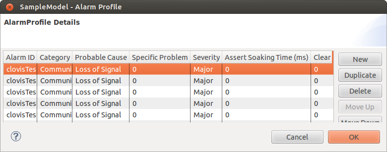

Chapter 5: Defining Alarm Profiles
==================================
This chapter provides information about defining alarms to map to the resources. Any application can raise an alarm, on detecting 
an erroneous condition on a managed resource. You have to pre-define the variety of alarms to be raised in a system for different 
categories, probable causes, and severity types. All the categories and probable causes conform to the ITU-T X.733 standard. For 
each category, there is a different set of probable causes.

1. The alarms are defined in the **Alarm Profile** window. From the **Clovis** menu, click **Alarm Profile**... or press **Shift+Ctrl+L** 
on the keyboard to open the **Alarm Profile** window.

2. To create an alarm profile, click New and enter the following:

* **Alarm ID:** This is the alarm ID.
* **Category:** Category to which the alarm belongs. Select the **Category** of the alarm from the list.
* **Probable Cause:** Probable causes for the alarm to be activated. Select the **Probable Cause** of the alarm from the list.

The following table lists the available categories and the probable causes for each of the categories.

+--------------------+----------------------------------------------------+
| Category           | Probable Cause                                     |
+====================+====================================================+
| Communications     | - Loss of signal                                   |
|                    | - Loss of frame                                    |
|                    | - Framing error                                    |
|                    | - Local node transmission error                    |
|                    | - Remote node transmission error                   |
|                    | - Call establishment error                         |
|                    | - Degraded signal                                  |
|                    | - Communications subsystem failure                 |
|                    | - Communications protocol error                    |
|                    | - LAN error                                        |
|                    | - DTE                                              |
+--------------------+----------------------------------------------------+
| Quality of service | - Response time excessive                          |
|                    | - Queue size exceeded                              |
|                    | - Bandwidth reduced                                |
|                    | - Retransmission rate excessive                    |
|                    | - Threshold crossed                                |
|                    | - Performance degraded                             |
|                    | - Congestion                                       |
|                    | - Resource at or nearing capacity                  |
+--------------------+----------------------------------------------------+
| Processing error   | - Storage capacity problem                         |
|                    | - Version mismatch                                 |
|                    | - Corrupt data                                     |
|                    | - CPU cycles limit exceeded                        |
|                    | - Software error                                   |
|                    | - Software program error                           |
|                    | - Software program abnormally terminated           |
|                    | - File error                                       |
|                    | - Out of memory                                    |
|                    | - Underlying resource unavailable                  |
|                    | - Application subsystem failure                    |
|                    | - Configuration or customization error             |
+--------------------+----------------------------------------------------+
| Equipment          | - Power problem                                    |
|                    | - Timing problem                                   |
|                    | - Processor problem                                |
|                    | - Dataset or modem error                           |
|                    | - Multiplexer problem                              |
|                    | - Receiver failure                                 |
|                    | - Transmitter failure                              |
|                    | - Receive failure                                  |
|                    | - Transmit failure                                 |
|                    | - Output device error                              |
|                    | - Input device error                               |
|                    | - Input output device error                        |
|                    | - Equipment malfunction                            |
|                    | - Adapter error                                    |
+--------------------+----------------------------------------------------+
| Environmental      | - Temperature unacceptable                         |
|                    | - Humidity unacceptable                            |
|                    | - Heating or ventilation or cooling system problem |
|                    | - Fire detected                                    |
|                    | - Flood detected                                   |
|                    | - Toxic leak detected                              |
|                    | - Leak detected                                    |
|                    | - Pressure unacceptable                            |
|                    | - Excessive vibration                              |
|                    | - Material supply exhausted                        |
|                    | - Pump failure                                     |
|                    | - Enclosure door open                              |
+--------------------+----------------------------------------------------+

* **Severity:** Select the Severity of the alarm from the list. The available options are:

  * Critical
  * Major
  * Minor
  * Warning

* **Specific Problem:** An integer value providing more specific information about the alarm being raised.
* **Assert Soaking Time (Milliseconds):** This is the time during which the alarm is observed before actually raising it as a genuine alarm.
* **Clear Soaking Time (Milliseconds):** This is the time when the alarm is cleared.
* **Description:** Enter any description for the alarm.

.. note::
    The alarm will be raised/cleared after the time interval specified in the **Assert Soaking Time/Clear Soaking Time** fields, 
    for that particular alarm. If you want to raise the alarm instantly then the values of both the fields has to be 0.

3. Click OK. The alarms are saved.

