Chapter 6: Setting Component Properties
=======================================
This chapter provides information about the properties that you can specify for the various components in the Component Editor.

**Key Topics:**

* Setting Cluster Details
* Setting Node Details
* Setting Service Unit Details
* Setting Service Group Details
* Setting SA Forum Component Details
* Setting Non-SA Forum Component Details Setting Service Instance Details
* Setting Component Service Instance Details

Setting Cluster Details
-----------------------
A cluster is a collection of nodes that have the following characteristics:

* Nodes have been configured as members of the cluster.
* The corresponding physical nodes provide adequate support to run their application processes.
* All nodes are capable of communicating with each other.
* All nodes are managed by a single Availability Management Framework

Double-click the cluster or right-click on the cluster and select **Properties**. The **Cluster Details** window is displayed.

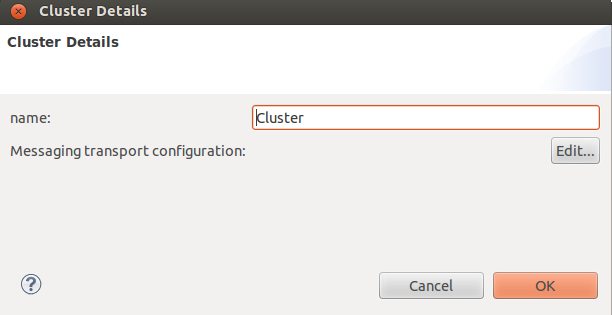

Enter the name for the cluster and click **OK**. The cluster name is saved.

Setting Node Details
--------------------
A node is a blade, a stand-alone PC, or a daughter card that runs the AIS services and can become a member of the cluster.

For more information, refer **Service Availability Forum Overview** Document (available from `saforum.org <https://www.associationvoice.com/Page/16627~217631/ErrorNotFoundhttpswwwassociationvoicecom443Service-Availability-Forum-E28093-Frequently-Asked-Questions-FAQ/>`__
and `opensaf.sourceforge.io <https://opensaf.sourceforge.io/>`__) 

Double-click the Node or right-click on the Node and select **Properties**. The **Node Details** window is displayed.

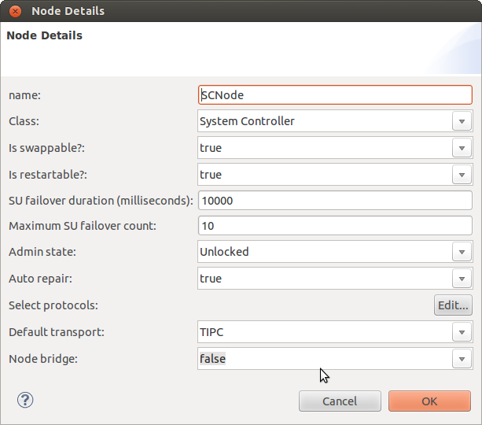

Enter the following information:

* **Name:** Name of the node. This is a unique identifier.
* **Class:** Select one of the following options from the drop-down list: (For infor-mation about these options, refer Glossary)

  * System Controller
  * Payload

* **Is swappable?:** Specifies if the blade is removable or irremovable. Select the True or False option from this list. True indicates that the blade is removable.
* **Is restartable?:** Specifies if the Service Unit can be restarted. Select the True or False option from this list. True indicates that the blade is restartable.
* **SU failover duration:** Specifies the time duration within which sequential failures of any two SUs in a node should not occur. If such an event occurs, the fault handling is escalated to Node Failover.
* **Maximum SU failover count:** :Specifies the maximum number of SU failovers that can be tolerated on a node. If the SU failover count increases beyond 10000, the Fault handling is escalated to Node Failover.
* **Admin state:** Specifies the set administrative state and this also allows you to lock or unlock an entity such as a node.
* **Auto repair:** By default, it is marked as False. If set to true, then after a failover the AMS will repair the entity by itself without any administrative intervention.

.. note::
    You must assign at least one node in the model as a Class A or Class B node.

Click **OK**. The properties for the node is saved.

Setting Service Unit Details
----------------------------
A Service Unit (SU) can be a single component, or a group of components that is administratively managed as one entity. Service Unit 
(SU) is collection of components or a single component that can be switched over to a redundant, identical collection of components. 

For more information, refer **Service Availability Forum Overview** Document (available from `saforum.org <https://www.associationvoice.com/Page/16627~217631/ErrorNotFoundhttpswwwassociationvoicecom443Service-Availability-Forum-E28093-Frequently-Asked-Questions-FAQ/>`__
and `opensaf.sourceforge.io <https://opensaf.sourceforge.io/>`__) 

Double-click the Service Unit or right-click on it and select **Properties**.. The **Service Unit Details** window is displayed.

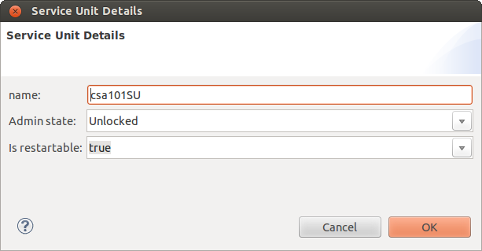

Enter the following information:

* **Name:** Name for the SU.
* **Admin state:** Specifies the defined administrative state and allows you to lock or unlock an entity such as a node.
* **Is restartable:** Specifies if the Service Unit can be restarted. Select the True or False option from this list.

Click **OK**. The properties for the SU is saved.

Setting Service Group Details
-----------------------------
Service Group (SG) is a collection of SUs of the same type that collectively provide service availability for one or more service 
instances. A redundancy model associated with the SG defines how the service units in the group are used to provide service 
availability. A SG is defined at run time and dynamically populated with SUs as necessary.

A SG contains multiple SUs, all of which are functionally identical. Each SG follows rules that decide when to start SUs, stop SUs, 
assign, and remove work. An SG may have a preference for starting certain SUs first. There is no manual or boot-time starting of 
components unless the rules of the SG permit it.

For more information, refer **Service Availability Forum Overview** Document (available from `saforum.org <https://www.associationvoice.com/Page/16627~217631/ErrorNotFoundhttpswwwassociationvoicecom443Service-Availability-Forum-E28093-Frequently-Asked-Questions-FAQ/>`__
and `opensaf.sourceforge.io <https://opensaf.sourceforge.io/>`__)

Double-click a SG or right-click on it and select **Properties**. The **Service Group Details** swindow is displayed.

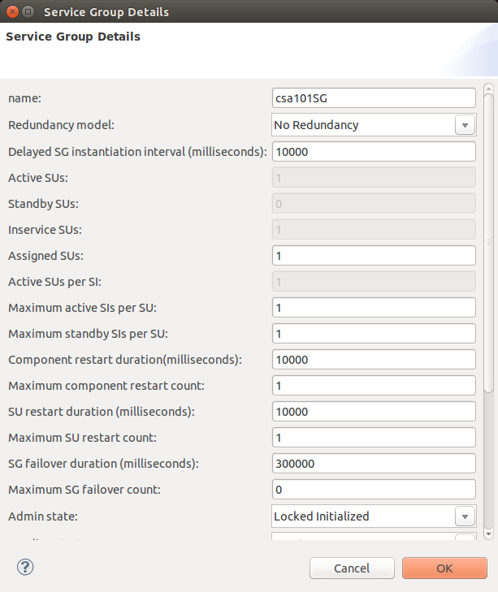

Enter the following information:

* **Name:** Name for the Service Group (SG). You can enter only a valid string. It does not accept numerics, special characters, 
  and spaces.
* **Redundancy model:** The SUs within a service group provide service availability to the service instances that they support 
  according to the particular SG redundancy model. The valid values are No Redundancy, 2N Redundancy, and M+N redundancy.
* **Delayed SG Instantiation Interval (milliseconds):** The delay between the time the ASP comes up and this SG is started (instantiated).
* **Active SUs:** Number of active Service Units (SUs). An Active SU is one that has been assigned "work" (i.e. an SI) and it is 
  "doing the work" instead of "backing up" another SU.
* **Standby SUs:** Number of standby SUs. A Standby SU is one that has been assigned as a backup for particular "work" that is 
  active on another SU.
* **Inservice SUs:** Number of In-Service SUs. This field allows the system to contain blades that do not have this SU running. For 
  example, on a 3 blade system, setting this field to 2 would mean that 1 blade will not run the SU. This field can also be used to 
  create "spares" or SUs that do not have any assignment ("active" or "standby") yet are ready to take an assignment (that is, the SU 
  is running). For example, setting the "Assigned SUs" to 2 but setting this field to 3 will create 1 "spare" SU.
* **Assigned SUs:** Maximum number of assigned SUs. The value should be 2 for the 2N Redundancy Model, or the sum of N+M in the N+M 
  redundancy model.
* **Active SUs per SI:** Number of active SUs per service instance. This is used to assign multiple SUs as "Active" to the same 
  "work" (SI). For the 2N redundancy model, this must be 1. For example, in a 6+1 model, setting this to "2" would mean that 3 SIs 
  are assigned "Active" to 3 pairs of blades.
* **Maximum active SIs per SUs:** Maximum active service instances per SU. This is a opposite of the previous field, in that it 
  allows you to assign multiple "Active" work to the same SU.
* **Maximum standby SIs per SUs:** This field allows a single SU to act as a backup for multiple "Active" SUs. For example to 
  implement 10+1 redundancy, this field must be 10. But to implement, say, 10+2 redundancy, setting this field to 5 would ensure that 
  5 SIs are assigned to each of the 2 backup blades (this assumes that "Standby SUs" is set to 2, and "Active SUs" is 10). Therefore, 
  choosing a 2N redundancy model forces this field to be 1.
* **Component restart duration (milliseconds):** (see below)
* **Maximum component restart count:** These 2 fields control behavior during component failure. By setting these fields to non-zero, 
  you may choose to have your component restart on failure and receive the same work (SI) assignments as it had before it failed. But 
  if the component must be restarted "count" (see below) times within this time period, the fault is escalated to the SU level. For 
  example, if the restart duration is 10000 (10 seconds) and the restart count is 5, then the system will try to restart the component 
  5 times. If these restarts occur in less then 10 seconds, then the fault is escalated to the SU level.
* **SU restart duration (milliseconds):** (see below)
* **Maximum SU restart count:** The same restart logic as a component, but applied to an SU. For example, if you had 2 components 
  associated with an SU then an SU restart would stop and restart both components (even if only 1 failed), and the original "work" 
  reassigned. If the fault is escalated, then you get an SU failover (meaning that the work is assigned "Active" to the "Standby" SU).
* **SG fail-over duration (milliseconds):** Specifies SG fail-over duration.
* **Maximum SG fail-over count:** Specifies maximum SG fail-over count.
* **Admin state:** Specifies the set administrative state and this also allows you to lock or unlock (start "LOCKED_A", stop 
  "LOCKED_I", or assign work "UNLOCKED") an SG.
* **Loading strategy:** Loading strategy to use when deciding how to assign SIs to SUs. Select one of the following options:

  * **Least SI per SU:** In this strategy, the assignment algorithm tries to maximize the number of SUs assigned active and standby 
    assignments, thus resulting in the least possible SI assignments per SU. This strategy is meaningful for the M+N redundancy model. 
    (2N is a trivial case). This is the default strategy specified in the AMF specification.
  * **Least SU Assigned:** In this strategy, the assignment algorithm tries to minimize the number of SUs that are assigned the 
    active or standby SIs. This strategy is meaningful for the M+N redundancy model (2N is a trivial case) and is useful when assigning 
    more SUs is costlier than adding new SIs to existing SUs and it is acceptable not to have the additional resiliency provided by 
    not having the max possible number of SUs assigned.
  * **Least Load per SU:** In this strategy, the assignment algorithm picks the SU with the lowest load to be the next candidate. 
    The definition of load is intended to be customizable for a particular deployment.
  * **SI preference:** In this strategy, the assignment algorithm tries to assign the SIs to the SUs based on the preference list 
    associated with each SI. SIs with higher rank have first dibs. The preference is only for the active assignment and if the 
    preferred nodes are not available, the algorithm defaults to LEAST_SI_PER_SU.
  * **User defined:** This is intended to be an user customizable strategy that is plugged in during system deployment.

* **Auto repair:** By default, it is marked as False. If set to true, then after a fail-over the AMS will repair the entity (i.e. 
  restart the component – work assignments are not preserved) by itself without any administrative intervention. This can be used for 
  software components. This is different then the "restart count" and "restart duration" fields because this field define actions 
  taken AFTER a component fail-over. Note, a node fail-over requires administrative intervention to restart.
* **Collocation Allowed:** If set to true, this parameter communicates to AMS that it can assign both active and standby SUs on the 
  same node for a given SG. Currently, this is the default behavior. For example, when set to "true" this implements software-only 
  redundancy (since your active and standby could be on the same node). Setting this to "false" implements both software and hardware 
  redundancy.
* **Alpha factor:** This property is only used for the M+N redundancy model. This allows AMS to assign standby assignments when the 
  total number of assignable SUs is less then M+N. Alpha value is the percentage of the total available SUs which should be used for 
  active assignments when the preferred configuration cannot be fulfilled. The possible value is between 1-100. The default value is 100.
* **Auto Adjust:** This property is used to adjust the SG back to the most preferred assignments based on the SU rank.
* **Auto Adjust Probation(milliseconds):** This is used to start a probation timer after the SU is repaired.
* **Reduction Procedure:** This describes optimal assignments if the preferred number of its service units can actually be 
  instantiated during the cluster startup. In the event that a service unit or a node fails to instantiate during cluster start-up or 
  is administratively taken out of service, a reduction procedure is described in most of the redundancy models. The Availability 
  Management Framework uses this reduction procedure to compute less optimal assignments before actually starting to assign the 
  service instances.

Click **OK**. The properties for the SG is saved.

Setting SA Forum Component Details
----------------------------------
Components must be designed so that the AMF dynamically assigns workloads to a component and chooses the role in which the component 
operates for a specific workload. Only local components that are under the direct control of the AMF can have a high level of 
integration with this framework. Such components are called SA Forum components. SA Forum component is capable of running OpenClovis 
services.

Each SA Forum component includes one or more processes that are linked to the AMF library. One of these processes registers the 
component with the AMF. This registered process provides AMF references to the availability control functions it implements. The 
AMF uses these control functions to direct component execution. For example:

* Assigning workloads to the component
* Removing workloads from the component
* Assigning the High Availability state to the component for each workload

The registered process executes the availability management requests it receives from these control functions and conveys such 
requests to other processes and the hardware equipment of the local component, where necessary.

For more information, refer **Service Availability Forum Overview** Document (available from `saforum.org <https://www.associationvoice.com/Page/16627~217631/ErrorNotFoundhttpswwwassociationvoicecom443Service-Availability-Forum-E28093-Frequently-Asked-Questions-FAQ/>`__
and `opensaf.sourceforge.io <https://opensaf.sourceforge.io/>`__)

Double click the **SA Forum Component** or right-click on it and select **Properties**.

The **SA Forum Component Details** window is displayed.

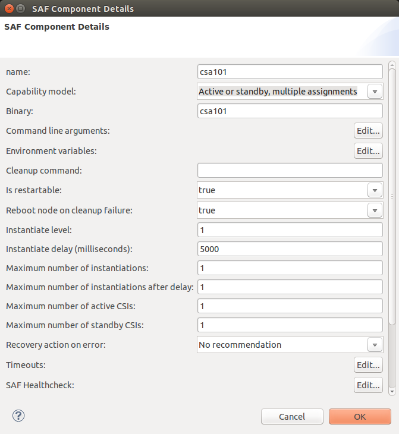

Enter the following information:

* **Name:** Name of the SA Forum Component. This accepts only a valid string. This does not accept numerics, special characters, 
  and spaces.
* **Capability model:** This defines the workload for the Component.
* **Binary:** Image name of the SA Forum Component.
* **Command Line Arguments:** Click Edit to display the Command Line Argument Details window. For more information, refer the 
  section Defining Command Line Arguments .
* **Environment variables:** Click Edit to display the Environment Variable Details window. For more information, refer the section 
  Defining Environment Variables .
* **Cleanup command:** This command will be executed by the AMF if the terminate command returned an error.
* **Is restartable:** Specifies if the component is restartable. Select one of the following options:

  * true
  * false

* **Reboot node on cleanup failure:** Specifies whether the node needs to be rebooted on component cleanup failure. Select one of 
  the following options:

  * true
  * false

* **Instantiate level:** Specifies when the component needs to be started.
* **Instantiate delay (milliseconds):** Specifies the delay before a component is started.
* **Maximum number of instantiations:** Specifies the maximum instantiation attempts.
* **Maximum number of instantiations after delay:** Specifies the maximum instantiation attempts after delay.
* **Maximum number of active CSIs:** Specifies the maximum number of active CSIs that a component can support.
* **Maximum number of standby CSIs:** Specifies the maximum number of standby CSIs that a component can support.
* **Recovery action on error:** Specifies the recovery action for a component when an error occurs. Select one of the following 
  options:

  * No Recommendation
  * Component restart
  * Component fail-over EO
  * Node switch-over
  * Node fail-over
  * Node failfast

* **Timeouts:** Click Edit to enter the timeout details. For more information, refer the section Specifying Timeout Details .
* **SAF Healthcheck:** Click Edit to enter the SAF Healthcheck details. For more information, refer the section Specifying SAF 
  Healthcheck Details .
* **Process properties:** Click Edit to view the Process Details window. For more information, refer the section Specifying Process 
  Properties .
* **Is 3rdparty component:** Enable this flag to True if this component is 3rd party component. IDE will not generate code for this 
  component. User should privide the binaries for this component in Make Images configuration dialog.
* **Is SNMP Sub-agent:** Enable this flag to True to allow this component to act as an SNMP sub-agent. OpenClovis IDE will generate 
  additional code for SNMP sub-agent development.
* **Is Build C++:** Enable this flag to True to allow external C++ code to be integrated with the C code using a compiler.

Click **OK**. The properties for the SA Forum component is saved.

Defining Command Line Arguments
^^^^^^^^^^^^^^^^^^^^^^^^^^^^^^^
The **Command Line Argument Details** window is used to specify the command line argument details for a component.

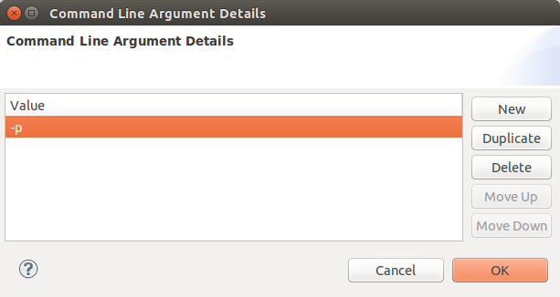

* Click **New** to enter **Command Line Argument**.
* Enter the **Value** and click **OK**. The command line arguments is saved.

Defining Environment Variables
^^^^^^^^^^^^^^^^^^^^^^^^^^^^^^
The **Environment Variable Details** window is used to specify the environment variable details.

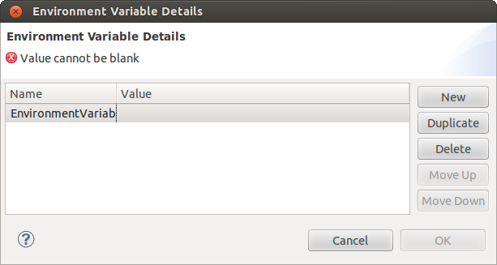

* Click **New** to enter a new Environment Variable.
* Enter the **Name** and the **Value**.

Click **OK**. The environment variables is saved.

Specifying Timeout Details
^^^^^^^^^^^^^^^^^^^^^^^^^^
Operations such as instantiation, termination, and cleanup must be completed within the specified time frame for the corresponding 
components. The default timeout is 10000 milliseconds.

The **Component Timeout Details** window is used to specify the timeout details.

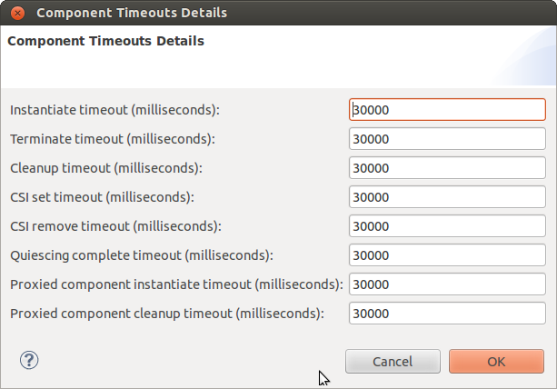

Enter the following information:

* **Instantiate timeout (milliseconds)** - This is the time limit for the component instantiation to complete. For SA Forum 
  components, it also includes the time required for the newly instantiated component to register with the Availability Management 
  Framework. If the instantiation of the component does not complete in the specified time period, the error report is generated on 
  the failed component and the cleanup operation is performed.
* **Terminate timeout (milliseconds)** - This is the time limit for terminating the service provided by an instance of a component. 
  The terminate operation stops the service in such a way that it could be resumed by another instance of the same component or 
  another component with minimal disruption.
* **Cleanup timeout (milliseconds)** - This is the time limit to complete the cleanup operation for a component. When recovering 
  from errors, if a particular instance of the component is not terminated, the AMF forces a cleanup of the component.
* **CSI set timeout (milliseconds)** - AMF assigns CSIs to the application components via a CSI set callback. This is the time AMF 
  will wait for a response from the component for a previous CSI set call. If a response is not received or response indicates an 
  error, AMF will declare an error on the component and take the necessary recovery actions. Multiple CSI set actions can be pending 
  for a component at any given time. The component can send a response for each separately or all together but they should all be 
  received within the specified timeout.
* **CSI remove timeout (milliseconds)** - AMF removes CSIs from application components via a CSI remove callback. This is the time 
  AMF will wait for a response from the component for a previous CSI remove call. If a response is not received or response indicates 
  an error, AMF will declare an error on the component and take the necessary recovery actions. Multiple CSI remove actions can be 
  pending for a component at any given time. The component can send a response for each separately or all together but they should 
  all be received within the specified timeout.
* **Quiesing complete timeout (milliseconds)** - AMF quiesces CSIs from application components via a CSI quiesce callback. This is 
  done as a result of a graceful "shutdown" administrative operation that affects CSIs assigned to the component. This is the time 
  AMF will wait for a response from the component for a previous CSI quiescing call. If a response is not received or response 
  indicates an error, AMF will declare an error on the component and undertake appropriate recovery actions. Multiple CSI quiescing 
  actions can be pending for a component at any given time. The component can send a response for each separately or all together but 
  they should all be received within the specified timeout.
* **Proxied component instantiate timeout (milliseconds)** - This is the time limit for the proxied component instantiation to complete.
* **Proxied component clean up timeout (milliseconds)** - This is the time limit to complete the cleanup operation for a proxied component.

Specifying SAF Healthcheck Details
^^^^^^^^^^^^^^^^^^^^^^^^^^^^^^^^^^
The **SAF Health check Details** window is used to specify the EO properties for a SA Forum component.

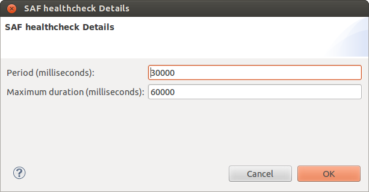

Enter the following information:

* **Period (milliseconds):** This indicates the period at which the corresponding healthcheck should be initiated.
* **Maximum duration (milliseconds):** This indicates the time-limit after which the Availability Management Framework will report an 
  error on the component if no response for a healthcheck is received by the Availability Management Frame-work in this time frame.

Specifying Process Properties
^^^^^^^^^^^^^^^^^^^^^^^^^^^^^
The **Process Details** window is used to specify the Process properties for a SA Forum component.

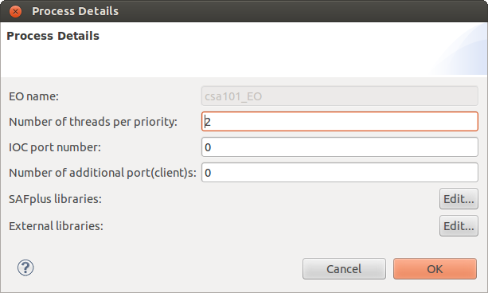

Enter the following information:

* **EO name:** Name of the execution object. This accepts only a valid string. This does not accept numerics, special characters, 
  and spaces.
* **IOC port number:** This is the requested IOC communication port. This accepts only numeric value. If 0 is specified, then 
  OpenClovis allocates an available port.
* **Number of additional port (client)s:** The number of additional clients.
* **SAF Plus libraries:** Specifies the basic libraries to be included for the component. When set to TRUE, the corresponding libraries 
  will be automatically initialized. Click **Edit** to enter information. The **SAF Pluse Library Details** window is displayed.

  .. image:: ../../images/ideguide/Saf-pluse-library.png

* Set the value of each of the following ASP components to either true or false depending on the component that you need to use:

  * COR
  * CM
  * Name Service
  * LOG
  * Transaction
  * Alarm
  * Debug
  * DBAL: This option should be set to true when you have to save contents of COR and check pointing data in external databases (persistent storage.)
  * Fault

* **External libraries:** Specifies the external libraries to be included for the component. Click **Edit** to enter information. The 
  **External Libraries** window is displayed.

  .. image:: ../../images/ideguide/Process-external-libraries.png

Associating Resources to SA Forum Component
^^^^^^^^^^^^^^^^^^^^^^^^^^^^^^^^^^^^^^^^^^^
To associate resources to SA Forum component, right-click on the SA Forum component and select **Associate Resources**. The **Associate 
Resources** window is displayed.

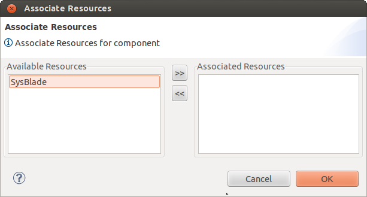

Select the resources for the component and click >> to move them under **Associated Resources.**

Click **OK**. The resources are associated to the component.

To dissociate resource from the component select the resources from **Associated Resources** list and click << to move them under 
**Available Resources** in the above dialog.

Setting SNMP sub-agent Properties
^^^^^^^^^^^^^^^^^^^^^^^^^^^^^^^^^
To specify SNMP sub-agent Properties, right-click on the SNMP sub-agent(SA Forum component with Is SNMP Sub-agent flag value as 
true) and select **Sub Agent Properties**. The **SNMP sub-agent Properties** window is displayed.

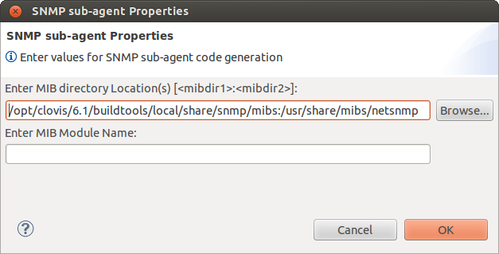

Enter the following information:

* **Enter MIB directory Location(s):** Location where MIBS are present.
* **Enter MIB Module Name:** The name of the MIB module you want to generate code.

.. note::
    Above values are required to generate code for MIB. If these fields are not specified, IDE will not generate code.

Setting Non-SA Forum Component Details
--------------------------------------
A Non-SA Forum Component is an entity that does not register directly with the AMF. Because of this they do not normally perform as 
efficiently in the areas of workload assignment, error detection, and recovery. Non-SA Forum Components are normally used only to 
link legacy applications to the AMF. There are two kinds of Non-SA Forum components. These are proxied and non-proxied.

Proxied Non-SA Forum Components are registered with the AMF by dedicated SA Forum components, which act as proxies between the AMF 
and the non-SA Forum components. These dedicated SA Forum components are called proxy components. The AMF manages the proxy component, 
calling its initialization routine, assigning it work, etc. The proxy component is responsible for conveying requests made by the 
AMF to its proxied components.

Non-Proxied Non-SA Forum Components have a less formal relationship with the AMF. For these components the role of the AMF is 
limited to the management of the component lifecycle. The AMF instantiates these components when the component needs to provide a 
service and terminates them when the component must stop providing the service.

For more information, refer **Service Availability Forum Overview** Document (available from `saforum.org <https://www.associationvoice.com/Page/16627~217631/ErrorNotFoundhttpswwwassociationvoicecom443Service-Availability-Forum-E28093-Frequently-Asked-Questions-FAQ/>`__
and `opensaf.sourceforge.io <https://opensaf.sourceforge.io/>`__)

Setting Proxied Non-SA Forum Component Details
^^^^^^^^^^^^^^^^^^^^^^^^^^^^^^^^^^^^^^^^^^^^^^
Proxied Non-SA Forum Components are linked to the cluster through an SA Forum Component known as a proxy component. In the **Component 
Editor** this relationship would look like the figure below.

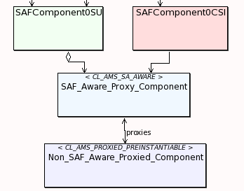

Double-click the **Non-SA Forum Component** or right-click on it and select **Properties**. The **Non SAF Component Details** window 
is displayed.

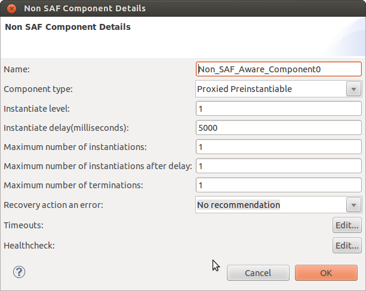

Enter the following information:

* **Name:** Name of the component. This accepts only a valid string. This does not accept numerics, special characters, and spaces.
* **Component Type:** Type of the component. For Proxied Non-SA Forum Components the only option is 'Proxied Preinstantiable'.
* **Instantiate level:** Specifies when the component needs to be started.
* **Instantiate delay (milliseconds):** Specifies the delay before the component is started.
* **Maximum number of instantiations:** Specifies the maximum instantiation attempts.
* **Maximum number of instantiations after delay:** Specifies the maximum instantiation attempts after delay.
* **Maximum number of terminations:** Specifies the maximum termination attempts.
* **Recovery action on error:** Specifies the recovery action for the component when an error occurs. Select of the following options:

  * Node failover
  * Node switchover
  * No Recommendation
  * Component failover
  * Component restart
  * Internally recovered
  * Node failfast
  * Cluster reset

* **Timeouts:** Click **Edit** to enter the timeout details. Click **Edit** to specify the command line arguments. For more 
  information, refer the section **Specifying Timeout Details**.
* **Healthcheck:** Click **Edit** to enter the Healthcheck details. For more information, refer the section Specifying SAF 
  Healthcheck Details.

Setting Non-Proxied Non-SA Forum Component Details
^^^^^^^^^^^^^^^^^^^^^^^^^^^^^^^^^^^^^^^^^^^^^^^^^^
Non-Proxied Non-SA Forum Components are linked to the cluster in the same manner as SA Forum Components, through relationships with 
a Service Unit and a Component Service Instance. In the Component Editor this relationship would look like the figure below.

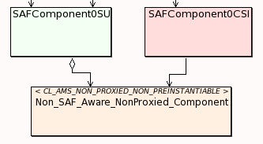

Double-click the **Non-SA Forum Component** or right-click on it and select **Properties**. The **Non SAF Component Details** window 
is displayed.

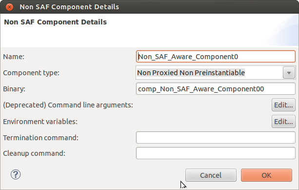

Enter the following information:

* **Name:** Name of the component. This accepts only a valid string. This does not accept numerics, special characters, and spaces.
* **Component type:** Type of the component. For Non-Proxied Non-SA Forum Components the only option is 'Non Proxied Non Preinstantiable'.
* **Binary:** For Non-Proxied Non-SA Forum Components this is also known as the Instantiate command. This command will be executed 
  by the AMF when it wants to instantiate a new instance of this component.
* **Command Line Arguments:** Click Edit to specify the command line arguments. For more information, refer the section Defining 
  Command Line Arguments .
* **Environment variables:** Click Edit to specify the environment variable details. Click Edit to specify the command line 
  arguments. For more information, refer the section **Defining Environment Variables**.
* **Termination command:** This command will be executed by the AMF when it wants to stop a service that is provided by this 
  component.
* **Cleanup command:** This command will be executed by the AMF if the terminate command returned an error.

Associating Resources to Non-Proxied Non-SA Forum Component
"""""""""""""""""""""""""""""""""""""""""""""""""""""""""""

.. note::
    You cannot associate resources to Proxied Non-SA Forum Components.

To associate resources to a Non-Proxied Non-SA Forum component, right-click on the Non-Proxied Non-SA Forum component and select 
**Associate Resources**. The **Associate Resources** window is displayed.

Select the resources for the component and click >> to move them under **Associated Resources**.

Click **OK**. The resources are associated to the component.

To dissociate resource from the component select the resources from **Associated Resources** list and click << to move them under 
**Available Resources** in the above dialog.

Setting Service Instance Details
--------------------------------
Service Instance (SI) is a logical entity that groups one or more Component Service Instances (CSI). A SI aggregates all CSIs to be 
assigned to the individual components of the service unit for the service unit to provide a particular service.

For more information, refer **Service Availability Forum Overview** Document (available from `saforum.org <https://www.associationvoice.com/Page/16627~217631/ErrorNotFoundhttpswwwassociationvoicecom443Service-Availability-Forum-E28093-Frequently-Asked-Questions-FAQ/>`__
and `opensaf.sourceforge.io <https://opensaf.sourceforge.io/>`__)

Double-click the **Service Instance** or right-click on it and select **Properties** to specify its details. The **Service Instance 
Details** window is displayed.

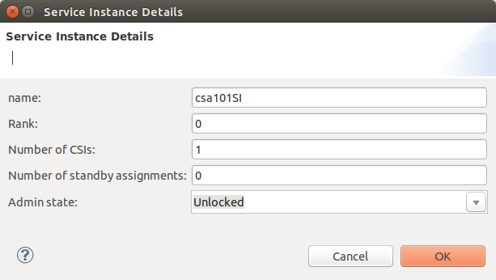

Enter the following information:

* **Name:** Name of the Service Instance. You can enter only a valid string and does not accept numerics, special characters, and spaces.
* **Rank:** The order of SI within the Service Group.
* **Number of CSIs:** Specifies the number of CSIs comprising the given SI. (A SI is an aggregation of CSIs).
* **Number of standby assignments:** Specifies the number of SUs that can be assigned STANDBY state for the SI.
* **Admin state:** Specifies the set administrative state and this also allows you to lock or unlock an entity such as a node.

Click **OK**. The SI properties are saved.

Setting Component Service Instance Details
------------------------------------------
A Component Service Instance (CSI) represents the workload that is dynamically assigned to a component. High availability (HA) 
states are assigned to a component on behalf of its component service instances.

For more information, refer **Service Availability Forum Overview** Document (available from `saforum.org <https://www.associationvoice.com/Page/16627~217631/ErrorNotFoundhttpswwwassociationvoicecom443Service-Availability-Forum-E28093-Frequently-Asked-Questions-FAQ/>`__
and `opensaf.sourceforge.io <https://opensaf.sourceforge.io/>`__)

Double-click the **Component Service Instance** or right-click on it and select **Properties** to specify the details. The 
**Component Service Instance Details** window is displayed.

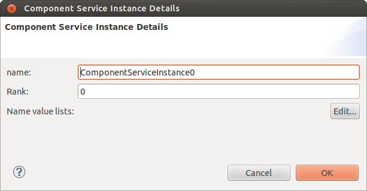

Enter the following information:

* **Name:** Name of the Component Service Instance. You can enter only a valid string and does not accept numerics, special characters, 
  and spaces.
* **Rank:** The order of CSI within SI.
* **Name Value Lists:** List of Name Value pairs. Click **Edit** to specify the CSI Workload details here.

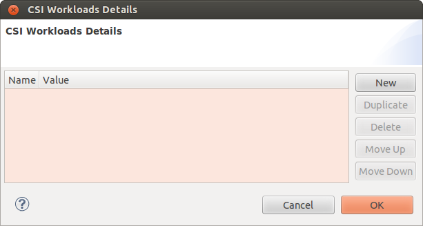

Enter the following information:

* **Name:** Name of the CSI Workload.
* **Value:** Value of the CSI Workload.

Click **OK**. The CSI properties are saved.
