Chapter 7: Configuring ASP Components
=====================================
This chapter provides information to configure the OpenClovis ASP components within OpenClovis IDE using the "ASP Component 
Configuration" dialog box. These settings are separated into two categories: build time and boot time settings.

**Key Topics:**

* Configuring Build Properties
* Configuring Boot Properties

Build time settings are stored in the **compileconfigs.xml** file in the project's config directory. These settings are used at compile 
time and changes to this file require a recompile and a redeployment to take effect .

Boot time properties are stored in **.xml** files in the project's config directory. These files are clLog.xml, clSlotInfo.xml, and 
clGmsConfig.xml. These files are read at boot time and can be changed on the target system without requiring a recompile. ASP 
should be restarted on the target system when changes are made to these files.

From the **Clovis** menu, click **ASP Component Configuration** or press **Shift+Ctrl+Y** on the keyboard. The **ASP Component Configuration** 
window is displayed.

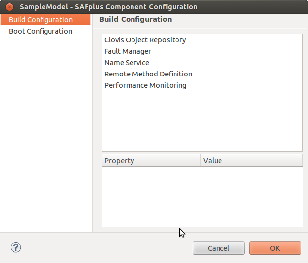

Configuring Build Properties
----------------------------
You can set the Build Configuration properties for the following components:

* Clovis Object Repository (COR)
* Fault Manager (FM)
* Name Service (NS)
* Remote Method Definition (RMD)

Setting Clovis Object Repository Parameters
^^^^^^^^^^^^^^^^^^^^^^^^^^^^^^^^^^^^^^^^^^^
The Clovis Object Repository (COR) serves as an object-oriented, resilient, inmemory repository service to store and provide access 
to the Managed Objects (MO) across the entire cluster. For more information on COR, refer to the **OpenClovis SDK User Guide**.

In the **ASP Component Configuration** window, click **Build Configuration** and then click **Clovis Object Repository**.

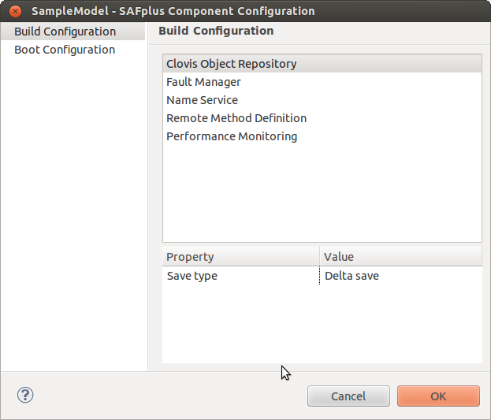

Enter the following information:

* **Save type** - Select the Save type from the list. The property can be set to **No save** or **Delta save**.

Setting Fault Manager Parameters
^^^^^^^^^^^^^^^^^^^^^^^^^^^^^^^^
The OpenClovis Fault Manager (FM) infrastructure provides a hierarchical scheme for managing faults in a system and initiating 
actions as configured during the design time.

In the **ASP Component Configuration window**, click **Build Configuration** and then click **Fault Manager**.

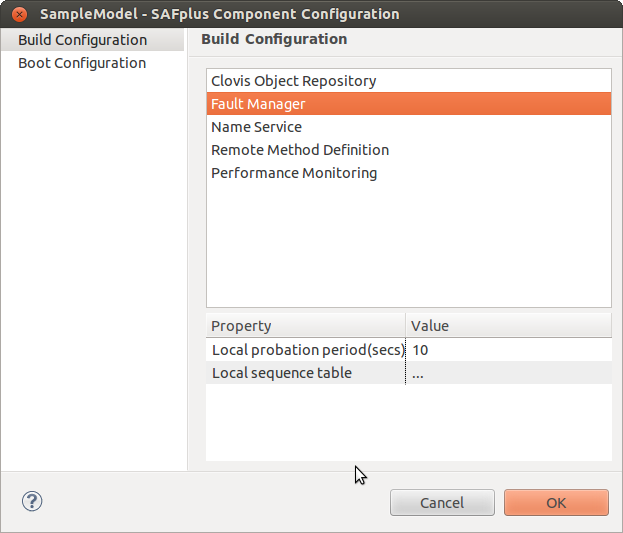

Enter the following information:

* **Local probation period (secs)** - Stores the fault history for the specified amount of time. If the fault takes place within the 
  specified time, progressive repair action will be taken.
* **Local sequence table** - Click **Edit** to edit the Sequence Table Details. To create a new sequence table, click **New** and 
  enter the following:

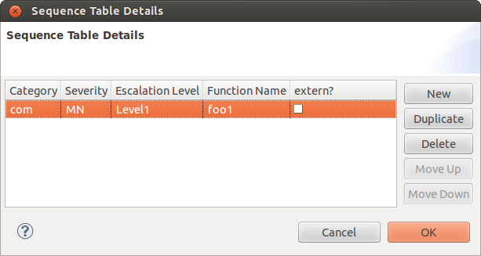

* **Category:** This is the category for the alarm. Select the category from the list. The available options are:

  * Com - Communication
  * Qos - Quality of Service
  * Proc - Processing
  * Equip - Equipment
  * Env - Environmental  
  
    .. note::
        Two sequence table entries cannot have the same category, severity, escalation level, and Function Name.

* **Severity:** This is the severity level of the alarm. Select the severity from the list. The available options are:

  * Minor
  * Warning

* **Escalation Level:** This is the escalation level for a recurring alarm. Select the escalation level from the list. The available 
  options are:

  * Level1
  * Level2
  * Level3
  * Level4
  * Level5

    .. note::
        Level 1 is the lowest escalation level and Level 5 is the highest escalation level.

* **Function Name:** This is the action to be taken for the specified escalation level.
* **extern?:** Select this checkbox if you need to provide a custom fault handler code.

Click **Duplicate** to create a Sequence Table from an existing Sequence Table.

Click **Delete** to delete a selected Sequence Table.

Click **Move Up** to move the selected Sequence Table up in the list.

Click **Move Down** to move the selected Sequence Table down in the list.

Click **OK** to save the changes and close **Sequence Table Details** window.

Click **Cancel** to exit without saving the changes.

Setting Name Service Parameters
^^^^^^^^^^^^^^^^^^^^^^^^^^^^^^^
The OpenClovis Name Service (NS) offers one-to-one mapping between the name of a service and its object reference.

In the **ASP Component Configuration** window, click **Build Configuration** and then click **Name Service**.

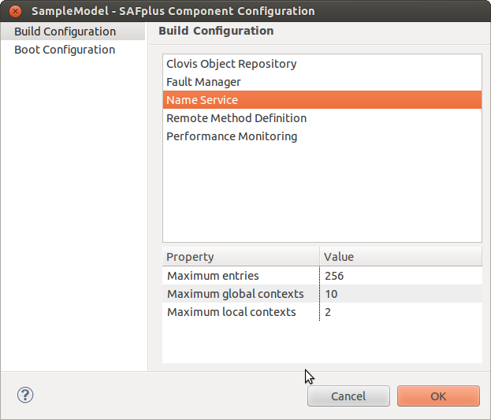

Enter the following information:

* **Maximum entries:** Maximum number of entries per context.
* **Maximum global contexts:** Maximum number of user-defined global contexts.
* **Maximum local contexts:** Maximum number of user-defined local contexts.

Setting Remote Method Definition Parameters
^^^^^^^^^^^^^^^^^^^^^^^^^^^^^^^^^^^^^^^^^^^
The OpenClovis Remote Method Definition (RMD) is the foundation on which all OpenClovis client APIs are implemented.

In the **ASP Component Configuration** window, click **Build Configuration** and then click **Remote Method Definition**.

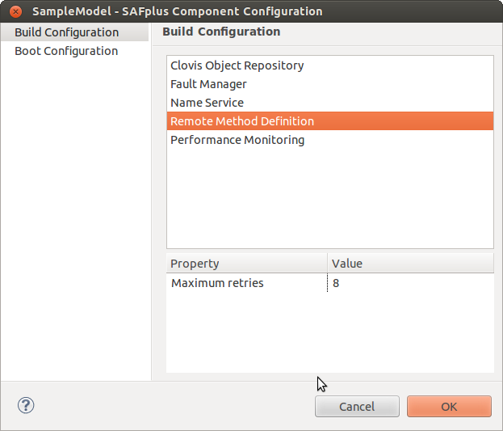

Enter the following information:

* **Maximum retries:** Maximum number of retries for an RMD call.

Setting Performance Monitoring Parameters
^^^^^^^^^^^^^^^^^^^^^^^^^^^^^^^^^^^^^^^^^
In the **ASP Component Configuration** window, click **Build Configuration** and then click **Performance Monitoring**.

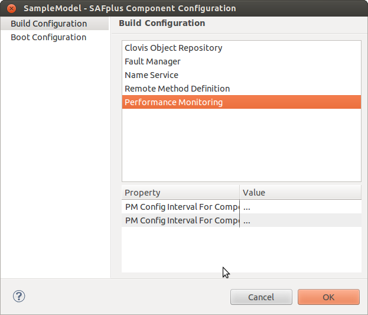

Enter the following information:

* **PM Config Interval For Component Types** - Click **Edit** to edit the config interval for component types.

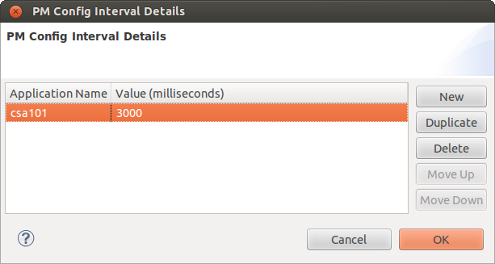

* **PM Config Interval For Component Instances** - Click **Edit** to edit the config interval for component instances.

Configuring Boot Properties
---------------------------
Boot Configuration properties can be set for the following components:

* Database Configuration
* Log
* Node Admission Control
* Group Membership Service

Setting Database Configuration Parameters
^^^^^^^^^^^^^^^^^^^^^^^^^^^^^^^^^^^^^^^^^
The OpenClovis Database Configuration allows user to configure Database for the system.

In the **ASP Component Configuration** window, click **Boot Configuration** and then click **Database Configuration**.

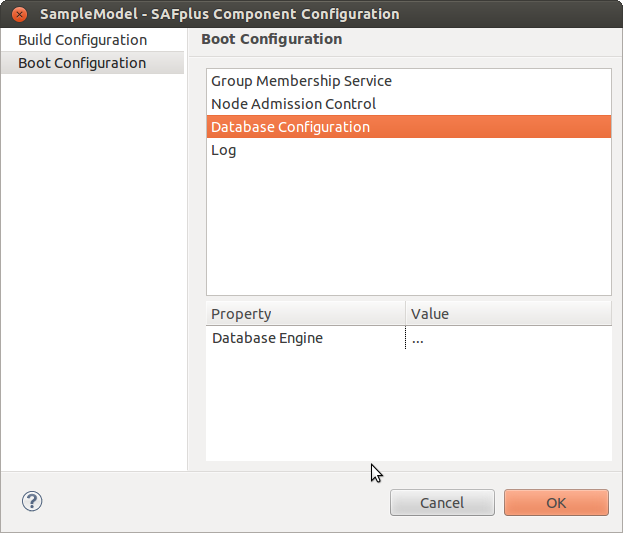

Enter the following information:

* **Database Engine:** Click **Edit** to edit the Database Engine for the system. The **Database Engine Details** window is displayed.

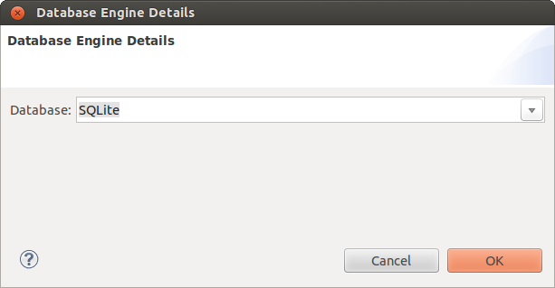

Enter the following information:

* **Database:** Select the Database from the list of available databases.

Setting Log Parameters
^^^^^^^^^^^^^^^^^^^^^^
Log Service enables applications to express and forward log records through well known log streams that lead to particular output 
destinations such as a named file.

In the **ASP Component Configuration** window, click **Boot Configuration** and then click **Log**.

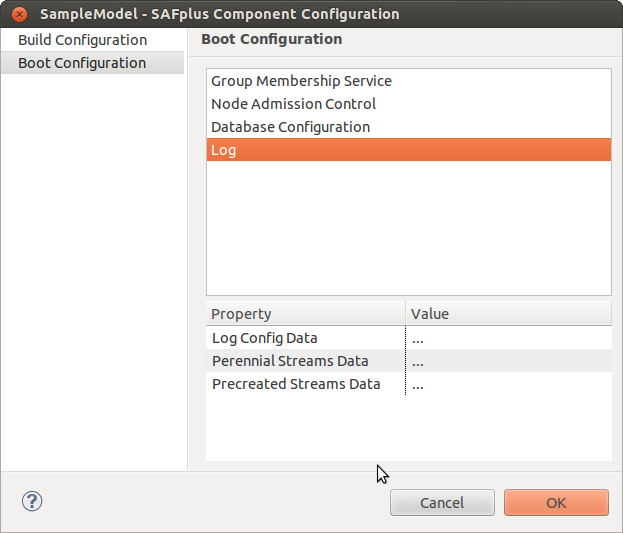

Enter the following information:

* **Log Config Data** - Click **Edit** to edit the Log Config Data. The **Log Config Data Details** window is displayed.

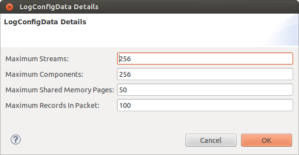

Enter the following information:

* **Maximum Streams:** Maximum Number of streams which can be opened.
* **Maximum Components:** Maximum Number of components which can use log service.
* **Maximum Shared Memory Pages:** Maximum Number of shared memory pages (used for log write at the client side, these records are 
  flushed to the actual file by the log server based on flush interval or flush frequency). If you want to use records of large size 
  then you may need to increase this shared memory size.
* **Maximum Records In Pocket:** The maximum number of records which log server picks at one time from the shared memory and sends 
  the records for flushing to the actual file.

**Perennial Streams Data** - Click **Edit** to edit the Perennial Streams Data. The **Stream Details** window displays a list of 
Stream Types and their properties.

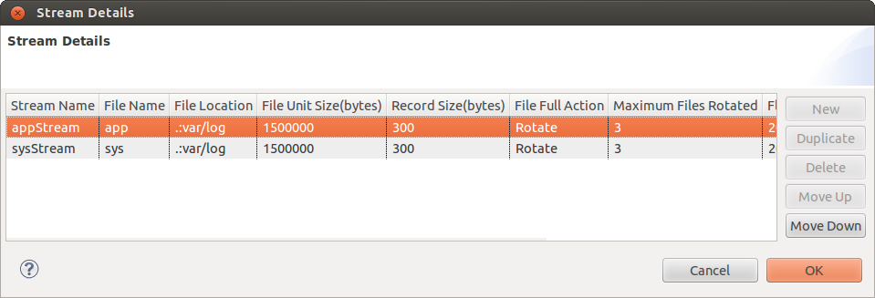

There are two pre-created perennial streams, app and sys. These log streams are created and opened automatically when ASP starts 
and are available as long as ASP is running. The sys stream is used by ASP system components for logging messages and information. 
The app stream is meant for use by application components for logging messages and information.

.. note::
    You cannot create new perennial streams.

Enter the following information:

* **Stream Name:** Name of the stream.
* **File Name:** Log file name to be associated with a particular log stream.
* **File Location:** Location of the log file that can be defined by the user. The path can either be absolute (beginning with a /) 
  or relative. If relative it will be placed in the specified directory under the ASP install directory. Additionally, this field 
  must start with either a period (.) or an asterisk (*) followed by a colon (:). A period indicates that the log file should be 
  written to the local machine. An asterisk indicates that the file should be written to the system controller.
* **File Unit Size (bytes):** Size of the log file in bytes.
* **Record Size (bytes):** Indicates the log record size in bytes.
* **File Full Action:** Action to be taken when the file is full (WRAP, ROTATE, HALT).
* **Maximum Files Rotated:** Maximum Number of files needs to be rotated when the File Full Action is ROTATE. This argument has to 
  be set to 0 when file full action is WRAP or HALT.
* **Flush Frequency:** The frequency of flushing the records to the log file. This takes a number and it means that after that number 
  of records are written to the shared memory, the records should be flushed to the log file.
* **Flush Interval(nanoseconds):** The interval after which log records should be flushed to the log file. Log server choose the 
  lower value out of 'flush frequency' and 'flush interval'.
* **SysLog:** Specify Yes for standard log.

**Precreated Streams Data** - Click **Edit** to edit the Precreated Streams Data. The **Stream Details** window is displayed. 
To create a new Stream Type, click **New**.

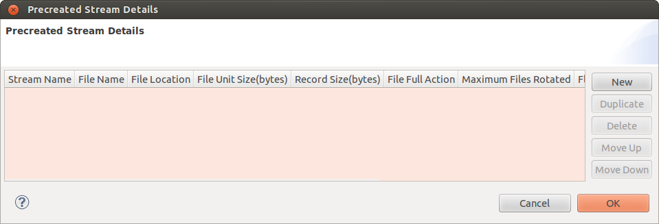

In addition to the perennial log streams described above you can create custom log files known as Precreated Streams. These streams 
can be used by applications to log error messages and information. Using multiple precreated streams, related information can be 
segregated into separate log files.

Enter the following information:

* **Stream Name:** Name of the stream.
* **File Name:** Log file name to be associated with a particular log stream.
* **File Location:** Location of the log file that can be defined by the user.
* **File Unit Size (bytes):** Size of the log file in bytes.
* **Record Size (bytes):** Indicates the log record size in bytes.
* **File Full Action:** Action to be taken when the file is full (WRAP, ROTATE, HALT)
* **Maximum Files Rotated:** Maximum Number of files needs to be rotated when the File Full Action is ROTATE. This argument has to 
  be set to 0 when file full action is WRAP or HALT.
* **Flush Frequency:** The frequency of flushing the records to the log file. This takes a number and it means that after that number 
  of records are written to the shared memory, the records should be flushed to the log file.
* **Flush Interval(nanoseconds):** The interval after which log records should be flushed to the log file. Log server choose the 
  lower value out of 'flush frequency' and 'flush interval'.
* **SysLog:** Specify Yes for standard log.
* **Stream Scope:** This field determines the visibility of a stream. Stream scope takes following two values : GLOBAL, LOCAL. 

  * Stream having GLOBAL scope has visibility across the cluster i.e. any process present in the cluster can use this stream for logging. 
  * Stream having LOCAL scope has the visibility restricted only to that particular node.

Setting Node Admission Control Parameters
^^^^^^^^^^^^^^^^^^^^^^^^^^^^^^^^^^^^^^^^^
This specifies the type of node that can be allowed for a slot.

In the **ASP Component Configuration** window, click **Boot Configuration** and then click **Node Admission Control**.

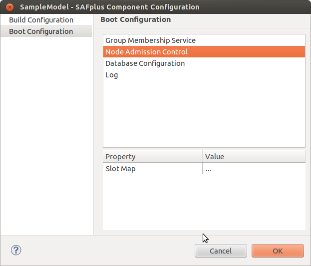

Enter the following information:

* **Slot Map:** Click **Edit** to edit the Slot Map Details. The **Slot Map Details** window displays a list of **Slot Numbers** and 
  their **Class Types**.

The list of slot numbers is dependent on the number of slots in the Chassis configuration in the Resource Editor.

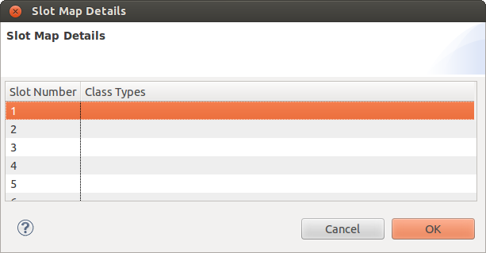

Enter the following information:

* **Slot Number:** Number of the slot in the chassis.
* **Class Types:** Click Edit to see the list of available nodes. Select the Node Types you want to be able to run in this slot 
  from the **Select Node Types** window.

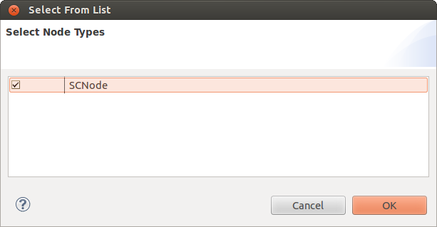

Setting Group Membership Service Parameters
^^^^^^^^^^^^^^^^^^^^^^^^^^^^^^^^^^^^^^^^^^^
The OpenClovis Group Membership Service (GMS) is the cluster membership service as defined by the SA Forum.

In the **ASP Component Configuration** window, click **Boot Configuration** and then click **Group Membership Service**.

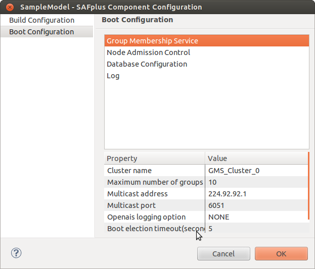

Enter the following information:

* **Cluster name:** Name of the cluster for the GMS that must be created.
* **Maximum number of groups:** The maximum number of GMS Groups that can be created in a cluster. The default value is 10, maximum 
  and minimum values are 256 and 0 respectively.
* **Multicast address:** The network IP address used by GMS service to send messages.
* **Multicast port:** The user defined unique multicast port used for the GMS Multicast traffic for receiving messages.
* **Openais logging option:** This option is used to enable logging from openais, which can be used for debugging purposes. It takes 
  following 4 options:

  * NONE: The logging is disabled when the value is set to 'NONE'.
  * STDERR: When it is set to "STDERR" the logs are redirected to standard output/error output.
  * FILE: When the option is set to 'FILE', then the logs are redirected to a file'openAis.log' under var/log directory in the 
    sandbox.
  * SYSLOG: When the option is set to 'SYSLOG', the openais logs are redirected to syslog in 'local5' log facility.

* **Boot election timeout(seconds):** This represents the time for which the node should wait before electing the leader in the 
  cluster.
* **Preferred active node:** This indicates the preferred active system controller node name.
