Chapter 8: Configuring AMF
==========================
This chapter provides information on creating the instances of the entities defined in the Component Editor using AMF Configuration. 
All the nodes and service groups in the system are instantiated using Availability Management Framework (AMF) Configuration. You 
can also configure the instance level parameters which are used by AMF.

AMF Configuration is a combination of AMS Configuration and CPM Configuration.

**Key Topics:**

* Configuring AMF
* Configuring CPM

From the **Clovis** menu, click **AMF Configuration** or press **Ctrl+Shift+F** on the keyboard to open the **AMF Configuration** window.

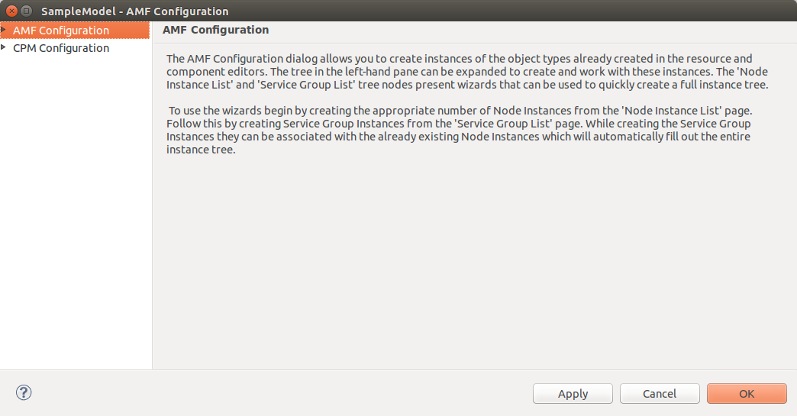

The Apply button will save all changes made since the dialog was opened or the Apply button was last clicked, leaving the dialog open.

The OK button will close the dialog saving all changes made since the dialog was opened or the Apply button was last clicked.

The Cancel button will close the dialog discarding all changes made since the dialog was opened or the Apply button was last clicked.

Configuring AMF Using the Wizards
---------------------------------
The AMF configuration dialog provides two wizards which can help in creating the initial AMF instance model. Once an instance model 
has been created using the wizards it can be customized and maintained manually. To create an instance model using the wizards, 
first use the **Node Creation Wizard** to create the appropriate Node instances and then use the Service **Group Creation Wizard** to fill 
out the rest of the instance tree associating the newly created Service Group instances with the existing Node instances.

Node Creation Wizard
^^^^^^^^^^^^^^^^^^^^
To access the **Node Creation Wizard** double-click **AMF Configuration** tree element in the left-hand pane and then click on the 
**Node Instance List** element. The **Node Creation Wizard** page is displayed.

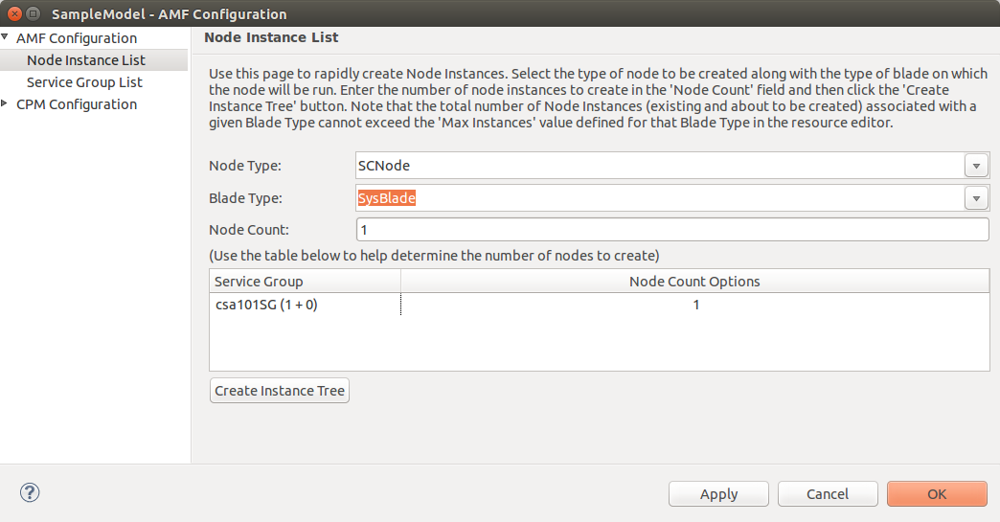

The following values may be entered.

* **Node Type:** Select the type of node to create. The list contains all of the node types defined in the component editor.
* **Blade Type:** Select the type of blade to create. The list contains all of the blade types defined in the resource editor.
* **Node Count:** Enter the number of node instances to create.

The Service Group table lists the Service Groups defined in the model and their redundancy models. You can use this information to 
help decide how many node instances to create.

Clicking the **Create Instance Tree** button will create the given number of node instances of the given type. Each node instance 
will be associated with the given blade type.

.. note::
    The total number of node instances associated with a given blade type may not exceed the **Maximum Instances** value entered 
    for the blade type in the resource editor.

    The number of node instances entered is usually equal to the total number of active and standby service units for all of the 
    service group types associated with the selected node type in the component editor.

Service Group Creation Wizard
^^^^^^^^^^^^^^^^^^^^^^^^^^^^^
To access the **Service Group Creation** Wizard double-click **AMF Configuration** tree element in the left-hand pane and then click 
on the **Service Group List** element. The **Service Group Creation Wizard** page is displayed.

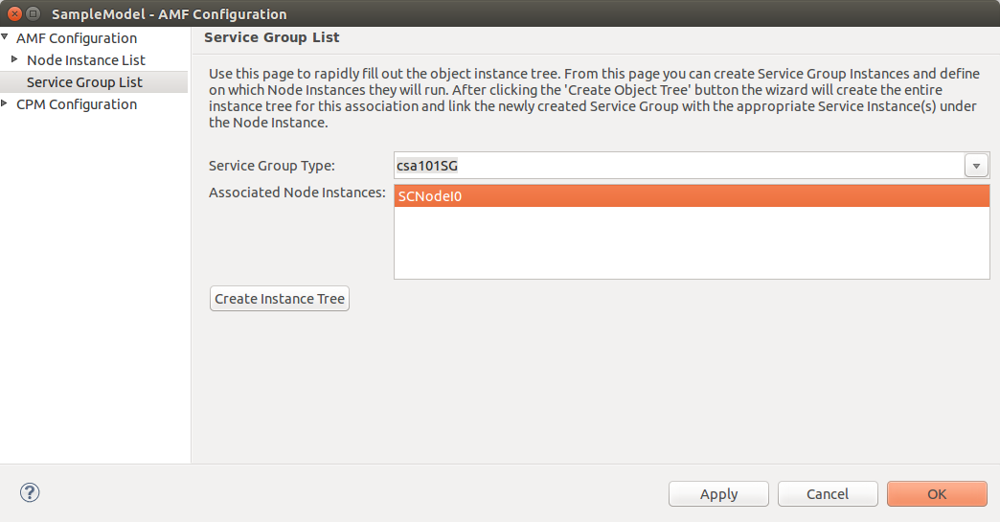

The following values may be entered:

* **Service Group Type:** Select the type of service group to create. The list contains all of the service group types defined in 
  the component editor.
* **Associated Node Instances:** Select the existing node instances with which to associate the newly created service group instance.

Clicking the **Create Instance Tree** button will create a new service group instance along with its contained service instances 
and component service instances. It will also create a service unit instance and corresponding component instance under each of the 
associated node instances. Each service unit instance created will be associated with the newly created service group instance.

.. note::
    The number of service instances created below the service group instance will be based on settings made to the service group 
    type in the component editor. The calculation is based on the number of active service units divided by the maximum number of 
    active service instances per service unit.

    The number of node instances selected must either be one or the total number of active and standby service units defined for 
    the selected service group type in the component editor.

Configuring AMF Manually
------------------------
AMF Configuration allows you to configure the following:

* Node Instance List
* Service Groups

Configuring Node Instance List
^^^^^^^^^^^^^^^^^^^^^^^^^^^^^^
To configure a node instance, specify the following:

* Node Instance
* Service Unit Instance for each Node Instance
* Component Instance for each Service Unit Instance

Specifying Node Instance
""""""""""""""""""""""""
In the **AMF Configuration** window, double-click **AMF Configuration**. Right-click on **Node Instance List** and select **New** to 
create a new node instance. If there are existing nodes, they are displayed in the left pane under **Node Instance List**.

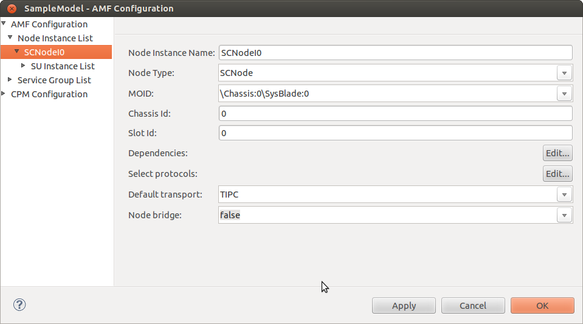

Enter the following:

* **Node Instance Name:** Name of the node instance.
* **Node Type:** Type of node. It specifies the node type to which this node instance belongs.

  .. note::
    The options in the list appear based on the number of nodes available in the Component Editor.

* **MOID** - Managed Object ID. You have to replace the * by digits to specify the exact MO instance. Then reselect the changed MOID by 
  clicking on the combo-box and selecting the particular entry from the list or just press enter.
* **Chassis Id:** Chassis Id for node instance.
* **Slot Id:** Slot Id for node instance.

  .. note::
    The MOIDs are created when you associate the component of a node in the Component Editor to a resource in the resource editor. 
    To do this, rightclick on a component and select the Associate Resources... option.

* **Dependencies:** Click **Edit** to specify the dependencies. The **Select Node Dependencies** window is displayed.

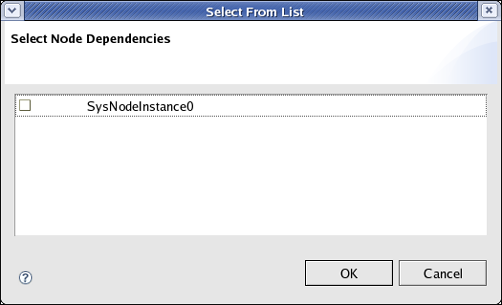

Select the node dependencies and click **OK**.

.. note::
    A node can be dependent on other nodes for it to be operational. Node dependency ensures that a dependent node is not 
    instantiated until its dependencies are met. If the dependencies of a node are not operationally enabled, then the node cannot 
    be used.

Click **OK**. The properties are saved.

Specifying Service Unit Instance for each Node Instance
"""""""""""""""""""""""""""""""""""""""""""""""""""""""
Double-click the newly created Node Instance, to display **Service Unit Instance List**. Right-click and click **New**. The SU 
Instance Details pane is displayed on the right-side.

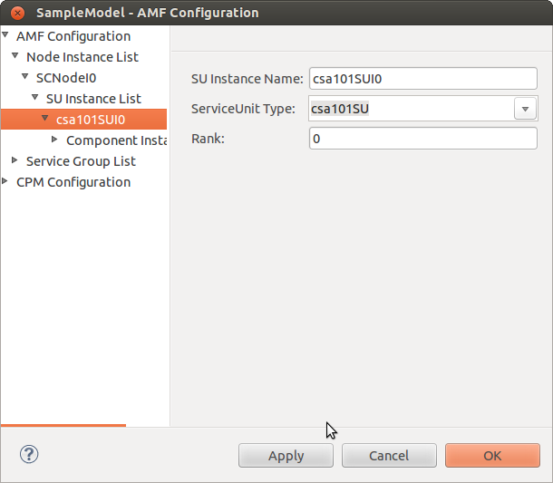

Enter the following information:

* **SU Instance Name:** Name of the Service Unit Instance.
* **ServiceUnit Type:** Type of Service Unit Instance.
* **Rank:** This is the order of SI. If there is more than one SU Instance, a SI can have a preference for being assigned to the active 
  and standby SUs in a particular order. This order is specified by the Rank value. For example, if there are two SU Instances, 
  SUInstance0 and SUInstance1, and the rank specified is rank 1 for SUInstance 0 and rank 2 for SUInstance 1, then the SI is first 
  assigned to the SUInstance0. If there is only one SU Instance, the SI is assigned to that SU.

Click **OK**. The properties are saved.

Specifying Component Instance for each Service Unit Instance
""""""""""""""""""""""""""""""""""""""""""""""""""""""""""""
Double-click the newly created Service Unit Instance to display the **Component Instance List**. To create a new Component Instance, 
right-click and select **New**.

The **Component Instance Details** pane is displayed.

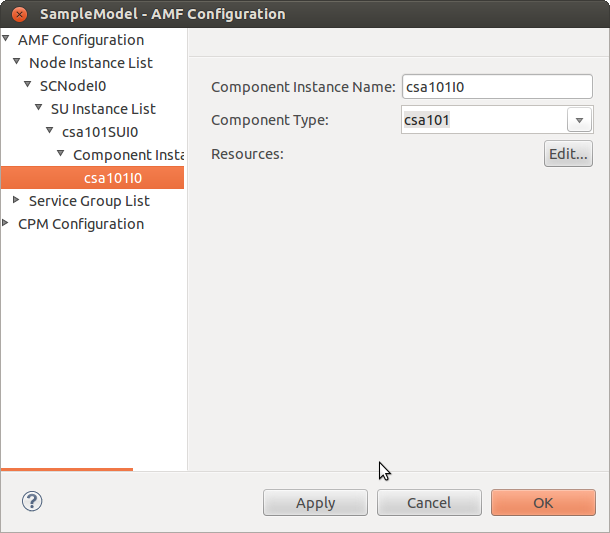

Enter the following information:

* **Component Instance Name:** Name of the Component Instance.
* **Component Type:** Type of the component.
* **Resources:** Click **Edit** to enter the resource details. The **Resource Details** window displays a list of MO Instance IDs.

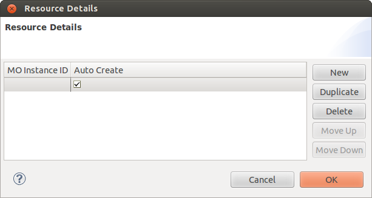

To create a new MO Instance ID, click **New**. Enter the following information:

* **MO Instance ID:** Managed Object (MO) instance ID. Select the MO ID from the list. Replace the * by digits to specify the exact 
  MO instance. Then reselect the changed MOID by clicking on the combo-box and selecting the particular entry from the list.
* **Auto Create:** If this option is set to true, then the **COR** creates the resource instance once it is up.

Configuring Service Groups
^^^^^^^^^^^^^^^^^^^^^^^^^^
To configure a SG, specify the following:

* Service Group Instance
* Service Instance for each Service Group Instance
* Component Service Instance for each Service Instance

Specifying Service Group Instance
"""""""""""""""""""""""""""""""""
In the **AMF Configuration** window, double-click **AMF Configuration**. Right-click on **Service Group List** and select **New** 
to create a new service group instance. If there are existing Service Groups, they are displayed in the left pane under **Service 
Group List**.

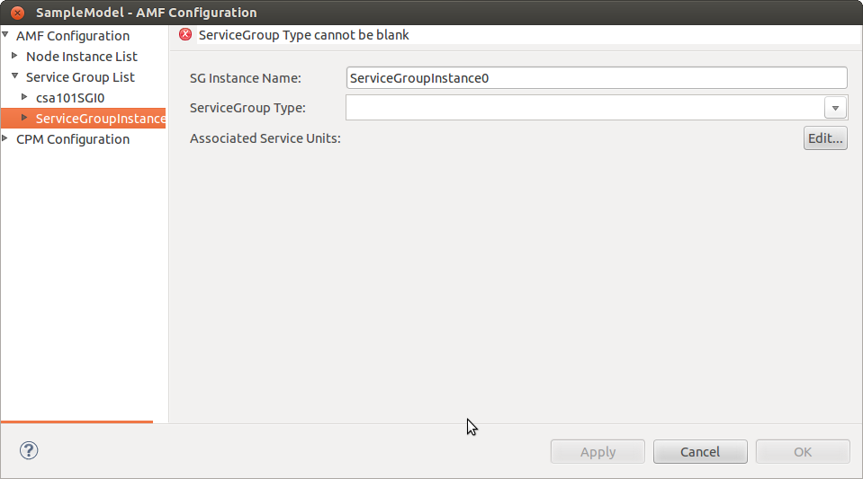

Enter the following information:

* **SG Instance Name:** Name of the Service Group (SG) instance.
* **ServiceGroup Type:** Type of the SG. The content of this list will differ based on the model.
* **Associated Service Units Details:** Click **Edit** to enter the associated SU details.

The **Select Service Unit** window is displayed.

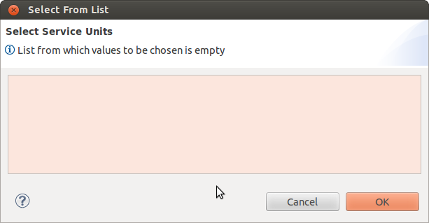

Select the SU and click **OK**.

Specifying Service Instance for each Service Group Instance
"""""""""""""""""""""""""""""""""""""""""""""""""""""""""""
Double-click on the newly created SG to display the **Service Instance List**. Right-click and select **New** to create a new SI. 
The **Service Instance Details** pane is displayed.

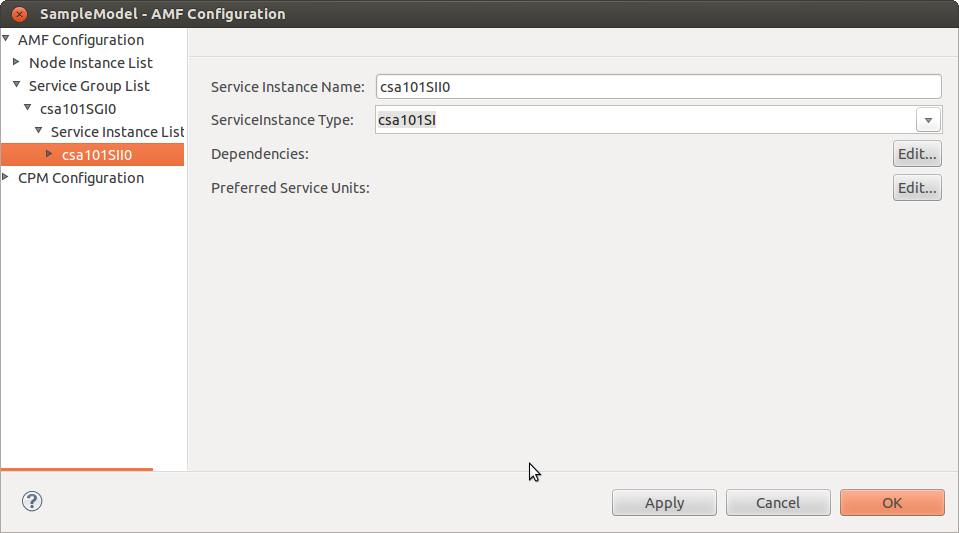

Enter the following information:

* **Service Instance Name:** Name of the Service Instance.
* **ServiceInstance Type:** Type of the Service Instance. Select the type from the list.
* **Dependencies:** Click **Edit** to specify the dependencies for the Service Instance. The **Select Service Instance Dependencies** 
  window is displayed.

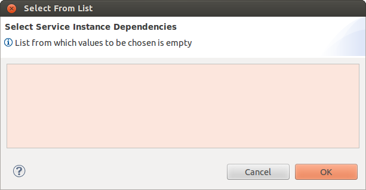

* Select the dependency and click **OK**.
* **Preferred Service Units:** Click **Edit** to specify the preferred Service Units. The **Select Service Units** window is displayed.

* Select the Service Unit and click **OK**.

Specifying Component Service Instance for each Service Instance
"""""""""""""""""""""""""""""""""""""""""""""""""""""""""""""""
Double-click the newly created SI to display the **Component Service Instance List**. Right-click and select **New** to create a 
new CSI. The **Component Service Instance Details** pane is displayed.

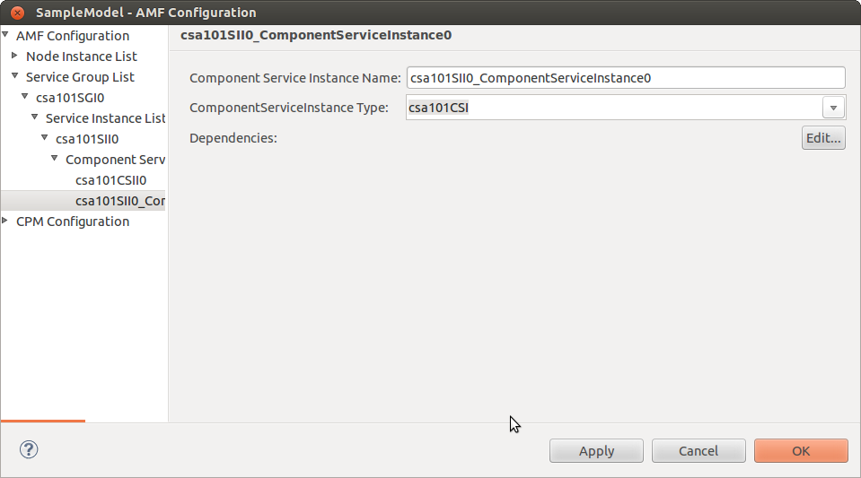

Enter the following information:

* **Component Service Instance Name:** Name of the Component Service Instance.
* **ComponentServiceInstance Type:** Type of the Component Service Instance. Select the type from the list.

  .. note::
    This field will be blank if the model is not designed with a CSI properly.

* **Dependencies:** Click **Edit** to specify the CSI Dependencies within same SI. The **Select Component Service Instance 
  Dependencies** window is displayed.

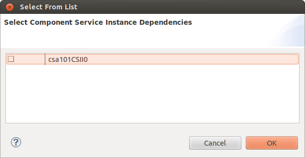

Select the **Component Service Instance** and click **OK**.

Configuring CPM
---------------
CPM Configuration is used for node configuration. CPM configuration for each node displays the CPM type, specifying whether the 
node is a local or global node. The OpenClovis Service Units can be chosen for the node from the list window. There are some basic 
OpenClovis Service units to be selected which are mandatory for the system to work.

CPM Configuration is done for the nodes that have been defined.

* **CPM Type:** This can be either 'LOCAL' or 'GLOBAL'.

  * 'LOCAL' type means that it is worker(non system controller) node.
  * 'GLOBAL' type means that it is a System Controller node.
  * For more information, refer to the functional description of AMF.

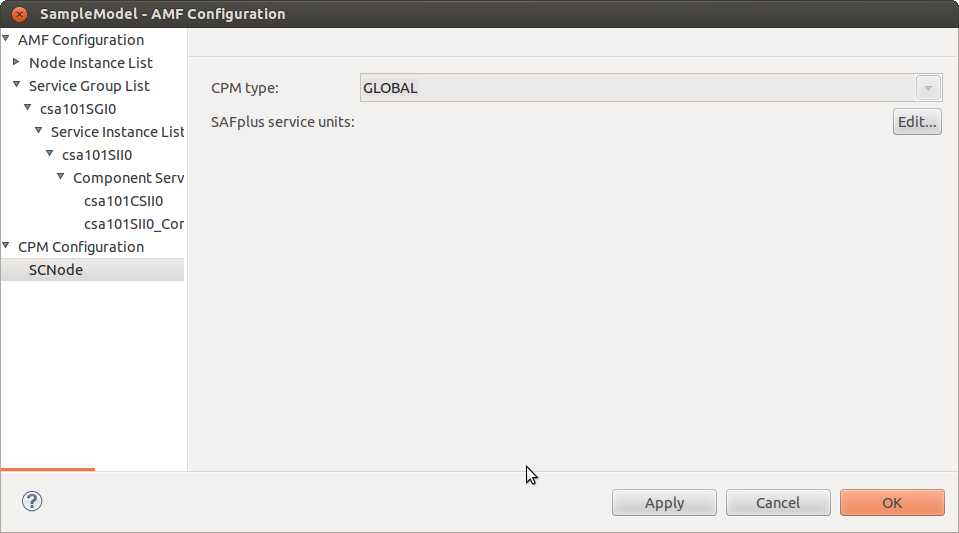

* **ASP Service Units:** Corresponding Service Units for the node can be selected or deselected from here. To edit the **ASP Service 
  Units**, click **Edit**.... The Select **ASP Service Units** window is displayed. Select or deselect the Service Units. Click **OK**.

  * For 'LOCAL' node all the required SUs are by default selected and user can also select or deselect the SUs.
  * For 'GLOBAL' node, all the required SUs are by default selected and user can also select or deselect the SUs except corSU.

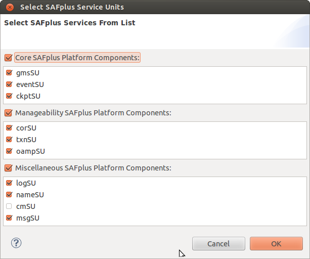

.. note::
    The number of nodes will depend on the nodes that are defined for this model.
