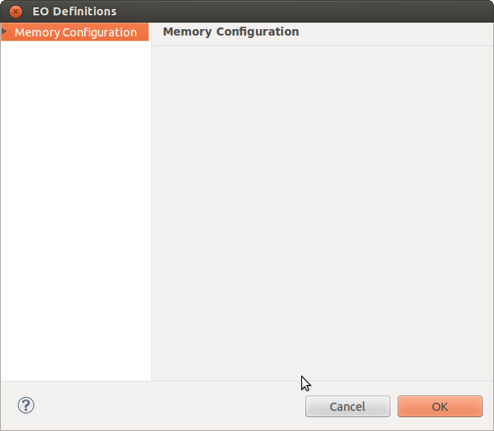
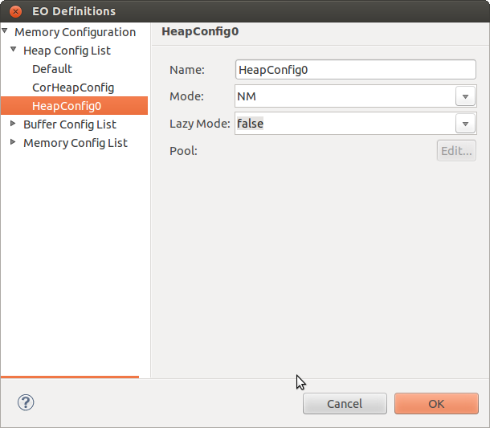
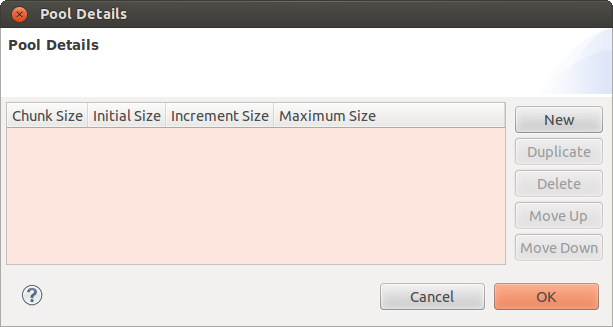
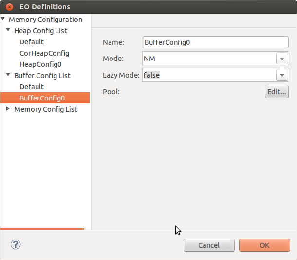
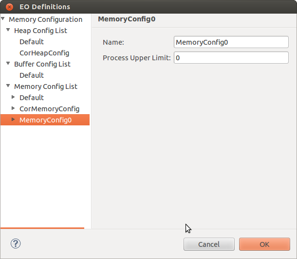
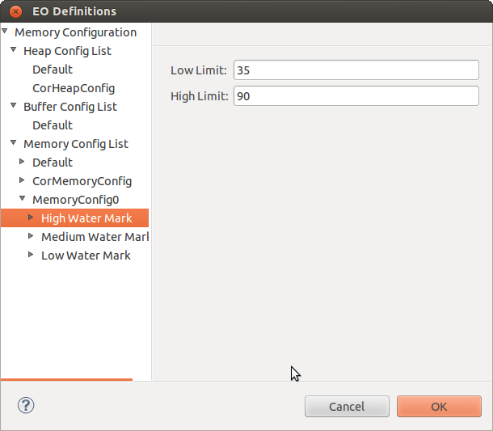
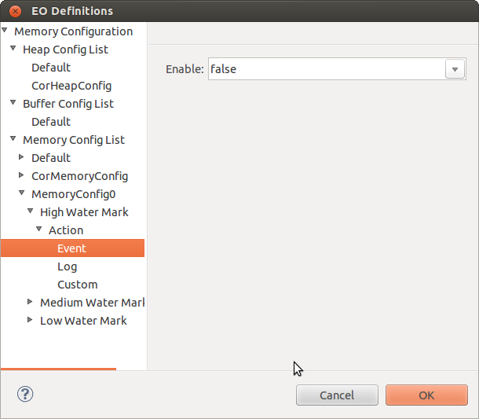
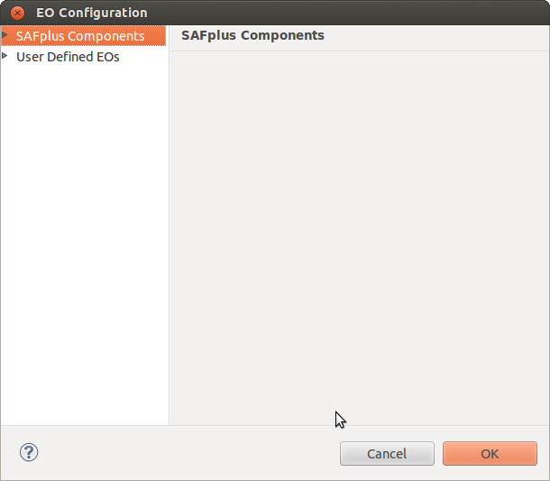
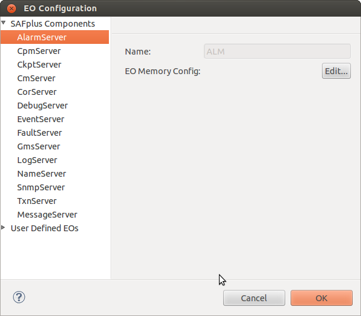
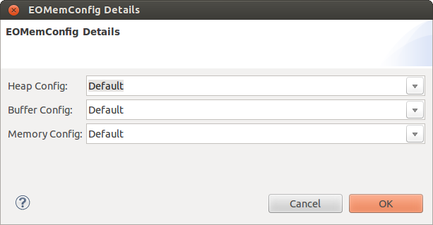

Chapter 9: Configuring and Allocating Memory Configuration Profiles
===================================================================
This chapter provides information about configuring and allocating memory configuration profiles to the various ASP components and 
the user-defined EOs.

**Key Topics:**

* Defining Memory Configuration Profiles
* Assigning Memory Configuration Profiles to Components

Defining Memory Configuration Profiles
--------------------------------------
The memory configuration profiles are defined in the **EO Definitions** window. You can also use the default memory configuration profiles.

From the **Clovis** menu, click **EO Definitions** to open the **EO Definitions** window.

You can specify the following types of memory profiles:

* Heap
* Buffer

Creating Heap Memory Profile
^^^^^^^^^^^^^^^^^^^^^^^^^^^^
Heap memory is used for dynamic memory allocation. Memory is allocated from a large pool of unused memory area called the heap. The 
size of the memory allocation can be determined at run-time. Heap includes all the pools of various chunk sizes.

To create a Heap memory profile:

1. In the **EO Definitions** window, double-click **Memory Configuration** in the left pane. Right-click **Heap Config List** and 
   select **New**.

2. Enter the following information:

* **Name:** Name for the heap memory profile.
* **Mode:** Type of the heap allocation mode. The options available are:

  * **NM:** This is the Native C Mode. In this mode, all requests are served by calling the OS memory allocation interface. It maps 
    to the memory APIs provided by libc.
  * **PAM:** This is the Pre Allocated Mode. It is the OpenClovis provided implementation of the memory management library. A large 
    chunk of the memory is pre-allocated during component initialization. The memory space is divided into pools of diverse memory 
    chunks and serves runtime dynamic memory allocation requests.
  * **CM:** This is the Custom Mode. You can plug-in customized memory management library calls.

* **Lazy Mode:** Configure the pool in lazy mode for pool expansion. When a pool exhausts its current allocation, it can still grow provided the dynamic memory space or the pool upper limit is not reached. It expands or grows by the increment size specified for the pool. In Lazy Mode, the incremented pool does not initialize until an allocation is made from that pool. In normal mode, the incremented pool initializes as soon as it is acquired by the memory management library.

Set the option to true or false.

* **Pool:** Click **Edit** to enter the pool details. **The Pool Details** window is displayed.

.. note::
    You can specify the pool details only if the allocation mode type is PAM.

Click **New** and enter the following information:

* **Chunk Size:** Piece of memory within the pool.
* **Initial Size:** Initial pool size for each pool.
* **Increment Size:** When the pool usage exceeds the initial size, the pool size grows by the increment size, unless the upper limit 
  is already reached or the dynamic memory space is reached.
* **Maximum Size:** Maximum pool size for each chunk size.

If the memory usage exceeds the initial pool size, the memory manager requests for more memory (using the configured increment) from 
the system as long as the new pool size or the total dynamic memory usage does not exceed the specified upper limits.

The values are expressed in bytes.

Click **OK** The pool details are saved.

3. Click **OK** to save the memory profile.

Creating Buffer Memory Profile
^^^^^^^^^^^^^^^^^^^^^^^^^^^^^^
The Buffer Memory provides buffers that can expand or shrink dynamically based on application requirement. The Buffer Memory is 
designed to provide an efficient method for management of user space buffer by avoiding data copy. It stores data for quick, 
temporary access.

The Buffer memory enable you to perform various functions such as, creating or deleting a message, and reading, writing and trimming 
the number of bytes from a message.

To create a Buffer memory profile:

1. In the **EO Definitions** window, double-click **Memory Configuration** in the left pane. Right-click **Buffer Config List** and 
   select **New**.

2. Enter the following information:

* **Name:** Name for the buffer memory profile.
* **Mode:** Type of the heap allocation mode. The options available are:

  * NM
  * PAM

* **Lazy Mode:** Set this option to true or false.
* **Pool:** Click **Edit** to enter the pool details. The **Pool Details** window is displayed.

Click **New** and enter the following information:

* **Chunk Size:** Piece of memory within the pool.
* **Initial Size:** Initial pool size for each chunk size.
* **Increment Size:** When the memory usage exceeds the initial size, the chunk size grows by the increment size, unless the upper 
  limit is already reached.
* **Maximum Size:** Maximum pool size for each chunk size. Click **OK**. The pool details are saved.

3. Click **OK** to save the memory profile.

Setting the Total Dynamic Memory Space, Watermarks, and Actions
^^^^^^^^^^^^^^^^^^^^^^^^^^^^^^^^^^^^^^^^^^^^^^^^^^^^^^^^^^^^^^^
You can specify the total memory usage space and also set three levels of watermark on the total memory consumption for each 
component instance. For each watermark the following attributes are configurable:

* Lower Limit Value for downward crossing
* Upper Limit Value for upward crossing
* Set of actions to be executed in case the threshold limit is crossed. The actions include event posting, logging, notifications, 
  and alarm generation.

For example, when 80% watermark is reached, a log message is logged.You can further alter the watermarks during run-time using MO 
instances that are associated with the software component instances.

To set the memory space:

1. In the **EO Definitions** window, double-click **Memory Configuration** in the left pane. Right-click **Memory Config List** and 
   select **New**.

2. Enter the following information:

* **Name:** Name for the memory profile.
* **Process Upper Limit:** Upper limit for the total memory consumption.

Double-click the profile to display the three levels of watermark:

* High Water Mark
* Medium Water Mark
* Low Water Mark

on each Water Mark and enter the following information:

* **Low Limit:** Memory limit value for downward crossing in bytes.
* **High Limit:** Memory limit value for upward crossing in bytes.

4. Double-click each Water Mark to specify one or all of the following actions:

* Event
* Log
* Custom

5. Click **Event** and select **true** or **false** from the drop-down list. If it is set to **true** , event is enabled. Similarly, 
   you can enable Log and Custom actions.
6. Click **OK** to save the memory profile.

Assigning Memory Configuration Profiles to Components
-----------------------------------------------------
After you have completed creating the memory configuration profiles, you can assign them to the various ASP components and the 
user-defined EOs in the **EO Configuration** window. By default, the **Default** memory configuration profile is associated to the 
components.

To assign the memory configuration profile to the SAFPlus components or user defined components:

1. From the **Clovis** menu, click **EO Configuration** or click the icon on the toolbar. The **EO Configuration** window is displayed.

2. Click **SAFPlus Components** to assign memory configuration profiles to 'SAFPlus components. The 'SAFPlus component list is displayed.

   or

   Click **User Defined EOs** to assign memory configuration profiles to user defined components.

3. Select the component to which you need to assign the memory profile.

4. Click **Edit** for **EO Memory Config**. The **EOMemConfig Details** window is displayed.

5. Select the default or user-defined memory configuration profiles for Heap, Buffer, and Memory.

6. Click **OK** to save and close **EOMemConfig Details** window.

7. Click **OK** to close the **EO Configurations** window.
