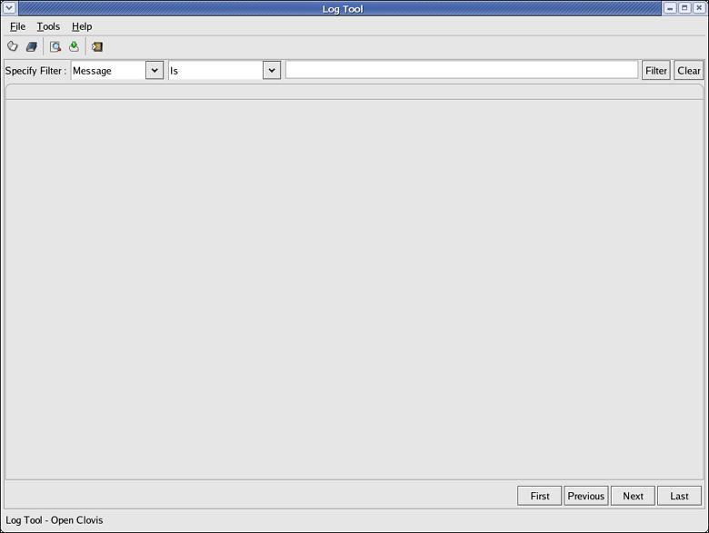
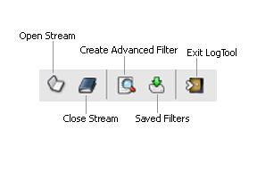

.. _log-tool-gd-label:

LogTool User's Guide
====================

Preface
-------
**OpenClovis Log Tool User Guide** provides information about the usage of OpenClovis Log Tool. OpenClovis Log Tool is an interactive 
utility that allows you to view binary log files in a readable format and hence monitor system errors, warnings, and other log 
information. By analyzing this information, you can troubleshoot the errors. These log files are in raw format and hard to read. Log 
Tool allows you to format the files and filter them for the required entries.

Document Organization
^^^^^^^^^^^^^^^^^^^^^
This guide is organized into various chapters to provide information on specific areas. The following table introduces the chapter 
names and a brief overview of the content.

+-------------------+-------------------------------------------------------------------------------------+
| Chapter           | Overview                                                                            |
+===================+=====================================================================================+
| Preface           | This chapter gives an introduction to OpenClovis Log Tool.                          |
+-------------------+-------------------------------------------------------------------------------------+
| Available Tools   | This chapter helps you understand the conceptual information, advantages and key    |
|                   |                                                                                     |
|                   | features of OpenClovis Log Tools. It provides information to access the available   |
|                   |                                                                                     |
|                   | Log Tools, Command Line Log Tool and Offline GUI Log Tool.                          |
+-------------------+-------------------------------------------------------------------------------------+

Related Documents
^^^^^^^^^^^^^^^^^
For additional information about OpenClovis products, refer to the following guides:

* **OpenClovis Release Notes** provides information about the software and the hardware required to install OpenClovis Application 
  Service Platform (SAFplus Platform) and Integrated Development Environment (IDE). It contains the additional features and enhancements 
  of the product since the previous release. It also summarizes the issues and limitations of the product and provides workarounds wherever applicable.
* **OpenClovis SA Forum Compliance** describes the level of compliance of OpenClovis SAFplus Platform and its Application Programming 
  Interface (API) with the relevant Service Availability Forum Specifications.
* **OpenClovis Installation Guide** provides the system requirements, installation procedure for OpenClovis SAFplus Platform, IDE, and 
  the Evaluation System.
* **OpenClovis Sample Application Tutorial** provides the steps to create and build a sample model using OpenClovis IDE and OpenClovis 
  SAFplus Platform. It also provides troubleshooting information for this process. This provides the logical first step in understanding 
  the OpenClovis offering.
* **OpenClovis Evaluation System User Guide** provides all the required information to configure and run the sample models packaged 
  within the Evaluation System. This document also provides good understanding of OpenClovis SAFplus Platform's functionality. This is 
  the natural follow on to the OpenClovis Sample Application Tutorial as it builds on the example created in that document.
* **OpenClovis SDK User Guide** provides information about OpenClovis Application Service Platform (SAFplus Platform) architecture, 
  various OpenClovis SAFplus Platform components, and their interactions. This guide helps you to configure the OpenClovis SAFplus 
  Platform components, compile, and execute the OpenClovis SAFplus Platform code to build your custom application.
* **OpenClovis IDE User Guide** describes the usage of Integrated Development Environment (IDE), a graphical development environment 
  that complements the SAFplus Platform platform. This guide helps you to understand how to use the various features of the IDE to build 
  the application.
* **OpenClovis API Reference Guide** is provided for each component. It describes the Application Programming Interface (API), Service 
  Model, and Management Information Model of the various OpenClovis Application Service Platform (SAFplus Platform) services. It helps 
  the developer to understand the capabilities of the SAFplus Platform services and the APIs provided by these services.
* **OpenClovis SAFplus Platform Console Reference Guide** provides details about managing applications built on OpenClovis SAFplus 
  Platform using the SAFplus Platform runtime debug console commands. SAFplus Platform Console commands can be used to manage, monitor, 
  and test your application.

OpenClovis Online Technical Support
^^^^^^^^^^^^^^^^^^^^^^^^^^^^^^^^^^^
OpenClovis customers and partners can register on our Web site and receive personalized services and information. If you need any 
support or assistance while working on OpenClovis products, you can access the following: `openclovis.com <https://www.openclovis.com/>`__. 
Send your queries to: support@openclovis.com. Open source community support is available at: `openclovis.org/forum <http://www.openclovis.org/forum/>`__.

Documentation Feedback
^^^^^^^^^^^^^^^^^^^^^^
We are interested in hearing from our customers on the documentation provided with the product. Let us know your comments and 
suggestions on improving the documentation at OpenClovis Inc. Send your comments to: support@openclovis.com. Or even better, 
edit (or comment in) the page on our documentation wiki located at `help.openclovis.com <http://help.openclovis.com/>`__.

Available Log Tools
-------------------
Log files come in 2 flavors, binary and ASCII. ASCII files are easily viewable using standard Linux editors and tools (vi, emacs, 
tail, etc). By default OpenClovis writes all of its logs in ASCII format. However you may want to change this to binary format or 
create your own binary format logs. For the binary format logs OpenClovis provides access using following tools:

* :ref:`Command Line Log Tool <log-tool-gd-cli-label>`
* :ref:`Offline GUI Log Tool <log-tool-gd-gui-label>`

.. _log-tool-gd-cli-label:

Using Command Line Log Tool
^^^^^^^^^^^^^^^^^^^^^^^^^^^
The online log viewer is a command line utility which may be used to view the Log Records present in the binary log files. The online 
log viewer only works on binary log files. To view an ASCII log file simply open them with your favorite editor.

The online log viewer displays the log records after some required conversion. It converts the ``Severity``, ``StreamId``, ``ComponentId`` 
to their corresponding names. This conversion is done using information present in metadata file (cfg file) corresponding to each log 
file. By default, the online log viewer displays the following fields of a log record:

* ``SeverityName``
* ``StreamName``
* ``ComponentName``
* ``ServiceId``
* ``MessageId``
* ``TimeStamp``
* ``Message``

.. note::
    Its very rare that log viewer does not find the stream id to stream name mapping in cfg file. If it does not then it would display 
    the stream id in place of stream name. Same holds true for component id to component name mapping. In this situation it would not 
    be possible to apply filter on that field.

Online log viewer executable ``asp_binlogviewer`` is deployed in ``bin`` directory of the SAFplus Platform. This online log viewer may 
be used in following ways:

* To view log records present in a log file (or a set of log files when multiple log files are present for a logical log file) in real 
  time i.e. when logging is going on. In this case it seeks to the latest record and starts displaying the record from that point 
  (which can even be the last record of the log file). As the Log Server writes, this Log Tool tails the files and prints it to the 
  Console. It automatically detects file rollover and tails the new file. Usage:

  .. code-block:: text

    asp_binlogviewer -l <log_file_prefix> 
                    [-f <filter>] 
                    [-t <msg_id_map_file>] 
                    [-p <num_prev_recs>] 
                    [-c <column(s)>] 
                    [-a] [-h|--help]

* To convert a binary log file to its corresponding text file (this text file contains the log records in exactly the same format as 
  it is displayed on the console). Usage:

  .. code-block:: text

    asp_binlogviewer -L <log_file_path> 
                    [-C <cfg_file_path>] 
                    [-t <msg_id_map_file>] 
                    [-h|--help]

  .. note::
    User may convert a binary log file to its corresponding text file when logging is going on as well as when it has stopped.

Viewing log records in real time
""""""""""""""""""""""""""""""""

Specify the location of log files
'''''''''''''''''''''''''''''''''
``-l``: This is the mandatory option for viewing records in real time.

It is used to specify the common prefix to log files (symbolic links to log files) on file system. ``<log_file_prefix>`` is common 
prefix of log file names.

**Example:**

The log files are ``/tmp/logFile.0`` ``/tmp/logFile.1`` and ``/tmp/logFile.2``.

.. code-block:: text

    $ASP_BINDIR/asp_binlogviewer -l /tmp/logFile

Setting Filter on a header field
''''''''''''''''''''''''''''''''
``-f``: User may specify filter on one of the header fields

``<filter>`` should be specified as:

.. code-block:: text

    "<header field><comparision operator><value>"

``<header field>`` options:

* ``s`` - SeverityName
* ``r`` - StreamName
* ``c`` - ComponentName
* ``v`` - ServiceId
* ``t`` - TimeStamp
* ``m`` - MessageId

``<comparision operator>`` options:

* ``=`` - Equal To
* ``!=`` - Not Equal To
* ``<`` - Less Than
* ``<=`` - Less Than and Equal To
* ``>`` - Greater Than
* ``>=`` - Greater Than and Equal To

Possible ``<value>`` in a filter:

* ``String`` for following fields : SeverityName, StreamName, ComponentName
* ``HH:MM:SS`` for TimeStamp
* ``Integer`` for following fields : ServiceId, MessageId

**Example:**

Set filter on stream name (StreamName) ``CL_LOG_APPLICATION``

.. code-block:: text

    $ASP_BINDIR/asp_binlogviewer -l <log_file_prefix>  -f "r=CL_LOG_APPLICATION"

For time stamp having value greater than ``4.30pm`` ...

.. code-block:: text

    $ASP_BINDIR/asp_binlogviewer -l <log_file_prefix>  -f "t>16:30:00"

Specify TLV mapping file
''''''''''''''''''''''''
``-t``: This option is used when log files contain records of TLV (tag length value) format.

Specify complete path to TLV mapping file.

**Example:**

``tlvmap.txt`` contains the TLV mapping for log records of log file ``/tmp/sys.0``

.. code-block:: text

    $ASP_BINDIR/asp_binlogviewer -l /tmp/sys -t tlvmap.txt

Following is a sample TLV map file which contains message id to TLV message mapping. TLV File content should be in following format:

.. code-block:: py3

    Message_ID<space>Message containing %TLV 
    
    # where <space> is a single space.

.. note::
    All the %TLV are replaced by their corresponding values from log record's tag, length, value information for that message id.

Following are the sample content of a TLV map file ``tlvmap.txt``:

.. code-block:: text

    5 Component %TLV was unble to start on node %TLV
    6 State Change: Entity [%TLV] Operational State (%TLV -> %TLV) AMF (%TLV)
    7 Registering Component %TLV via eoPort %TLV
    8 Extending %TLV byte pool of %TLV chunkSize

This file contains the message id to string mapping for TLV (tag lengh value) messages. '%TLV' of tlv strings are replaced by the 
corresponding value found in the log record.

Display previous log records
''''''''''''''''''''''''''''
``-p``: Display ``<num_prev_recs>`` previous log records and exit

``<num_prev_recs>`` is the number of previous log records to be displayed. If user specifies a number greater than the maximum log 
records or number of log records actually present in all the log files then entire log is displayed.

**Example:**

View 10 previous records

.. code-block:: text

    $ASP_BINDIR/asp_binlogviewer -l <log_file_prefix> -p 10

Display only selected fields of Log Record
''''''''''''''''''''''''''''''''''''''''''
``-c``: Display selected field(s) of Log Record

User may choose to display only selected fields of log record. This can be achieved by using ``-c`` option where the numbers are 
separated by ','.

The default columns are:

#. ``SeverityName``
#. ``StreamName``
#. ``ComponentName``
#. ``ServiceId``
#. ``MessageId``
#. ``TimeStamp``
#. ``Message``

**Example:**

Display only the following fields: ``StreamName``, ``ServiceId``, ``TimeStamp``

.. code-block:: text

    $ASP_BINDIR/asp_binlogviewer -l <log_file_prefix> -c 2,4,6

Display records present in entire log file(s)
'''''''''''''''''''''''''''''''''''''''''''''
``-a``: Display entire log and exit

This option displays all the log records present in a log file or all log files when multiple log files are present for single logical 
file.

**Example:**

Display all the log records which file ``/tmp/sys.0`` contains

.. code-block:: text

    $ASP_BINDIR/asp_binlogviewer -l /tmp/sys -a

Convert a binary log file to text file
""""""""""""""""""""""""""""""""""""""

Specify complete path to log file
'''''''''''''''''''''''''''''''''
``-L``: <log_file_path> is complete path to a log file.

``-C``: <cfg_file_prefix> is prefix to cfg (metadata) file. This is an optional argument which is required when log file name and 
prefix of cfg file are different.

``-t``: If log file contains TLV messages then please specify TLV file path using this option.

If log file is ``/tmp/logFile`` the corresponding text file will be ``/tmp/logFile.txt``

**Example:**

When log file name and prefix of cfg files are the same (log file is ``/tmp/sys_2007-04-18T18:58:36`` and cfg file is 
``/tmp/sys_2007-04-18T18:58:36.cfg``):

.. code-block:: text

    $ASP_BINDIR/asp_binlogviewer -L /tmp/sys_2007-04-18T18:58:36 

**Example:**

When log file name and prefix of cfg files are different (log file is ``/tmp/sys_2007-04-18T18:58:37`` and cfg file is 
``/tmp/sys_2007-04-18T18:58:36.cfg``):

.. code-block:: text

    $ASP_BINDIR/asp_binlogviewer -L /tmp/sys_2007-04-18T18:58:37 \
                                 -C /tmp/sys_2007-04-18T18:58:36

For detailed help
"""""""""""""""""
``--help`` or ``-h``: Display help and exit

.. code-block:: text

    $ASP_BINDIR/asp_binlogviewer -h
    $ASP_BINDIR/asp_binlogviewer --help

Command line log tool Output Format
"""""""""""""""""""""""""""""""""""
As the Log Server writes, this Log Tool tails the files and prints it to the Console. It automatically detects file rollover and tails 
the new file.

**The output is of the form:**

.. code-block:: text

    SEVERITY STREAMNAME COMPONENTNAME SERVICEID MESSAGEID TIMESTAMP MESSAGE

**For example:**

.. code-block:: text

    DEBUG applogs cpmServer_SysController_1 10 0 {Mon Jan 22 17:41:08 2007} \
    ( 0x6d 0x53 0x27 0x2a 0x97 0x22 0x1e 0x34 )

Where:

* ``DEBUG`` is the Severity
* ``applogs`` is the Stream Name
* ``cpmServer_SysController_1`` is the Component Name
* ``10`` is the Service ID
* ``0`` is the Message ID which indicates that it is BUFFER type Binary Message. Message ID 1 is for ASCII message and it is not 
  supported by log viewer, Message IDs other than 0 and 1 are of TLV type Binary Message.
* ``{Mon Jan 22 17:41:08 2007}`` is the Time Stamp
* ``( 0x6d 0x53 0x27 0x2a 0x97 0x22 0x1e 0x34 )`` This is the hex value of each message byte separated by a space.
* online log viewer doesn't interpret the message part in case of BUFFER type records, it simply prints each byte of the message.

.. _log-tool-gd-gui-label:

Using Offline GUI Log Tool
^^^^^^^^^^^^^^^^^^^^^^^^^^
OpenClovis Offline Log Tool is an interactive GUI utility that allows you to view log files in a readable format and provides support 
for navigation, filtering and sorting of the log records. The Offline Log Tool only works on binary log files. To view ASCII log file 
simply open them with your favorite editor.

Getting Started
"""""""""""""""
This provides information to launch the GUI Log Tool and helps you familiarize with its features.

How To Launch?
''''''''''''''
The Log Tool is installed in the ``<installation_directory>/sdk-3.0/bin`` directory during OpenClovis SDK installation.

If you have created the symbolic links during OpenClovis SDK installation, execute the following command:

.. code-block:: console

    # cl-log-viewer

If you have not created the symbolic links during OpenClovis SDK installation, go to the ``<installation_directory>/sdk-3.0/bin`` 
directory and execute the **same command**.

Alternatively, you can go to the ``<installation_directory>/sdk-3.0/logviewer`` directory and execute the following command:

.. code-block:: console

    # ./logViewer.sh

.. note::
    Using ``cl-log-viewer`` approach to launch the Log Tool is encouraged.

The **Log Tool** window is displayed.

Using Menus
'''''''''''
Log Tool has the following three menus:

* **File** - The File menu has options that allow you to open a file, close the current open file, close all open files, and exit the 
  tool.
* **Tools** - The Tools menu has options that allow you to create and save filters, access the saved filters, and configure settings 
  for the filter location and the mapping file.
* **Help** - The Help menu provides information about the Log Tool.

Using Toolbar
'''''''''''''
The add-on icons for the Log Tool are as shown.

* **Open Stream icon** - Use this icon to open a Log file.
* **Close Stream icon** - Use this icon to close a Log file.
* **Create Advanced Filter icon** - Use this icon to create, apply, and save filters.
* **Saved Filters** - Use this icon to apply the saved filter to a set of records.
* **Exit Log Tool** - Use this icon to close the **Log Tool** window.

Viewing Log Files
"""""""""""""""""
This section provides information to open log files, use filters to customize views, configure the user directory, and mapping file 
locations.

Opening Log File
''''''''''''''''
To open a Log file:

1. From the **File** menu, click **Open** or press **Ctrl+O**. The **File Selection Dialog** dialog box is displayed.

   .. image:: ../images/logtoolguide/LogTool_FileSelectionDialog.jpg

2. Enter the following:

   * **Log File** - Click **Browse**. The Select **Log File** dialog box is displayed. Specify the binary Log file that you need to 
     view. The log file has the log records in the binary format. Click **OK**. The **Select Log File** dialog box closes.

   .. image:: ../images/logtoolguide/LogTool_SelectLogFile.jpg

   * **Config File** - Click **Browse**. The Select **Config File** dialog box is displayed. Specify the configuration file that 
     configuration data (such as record length, component ID mapping, and stream ID mapping) for the log file. Click **OK** . The Select 
     **Config File** dialog box closes.

   .. image:: ../images/logtoolguide/LogTool_SelectConfigFile.jpg

3. In the **File Selection Dialog** dialog box, click **OK**. The selected Log file opens in the **Log Tool** window.

   .. note::
    Validations are performed to check if you have specified the correct files. If the files are not correct, the corresponding error 
    message is displayed.

   .. image:: ../images/logtoolguide/LogTool_OpenedLogFile.jpg

Sorting Log Records
'''''''''''''''''''
You can click each column header to sort the entries. Every time you click the column header, the direction of sorting changes. 
Sorting is applicable for the current batch of records only.

Listing Log Records
'''''''''''''''''''
The following options are provided for listing Log Records:

* Click **First** to view the first batch of records.
* Click **Next** to view the next batch of records.
* Click **Previous** to view the previous batch of records.
* Click **Last** to view the last batch of records.

Using Filters
"""""""""""""
This chapter provides information on using basic filter, creating and saving filter and using saved filters.

A typical log file generally contains large number of entries. When you need to troubleshoot a problem, only certain entries may be 
relevant. For example, you may need to view logs with severity level 3. You can use filters to view the log file based on certain 
criteria to create customized views. You can also save the filter criteria and use it at a later time.

Using Basic Filter
''''''''''''''''''
Basic filter comprises the drop-down lists available in the **Log Tool** window.

To filter records using the basic filter:

1. From the first drop-down list, select the filtering option. The options available are:

   * ``Record Number``
   * ``Severity``
   * ``StreamId``
   * ``ComponentId``
   * ``ServiceId``
   * ``TimeStamp``
   * ``MessageId``
   * ``Message``

2. From the second drop-down list, select the type of filtering. The options in this list is displayed based on your selection in the 
   first drop-down list.
3. Based on these two selections, you can perform one of the following:

   * In the text box, enter the filter criteria.
   * In the value selector, specify a value.

   .. note::
    If you select ``TimeStamp`` as the filter type in the first drop-down list, you need to specify the date and the time as the values.

4. Click **Filter**. The records are filtered and displayed based on the specified criteria. Figure Filtered List shows the records 
   filtered based on Severity 2.

   .. image:: ../images/logtoolguide/LogTool_FilteredList.jpg

5. Click **Clear** to clear the applied filter and display the records from the start of the file.

   The following table provides information about the various filter options and the types:

+------------------------+-------------------------------------------------+
| Filter Option          | Filter Type                                     |
+========================+=================================================+
| ``Message``            | - Is                                            |
|                        | - Is Not                                        |
|                        | - Contains                                      |
|                        | - Does Not Contain                              |
|                        | - Starts With                                   |
|                        | - Does not start with                           |
|                        | - Ends With                                     |
|                        | - Does not End With                             |
+------------------------+-------------------------------------------------+
| - ``Severity``         | - =                                             |
| - ``StreamId``         | - <                                             |
| - ``ComponentId``      | - >                                             |
| - ``ServiceId``        | - <=                                            |
| - ``TimeStamp``        | - >=                                            |
| - ``Record Number``    | - Between                                       |
| - ``MessageId``        | - Range                                         |
+------------------------+-------------------------------------------------+

.. raw:: html

   

.. rst-class:: center

**Filter Options and Types**

Creating and Saving Filter
''''''''''''''''''''''''''
You can create and save filters so that you can apply the saved filters to a set of records at a later time.

To create a filter:

1. From the **Tools** menu, click **Advanced Filter** or press **Ctrl+F**. The **No previous Filter** dialog box is displayed if you 
   are creating a filter for the first time. Otherwise, the **Advanced Filter** window is displayed.

   .. image:: ../images/logtoolguide/LogTool_NoPreviousFilter.jpg

2. Click **OK**. The **Advanced Filter** window is displayed.

   .. image:: ../images/logtoolguide/LogTool_AdvancedFilter.jpg

3. Enter the following information:

   * **Filter Name:** This is the name for the new filter.
   * **Filter Type:** Select the type of the filter. The available options are:

     * AND - Select this option if you need all the criterion to be satisfied.
     * OR - Select this option if at least one of the criteria has to be satisfied.

   * Click **Create Filter Criterion** to specify the criterion in the drop-down lists.
   * From the first drop-down list, select the filtering option.
   * From the second drop-down list, select the type of filtering. The options in this list is displayed based on your selection in 
     the first drop-down list.
   * Based on these two selections, in the text box, enter the filter criteria or specify a value.

   .. note::
    If you select ``TimeStamp`` as the filter type in the first drop-down list, you need to specify the date and the time as the values.

4. Click **Apply** to apply the filter to the existing records.
5. Click **Save** to save the filter.

Click **Remove** to remove a filter criteria.

Click **Cancel** to cancel creating the filter.

Using Saved Filter
""""""""""""""""""
To use a saved filter:

1. From the **Tools** menu, click **Saved Filters** or press **Ctrl+S**. The **Saved Filter** dialog box displays the list of saved 
   filters.

   .. image:: ../images/logtoolguide/LogTool_SavedFilters.jpg

2. Select the filter that you need to apply and click **Apply**. The selected filter is applied to the existing records.
3. To add more filters, click **Add**. The **Advanced Filter** window is displayed. For information to create and save a filter, refer 
   to the section Creating and Saving Filter.
4. To remove a saved filter, select the filter and click **Remove**. The selected filter is removed from the list.
5. Click **OK** to close the **Saved** Filters dialog box.
6. Click **Cancel** to cancel the process of applying a saved filter.

Configuring User Directory and Mapping File Location
""""""""""""""""""""""""""""""""""""""""""""""""""""
To configure the location for user-defined filters and mapping files:

1. From the **Tools** menu, click **Settings** or press **Ctrl+T**. The **Settings window** is displayed.

   .. image:: ../images/logtoolguide/LogTool_ConfigureLocation.jpg

2. Enter the following information:

   * **User Directory:** This is the directory where the created filters are saved. This must be an existing directory.
   * **TLV Mapping File:** This is the directory where the mapping file for the ``MessageId`` is stored. A log file represents the 
     MessageIds in a sequence of bytes. The mapping file contains the string representation for these MessageIds. If you specify a 
     mapping file, then the corresponding string representation for the MessageId is displayed when you open the Log file using the 
     Log Tool. If you do not specify the mapping file, then the MessageId is displayed as a sequence of bytes.

3. Click **Apply** to apply the configured locations to the current open Log file.
4. Click **OK** to save the settings.

Click **Restore Defaults** to restore the default locations.

Click **Cancel** to cancel the settings.

Closing Log File(s)
"""""""""""""""""""
To close a Log file, from the **File** menu, click **Close** or press **Ctrl+C**. The Log file that is currently open is closed.

To close all open Log files, from the **File** menu, click **Close All** or press **Ctrl+Shift+C**. All Log files that are open are closed.

Exiting Log Tool
""""""""""""""""
To exit from Log Tool, from the **File** menu, click **Exit** tor press **Ctrl+X**. The **Log Tool** window closes.
