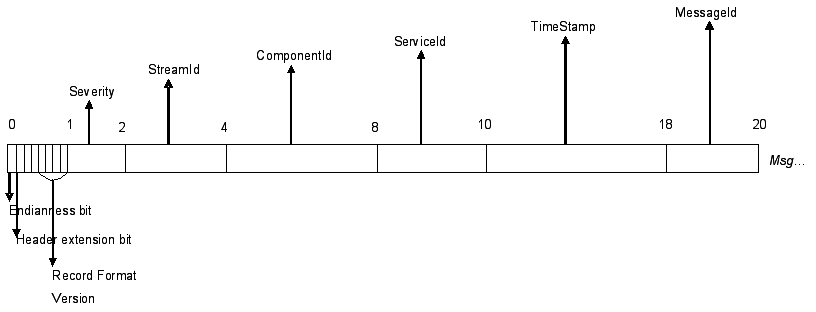

Basic Infrastructure
====================
It is well known that the standard C library contains deficiencies in scope, simply because it has not been updated to reflect 
modern programming needs. For example, while it does encapsulate standard operating services such as disk and terminal IO, it does 
not capture operating system services such as threads, and timers. It also does not provide a standard set of container data 
structures, like linked lists and hash tables. Additionally, various operating systems sometimes differ in their support for these 
newer services; to support multiple operating systems a compatibility layer must be written. Finally, certain operating system 
services are not sufficient for modern use or not sufficent for use within a clustered environment -- for example, the standard Unix 
timer allows only a single timer per process (we allow thousands), and the logging service has only minimal cluster support (we 
provide a fully cluster-aware logging system).

The Basic Infrastructure addresses these deficiencies by providing libraries that supply additional functionality, address 
insufficient APIs, and provide a compatibility layer. Additionally, the Basic Infrastructure handles the operational details of 
running within the OpenClovis distributed computing environment. These essential services, memory and data management are used by 
all the OpenClovis software and utilities. Customer applications are also welcome to use these APIs to take advantage of this 
infrastructure.

Components of Basic Infrastructure
----------------------------------
**Basic Services:**

* Log Service
* Operating System Abstraction Layer (OSAL)
* Timer Library
* SAFplus Platform Console
* Rule-Based Engine (RBE)
* Execution Object (EO)

**Memory Management:**

* Containers
* Circular List
* Queue Library
* Buffer Manager Library
* Heap Memory

**Data Management:**

* Database Abstraction Layer (DBAL)

Log Service
-----------
SAFplus Platform Log Service provides the facility of recording the information about various events of applications. Any 
application/SAFplus Platform component in the cluster can use the Log Service to record the information. Log Service persist the 
information recorded by its clients so that it is available for consumption at later points in time also. The consumer may be an 
offline consumer, consuming the information at some later point in time, or an online consumer, consuming the information as soon 
as it is generated. Log Service does not interpret the information recorded by its clients. It treats the information as octet stream 
and does not apply any semantic meaning to it.

**Features:**

* SAFplus/Log service provides high performance, low overhead logging.
* SAFplus/Log service supports ASCII, binary and Tag-Length-Value (TLV) logging.
* It provides support for LOCAL/GLOBAL streams.
* Log-levels can be changed during the operation.
* Redundancy support during failover and switch over.

Logging Types
^^^^^^^^^^^^^
There are three different kind of logging modes are supported by SAFplus/Log Service. They are as follows Binary logging, TLV logging 
and ASCII logging. During logging message msgId field of clLogWriteAsync() API will identify what kind of record is being logged. 
This msgId is typically an identifier for a string message which the viewer is aware of through off-line mechanism. Rest of the 
arguments of this function are interpreted by the viewer based on this identifier. By default, SAFplus Platform components log their 
messages as ASCII logging by using clLog() macro which intern puts the messages into predefined SYS stream using CL_LOG_HANDLE_SYS 
as handle.

* **ASCII Logging:** 
  There are two ways application can do ASCII logging. The first method is by calling clLogWriteAsync() with msgId field as 
  CL_LOG_MSGID_PRINTF_FMT, the second way is by calling clAppLog() macro.

* **Binary Logging:** 
  Binary logging should be done through clLogWriteAsync() API with msgId field as CL_LOG_MSGID_BUFFER.

* **TLV(Tag-Length-Value) Logging:** 
  TLV logging should be done through clLogWriteAsync() API with user defined msgIds other than CL_LOG_MSGID_BUFFER and 
  CL_LOG_MSGID_PRINTF_FMT.

Log Service Entities
^^^^^^^^^^^^^^^^^^^^

* **Log Record:** One unit of information related to an event. This is an ordered set of information. Log Record has two parts - header 
  and user data. Header contains meta-information regarding the event and data part contains the actual information. All information 
  related to one event is stored as one unit. This unit is known as Log Record.
* **Log Stream:** Log Records are grouped together based on certain client defined theme. This group is called Log Stream. These Log 
  Streams can be shared by various components of an application or of different applications. The theme and the users of a Log 
  Stream are defined by the application.
* **Log File:** One of the destination for Log Stream and persistent store for Log Records. A collection of Log Streams can flow into 
  one Log File for the ease of management of data.
* **Log Stream Attributes:** Each Log Stream is characterized by a set of attributes. These attributes are specified at the time of 
  creation of the Stream and can not be modified during the lifetime of that Stream. The attributes include the file name and the 
  location of the file where the Stream should be persisted, size of each record in the Log Stream, maximum number of records that 
  can be stored in one physical file, action to be taken when the file becomes full, whether the file has a backup copy and the 
  frequency at which the Log Records must be flushed. These attributes are specified through ClLogStreamAttributesT structure.
* **GLOBAL Log Stream:** All global streams will have unique name within the cluster with stream scope of CL_LOG_STREAM_GLOBAL. A 
  global stream is accessible throughout the cluster irrespective of where it is created.
* **LOCAL Log Stream:** All local streams will have unique name within the node with stream scope of CL_LOG_STREAM_LOCAL. A local 
  stream is restricted to local node.

Log Record Format
^^^^^^^^^^^^^^^^^
SAFplus/Log service follows two different record formats. Those are binary record format and ASCII record format.

Binary Record Format
""""""""""""""""""""
Binary record format is described as below.

* Byte 0 of Log Record has 3 fields

  * Bit 0 denotes endianess(Bit value 1 denotes little endian)
  * Bit 1 denotes Header extension bit, currently unused
  * Bit 2 - Bit 3 are currently unused
  * Bit 4 - Bit 7 denotes record format version, currently 0

* Byte 1 denotes severity with which the Log Record is logged
* Byte 2 - Byte 3 denotes StreamId of Log Stream to which the Log Record belongs
* Byte 4 - Byte 7 denotes ClientId of the component logging the record
* Byte 8 - Byte 9 denotes ServiceId of the component logging the record
* Byte 10 - Byte 17 denotes timestamp of the Log Record
* Byte 18 - Byte 19 denotes messageId of the message that follows it

Each log record contains a bit specifying the endianness of the format in which the log record is stored. This is the 0th bit of the 
0th byte. If the bit is set then the log record format is stored in little endian format otherwise on big endian.

First Byte that we put in configuration file, filename_<creationTime>.cfg, denotes the endianess of machine on which the File Handler 
is running. Again, value of 1 denotes little endian machine.

ASCII Record Format
"""""""""""""""""""
The ASCII record format contains only the log message. The content and format of the log message is left to the caller. In order to 
create coherent and consistent log records, the caller should define a consistent style and insert all desired meta data into each 
log record. These may include timestamp, severity, source process, etc. For convenience, OpenClovis provides a macro, clAppLog(), 
which takes care of consistent formatting by automatically inserting the following information into each log record:

* timestamp
* node name
* process pid number
* program (EO) name
* message number
* file name and line number (conditional)

In addition, the following structured information must be provided by the user as macro arguments:

* area name
* context name
* severity
* actual log message

Viewing Log Records of Different Types
^^^^^^^^^^^^^^^^^^^^^^^^^^^^^^^^^^^^^^

ASCII log records
"""""""""""""""""
To view an ASCII log file simply open them with your favorite editor.

Binary log records and TLV(Tag-Length-Value) records
""""""""""""""""""""""""""""""""""""""""""""""""""""
To view these two types of records OpenClovis provides following log viewing tools:

* Online log viewer ('asp_binlogviewer' present in $ASP_BINDIR directory)
* Offline log viewer ('cl-log-viewer' present in <installation_directory>/sdk-3.0/bin directory)

If the log file contains the log records of TLV type then user need to provide the TLV mapping file which contains user defined 
message id to actual log message mapping. Following is a sample TLV map file which contains message id to TLV message mapping. TLV 
File content should be in following format, where <space> is a single space:

.. code-block:: text

    Message_ID<space>Message containing %TLV

All the %TLV are replaced by their corresponding values from log record's tag, length, value information for that message id. 
Following are the sample content of a TLV map file tlvmap.txt:

* Component %TLV was unble to start on node %TLV
* State Change: Entity [%TLV] Operational State (%TLV -> %TLV) AMF (%TLV)
* Registering Component %TLV via eoPort %TLV
* Extending %TLV byte pool of %TLV chunkSize

For detailed usage of log view tools, please refer to **OpenClovis Log Tool User Guide**.

Log File and Its Characteristics
^^^^^^^^^^^^^^^^^^^^^^^^^^^^^^^^
Multiple Log Streams may be persisted in one Log File.

Local and Global streams can be mixed together in one Log File. But, in such a case, all the stream attributes other than flushFreq 
and flushInterval must be same.

Log File is a logical concept and it is a collection of physical files. Each such physical file is called a Log File Unit. 

In case the action on Log File being full is specified as CL_LOG_FILE_FULL_ACTION_HALT or CL_LOG_FILE_FULL_ACTION_WRAP, the Log File 
consists of only one Log File Unit, whereas if the action is CL_LOG_FILE_FULL_ACTION_ROTATE, one Log File contains multiple Log File 
Units.

Each Log File Unit is of same size specified as fileUnitSize in Log Stream Creation attributes. Maximum number of Log File Units in a 
Log File is governed by maxFilesRotated attribute of Log Stream. 

The Log File Unit names follow the following pattern: fileName_<creationTime>, where fileName is a stream attribute and 
<creationTime> is the wall clock time at which this Log File Unit is created, this time is in ISO 8601 format. 

One more file per Log File is generated with the name filename_<creationTime>.cfg to store the metadata of Log Streams being 
persisted in the Log File. This file contains attributes of the Log Streams going in this file and streamId to streamName mapping.

Log Service Configuration
^^^^^^^^^^^^^^^^^^^^^^^^^
The common log service parameters, and the configuration parameters of the perennial and precreated log streams are described in 
section **OpenClovis SAFplus Platform Component Configuration**.

Controlling Logging Behavior from the Applications
^^^^^^^^^^^^^^^^^^^^^^^^^^^^^^^^^^^^^^^^^^^^^^^^^^
To change the default log level set the environment variable "CL_LOG_SEVERITY" to one of the following values:

* **EMERGENCY:** 
  system is unusable
* **ALERT:** 
  action must be taken immediately
* **CRITICAL:** 
  critical conditions
* **ERROR:** 
  error conditions
* **WARN:** 
  warning conditions
* **NOTICE:** 
  normal but significant condition
* **INFO:** 
  informational messages
* **DEBUG:** 
  debug-level messages
* **TRACE:** 
  Information about entering and leaving functions and libraries.

The meaning of each level is the same as the standard syslog levels (RFC 3164), with the addition of TRACE.

A log will be printed if it is more severe or equal in severity to the level set in CL_LOG_SEVERITY. Additionally, if the log level 
is set to DEBUG, then all log messages will also contain the file and line number of the statement that generated the log. If this 
environment variable is not set, "NOTICE" is used. Logs that are less severe than NOTICE (INFO, DEBUG, TRACE) may impact system 
performance.

Example:

.. code-block:: bash

    export CL_LOG_SEVERITY=DEBUG

To add or remove time stamps form logs use the 'CL_LOG_TIME_ENABLE' variable. Time stamps are enabled by default. Example:

.. code-block:: bash

    export CL_LOG_TIME_ENABLE=0

.. seealso::
    For further information on the Log Service and its APIs, please refer to the Log Service section of the **OpenClovis API 
    Reference Guide**.

Advanced Filtering Techniques of ASCII Log Files
^^^^^^^^^^^^^^^^^^^^^^^^^^^^^^^^^^^^^^^^^^^^^^^^
Setting the log level to DEBUG or TRACE can generate too many irrelevant logs to easily debug a problem, and may impact system 
performance. To solve this problem a more sophisticated rule based filtering system is available. To use this system, create a file 
called "/tmp/logfilter.txt" (located in the /tmp directory so it will not be removed if you delete and redeploy SAFplus Platform).

This file must contain filter rules, 1 per line. The format of a rule is as follows: 

.. code-block:: text
    
    (NodeName:ProgramName.AreaName.ContextName)[FileName]=Severity

* **NodeName:** 
  The name of the node as specified in the IDE (it also is used as the name of the deployment .tgz file)
* **ProgramName:** 
  The name of the program as specified in the IDE
* **AreaName:** 
  This arbitrary string is passed as a parameter to the clAppLog function, and is meant to correspond to some aspect of the software 
  organization
* **ContextName:** 
  This arbitrary string is passed as a parameter to the clAppLog function, and is meant to correspond to the software library
* **FileName:** 
  The source file that generated the log
* **Severity:** 
  The log severity (values defined above) to use as the cutoff for all matching logs.

Note that the asterisk "*" character may be used in any of these fields to match all possibilities.

The following is an example of a filter file:

.. code-block:: bash

    #this file containes set of rules to filter out debug messages
    #while bring up SAFplus Platform. User can add as many rules as they want. 
    #Rules will be considered as OR.

    #SYNTAX for the follows
    #(NodeName:ServerName.AreaName.ContextName)[fileName]=Severity

    #The following are the set of rules. 

    #For all the messages from SysCtrl0 , set the severity level to ERROR.
    (SysCtrl0:*.*.*)[*]=ERROR

    #For all the message from logServer, set the severity level to INFO.
    (*:LOG.*.*)[*]=INFO

    #For all the message from ckpt AREA name, set the severity level to NOTICE.
    (*:*.CKP.*)[*]=NOTICE

Operating System Abstraction Layer (OSAL)
-----------------------------------------
The OpenClovis Operating System Abstraction Layer (OSAL) provides a standard interface to commonly used operating system functions. 
The OSAL layer supports target operating systems like most varieties of Linux.

Features
^^^^^^^^
Easily adaptable to any proprietary target operating system.

How it works
^^^^^^^^^^^^
All OpenClovis SAFplus Platform components are developed based on OSAL that provides an OS agnostic function to all system calls, 
such as process and thread management functions. Internally, OSAL maps such functions to the respective equivalent system calls 
provided by the underlying OS. This allows OpenClovis SAFplus Platform as well as all OpenClovis SAFplus-based applications to be 
ported to new operating systems with no modifications.

OpenClovis SAFplus Platform is delivered with a Posix-compliant adaptation module that allows it to operate to any Posix-compliant 
system, such as Linux and most UNIX systems.

OSAL is currently designed as a standalone library with trivial dependencies on the Util and Debug OpenClovis SAFplus Platform 
components for debugging and logging.

The full OSAL API documentation is located in the OpenClovis API Reference Guide, included in your SAFplus Platform documentation 
package.

Task Pool and Job Queue
^^^^^^^^^^^^^^^^^^^^^^^

Task Pool
"""""""""
A Task pool is a manager of a set of threads that provides a simple facility for deferring jobs to tasks in the pool and has the 
ability to automatically create/delete tasks when needed. Task Pools can be created using clTaskPoolCreate/clTaskPoolRun.

Taskpool could be stopped with clTaskPoolStop and deleted with clTaskPoolDelete.

Taskpools could be also monitored externally by another guy to check for deadlocks with the job threads with clTaskPoolMonitorStart 
providing a monitorThreshold and a monitorCallback thats invoked whenever any thread in the taskpool is blocked on a job callback 
for more than configured threshold. The callback is invoked with the ThreadID, interval at which the thread was blocked and the max. 
allowed threshold for the task pool configured.

Job Queue
"""""""""
A job queue is a list of "work items" (a function pointer and argument) that is attached to a task pool. Tasks in the pool 
automatically consume and execute any jobs that are placed on the queue. The flexibility and power is increased through 
clJobQueueInit with a task pool max threads limit (non-zero). Jobs are be pushed through clJobQueuePush API that takes a job 
handler(function pointer) and a job argument. This job is then run in the context of a task pool thread.

.. note::
    Job/Taskpool processing could be stalled through clJobQueueQuiesce/clTaskPoolQuiesce and only taskpools could be resumed with 
    clTaskPoolResume. Job queues created are deleted with clJobQueueDelete.

.. seealso::
    Please see the **API documentation** for more details.

Timer Library
-------------
The OpenClovis Timer Library enables you to create multiple timers to execute application specific functionality after certain 
intervals. It performs the following functions:

* Creates multiple timers.
* Specifies a time-out value for each timer.
* Creates one-shot or repetitive timers.
* Specifies an application specific function that should be executed every time the timer fires or expires.

.. note::
    The operating systems such as Linux or BSD supports limited number of timers that can be created in an application. However, an 
    application such as OSPF and BGP requires a lot of timers at various points during its execution of the application.

.. seealso::
    For further information on the Timer Library and its APIs, please refer to the Timer section of the **OpenClovis API Reference 
    Guide**.

SAFplus Platform Console
------------------------
The OpenClovis SAFplus Platform Console is a simple command line interface (CLI) that provides diagnostic access to all system 
components (including OpenClovis SAFplus Platform service components, and eonized customer applications), irrespective of the 
location (node) where the component runs. This CLI is designed to assist the application developers and field engineers in testing 
and debugging applications, and so is also called the "Debug CLI".

The CLI infrastructure routes the commands to the respective component which processes the commands and provides responses to the 
user. OpenClovis SAFplus Platform service components provide custom commands so that functionality specific to that service 
component can be accessed.

**Features:**

* Using CLI commands, you can view or manipulate the data managed by OpenClovis SAFplus Platform components.
* SAFplus Platform Console can be used for eonized customer applications. The framework ensures that the application is accessible 
  from the central CLI server. Customer applications add custom commands and functionality by "registering" commands and function 
  handlers into the SAFplus Platform Console through APIs defined in the "Debug" library.
* SAFplus Platform Console allows examination of information stored in the COR database, without the need to write custom handlers.
* SAFplus Platform Console provides a centralized access to all OpenClovis SAFplus Platform components and eonized applications. 
  Using custom CLI commands a wide variety of services and features can be exposed to the CLI framework, which allows sophisticated, 
  multi-component tests orchestrated through this interface.

.. seealso::
    Specific information is located in the **OpenClovis SAFplus Platform Console Reference Guide** provided with your **OpenClovis SDK 
    documentation** set.

Rule-Based Engine (RBE)
-----------------------
The OpenClovis Rule-Based Engine (RBE) provides a mechanism to create rules to be applied to the system instance data, based on 
simple expressions.

An expression consists of a mask and a value. These expressions are evaluated on user data and generate a Boolean value for the 
decision process.

For instance, RBE is used by the Event Service to support filter-based subscriptions. The event is published with a pattern that is 
matched against the filter provided by the subscribers. Only those subscribers that match successfully are notified. The RBE library 
provides simple bit-based matching based on the flags specified.

Containers
----------
The OpenClovis Container Library provides basic data management facilities by means of container abstraction. It provides a common 
interface for all Container types.

It supports three types of containers listed as follows:

* Doubly linked list
* Hashtable (supports open-hashing)
* Red-Black trees (balanced binary tree)

Circular List
-------------
The OpenClovis Circular List provides implementation of circular linked list and supports addition, deletion, and retrieval of node 
and walks through the list.

Queue Library
-------------
The OpenClovis Queue Library provides implementation for an ordered list. It supports enqueuing, dequeuing, and retrieval of a node 
and walk through the queue.

Buffer Manager Library
----------------------
The OpenClovis Buffer Manager Library is designed to provide an efficient method of user-space buffer and memory management to 
increase the performance of communication-intensive OpenClovis SAFplus Platform components and user applications. It contains 
elastic buffers that expand based on application memory requirement.

Heap Memory
-----------
Heap memory is used for dynamic memory allocation. Memory is allocated from a large pool of unused memory area called the heap. The 
size of the memory allocation can be determined at run-time. The OpenClovis heap memory subsystem allows the components to be 
configured with allocation limits so that a process with a memory leak will not consume resources needed by other processes. 
Additionally allocation alarms can be configured so that the operator can be notified of imminent memory exhaustion and appropriate 
action be taken.

.. seealso::
    For information about configuring these limits and alarms see **OpenClovis SAFplus Platform Component Configuration**.

Database Abstraction Layer (DBAL)
---------------------------------
The OpenClovis Database Abstraction Layer (DBAL) provides a standard interface for any OpenClovis SAFplus Platform infrastructure 
component or application to interface with databases.

**Features:**

DBAL currently supports:
the SQLite database
the GNU Database Manager (GDBM).
the Oracle Berkeley DB

**How it Works**

The primary user of this interface is the COR component which can write or read its object repository to and from a database for 
either persistent storage or offline processing. DBAL is also a standalone library with no dependencies on any other OpenClovis 
SAFplus Platform components.

.. seealso::
    For information about selecting a database engine see Configuring Database Abstraction Layer (DBAL).

Execution Object (EO)
---------------------
SAFplus applications must interact with other aspects of the SAFplus infrastructure, by issuing RPC calls, receiving AMF requests, 
events etc. So each application essentially must be a multi-threaded client/server in order to interact with SAFplus, irrespective 
of whether your "main" is single-threaded. This functionality is encapsulated within the EO library, is activated when any SAFplus 
library is first initialized, and is normally almost completely hidden from the application code.

However, it is possible for secondary effects to be exposed at the application layer. Two examples are thread starvation and the 
trigger of our thread hang/deadlock detector.

Execution Object Thread Pooling
^^^^^^^^^^^^^^^^^^^^^^^^^^^^^^^

.. note::
    OpenClovis uses the terms task and thread interchangeably

The EO library creates a task pool per IOC (communications channel) priority per EO. The task pool is attached to a job queue and is 
configured in code to have a maximum number of servicing threads (the thread count configuration can be changed in SAFplus header 
files).

Whenever an incoming request (such as to call an application-level callback) comes into a component via an IOC receive, the priority 
of the header is mapped to the appropriate job queue before getting pushed into that job queue. Then the job is picked up by the 
task pool which schedules an idle thread associated with the task pool to process the job (or creates a new thread if within the 
limit) and the job handler is then subsequently invoked in the context of the thread.

These task pool threads are monitored for blocked threads and will log an entry to our log file whenever a possible deadlock or 
threadblock is detected. Essentially, each task pool thread must periodically return to the pool of idle threads, or it will be 
flagged. Therefore, it is important that application code not "hijack" the threads by spending too much time in the callback routine.

The task pool and job queue APIs can be used independently by applications to implement your own thread and job management.

.. seealso::
    For more information please see the Task Pool and Job Queue sections under **Basic Infrastructure**
