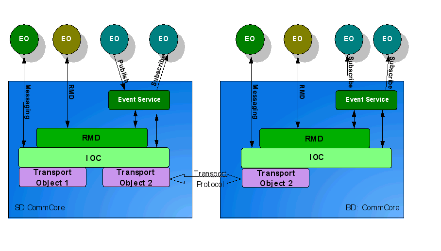
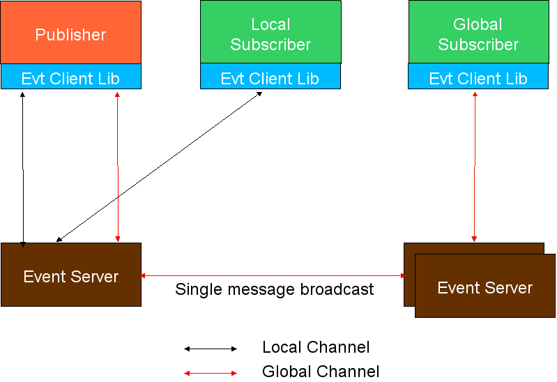
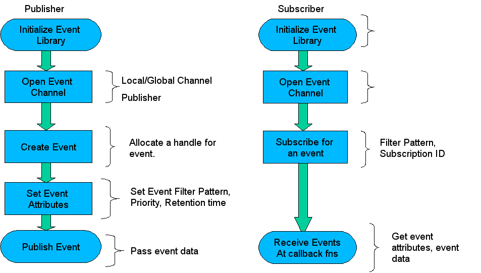
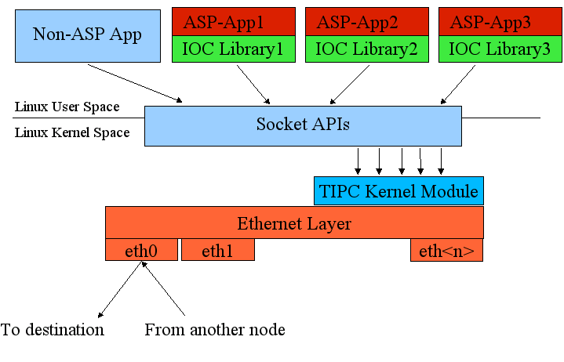
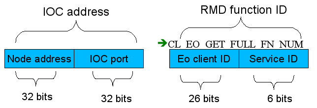
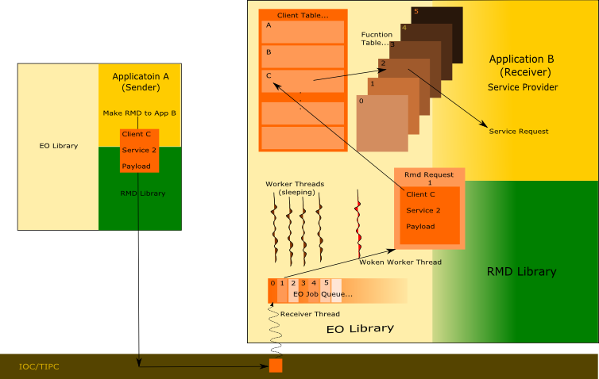
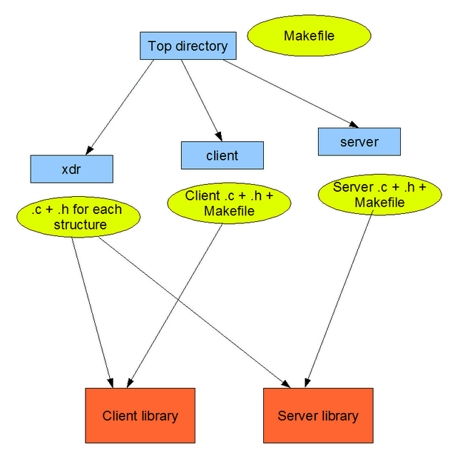

Communication Infrastructure
============================
Intracluster Communications is a critical element in any tightly coupled distributed system, and is very different from standard TCP 
client/server communications paradigms. OpenClovis provides several communications facilities that are used by the SAFplus Platform 
framework and that should be used by customer software. OpenClovis provides an abstraction for simple low-latency LAN based direct 
message passing called IOC, and provides an implementation of the same over TIPC - the standard Linux inter-cluster low-latency 
communications mechanism. All OpenClovis services use IOC to communicate with peers except for GMS (Group management) which uses IP 
multicast. Therefore, a customer can port the entire SAFplus Platform to another messaging system simply by implementing the IOC 
interfaces.

These communications services are available on every SAFplus Platform node and are automatically integrated into EO-inized 
applications. They allow any component to directly communicate with any other component running on any node and allow components to 
be identified (addressed) either by location or by an arbitrary name (location transparent addressing). These "arbitrary names" can 
be move from component to component as need or failures dictate. The communications system also automatically provides component and 
node failure notifications via a heartbeat mechanism.

Higher level communications abstractions and tools such as events, remote procedure calls, and endian translation are also supported.

Components of Communication Infrastructure:

* **Event Service:** 
  Publish/Subscribe multipoint communications model.
* **IOC:** 
  Low level messaging abstraction layer
* **Name Service:** 
  Identify nodes via names instead of physical addresses. Names can be transferred between nodes to implement failover.
* **Remote Method Dispatch (RMD):** 
  Call functions on other nodes
* **Interface Definition Language (IDL):** 
  Abstract definition language that can be used in mixed-endian environments to allow data do be automatically swapped.

Event Service
-------------

Overview
^^^^^^^^
The Event Service is a publish/subscribe multipoint-to-multipoint communication mechanism that is based on the concept of event 
channels, where a publisher communicates asynchronously via with one or more subscribers over a channel. The publishers and 
subscribers are unaware of each others existence.

Terms, Definitions
^^^^^^^^^^^^^^^^^^

* **Event:** Any data that needs to be communicated to interested parties in a system is called an event. This data typically 
  describes an action that was taken or a problem that was detected.
* **Subscribers:** Entities interested in listening to an event
* **Publishers:** Entities that generate the event. An entity can be both a publisher and a subscriber
* **Event Channel:** A global or local communication channel that allows communication between publishers and subscribers. By 
  sending events in channels, all events do not need to go to all Subscribers.
* **Event Data:** Zero or more bytes of payload associated with an event
* **Event Attributes:** The publisher can associate a set of attributes with the each event such as the event pattern, publisher 
  name, publish time, retention time, priority, etc.
* **Event Pattern:** The attribute which describes type of an event and categorizes it. This is used for filtering events.
* **Event Filter:** The subscribers use filters based on the patterns exposed by the publisher to choose the events of interest, 
  ignoring the rest.

Features
^^^^^^^^
* SAF compliant implementation
* The publisher and the subscriber can be:

  * In the same process address space
  * Distributed across multiple processes on the same CPU/board
  * Distributed across multiple processes on various CPU/boards

* Event Channels can be local or global

  * Local channels for SAFplus Platform node internal events
  * Global channels for SAFplus Platform cluster wide events

* Multiple subscribers and publishers can open the same channel
* Events are delivered in strict order of generation
* Guaranteed delivery
* At most once delivery
* Events can have

  * Any payload associated with them
  * Pattern defining the type of the event
  * A specified priority
  * A retention time for which the event is to be held before discarding

* Events published on a channel can be subscribed to, based on a filter that matches the event pattern
* Debug support by monitoring and logging

  * Controlled at run time

Architecture
^^^^^^^^^^^^

The Event Service is based on RMD and IOC. It involves the communication between publishers and subscribers without requiring either 
side to explicitly "identify" the other side. That is, the publisher does not need to know who the subscribers are and vice versa. 
This is accomplished via an abstraction called an event channel. All events published to a channel go to all subscribers of the 
channel. To handle node specific events efficiently, a channel is categorized as local and global. The local channel is limited to 
a single node while a global channel spans across the nodes in the cluster. This feature is an extension to the SA Forum (SAF) event 
system where there is no such distinction and all channels are inherently global. An event published on a global channel requires a 
network broadcast while a local event does not use the network and is therefore very efficient.

Flow
^^^^

To use the Event Service an understanding has to be established between the publisher and the subscriber. The type of the payload 
that shall be exchanged should be known to both and also if any pattern is used by the publisher it has to be made known to the 
subscriber.

Both the subscriber and publisher are required to do a Event Client Library initialize to use the Event Service. Both then open the 
channel, subscriber with the subscriber flag and publisher with publish flag. To both publish and subscribe to a channel, set both 
flags. This means that the subscriber and publisher can be the same entity. However, for the purposes of clarity in this description 
the logical separation of "subscriber" and "publisher" will be maintained.

The subscriber than subscribes to a particular event using a filter that will match specific event patterns that interests that 
subscriber. The publisher on the other hand will allocate an event and set it's attributes. It optionally sets the pattern to 
categorize the event. This pattern is matched against the filter supplied by the subscriber. The publisher then publishes the event 
on the channel. If channel is global the event is sent to all the event servers on the cluster who in turn deliver the event to any 
subscribers on that node. If the channel is local the event is delivered to the subscribers who have subscribed to this event locally. 
The event is delivered only to those subscribers which have an appropriate filter.

For further details on the usage of Event Service kindly refer to the OpenClovis API Reference Guide.

Transparent Inter Process Communication (TIPC)
----------------------------------------------
TIPC provides a good communication infrastructure for a distributed, location transparent, highly available applications. TIPC is a 
Linux kernel module; it is a part of the standard Linux kernel and is shipped with most of standard distributions of Linux. It 
supports both reliable and unreliable modes of communications, reliable being desired by most applications (even if the hardware is 
reliable, buffering issues can make the program-to-program communications unreliable). Since TIPC is a Linux kernel module and works 
directly over the Ethernet, any communication that uses TIPC will be very fast compared to other protocols. The TIPC kernel module 
provides a few important features like topology service, signaling link protocol, location transparent addressing. This section 
describes only the features of TIPC as used by SAFplus Platform, although SAFplus Platform programs are welcome to access the TIPC 
APIs directly to use other features. For more details please refer to the tipc project located at `TIPC Linux kernel <https://tipc.sourceforge.net/>`__.

From TIPC view point the network is organized into a 5-layer structure.

* **TIPC Network:** This is the ensemble of all the computers interconnected via TIPC. This is a domain within which any computer 
  can reach any other computer using the TIPC address.
* **TIPC Zone:** This is group of clusters is a zone.
* **TIPC Cluster:** A group of computers is called a cluster.
* **TIPC Node:** A node is a computer.
* **TIPC Slave Node:** It is same as a node, but will communicate with only one node in a cluster. This is unlike normal nodes which 
  are connected to all the nodes in the cluster.

TIPC does not use "normal" ethernet MAC addresses or IP addresses. Instead it uses a "TIPC address" that is formed from these fields. 
In general, this complexity is hidden from the SAFplus Platform programmer since addresses are automatically assigned.

TIPC features
^^^^^^^^^^^^^
The list below describes some features of TIPC:

* Broadcast.
* Location Transparent Addressing.
* Topology Service.
* Link Level Protocol.
* Automatic Neighbor Detection.

Broadcast
^^^^^^^^^
TIPC supports unicast, multicast and broadcast modes of sending a packet. Depending on the intended mode the TIPC address has to be 
specified. The format of the address looks like (type, lower instance and upper instance).

* **type:** This is the port number of a component to which the packet is to be sent to.
* **lower instance:** This is the lowest address of the nodes to which the packet should go to.
* **upper instance:** It is the highest address of the nodes to which the packet should go to.

The lower instance and upper instance together form the range of address. If these 2 are same then the packet will be unicasted to 
that destination node. And if the the range covers all the nodes of a system then it is a broadcast packet and will be sent to all 
the nodes node in the system.

Location Transparent Addressing
^^^^^^^^^^^^^^^^^^^^^^^^^^^^^^^
An application can be contacted without having the knowledge of its exact location. This is possible through Location Transparent 
Addressing. A highly available application in a system while providing service to many of its clients might suddenly go down due to 
this some kind of failure in the system. And the same application can come up on another node/machine with the same Location 
transparent address. This way the clients can still reach the server with the same address, which they used to contact previously.

Topology Service
^^^^^^^^^^^^^^^^
TIPC provides a mechanism of inquiring or subscribing for the availability of a address or range of addresses.

Intelligent Object Communication (IOC)
--------------------------------------
The Intelligent-Object-Communication(IOC) module of SAFplus Platform provides the basic communication infrastructure for an SAFplus 
Platform enabled system. The IOC is a compatibility layer on top of TIPC that will allow customers to port SAFplus Platform to other 
architectures. Therefore, all SAFplus Platform components use the IOC APIs rather than TIPC APIs. IOC exposes only the most essential 
TIPC features to make porting simpler. IOC also abstracts and simplifies some of the legwork required to connect a node into the TIPC 
network. Customers are encouraged to use the IOC layer (or higher lever abstractions like event and RMD) to ensure portability in 
their applications, or may use TIPC directly.

IOC Architecture
^^^^^^^^^^^^^^^^

IOC Features
^^^^^^^^^^^^

* Reliable and Unreliable mode of communication.
* Broadcasting of messages.
* Multicasting of messages.
* Transparent/Logical Address to a component.
* An SAFplus Platform node arrival/departure notification.
* The arrival/departure notification of a component.

Reliable and Unreliable mode of communication
"""""""""""""""""""""""""""""""""""""""""""""
The IOC with the help of TIPC allows the applications to create a reliable or an unreliable communication port. All the communication 
ports are connectionless ports. This helps to achieve a high speed data transfer. Reliable communications are highly recommended and 
is the default used by OpenClovis SAFplus Platform. It should be used even within an environment with extremely low message loss at 
the hardware level (such as an ATCA chassis) because message loss may also occur in the linux kernel or network switch due to 
transient spikes in bandwidth utilization.

Broadcasting of messages
""""""""""""""""""""""""
IOC supports the broadcasting of messages, qualified by destination port number. This means that a broadcast message sent from a 
component will reach all components on all nodes in the cluster that are listening to the communications port specified in the 
destination-address field of the message.

Multicasting of messages
""""""""""""""""""""""""
Multicasting is sending of a message to only a group of components. Any component may join the group by registering itself with IOC 
for a specific multicast address. Thereafter any message sent to that multicast address will reach all the registered components in 
the cluster.

Location Transparent/Logical Address to a component
"""""""""""""""""""""""""""""""""""""""""""""""""""
Transparent addressing support of IOC makes communication possible for an SAFplus Platform component with another another SAFplus 
Platform component without knowing the second one's physical address. Location Transparent addressing is commonly used in the case 
of redundant components that provide a single service. If the service uses a Location Transparent address, clients do not need to 
discover what component is currently providing the service; a client simply addresses a message to the Location Transparent Address, 
and that message is automatically sent to the component that is currently "active".

On the server side, it is the responsibility of the "active" component of the redundant pair to "register" with IOC for all messages 
sent to the Location Transparent Address.

SAFplus Platform node arrival/departure Notification
""""""""""""""""""""""""""""""""""""""""""""""""""""
In a cluster having many SAFplus Platform nodes in a system, some SAFplus Platform components might be interested in knowing when a 
node in the cluster arrives and when one leaves. This feature of IOC informs such an event to all the interested SAFplus Platform 
components in the whole SAFplus Platform system. Components may use either a query or a callback based interface.

The arrival/departure notification of a component
"""""""""""""""""""""""""""""""""""""""""""""""""
This feature of IOC helps the components which are interested in other components' health status. The IOC with the help of TIPC will 
come to know about every SAFplus Platform components health in a system and it conveys this to all the interested SAFplus Platform 
components though a query or callback interface. Component arrival and departure is actually measured by when the component creates 
or removes its connection to TIPC, as opposed to when the process is created or deleted. The OpenClovis EO infrastructure always 
creates a default connection upon successful initialization, so this measurement is actually more accurate than process monitoring. 
A thread is automatically created in each process as part of the EO infrastructure to monitor all other components health status and 
to handle SAFplus Platform communications.

Interface Bonding
^^^^^^^^^^^^^^^^^
Any fully redundant solution requires physical redundancy of network links as well as node redundancy. This link-level redundancy is 
particularly important between application peers (i.e. between nodes in the cluster) because if peer communications fail at the 
ethernet level than it is not possible to distinguish certain link failure modes from node failure modes. In these cases each peer 
will assume that the other has failed, leading to a situation where all nodes assume the "active" role. In the worst case, each 
"active" node will service requests and so the state on each node will diverge (in practice the nodes tend to interfere with 
eachother, by both claiming the same IP address for example, resulting in loss of service). When the link failure is resolved, one 
of the 2 nodes will revert back to "standby" status, losing all state changes on that node. The solution to this "catastrophic" 
failure mode is simply to have link redundancy so that no single failure will cause the system to enter this state.

The simplest link redundancy solution can be implemented at the operating system layer and is called "interface bonding". In essence 
2 "real" interfaces, say "eth0" and "eth1" are combined to form a single "virtual" interface called "bondN" (or "bond0" in this case) 
that behaves from the applications' perspective like a single physical interface. Policies can be chosen as to how to distribute or 
route network traffic between these 2 interfaces.

The OpenClovis SAFplus Platform can be configured to use a "bonded" interface for its communications in the exact same way as it is 
configured to use a different "real" interface (see the IDE user guide or XML configuration file formats for more information). 
Customers may want to configure their "bonded" interface in different ways based on their particular solution. Details describing 
how to enable bonding in operating system and OS distribution specific and is therefore beyond the scope of this document and the 
OpenClovis SAFplus Platform software. However a bonding configuration that is considered the "best practice" for use with OpenClovis 
SAFplus Platform is described in the following sections.

Configuring the bonding
"""""""""""""""""""""""
The Interface Bonding is a Linux kernel module. To work with this the kernel should have been compiled with the "Bonding driver support" (for major distributions, this flag is often on by default). For more details on how to install bonding driver module into the kernel please refer to the "bonding.txt" in Linux Documentation's "networking" section.

* Loading the kernel module The following two lines are needed to be added to /etc/modprobe.conf or /etc/modules.conf alias bond0 
  bonding options bond0 mode=active-backup arp_interval=100 \\ arp_ip_target=192.168.0.1 max_bonds=1

  * mode: Specifies one of the bonding policies.

    * active-backup: Only one slave in the bond is active. A different slave becomes active if, and only if, the active slave fails. 
      The bond's MAC address is externally visible on only one port (network adapter) to avoid confusing the switch. This mode 
      provides fault tolerance.

  * arp_interval: Specifies the ARP monitoring frequency in milli-seconds.
  * arp_ip_target: Specifies the ip addresses to use when arp_interval is > 0. These are the targets of the ARP request sent to 
    determine the health of the link to the targets. Specify these values in ddd.ddd.ddd.ddd format. Multiple ip addresses must be 
    separated by a comma. At least one ip address needs to be given for ARP monitoring to work. The maximum number of targets that 
    can be specified is set at 16.
  * max_bonds: Specifies the number of bonding devices to create for this instance of the bonding driver. E.g., if max_bonds is 3, 
    and the bonding driver is not already loaded, then bond0, bond1 and bond2 will be created. The default value is 1.

* Use the standard distribution techniques to define the network interfaces. For example, on Red Hat distribution create an 
  ifcfg-bond0 file in /etc/sysconfig/network-scripts directory that resembles the following : DEVICE=bond0 ONBOOT=yes BOOTPROTO=dhcp 
  TYPE=Bonding USERCTL=no
* All interfaces that are part of a bond should have SLAVE and MASTER definitions. For example, in the case of Red Hat, if you wish 
  to make eth0 and eth1 a part of the bonding interface bond0, their config files (ifcfg-eth0 and ifcfg-eth1) should resemble the 
  following: DEVICE=eth0 USERCTL=no ONBOOT=yes MASTER=bond0 SLAVE=yes BOOTPROTO=none Use DEVICE=eth1 in the ifcfg-eth1 config file. 
  If you configure a second bonding interface (bond1), use MASTER=bond1 in the config file to make the network interface be a slave 
  of bond1.
* Restart the networking subsystem or just bring up the bonding device if your administration tools allow it. Otherwise, reboot. On 
  Red Hat distros you can issue 'ifup bond0' or '/etc/rc.d/init.d/network restart'.
* The last step is to configure your model to use bonding. This can be done in the IDE through the "SAFplus Platform Component 
  Configuration.Boot Configuration.Group Membership Service.Link Name" field. This default can also be overridden on a per-node 
  basis through the "target.conf" file, LINK_<nodename> variable.

Name Service
------------

Overview
^^^^^^^^
Naming Service is mechanism that allows an object to be referred by its "friendly" name rather than its "object(service) reference". 
The "object reference" can be logical address, resource id, etc. and as far as Name Service is concerned, "object reference" is 
opaque. In other words, Naming service (NS) returns the logical address given the "friendly" name. Hence, Name Service helps in 
providing location transparency.This "friendly" name is topology and location agnostic.

Basic concept
^^^^^^^^^^^^^
The name service maintains a mapping between objects and the object reference (logical address) associated with the object. Each 
object consists of an object name, an object type, and other object attributes. The object names are typically strings and are only 
meaningful when considered along with the object type. Examples of object names are "print service", "file service", "user@hostname", 
"function abc", etc. Examples of object types include services, nodes or any other user defined type. The object may have a number 
of attributes (limited by a configurable maximum number) attached to it. An object attribute is itself a <attribute type, attribute 
value> pair, each of which is a string. Examples of object attributes are, <"version", "2.5">, <"status", "active"> etc.

The name service API provides methods to register/deregister object names, types, attributes and associated addresses. A process may 
register multiple services with the same address or multiple processes may register the same service name and attributes. Some object 
names, attributes and addresses may also be 'statically' defined at start time. It is the responsibility of the process that registers 
an object to remove it when the object is no longer valid. However in the case where a process undergoes an abnormal termination, 
the name service will automatically remove associated entries.

The name service provides the ability to query the name database in various ways. Clients may query the name service to obtain the 
address and attributes of a object by giving the object name and type. "Content-addressable" access is also provided. In other words, 
clients may give attributes and ask for object names that satisfy those attributes.

Features
^^^^^^^^
* The name service maps "service names" to attributes, including addresses
* Service Providers register their "service name", "address" and attributes with the Name Service
* Service Users query the Name Service to get information about a service
* Service users can communicate with service providers without knowing their logical address or physical location
* Multiple service providers can register the same name. The name service maintains a reference count for each "name" registered
* The name service subscribes to component failure notification from AMF. If a component dies, the reference count for the services 
  it has registered is decremented.
* Supports context based naming to allow partitioning of the name space

  * Local name spaces are local to the Name Server on a SAFplus Platform node
  * Global Name Spaces are global to the SAFplus Platform cluster
  * Name spaces are dynamically created at run time

* Supports three type of queries

  * Query based on "Service Name": Given a service name returns the address and service attributes
  * Query based on "Service attributes": Given service attributes, returns the Service Name and address
  * Query based on "name space context": Given a name space context, returns all names in that space

Subcomponents
^^^^^^^^^^^^^
Based on the responsibilities, the Name Service component can be further subdivided into following modules

* **Core Module:** 
  Responsible for supporting the creation and deletion of user defined contexts and processing the requests for registration, 
  deregistration. Also responsible for supporting the various NS related queries
* **Life cycle Management Module:** 
  Responsible for initialization, finalization, restart and other management functionalities
* **Syncup Manager Module:** 
  Responsible for NS DB synchronization and backing up of DB in persistent memory

Contexts and Scopes
^^^^^^^^^^^^^^^^^^^
The name service supports different sets of name-to-object reference mappings(also referred to as "context"). A particular "name" 
is unique in the context. A process will specify the context and the scope of its service during registration with the name service.

Context
"""""""

* **User-defined set:** 
  Applications may choose to be a part of a specific set (or context). For that, first a context has to be created. For example, all 
  the SAFplus Platform related services can be a part of a separate context.

* **Default set:** 
  Name Service supports a default context for services that don't form a part of any specific context.

Scope
"""""

* **Node-local scope:** 
  The scope is local to the node. That is, the service provider and the user should co-exist on the same blade.

* **Global or cluster-wide scope:** 
  The service is available to any user on any of the blades.

Registration and Deregistration
^^^^^^^^^^^^^^^^^^^^^^^^^^^^^^^
As the name suggests, during registration, an entry (i.e mapping between "name" and logical address) for the component is added into 
the name service database and during deregistration the entry is deleted.

In a typical SAFplus Platform HA scenario, whenever a component comes up and ACTIVE HA state is assigned to it, it registers with 
the local name service giving a string name for the service, the logical address, context and scope (the application obtains the 
logical address by using CL_IOC_LOGICAL_ADDRESS_FORM). Next the entry is added to the local name service database. If the scope is 
cluster-wide, the local name service indirectly passes this information to the name service master. Based on the context, the name 
service master decides whether to store the entry in the default context or the given user defined context. The name service also 
stores the component identifier along with that entry so that the entry can be purged if the component dies.

Note that the Name Service does not care about the HA state assigned to the component. On the one hand, this means that the component 
author must handle registration and deregistration when the service becomes active or standby. On the other hand, this allows great 
flexibility since standby components can still register names. The name service maintains reference count of instances providing a 
given service. Whenever a component registers with the name service, this reference count is incremented and whenever a component 
dies or deregisters, this reference count is decremented by the name service. If nobody is refering to a particular entry, then 
that entry will be deleted. Whenever a component goes down gracefully, it is the responsiblity of the component to delete the 
service which it registered.

Name Service entries
^^^^^^^^^^^^^^^^^^^^
The name service database contains the following entries Name to Logical Address mapping, CompId of the component hosting the service, 
Count of no. of instances for the given service, a set of user defined attributes - The attributes will be <attribute type, attribute 
value> pair, each of which is a string. Examples of object attributes are, <"version", "2.5">, <"status", "active"> etc. The upper 
limit on no. of attributes is user configurable.

Querying Name Service
^^^^^^^^^^^^^^^^^^^^^
Whenever a component wants to get the logical address of a service, it queries its local Name Server specifying the context. Context 
is needed because "name" is not unique across contexts i.e. Same "name" can map to different objects in different contexts. Local 
Name Server checks both the node-local and the cluster-wide entries. The Name Service query is based on "Name". If an application 
queries the local NS EO, and an entry is not found in local NS database (there is a chance that NS updation message did not reach 
the NS/L), the NS/L EO contacts the NS/M EO, which looks up its cluster-wide entries and gets the information. If the information 
is found, NS/L updates its local database as well.

Remote Method Dispatch (RMD)
----------------------------

Overview
^^^^^^^^
This service is generically known as RPC (Remote Procedure Calls). In a system with a single address space, function calls made are 
local to the address space. However, in a distributed system, the services sought by a caller may not always be available locally, 
but at some remote node. Remote Method Dispatch or RMD facilitates calls to the remote callee and returns the results to the caller. 
From the point of view of the caller, and RMD call looks exactly like a local function call. However, the function is actually 
executed on another node. Details like what node provides the service, how to communicate with this node, and platform specifics 
like endianess is hidden from the caller.

Features
^^^^^^^^

* Similar to RPC - Remote Procedure Call
* Enables you to make a function call in another process, irrespective of the location of the process
* Communication takes place over low latency IOC/TIPC layer
* Reliable communication ("at most once" semantics)
* Support both synchronous and asynchronous flavors
* IDL can be used to generate client/server stubs for user components (and is of course used internally for SAFplus Platform 
  components)
* Platform agnostic - works across mixed endian and mixed mode (32 bit and 64 bit)

Types of RMD Calls
^^^^^^^^^^^^^^^^^^

* Sync (with or without Response)

  * This call will block until a response is received
  * Reliable - function caller knows whether or not it succeeded when the call returns

* Async with Response

  * This will initiate the function call and include a callback function to handle the response
  * Reliable - function caller knows whether or not it succeeded via the callback

* Async without Response

  * This sends NULL for callback function
  * Not reliable

RMD Usage
^^^^^^^^^
From the caller's perspective, RMD usage is essentially a function call if IDL was used to generate the client/server stubs. RMD 
functions can be defined, and code generated through the OpenClovis IDE; please refer to the **OpenClovis IDE User's Guide** chapter 
'Defining IDL'

Underneath the IDL are calls to the RMD API which are rarely used directly but described here for completeness.

Irrespective of the type of the call the RMD API will require at least the following parameters:

* IOC address (destination address and port)
* Input message (Input arguments to the call)
* Output message (The returned arguments)
* flags
* RMD options

Additionally, in case of async call, a callback function and a cookie (piece of context data that is not used by RMD, but passed 
back to the callback) need to be passed.

As illustrated in the diagram below the address comprises of the node address and port on which the application/service provider is 
listening. The user is also required to specify the service he wants executed via a RMD number which comprises of the Client ID and 
Service ID. The former helps identify which client service is sought - this could be the native table which consists of the services 
exposed by the application or any other client table installed by the libraries to which the application is linked. The service 
number is the index of the service that is desired.

For further details on the RMD usage kindly refer **OpenClovis API Reference Guide**.

RMD IDL
^^^^^^^
RMD is typically used via IDL so that the user is saved from the idiosyncrasies of the underlying architectures and such.

* RMD IDL simplifies building of RMDs

  * Generates server and client stubs
  * Stubs do marshalling and un-marshalling of arguments making them platform agnostic
  * Select appropriate semantics
  * Takes care of endianness and mixed mode issues
  * Uses XDR (see internet RFC1014) notation

* OpenClovis/IDE enables the generation of RMDs and linking them to a client EO
* Any function installed in an EO client can be called remotely

RMD/EO Interface
^^^^^^^^^^^^^^^^

RMD and EO are tightly knit as can be observed in the illustration above. The service provider or server exposes a certain set of 
services by installing it in the EO. The client application interested in the service makes a RMD call to the server with the desired 
arguments. The node address specifies the node on which the server resides and the port identifies the server process. The RMD number 
specifies the service that needs to be executed of a particular client residing on the server. This request is sent across over 
TIPC/IOC layer to the server. The receiver thread of the server picks up this request and queues the same into the EO job queue and 
wakes up one of the worker threads to process the request. The worker thread checks the service requested and processes the request 
in the context of the server. The client is totally unaware where the service is processed. It could be in the same process address 
space, on a process on the same node or a process on a remote node.

Please refer the Componentization section of this document for a better understanding.

Interface Definition Language (IDL)
-----------------------------------
The OpenClovis Interface Definition Language (IDL) is a library used by all EOs to communicate efficiently across nodes. Using IDL, 
OpenClovis SAFplus Platform services can communicates across mixed endian machines and mixed mode (32-bit and 64-bit architecture) 
setup. This it accomplishes by providing marshalling and unmarshalling functions for the various types of arguments. Thus IDL in 
combination with RMD is used to provide a simple and efficient means of communication across EOs.

IDL Usage
^^^^^^^^^
The IDL generation is done through a script that takes 2 arguments:

* the xml file which provides a definition of the user's EO and relevant data structures
* a directory in which to generate the code

It then generates client and server side code for the xml definition into the specified directory. The user then issues a top level 
build whereafter the server & client side libraries are generated. The user should link with the client side libraries and include 
the client and xdr headers in his code to make client calls. On the server side, the user is expected to provide actual function 
definitions corresponding to the service definitions present in the xml file. He is also expected to install the server stubs before 
using & uninstall them during termination using the install/uninstall functions provided on a per EO basis.

Code is generated as follows:

* Top level makefile that recursively descends into client & server
* The directory xdr in which, a .c & .h is generated for every custom defined data structure in the xml.

For every struture,corresponding marshal.c and unmarshall.c files will be generated.

* client - a .c & .h is generated in this directory. They contain the definition and declaration respectively of the sync client, 
  async client and the async callback for each EO service defined in the xml. It also contains a makefile that generates a library 
  out of the files in this directory and the xdr directory.
* server - a .c & .h is generated in this directory. They contain the definition and declaration respectively of the server stub and 
  the server function for each EO service defined in the xml. It also contains a makefile that generates a library out of the files 
  in this directory and the xdr directory.

The generated code inside the target directory looks like the following:

IDL translates the user's data structures passed through a function call to a message and vice versa. Therefore it requires the user 
to specify the function signatures. This is currently being done through xml. The user defines the EO through the xml along with the 
relevant data structures. The following section describes the xml definition in detail.

IDL Specification
^^^^^^^^^^^^^^^^^
The IDL script expects the EO interface definition from the user in XML format.

User-Defined Types
""""""""""""""""""
The IDL uses XDR representation to store application data internally while transferring it to another EO. Therefore, IDL requires 
the application to specify the data structures that will be transferred through RMD so that it can generate XDR functions required 
to marshal/un-marshal these data structures. Marshalling is the process of converting the native data to XDR format and 
un-marshalling is retrieving the data back to native format. There can be three user-defined types: structures, unions and 
enumerations. These are explained below.

Enumerations
''''''''''''
Enumerations are like enums in C and are defined likewise.

Structures
''''''''''
These are like structures in C. Therefore, every structure defined is composed of data members. There is a restriction that structures 
within the structures are not allowed to be defined. However, this restriction can be overcome by defining the two structures 
separately and embedding one inside another as a data member. Data members have the following attributes:

* **name** This is the name of the data member and it is referred to within the structure by this name.
* **type** This can be one of the pre-defined Clovis data types or a user-defined type. It is the user's responsibility to make sure 
  that there are no circular inclusions. Circular inclusions happen when two or more UDTs include each other in their respective 
  definitions in such a way that it creates a cyclic dependency amongst all the involved UDTs. The supported pre-defined Clovis data 
  types are ClInt8T, ClUint8T, ClInt16T, ClUint16T, ClInt64T, ClUint64T, ClInt32T , ClUint32T. ClNameT and ClVersionT.

pointer
'''''''
This is an optional attribute. When this is enabled, it means that the data member is a pointer to the type specified. We cannot 
specify more than one level of indirection since it is necessary to specify the number of elements being pointed to for every level 
of indirection.

lengthVar
'''''''''
This attribute should be specified only if the data member is a pointer type, which means that the pointer attribute is set to true. 
This attribute specifies which data member in the structure will contain the number of elements being pointed to. It is an optional 
attribute. When no such attribute is specified for a pointer type data member, it is assumed that a single element is being pointed 
to.

multiplicity
''''''''''''
This attribute is used to specify an array type of data member. The number of elements is specified through this attribute. This 
attribute must not be specified along with the pointer attribute. This is an optional attribute.

Unions
''''''
These are defined similar to structures. The difference is in terms of the interpretation and generation.

EO Interface
""""""""""""
The EO has multiple tables called Clients into which the exported interface functions are installed. The user has to specify which 
functions are installed in which tables and then give a declaration of the functions themselves. Thus, an EO interface definition 
consists of one or more clients:

Client
''''''
A client has a Client-Id, which must either be a number or a constant. A client has multiple functions called Services. A Service 
has a name and zero or more Arguments. The Arguments to a Service are defined as follows:

* **Handle** The handle is the first parameter to be passed to a call on the client side or the server side. It is initialized with 
  the address of the destination EO, and parameters like timeout, retries and priority on the call. For more details on handles, 
  please refer to the SISP API Reference Manual.
* **Argument** An argument is similar to a data member, except for the following differences:

  * It does not have a multiplicity
  * It has an additional attribute where the user specifies if the argument is of type:

    * [CL_IN]: argument is an input to the function.
    * [C_inout]: argument is an input to the function and the function is expected to fill it up and pass it back to the caller.
    * [out]: the function is expected to fill the argument and pass it back to the caller.

Since an inout or an out type of argument is supposed to be passed back to the user, it must always have the pointer attribute set to true.

XDR marshalling and unmarshalling
^^^^^^^^^^^^^^^^^^^^^^^^^^^^^^^^^
The IDL uses XDR to store data into a message. This is called marshalling of data. The reverse process i.e. Of retrieving data from 
the message into the native format is called unmarshalling of data. XDR stands for eXternal Data Representation Standard (described 
in RFC 1832). It is a means of storing data in a machine independent format. We will look at relevant sections of XDR in this 
section.

Data structures: IDL recognizes the following data structures:

* ClInt8T
* ClUint8T
* ClInt16T
* ClUint16T
* ClInt32T
* ClUint32T
* ClInt64T
* ClUint64T
* ClNameT
* ClVersionT
* struct formed from other data structures
* union formed from other data structures
* enum

All data structures map to respective C structures except for 'union'. In XDR, we need to know which member in a union is valid since 
it needs to be marshalled/unmarshalled. Therefore a union is implemented as a structure which aggregates the respective C-style union 
and a member called discriminant which takes appropriate values for every member of the C-style union.

Marshalling
"""""""""""
In all of the marshalling algorithms, the message is written to only if non-zero. The message should be 0 if the veriable under 
consideration needs to be deleted. All data is converted to network byte order before writing to message.

Unmarshalling
"""""""""""""
In all of the unmarshalling algorithms, the message should always be non-zero. All data is converted to host order before reading 
from a message.

IDL Stubs
^^^^^^^^^
The IDL generates the following for every function installed in the EO interface:

* sync client stub
* async client stub
* server stub
* async callback

In addition, it generates 2 functions to install and uninstall the server functions into the EO.

A client function is defined by it's arguments.

**Arguments** - Arguments or parameters are marshalled into a message which are passed to the server functions and vice versa. 
Therefore it is necessary to understand what type of arguments can be available and how the marshalling/unmashalling can be done. 
There are 2 orthogonal classifications of arguments.

Classification based on direction of transfer:

* **CL_IN** - these are provided as an input to a function. In our case, they are sent to the server through input message
* **CL_OUT** - these are used to return results to the caller. In our case, these parameters are sent from the server to the client 
  in the output message
* **CL_INOUT** - these act as both input as well as output arguments. Consequently in our case, they are sent in both directions. As 
  of now we are not handling inout variables.

Classification based on passing:

* By value - these are passed as a copy. The original variables are not modifiable.
* By reference - these are passed as address. Therefore the original variables are modifiable. Since IDL marshalls/unmarshalls the These are further categorized as:

  * without count - when pointers are passed without count, they are assumed to point to a single element
  * with count - when a reference is passed with a count variable (an input basic type parameter), the count variable is assumed to contain the number of elements being pointed to.

Thus an argument can be classified into one of the following categories:

* CL_IN, by value (CL_OUT type parameters return results to the callee, they always need to be passed by reference)
* CL_IN, by reference without count
* CL_IN, by reference with count
* CL_OUT, by reference without count
* CL_OUT, by reference with count

IDL Sync Client Stub
^^^^^^^^^^^^^^^^^^^^
The IDL sync client stub is generated from the EO definition provided in the xml file. A stub is generated for every function 
installed in the EO clients. The first argument of the stub is always the handle which contains the RMD parameters and it needs to 
be pre-initialized. For more information on the handle, please refer to the API guide. It has the same signature as is specified in 
the xml file.

IDL Async Client Stub
^^^^^^^^^^^^^^^^^^^^^
Same as the sync stub except that the RMD call is asynchronous. Additional arguments are supplied for this - the callback to be 
invoked on successful invocation and also the cookie to be passed as an argument to the callback.

IDL Async Callback
^^^^^^^^^^^^^^^^^^
This is the function that is called when an async call is made and the context from the server returns. It is similar to the part 
of sync client stub which is present after the sync RMD call returns. This function is invoked from the RMD's context.

IDL Server Stub
^^^^^^^^^^^^^^^
The IDL server stub is invoked by RMD server library in response to a request from the client. This stub gets installed in the EO's 
client tables. This stub does the reverse of the sync client stub. It extracts the in from the input message and calls the actual 
server function with these parameters. When the function returns, it packs the out parameters in a the output message and returns 
destroys the variables it created.
