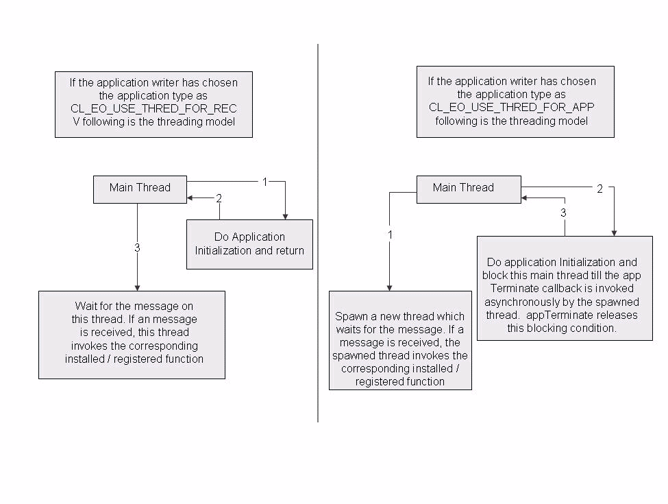

.. _comp-cfg-label:

OpenClovis SAFplus Platform Component Configuration
===================================================
Certain Components are allowed to be configured, to provide the flexibility of configuring OpenClovis SAFplus Platform to suit your 
requirements. OpenClovis SAFplus Platform can be customized and configured to execute on target platforms and support your 
application software.This chapter provides you the configuration details of OpenClovis SAFplus Platform components.

**Key Topics:**

* Configuring Execution Object (EO)
* Configuring Memory
* Configuring Remote Method Dispatch (RMD)
* Configuring Clovis Object Registry (COR)
* Configuring Log Service
* Configuring Group Membership Service (GMS)
* Configuring Name Service
* Database Abstraction Layer (DBAL)

Configuring Execution Object (EO)
---------------------------------
A SAFplus application must activate EO library to interact with other aspects of the SAFplus infrastructure. EO library is activated 
with configurable parameters when any SAFplus library is first initialized, and is normally almost completely hidden from the 
application code. The parameters are located in **<project_area>/<model>/src/app/clCompCfg.h** file which is generated through 
OpenClovis IDE and rarely needs to be changed.

EO comprises the following configurable parameters while declaring the **clEoConfigT** structure:

COMP_EO_NAME
^^^^^^^^^^^^
This attribute defines the name of the EO. This name is used in logging (for example).

* Format - To configure this parameter, set EO name field of the ClEoConfigT to the name of the EO. For example:

  .. code-block:: c

    ClEoConfigT clEoConfig;
    clEoConfig.name = "UserEO"

* Range - You can provide any string as the EO name that can be up to CL_EO_MAX_NAME_LEN characters long.

COMP_EO_THREAD_PRIORITY
^^^^^^^^^^^^^^^^^^^^^^^
This attribute defines the priority of the threads used to handling incoming SAFplus requests.

* Format - To configure this parameter, pri field of the ClEoConfigT to the required priority. For example:

  .. code-block:: c

    clEoConfig.pri = CL_OSAL_THREAD_PRI_MEDIUM 

* Range - You can define the priority to have the following values:

  .. code-block:: c

    CL_OSAL_THREAD_PRI_HIGH
    CL_OSAL_THREAD_PRI_MEDIUM
    CL_OSAL_THREAD_PRI_LOW
    Default = CL_OSAL_THREAD_PRI_MEDIUM

.. note::
    This parameter must not be modified. This parameter has no effect in the current implementation.

COMP_EO_NUM_THREAD
^^^^^^^^^^^^^^^^^^
This attribute defines the number of worker threads created for a task pool per IOC (communications channel) priority.

* Format - To configure this parameter, set noOfThreads field of the ClEoConfigT to the required number of RMD threads. For example:

  .. code-block:: c

    clEoConfig.noofThreads = 2

* Range - You can define the values in the following range:

  * Minimum = 2
  * Maximum = 2^32 -1
  * Default = 2

COMP_IOC_PORT
^^^^^^^^^^^^^
This attribute defines the requested IOC communication port.

* Format - To configure this parameter, set **reqIocPort** field of the **ClEoConfigT** to the required IOC port. If 0 is specified 
  as a port then the new port number is automatically assigned by the IOC.
* Range - You can define the values in the following range:

  * Minimum = CL_IOC_USER_APP_WELLKNOWN_PORTS_START
  * Maximum = CL_IOC_USER_APP_WELLKNOWN_PORTS_END

For example:

If the application wants a communication port well know to other processes in the system and also which will not change on restart 
of the process, then it can be set as shown below:

.. code-block:: c

    clEoConfig.reqIocPort = CL_IOC_USER_APP_WELLKNOWN_PORTS_START + 
                        <app_specific_unique_number>;

If the apllication wants the IOC to assign a communication port to it, which can change every time the process is restarted, then 0 
should be passed in reqIocPort field.

.. code-block:: c

    clEoConfig.reqIocPort = 0;

COMP_EO_USER_CLIENT_ID
^^^^^^^^^^^^^^^^^^^^^^
This attribute defines the maximum number of client tables that can be initialized by the EO. This is used to allocate space needed 
to install the client tables.

* Format - To configure this parameter, set **maxNoClients** field of the **ClEoConfigT** to the required value. The default value 
  **CL_EO_USER_CLIENT_ID_START** allocates enough space to accommodate the OpenClovis SAFplus Platform services. If you want to 
  initialize additional clients, you must specify this parameter as:

  .. code-block:: c

    clEoConfig.maxNoClients = CL_EO_USER_CLIENT_ID_START + n

  where n is the number of additional client tables.

* Range - You can define the values in the following range:

  * Minimum = CL_EO_USER_CLIENT_ID_START
  * Maximum = 2^32 -1
  * Default = CL_EO_USER_CLIENT_ID_START

COMP_EO_USE_THREAD_MODEL
^^^^^^^^^^^^^^^^^^^^^^^^

.. note::
    This parameter is deprecated since the application now receives the "main" thread by default, and should be left as 
    **CL_EO_USE_THREAD_FOR_APP**

This attribute defines whether the application needs the main thread or not. For more details on this parameter, refer to Figure 
Illustration of the usage of application type.

* Format - To configure this parameter, set appType field of the **ClEoConfigT** to either **CL_EO_USE_THREAD_FOR_RECV** or 
  **CL_EO_USE_THREAD_FOR_APP**. For example:

  .. code-block:: c

    clEoConfig.appType = CL_EO_USE_THREAD_FOR_APP

* Range - You can define the value of this parameter as either **CL_EO_USE_THREAD_FOR_RECV** or **CL_EO_USE_THREAD_FOR_APP**.

Configuring Memory
------------------
This section provides information about configuring the memory profiles and specify the total memory space and the watermarks for 
the total memory consumption for each component instance.

Heap and Buffer Memory Profiles
^^^^^^^^^^^^^^^^^^^^^^^^^^^^^^^
The following are the configurable parameters for heap and buffer memory profiles located in this file:

.. code-block:: text

    <project_area>/<model>/src/config/clEoDefinitions.xml

This file is generated through OpenClovis IDE.

heapConfig name
"""""""""""""""
This is the name for the heap memory profile.

bufferConfig name
"""""""""""""""""
This is the name for the buffer memory profile.

mode
""""
This indicates the type of the heap allocation mode. The values that can be provided are:

* **NM:** This is the Native C Mode. In this mode, all requests are served by calling the C library memory allocation interface.
* **PAM:** This is the Pre Allocated Mode. It is the OpenClovis provided implementation of the memory management library. A large 
  chunk of the memory is pre-allocated during component initialization. The memory space is divided into pools of diverse memory 
  chunks and serves run-time dynamic memory allocation requests.
* **CM:** This is the Custom Mode. You can plug-in customized memory management library calls.

lazyMode
""""""""
You can configure the pool in lazy mode for total memory consumption. Set the value to true or false.

When a pool exhausts its current allocation, it can still grow provided the dynamic memory space or the pool upper limit is not reached. It expands or grows by the increment size specified for the pool. In Lazy Mode, the incremented pool does not initialize until an allocation is made from that pool. In normal mode, the incremented pool initializes as soon as it is acquired by the memory management library.

The following parameters can be configured for a heap and buffer memory pools. The values are expressed in bytes.

* **chunkSize** = Maximum size of one allocation from the pool.
* **initialSize** = Initial pool size for this pool.
* **incrementSize** = When the pool usage exceeds the initial size, the pool size grows by the increment size, unless the max limit 
  is already reached or the total dynamic memory space is reached.
* **maxSize** = Maximum pool size for this pool.

Memory Configuration Profiles
^^^^^^^^^^^^^^^^^^^^^^^^^^^^^
The following are the configurable parameters for memory configuration profiles located in this file

.. code-block:: text

    <project_area>/<model>/src/config/clEoDefinitions.xml

This file is generated through OpenClovis IDE. These parameters are used to set the total memory usage space and the watermarks on 
the total memory consumption for each component instance.

memoryConfig name
"""""""""""""""""
This is name for the memory profile.

processUpperLimit
"""""""""""""""""
This is the upper limit for the total memory consumption. The value is expressed in bytes. The dynamic memory allocation cannot 
exceed this limit.

Three levels of watermark are provided high, medium, and low. For each level of watermark, the following attributes can be 
configured:

* **lowLimit** = Memory limit value for downward crossing in percentage.
* **highLimit** = Memory limit value for upward crossing in percentage.

For each watermark the following set of actions can be set to true or false:

* **event enable** = If the lowLimit value or highLimit value is reached, an event is generated.
* **notification enable** = If the lowLimit value or highLimit value is reached, a notification is generated.
* **log enable** = If the lowLimit value or highLimit value is reached, a log is generated.
* **custom enable** = If the lowLimit value or highLimit value is reached, userdefined custom function is called.

Assigning Memory Profiles
^^^^^^^^^^^^^^^^^^^^^^^^^
Memory profiles are assigned to components in the **clEoConfig.xml** file located in 

.. code-block:: text

    <project_area>/<model>/src/config/clEoConfig.xml 

This file is in the source code or in $(ASP_DIR)/etc on the target. This file is generated by the OpenClovis IDE, and so these 
values are better modified through the IDE.

The file contains one XML tag per component of the following format:

.. code-block:: mxml

    <eoConfig name="LOG">
        <eoMemConfig heapConfig="Default" bufferConfig="Default" memoryConfig="Default"/>
        <eoIocConfig/>
    </eoConfig>

The "eoConfig" tag delimits all configuration for one component and has one field:

* **name:** This is the name of the SAFplus Platform component or user application.

The "eoMemConfig" tag specifies memory profiles by name through 3 fields:

* **heapConfig:** This is the heap memory profile that is assigned to the SAFplus Platform component or user application.
* **bufferConfig:** This is the buffer memory profile that is assigned to the SAFplus Platform component or user application.
* **memConfig:** This is the memory configuration profile that is assigned to the SAFplus Platform component or user application.

Configuring Remote Method Dispatch (RMD)
----------------------------------------
RMD comprises only one configurable parameter:

gClRmdMaxRetries
^^^^^^^^^^^^^^^^
This parameter allows you to define the default value for maximum number of retries for calling a remote function.

* Format - The constant gClRmdMaxRetries must be defined in the clASPCfg.c file. For example:

  .. code-block:: c

    #define gClRmdMaxRetries 0

* Range - You can define the maximum retries in the following range:

  * Minimum = 0
  * Maximum = 2^32-1
  * Default = 8

Configuring Clovis Object Registry (COR)
----------------------------------------
The configuration information for COR is generated by IDE in the clCorConfig.xml file. There are two configuration parameters for 
COR. First is the corOHMask and the other one is corSaveOption. Both of these are described below:

COR object handle Mask (corOHMask)
^^^^^^^^^^^^^^^^^^^^^^^^^^^^^^^^^^
This is the COR Object Handle mask used to get the compressed version of the MOID of a MO object. The MOID comprises pairs of 
{class Id, Instance Id} traversed from root to the object.

Storing the MOID for each object can be expensive since class Id and Instance Id both take four bytes each. Looking at the tree 
hierarchy there can be very few nodes at the top, which may not need full eight bytes of memory space. So, to store the MOID 
efficiently the MOID is compressed and stored in object handle. By specifying the mask, you will know the maximum number of classes 
and instances that you have at each level of Instance Tree starting from Root.

The number of entries in the OH mask are always even. It contains pair of values for every level, where first one denotes the 
maximum number classes at any level and second one denoting the maximum number of instances that can be created for that class at 
that level. This maximum number in both the cases is calculated by ((2^number) -1 ). Also the number of pairs in the OH mask shows 
the depth of the object tree allowed for this information model.

Suppose the OH mask is {a, b, c , d}, then we can make out following things from it:

#. There can be only two level of object tree possible from this.
#. At first level there can be (2^a)-1 classes can be created and each class can have (2^b)-1 instances. Similarly for the second 
   level (2^c)-1 classes can be present and each class can have (2^d)-1 instances.

Few important things about OH mask :

* The number of pairs in the OH mask can go upto only 20 level as the MOID can only access an object tree of depth 20.
* The total of all the values in the OH mask should not exceed 48. This magic number comes from the number of bits used in the 
  structure ClCorObjectHandleT for storing the object handle. The number of bits that are used in this structure to store the 
  classId and instance Id information is 48.
* Format - Following is an example of corOHMask:

  .. code-block:: text

    corOHMask={4, 8, 4, 8, 4, 8, 4, 8}

  Here you can tell that at level 0 (The level after root), there can be maximum of (2^4)-1 = 15 classes and (2^ 8)-1 = 255 
  instances per class.

  .. note::
    This parameter should not changed manually as this is generated by the IDE during modeling time. Any manual change should be 
    done at your discretion.

COR Repository Save Option (corSaveOption)
^^^^^^^^^^^^^^^^^^^^^^^^^^^^^^^^^^^^^^^^^^
This is the COR persistency option. This can take two values:

* **CL_COR_DELTA_SAVE:** which signifies that the all the delta changes in the COR repository during runtime should be persisted. 
  These information will be restored by COR once it is restarted.
* **CL_COR_NO_SAVE:** This option tells COR that the information need not be persisted at runtime nor restored at restart.

Configuring Log Service
-----------------------
The configuration information for Log Service is generated by IDE in the clLog.xml file. The configuration of log service has been 
split into three sections. There are as follows:

* Log service common config parameters
* Log service perennial stream config parameters
* Log service precreated stream config parameters

.. seealso::
    An example clLog.xml file generated by IDE is shown in chapter XML Representation of the Model of **OpenClovis IDE User Guide**.

Log service common config parameters
^^^^^^^^^^^^^^^^^^^^^^^^^^^^^^^^^^^^
These values are specific and common to log services running on the cluster. The following are the configurable parameters of the 
Log service:

* **maximumStream:** The value of this tag specifies the maximum number of streams can be created at log service which is running 
  on the local node. This number is configurable by the user (developer, tester or system administrator) based on the memory 
  availability of the system.
* **maximumComponents:** The value of this tag specifies the maximum number of components(loggers) can be at the cluster. This 
  number is configurable by the user.
* **maximumSharedMemoryPages:** The value of this tag specifies the maximum number of shared memory should be allocated for new 
  stream. This is basically talking about the size of the shared memory. This should be configurable by keeping mind the size of 
  the record and flush frequency.
* **maximumRecordsInPacket:** The value of this tag specifies the maximum number records can be flushed from log server to the file. 
  At any point of time, these many records will be multicasted by log service to the file owners.

.. note::
    These above values should not be changed at run time.

Log service perennial stream config parameters
^^^^^^^^^^^^^^^^^^^^^^^^^^^^^^^^^^^^^^^^^^^^^^
When the log server comes up with SAFplus Platform, two default perennial streams will be created and predefined handles will be 
populated. Any SAFplus Platform component/application can use this default streams for logging. These two streams are local streams.

* **fileName:** The value of this tag specifies the name of the file should be created for this perennial streams. Any valid file 
  names are configurable by the user.
* **fileLocation:** The value of this tag specifies the log file location. Format of this filelocation is <nodname>:<path>, where 
  node name is name of the node instance in which file will be created under the path directory. If path is start with '/' then log 
  service treats the path as absolute path, else this file location is prepended with the environment variable ASP_DIR. The directory 
  is created by the Log Server if it does not exist. This name is configurable by the user.

  * If nodename is '*' <star> , then the file will be created where the system controller active is running.
  * If nodename is '.' <dot>, then the file will be created in the local node.

* **fileUnitSize:** The value of this tag specifies the size of the log file in bytes. When the file size is reached its specified 
  limit, the given file full action will be applied on the file.
* **record size:** The value of this tag specifies the size of the record (single log message) in bytes.
* **fileFullAction:** The value of this tag specifies the action should be taken when the file reaches its specified limit. It can 
  take one of the following values

  * HALT
  * WRAP
  * ROTATE

* **maximumFilesRotated:** The value of this tag specifies the maximum number of files will be created, in case the file full action 
  is ROTATE. If the file full action is HALT or WRAP, then this value has to be set to 0.
* **flushFreq:** The value of the tag specifies number of Log Records after which the Log Stream must be flushed. This is the 
  maximum number of records on a node which are still not persisted at any given point in time. Log Service make best effort to ensure 
  that no more than flushFreq no of records will be lost if a node fails. A value of zero indicates that this field is ignored and Log 
  Records are flushed based on flushInterval. At least one of flushFreq and flushInterval must be non-zero for a Log Stream.
* **flushInterval:** The value of the tag specifies time in nanoseconds after which the Log Stream must be flushed. This is the 
  maximum time a Log Records can stay in a Log Stream un-persisted. Log Service guarantees that Log Records generated at least this 
  much time before a node failure will not be lost on a node failure. A value of zero indicates that this field is ignored and Log 
  Records are flushed based on flushFreq. At least one of flushFreq and flushInterval must be non-zero for a Log Stream. This field 
  will be ignored by default. If the user configures lockMode is mutex, then this field will be considered.

Log service precreated stream config parameters
^^^^^^^^^^^^^^^^^^^^^^^^^^^^^^^^^^^^^^^^^^^^^^^
When the log server comes up with SAFplus Platform, these given precreated streams will be created and handles will not be known to 
the user. Any SAFplus Platform component/application can open this stream and use it. If the stream is configured as GLOBAL streams 
then the same configuration should be available on all the nodes in the cluster.

* **streamName:** This value of the tag specifies the name of the precreated stream. This can be any valid name.
* **streamScope:** This value of the tag specifies the scope of the precreated stream. One of the following varibale will be a 
  valid value for this tag.

  * LOCAL
  * GLOBAL

* **fileName:** The value of this tag specifies the name of the file should be created for this perennial streams. Any valid file 
  names are configurable by the user.
* **fileLocation:** The value of this tag specifies the log file location. Format of this filelocation is <nodname>:<path>, where 
  node name is name of the node instance in which file will be created under the path directory. If path is start with '/' then log 
  service treats the path as absolute path, else this file location is prepended with the environment variable ASP_DIR. The 
  directory is created by the Log Server if it does not exist. This name is configurable by the user.

  * If nodename is '*' <star> , then the file will be created where the system controller active is running.
  * If nodename is '.' <dot>, then the file will be created in the local node.

* **fileUnitSize:** The value of this tag specifies the size of the log file in bytes. When the file size is reached its specified 
  limit, the given file full action will be applied on the file.
* **record size:** The value of this tag specifies the size of the record (single log message) in bytes.
* **fileFullAction:** The value of this tag specifies the action should be taken when the file reaches its specified limit. It can 
  take one of the following values

  * HALT
  * WRAP
  * ROTATE

* **maximumFilesRotated:** The value of this tag specifies the maximum number of files will be created, in case the file full action 
  is ROTATE. If the file full action is HALT or WRAP, then this value has to be set to 0.
* **flushFreq:** The value of the tag specifies number of Log Records after which the Log Stream must be flushed. This is the 
  maximum number of records on a node which are still not persisted at any given point in time. Log Service make best effort to 
  ensure that no more than flushFreq no of records will be lost if a node fails. A value of zero indicates that this field is 
  ignored and Log Records are flushed based on flushInterval. At least one of flushFreq and flushInterval must be non-zero for a 
  Log Stream.
* **flushInterval:** The value of the tag specifies time in nanoseconds after which the Log Stream must be flushed. This is the 
  maximum time a Log Records can stay in a Log Stream un-persisted. Log Service guarantees that Log Records generated at least this 
  much time before a node failure will not be lost on a node failure. A value of zero indicates that this field is ignored and Log 
  Records are flushed based on flushFreq. At least one of flushFreq and flushInterval must be non-zero for a Log Stream. This field 
  will be ignored by default. If the user configures lockMode is mutex, then this field will be considered.

Configuring Group Membership Service (GMS)
------------------------------------------
The following parameters are located in **<project_area>/<model>/src/config/clGmsConfig.xml** file.

The following are the configurable parameters of GMS service:

* **clusterName:** Name of the cluster
* **linkName:** Name of the Link to be used. For example, eth0, eth1, eth2 and so on.
* **multicastAddress:** Multicast IP address used by GMS to exchange multicast messages with its peer GMS servers.
* **multicastPort:** Port on which GMS server binds and listens to the multicast messages from its peer GMS servers
* **maxNoOfGroups:** Maximum number of groups to allow in the cluster. Min = 0, Max = 256, Default = 10.
* **openAisLoggingOption:** This options controls the log output from OpenAis software used by GMS. This tag can take the value 
  'file', 'stderr', 'syslog' and 'none'. The default value is 'none'. Note that this option is useful while debugging issues with 
  GMS. Also note that, if the option is 'syslog', then local5 channel is used. So user needs to configure this channel in 
  syslog.conf. And if the option is set to 'file', then a log file with name 'OpenAis.log' is created under $ASP_LOGDIR directory.

.. note::
    Please note that the value of multicastAddress and multicastPort parameters should be same across all the nodes in a cluster.

.. note::
    GMS runs on top of IP multicast. It uses the multicast address and the multicast port number specified in the configuration 
    given above and forms a multicast group. This way it knows when a new member joins a group and leaves a group. Please note that 
    multicast has certain dependencies such as the firewall should be disabled on the machine using "iptables -F" command, etc.

Configuring Name Service
------------------------
The following configurable parameters of Name Service are located in **<project_area>/<model>/src/config/clASPCfg.c** file.

gClnsMaxNoEntries
^^^^^^^^^^^^^^^^^
This attribute provides the maximum number of entries that can be registered in a given context.

* Format - The constant gClnsMaxNoEntries must be defined in the clASPCfg.c file. For example:

  .. code-block:: c

    #define gClnsMaxNoEntries 256 

* Range - Default value is 256. You can define any value between integers 1 to 2^32-1

  * Minimum = 1
  * Maximum = 2^32-1
  * Default = 256

gClnsMaxNoGlobalContexts
^^^^^^^^^^^^^^^^^^^^^^^^
This attribute provides the maximum number of user-defined global contexts you can create.

* Format - The constant gClnsMaxNoGlobalContexts must be defined in the clASPCfg.c file. For example:

  .. code-block:: c

    #define gClnsMaxNoGlobalContexts 10

* Range - Default value is 10. You can define any value between integers 0 to 2^32-1

  * Minimum = 0
  * Maximum = 2^32-1
  * Default = 10

gClnsMaxNoLocalContexts
^^^^^^^^^^^^^^^^^^^^^^^
This attribute provides the maximum number of user-defined local contexts that you can create.

* Format - The constant gClnsMaxNoLocalContexts must be defined in the clASPCfg.c file. For example:

  .. code-block:: c

    #define gClnsMaxNoLocalContexts 2

* Range - Default value is 2. You can define any value between integers 0 to 2^32-1

  * Minimum = 0
  * Maximum = 2^32-1
  * Default = 2

Configuring Database Abstraction Layer (DBAL)
---------------------------------------------
The configuration parameters for Dbal is located in <project_area>/<model>/src/config/clDbalConfig.xml file.

The various database engines supported by Dbal are listed in this file. These engines are configured within set of <Engine> .. 
</Engine> tags. By default the 'SQLite' DB Engine is configured to be used. If the user wants to use some other engines, then he 
needs to comment this engine and enable the other.

For eg: by default the IDE generated clDbalConfig.xml file will look like:

.. code-block:: mxml
    :caption: clDbalConfig.xml

    <Dbal>
        <!--Engine>
            <FileName>libClGDBM.so</FileName>
            <Type>GDBM</Type>
        </Engine-->  
        <!--Engine>
            <FileName>libClBerkeleyDB.so</FileName>
            <Type>BerkeleyDB</Type>
        </Engine-->
        <Engine>
            <FileName>libClSQLiteDB.so</FileName>
            <Type>SQLiteDB</Type>
        </Engine>
    </Dbal>

If the user needs to use Berkeley DB instead of SQLite, then he has to do the change like below:

.. code-block:: mxml
    :caption: clDbalConfig.xml

    <Dbal>
        <!--Engine>
            <FileName>libClGDBM.so</FileName>
            <Type>GDBM</Type>
        </Engine-->  
        <Engine>
            <FileName>libClBerkeleyDB.so</FileName>
            <Type>BerkeleyDB</Type>
        </Engine>
        <!--Engine>
            <FileName>libClSQLiteDB.so</FileName>
            <Type>SQLiteDB</Type>
        </Engine-->
    </Dbal>

Usage of environment variable ASP_DB_SYNC
^^^^^^^^^^^^^^^^^^^^^^^^^^^^^^^^^^^^^^^^^
ASP_DB_SYNC environment variable may be used to open all the DBs in synchronous or asynchronous mode depending on its value. To 
open all the DBs in synchronous mode set ASP_DB_SYNC to TRUE and FALSE for asynchronous mode. If this variable is set then it 
overrides the DBAL open flag CL_DB_SYNC (please refer the OpenClovis API Recerence Guide for usage of CL_DB_SYNC flag).
