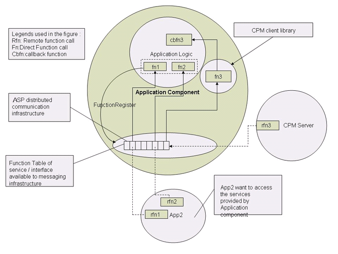
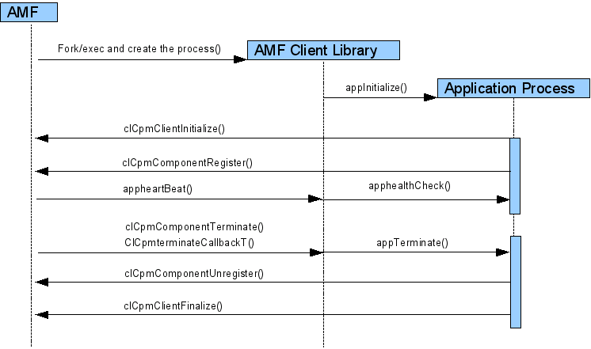

.. _comp-dev-label:

Developing Application Components in OpenClovis SAFplus Platform Environment
============================================================================

Eonization
----------
**Eonization** is a mechanism that enables the user application to communicate with OpenClovis SAFplus Platform. The name eonization 
derives from the word 'EO' or execution object. The end product of eonization is an EO that is able to communicate with other EOs in 
the SAFplus Platform environment.

Eonization enables an application to :

#. Invoke services exposed by the other EOs.
#. Expose services so that other EOs can invoke the same.
#. Provide some callbacks so that its lifecycle can be monitored by the SAFplus Platform.
#. Use the manageability features provided by the SAFplus Platform.
#. Integrate it with the AMF so that the application becomes highly available.

Significance of Eonization
--------------------------
The two most common software entities which are provided and managed (rather primitively) by many operating systems are **processes** 
and the **threads**. In most systems, processes are isolated from each other, whereas threads share same address space and hence 
error/failure in one of the threads can lead to errors/failures in other threads also.

In UNIX, the interaction between the OS and a process is passive. The OS starts up the process, sets up its environment and executes 
its main function. This enables the process to execute without any direct interference from the OS. It can either enter into an 
infinite loop or choose to intermittently request for services from the OS. Since the OS is unaware of the process' internals, it 
reacts only when it receives service requests from the process. The only mechanism for pro-actively sending information to the process 
is using signals.

But this model of OS to process communication is insufficient for middleware systems in carrier grade system, where the OS needs more 
fine grained control over the processes it creates and manages them over time. So we have two possible approaches in as far as the OS 
to process communication models are concerned in carrier grade system:

* Write an OS from scratch, which will periodically invoke specific set of callbacks in the context of processes that it creates, to 
  manage the component. or
* Create a wrapper over a normal application and make the application register some callbacks when initializing, which is called by the 
  SAFplus Platform middleware to manage the application. This approach requires some work from applications side like providing those 
  callbacks and registering them etc.

The OpenClovis SAFplus Platform follows the second approach and this process of "wrapping the component and it registering the 
callbacks which will be invoked by the middleware" is called **Eonization**. So the life cycle of a typical application will be:

* Register the callbacks with the SAFplus Platform.
* The callbacks will be invoked asynchronously by the SAFplus Platform, to manage the application.

The above model is similar to the life cycle of an X window client application, which registers set of callbacks to be invoked whenever 
there is a key press event or button press event etc. and the X server asynchronously invoking the corresponding callback in the 
context of the X window client application.

It is important to realize that this eonization provided by the OpenClovis EO infrastructure is much more general than one required to 
support programming models such as SAF programming model. Not only does it support AMF managing the component through invoking callbacks 
for a particular component, it allows any component to invoke callbacks provided by any other component, thus allowing for a much more 
powerful and generic programming model.

Steps involved in developing application components
---------------------------------------------------

.. seealso::
   Using the OpenClovis IDE to build a model and generate the corresponding code automates the steps outlined in this section. For more 
   information regarding the OpenClovis IDE see the *OpenClovis Sample Application Tutorial* and the *OpenClovis IDE User Guide*.

* :ref:`Step 1: Defining the Skeleton of a Component <comp-dev-step-1-label>`

  Define the skeleton of a component and describe its lifecycle functions and interface functions. Assign a unique IOC communication 
  port to the component that identifies the execution object.

* :ref:`Step 2: Defining clEoBasicLibs <comp-dev-step-2-label>`

  Define the set of OpenClovis SAFplus Platform libraries required by the component.

* :ref:`Step 3: Initializing the CPM Library <comp-dev-step-3-label>`

  Initialize the CPM client library.

* :ref:`Step 4: Registering the CPM <comp-dev-step-4-label>`

  Register the component with CPM infrastructure.

* :ref:`Step 5: Un-registering the CPM Library <comp-dev-step-5-label>`

  Un-register the application from CPM Infrastructure, on exit of the application.

* :ref:`Step 6: Finalizing the CPM Library <comp-dev-step-6-label>`

  Finalize the CPM client library when the component exits.

.. _comp-dev-step-1-label:

Step 1: Defining the Skeleton of a Component
^^^^^^^^^^^^^^^^^^^^^^^^^^^^^^^^^^^^^^^^^^^^
Using OpenClovis IDE, define a structure with the name as ``clEoConfig`` with the following fields initialized appropriately:

* Component lifecycle management parameters
* Number of worker threads
* Unique communication port Id associated with the component for communication within the SAFplus Platform infrastructure.

.. code-block:: c

   # define COMP_EO_NUM_THREAD 3
   # define COMP_IOC_PORT 0

   ClEoConfigT clEoConfig = {
       COMP_EO_NAME,                 /* EO Name */
       COMP_EO_THREAD_PRIORITY,      /* EO Thread Priority */
       COMP_EO_NUM_THREAD,           /* No of EO thread needed */
       COMP_IOC_PORT,                /* Required IOC Port */
       COMP_EO_USER_CLIENT_ID,       /* Client table ID*/
       COMP_EO_USE_THREAD_MODEL,     /* Whether to use main thread for EO
                                      * receive or not */
       clCompAppInitialize,          /* Function callback to initialize the
                                      * application */
       clCompAppFinalize,            /* Function callback to terminate the
                                      * application */
       clCompAppStateChange,         /* Function callback to change the
                                      * application state */
       clCompAppHealthCheck,         /* Function callback to check the
                                      * application health */
   };

Where,

* ``COMP_EO_NAME`` is the name of the component, also called as the Execution Object (EO).
* ``COMP_EO_THREAD_PRIORITY`` is the priority of the EO thread.
* ``COMP_EO_NUM_THREAD`` is the count of worker threads for RMD message processing. This must be greater than or equal to 1.
* ``COMP_IOC_PORT`` is the unique IOC communication port associated with every component.
* ``COMP_EO_USER_CLIENT_ID`` is the maximum number of clients that can exist for a given component. The default value that can be used 
  for this is ``COMP_EO_USER_CLIENT_ID_START``.
* ``COMP_EO_USE_THREAD_MODEL`` indicates whether the application should block the main thread or not.
* ``clCompAppInitialize`` is invoked by the OpenClovis SAFplus Platform infrastructure when an eonized application is started. It is 
  similar to the main() function of a typical C program. The application should do all its application specific initialization in this 
  function. For SA-aware components, after the application has done its initialization, it informs AMF that it is ready to provide 
  services using ``clCpmComponentRegister`` API.
* ``clCompAppFinalize`` is being deprecated and must be NULL.
* ``clCompAppStateChange`` is called whenever the application state needs to be changed to ``SUSPEND`` or ``RESUME``.
* ``clCompAppHealthCheck`` is called periodically by Component Manager to check the health of an eonized application, if the heart 
  beating is enabled. In response to this callback, the application is supposed to check if it is in a state of providing service and 
  if so provide appropriate feedback to CPM saying so.

.. image:: ../../images/sdkguide/SDK_UsageofApplicationType.png

.. note::
   The application must consider the following while defining the ``clEoConfig`` structure:

   * If you select ``COMP_EO_USE_THREAD_MODEL`` as ``CL_EO_USE_THREAD_FOR_RECV``, the main thread **must not be** blocked in the 
     ``clCompAppInitialize``. It must return after the library is initialized. Later, the main thread will be used for RMD message 
     receive function.
   * If you select ``COMP_EO_USE_THREAD_MODEL`` as ``CL_EO_USE_THREAD_FOR_APP``, the main thread **must be** blocked in the 
     ``ClEoAppCreateCallbackT`` or used by the application. It must return only when the ``ClCpmTerminateCallbackT`` is called.

.. _comp-dev-step-2-label:

Step 2: Defining clEoBasicLibs
^^^^^^^^^^^^^^^^^^^^^^^^^^^^^^
This structure contains the basic OpenClovis SAFplus Platform libraries required by the component. The first six libraries must always 
be set to ``CL_TRUE`` ; the remaining can be made ``CL_TRUE`` only if the corresponding services are required by the application. If 
set to ``CL_TRUE``, the corresponding libraries will automatically get initialized during component initialization.

.. code-block:: c

   ClUint8T clEoBasicLibs[] = {
       CL_TRUE,      /* OSAL */
       CL_TRUE,      /* Timer */
       CL_TRUE,      /* Buffer */
       CL_TRUE,      /* IOC */
       CL_TRUE,      /* RMD */
       CL_TRUE,      /* EO */
       CL_TRUE,      /* OM */
       CL_FALSE,     /* HAL */
       CL_FALSE,     /* DBAL */
   };

Step 2.1: Defining clEoClientLibs
"""""""""""""""""""""""""""""""""
This structure contains a list of client libraries which the components can initialize if they need the corresponding service within 
the SAFplus Platform infrastructure. All the values in this structure are optional. If set to ``CL_TRUE``, the corresponding libraries 
will automatically get initialized during component initialization.

.. code-block:: c

   ClUint8T clEoClientLibs[] = {
       CL_TRUE,       /* Clovis Object Registry */
       CL_TRUE,       /* Chassis Manager */
       CL_TRUE,       /* Name Service*/
       CL_TRUE,       /* Log Service*/
       CL_FALSE,      /* Trace Service */
       CL_FALSE,      /* Diagnostic Manager */
       CL_TRUE,       /* Transaction Manager */
       CL_FALSE,      /* NA */
       CL_TRUE,       /* Provisioning Library*/
       CL_TRUE,       /* Alarm Manager */
       CL_TRUE,       /* Debug Service*/
       CL_FALSE       /* Group Membership Service */
   };

When this is defined, the application is eonized. During startup, the stubs generated by OpenClovis IDE does all the necessary things 
as defined in the above structures.

.. note::
   OpenClovis SAFplus Platform libraries linked to the user application require three structures to be defined, otherwise, it will lead 
   to compilation failure.

.. _comp-dev-step-3-label:

Step 3: Initializing the CPM Library
^^^^^^^^^^^^^^^^^^^^^^^^^^^^^^^^^^^^
From ``clCompAppInitialize`` callback, you need to initialize the CPM library by calling the ``clCpmClientInitialize`` and provide a 
structure for callback, defined as ``ClCpmCallbacksT`` in ``clCpmApi.h`` file.

* ``ClCpmHealthCheckCallbackT`` callback: This callback is not implemented by OpenClovis SAFplus Platform for the current release.
* ``ClCpmTerminateCallbackT`` callback: This is called when the application requires to be terminated. In this function callback, the 
  application will clean up its acquired resources.
* ``ClCpmCSISetCallbackT`` callback: This is called when AMF assigns the workload to the application.
* ``ClCpmCSIRmvCallbackT`` callback: This is called when AMF removes the workload from the application.
* ``ClCpmProtectionGroupTrackCallbackT`` callback: This is called when there is a change in the status of the protection group of a 
  particular CSI. The application tracks the status of the CSI using ``clCpmProtectionGroupTrack`` API.
* ``ClCpmProxiedComponentInstantiateCallbackT`` callback: This is called when the proxy component instantiates one or more of its 
  proxied components.
* ``ClCpmProxiedComponentCleanupCallbackT`` callback: This is called when the proxy component clean up one or more of its proxied 
  components.

.. _comp-dev-step-4-label:

Step 4: Registering the CPM
^^^^^^^^^^^^^^^^^^^^^^^^^^^
From ``clCompAppInitialize`` callback, you need to register the component by invoking ``clCpmComponentRegister`` API. The component 
must be registered only when it is ready to provide the services. After the component is registered, it can either provide some 
specific service or use the services provided by other components. When AMF decides to terminate the component, it calls the 
``ClCpmTerminateCallbackT`` callback provided by the application.

.. _comp-dev-step-5-label:

Step 5: Un-registering the CPM Library
^^^^^^^^^^^^^^^^^^^^^^^^^^^^^^^^^^^^^^
From ``ClCpmTerminateCallbackT`` callback, you need to un-register the component by invoking ``clCpmComponentUnregister`` API. The 
component is un-registered when the component is no longer providing the services. You can cleanup all the associated resources.

.. _comp-dev-step-6-label:

Step 6: Finalizing the CPM Library
^^^^^^^^^^^^^^^^^^^^^^^^^^^^^^^^^^
From ``ClCpmTerminateCallbackT`` callback, you need to finalize CPM library by calling the ``clCpmClientFinalize`` API.

Component Characteristics
-------------------------
An application component in OpenClovis SAFplus Platform infrastructure has the following characteristics:

* Each component has an associated lifecycle and registers the initialization and termination functions with OpenClovis SAFplus 
  Platform infrastructure.
* Each component has a communication port called the IOC port assigned by OpenClovis SAFplus Platform infrastructure to communicate 
  with other components including Event, Checkpoint, Component Manager and so on. IOC manages the IOC port and implements the actual 
  mechanism of sending and receiving messages.
* Each component installs the services into the function table indexed by the service id through the ``clEoClientInstall`` API. This 
  function table is contained in the client table identified by the client id namely, ``CL_EO_NATIVE_COMPONENT_TABLE_ID``. To use any 
  service of the component, you must use the RMD number that uniquely identifies the service.
* Each component is associated with one or more worker threads. Every message intended to be delivered to a component, is set in a 
  queue by IOC on the corresponding port. This message is then picked up by the receiver thread in EO and queued in the EO Job Queue. 
  One of the worker threads picks up the message, decodes the RMD number, and executes the appropriate interface function.

.. _typical-component:

.. raw:: html

   

.. rst-class:: center

    **A Typical Component in OpenClovis SAFplus Platform Environment**

Figure :ref:`A Typical Component in OpenClovis SAFplus Platform Environment <typical-component>` explains the elements of OpenClovis 
SAFplus Platform component.

OpenClovis SAFplus Platform component comprises the following:

#. The function ``cbfn3`` is a callback function that represents the lifecycle function of the component. The lifecycle functions are 
   registered with distributed infrastructure of OpenClovis SAFplus Platform and helps to initialize, finalize, and check the status of 
   the component. These functions facilitate CPM to manage the lifecycle of the component.
#. The functions ``fn1`` and ``fn2`` are the component interface functions with a unique identifier. These functions are called the 
   service interface of the component and they represent the services that the components can provide.

   .. note::
        The function ``fn3`` is a service interface of the CPM component.

#. ``App2`` can make calls to ``fn1`` and ``fn2``, component interface function of ``App1`` using RMD of OpenClovis SAFplus Platform 
   distributed infrastructure. The functions ``fn1`` and ``fn2`` are depicted as ``rfn1`` and ``rfn2`` respectively in Figure 
   :ref:`A Typical Component in OpenClovis SAFplus Platform Environment <typical-component>`.

The CPM server periodically performs a health check on the component and remotely invokes the CPM client service functionality using 
RMD. This functionality in turn invokes the health check up callback, illustrated as ``cbfn3`` in Figure :ref:`A Typical Component in 
OpenClovis SAFplus Platform Environment <typical-component>`, of the component and returns the status to the CPM server.

Component Initialization
------------------------
OpenClovis SAFplus Platform provides a set of libraries that must be initialized for application manageability, high availability, and 
pre-defined main function for easy usability.

The following are the consequences when a component application is initialized:

#. It initializes the basic OpenClovis SAFplus Platform libraries to provide operating system or architecture-independent execution 
   context for the component. It also installs the signal handler to handle all the signals that causes the process termination [for 
   example SIGSEGV, SIGFBP, SIGILL, and so on]. Whenever a signal is generated, signal handler receives the stack trace and 
   signal-related information. The stack trace and the signal information are then moved into the shared memory.
#. It creates the communication link.
#. It initializes the client libraries so that the component can use the functionality provided by other components of OpenClovis 
   SAFplus Platform. For example, Event, Provisioning and so on.
#. It passes the control to the initialization callback function provided in the ``clEoConfig`` structure, where it can implement the 
   specific functionalities exposed by the application.
#. If the application holds the main thread, the execution continues with the application. Otherwise, after the initialization callback 
   returns, the main thread waits in a loop to accept messages.
#. When OpenClovis SAFplus Platform requires to shutdown a component, based on the policy or during node shutdown, 
   ``ClCpmTerminateCallbackT`` callback is invoked, which requires to follow the steps explained above.

.. rst-class:: center

    **Component Initialization sequence diagram**

.. note::
   If you create new threads or tasks, and send messages from the thread context, then ``clEoMyEoObjectSet()`` and 
   ``clEoMyEoIocPortSet()`` must be in the new thread context to set the environment for communication purpose. If not, every RMD 
   returns a failure.

Using Availability Management Framework (AMF)
---------------------------------------------
Applications can be made highly available by providing certain callbacks specific to AMF. AMF requires applications to provide callbacks 
for lifecycle operations, work assignment operations, and protect group related operations (optional). AMF decides to instantiate and 
assign workload to a component. The components can be instantiated by calling the ``clCompAppInitialize`` callback of the component. 
This callback is an indication to the component to start the process.

After the component completes the start process and is ready to receive the work assignments, it informs the AMF framework by invoking 
the AMF ``clCpmComponentRegister`` API.

Registration process is an indication for AMF that the component have been successfully started and can be assigned work by AMF. On 
receiving the register callback AMF assigns workload to the component with appropriate high availability state using the CSI set 
callback API registered in the callback function list using ``clCpmClientInitialize`` API.

The CSI set API informs the component that a given CSI (workload) have been assigned to the component. The CSI contains information 
about the name-value pairs and HA state assigned to the component. The name value pairs are the names and values that a component 
requires to start serving the workloads. For example, a name-value pair can be a configuration filename and its path or location of 
checkpointed data. The high availability state is assigned by the AMF to the component, for example, ACTIVE or STANDBY. The ACTIVE HA 
state is an indication that the component will be active for the given CSI. The STANDBY high availability state indicates that the 
component must prepare itself to takeover in case of failures of the ACTIVE component.

After receiving the CSI set request, the component informs the AMF framework after it is completes the processing required for serving 
the CSI. This response is an indication for the AMF that the component has successfully received the CSI request and is ready to serve 
the CSI.

HA state can have the following values:

* **Active** - This means the component is ready to serve the CSI.
* **Standby** - This means that component is on standby for the CSI.
* **Quiescing** - This means the component must finish the existing operations and must not take any new assignment. After it has 
  completed serving the existing request, it informs the AMF framework by calling ``Quiescing`` complete API. This is an indication to 
  AMF that the component will not take any new assignment for the CSI and the AMF framework can remove the CSI assignments from this 
  component and send it to other components.

AMF framework can call the CSI remove callback to remove the CSI assignments from the component. Component's response to this API is an 
indication for AMF to assign the CSI to other component.

AMF also provides API for interested component to track the status of protection group. Protection group comprises all the components 
that are assigned HA state (Active or Standby) for the CSI. Protection group tracks API allows the interested component to register 
with the framework indicating the CSI for which it is interested. The AMF framework informs the component whenever there is a change 
in the protection group by calling the protection group callback.

Proxied components can interact with the AMF framework through a proxy component. Proxy component is an SA-aware component that can 
communicate with the AMF framework directly. The calls to proxied component pass through the proxy component. All the lifecycle 
operations, workload operations for proxied component are carried through the proxy component.

Characteristics of a Sample Application
---------------------------------------
The sample application depicts an application to generate Global Sequence Numbers. The following are the characteristics of this 
component:

* ``clCompAppInitialize``, ``clCompAppFinalize``, and ``clCompAppStateChange`` are the lifecycle related functions.
* ``clCompAppHealthCheck`` is the functionality related to High Availability.

Sample Code for developing an application component
---------------------------------------------------

clCompAppMain.h
^^^^^^^^^^^^^^^

.. code-block:: c

   #ifndef CL_COMP_APP_MAIN
   # define CL_COMP_APP_MAIN
   # include <clCompCfg.h>
   # ifndef COMP_NAME
   # error "COMP_NAME is not defined. Bad or missing ./clCompCfg.h"
   # endif
   ClRcT clCompAppTerminate
                 (ClInvocationT invocation,
                  const ClNameT *compName);
   ClRcT clCompAppAMFCSISet
                 (ClInvocationT invocation,
                  const ClNameT *compName,
                  ClAmsHAStateT haState,
                  ClAmsCSIDescriptorT csiDescriptor);
   ClRcT clCompAppAMFCSIRemove
                 (ClInvocationT invocation,
                  const ClNameT *compName,
                  const ClNameT *csiName,
                  ClAmsCSIFlagsT csiFlags);
   ClRcT clCompAppInitialize
                 (ClUint32T argc,
                  ClCharT *argv[]);
   ClRcT clCompAppFinalize();
   ClRcT clCompAppStateChange
                 (ClEoStateT eoState);
   ClRcT clCompAppHealthCheck
                 (ClEoSchedFeedBackT *schFeedback);
   #endif

clCompAppMain.c
^^^^^^^^^^^^^^^

.. code-block:: c

   #include <clCommon.h>
   #include <clOsalApi.h>
   #include <clIocServices.h>

   #include <clRmdApi.h>
   #include <clDebugApi.h>
   #include <clOmApi.h>
   #include <clOampRtApi.h>
   #include <clProvApi.h>
   #include <clAlarmApi.h>

   #include <clEoApi.h>
   #include <clCpmApi.h>
   #include <clIdlApi.h>
   #include <string.h>
   #include "./clCompAppMain.h"
   #include "clCompA.h"
   #if HAS_EO_SERVICES
   extern ClRcT idlClientInstall(void);
   #endif
   ClCpmHandleT cpmHandle;
   ClRcT clCompAppTerminate(ClInvocationT invocation, const ClNameT *compName)
   {
       ClRcT rc;

       COMPA_DBG_PRINT(("Inside %s \n", __FUNCTION__));
       /*
        Do the App Finalization
        */
       clAppFinalize();
       COMPA_DBG_PRINT(("Unregister with CPM before Exit .................%s\n",
                        compName->value));
       rc = clCpmComponentUnregister(cpmHandle, compName, NULL);
       COMPA_DBG_PRINT(("Finalize before Exit ................. %s\n",
                        compName->value));
       rc = clCpmClientFinalize(cpmHandle);
       clCpmResponse(cpmHandle, invocation, CL_OK);
       return CL_OK;
   }
   ClRcT clCompAppAMFCSISet(ClInvocationT invocation, const ClNameT *compName,
                            ClAmsHAStateT haState,
                            ClAmsCSIDescriptorT csiDescriptor)
   {
       ClRcT rc = CL_OK;
       COMPA_DBG_PRINT(("Inside Function %s \n", __FUNCTION__));
       if (haState == CL_AMS_HA_STATE_QUIESCING)
       {
           /*
            TODO make the quiescing complete call after the work assigned is
            done
            */
           rc = clAppSetQuiescingState(invocation, compName, csiDescriptor);
           COMPA_DBG_PRINT(("######## before clCpmCSIQuiescingComplete for "
                            "%s ########\n", COMP_EO_NAME));
           clCpmCSIQuiescingComplete(cpmHandle, invocation, rc);
       }
       else if (haState == CL_AMS_HA_STATE_ACTIVE)
       {
           rc = clAppSetActiveState(invocation, compName, csiDescriptor);
           COMPA_DBG_PRINT(("######## before clCpmResponse(ACTIVE) for "
                            "%s########\n", COMP_EO_NAME));
           clCpmResponse(cpmHandle, invocation, rc);
       }
       else if (haState == CL_AMS_HA_STATE_STANDBY)
       {
           rc = clAppSetStandbyState(invocation, compName, csiDescriptor);
           COMPA_DBG_PRINT(("######## before clCpmResponse(STANDBY) for "
                            "%s########\n", COMP_EO_NAME));
           clCpmResponse(cpmHandle, invocation, rc);
       }
       else
       {
           COMPA_DBG_PRINT(("######## before clCpmResponse(%d) for %s########\n",
                            haState, COMP_EO_NAME));
           clCpmResponse(cpmHandle, invocation, CL_OK);
       }
       if (CL_OK != rc)
       {
           COMPA_DBG_PRINT(("clCompAppAMFCSISet failed with %d for %s\n", rc,
                            COMP_EO_NAME));
       }
       return CL_OK;
   }

   ClRcT clCompAppAMFCSIRemove(ClInvocationT invocation, const ClNameT *compName,
                               const ClNameT *csiName, ClAmsCSIFlagsT csiFlags)
   {
       ClRcT rc = CL_OK;
       COMPA_DBG_PRINT(("Inside Function %s \n", __FUNCTION__));
       /*
        TODO stop the work assigned before making the response done
        */
       rc = clAppCSIRemove(invocation, compName, csiName, csiFlags);
       clCpmResponse(cpmHandle, invocation, rc);
       return CL_OK;
   }
   /*
   Service Initialization:
     1. Initialize your counter and create mutex.
     2. Register Name and generate Logical Address
     3 Initialize Checkpoint Service
   */
   ClRcT clAppInitialize(ClCpmHandleT cpmHandle)
   {
       ClRcT rc = CL_OK;
       ClNameSvcRegisterT nameRegInfo = { {0} };
       ClEoExecutionObjT *pEoObj = NULL;
       ClNameT compName = { 0 };
       clLogWrite(CL_LOG_HANDLE_APP,CL_LOG_DEBUG,COMP_A_SERVICE_NAME,
       CL_COMPA_LOG_0_INIT_ENTER);
       gAppGlobal.version.releaseCode = 'B';
       gAppGlobal.version.majorVersion = 0x01;
       gAppGlobal.version.minorVersion = 0x01;
       gAppGlobal.ckptName.length = sizeof(CKPT_NAME);
       strncpy(gAppGlobal.ckptName.value, CKPT_NAME, strlen(CKPT_NAME));
       gAppGlobal.cpmHandle = cpmHandle;
       gAppGlobal.ckptHdl = -1;
       /*
        counter is initialized here
        */
       gAppGlobal.count = 0;
       rc = clOsalMutexCreate(&gAppGlobal.mutex);
       if (rc != CL_OK)
       {
           COMPA_DBG_PRINT(("Failure in mutex create [0x %x]", rc));
           clLogWrite(CL_LOG_HANDLE_APP,CL_LOG_ERROR,COMP_A_SERVICE_NAME,
                   CL_COMPA_LOG_1_MUTEX_CREATE_FAILED, rc);
           return rc;
       }
       /* register your name with Name Service and get the logical address */
       rc = clCpmComponentNameGet(gAppGlobal.cpmHandle, &compName);
       if (CL_OK != rc)
       {
           COMPA_DBG_PRINT(("Failure in component name get [0x %x]", rc));
           clLogWrite(CL_LOG_HANDLE_APP,CL_LOG_ERROR,COMP_A_SERVICE_NAME,
                   CL_COMPA_LOG_1_NAME_GET_FAILED, rc);
           goto mutexCleanup;
       }
       rc = clCpmComponentIdGet(gAppGlobal.cpmHandle, &compName,
                                &gAppGlobal.compId);
       if (CL_OK != rc)
       {
           COMPA_DBG_PRINT(("Failed to get the component ID  [0x %x]", rc));
           clLogWrite(CL_LOG_HANDLE_APP,CL_LOG_ERROR,COMP_A_SERVICE_NAME,
                   CL_COMPA_LOG_1_ID_GET_FAILED, rc);
           goto mutexCleanup;
       }
       nameRegInfo.name.length = strlen(COMP_A_SERVICE_NAME);
       strcpy(nameRegInfo.name.value, COMP_A_SERVICE_NAME);
       nameRegInfo.compId = gAppGlobal.compId;
       nameRegInfo.priority = CL_NS_PRIORITY_HIGH;
       nameRegInfo.attrCount = 0;
       gAppGlobal.nameObjRef = CL_NS_GET_OBJ_REF;
       rc = clNameRegister(gAppGlobal.nameCntxId, &nameRegInfo,
                           &(gAppGlobal.nameObjRef));
       if (rc != CL_OK)
       {
           COMPA_DBG_PRINT(("Failed to register with name [0x %x]", rc));
           clLogWrite(CL_LOG_HANDLE_APP,CL_LOG_ERROR,COMP_A_SERVICE_NAME,
                   CL_COMPA_LOG_1_NAME_REGISTER_FAILED, rc);
           goto mutexCleanup;
       }
       else
       {
           clLogWrite(CL_LOG_HANDLE_APP,CL_LOG_DEBUG,COMP_A_SERVICE_NAME,
                      CL_COMPA_LOG_0_NAME_REGISTERED);
       }
       /*
        Initialize the Checkpoint Service
        */
       rc = clCkptInitialize(&gAppGlobal.ckptSvcHdl, NULL, &gAppGlobal.version);
       if (rc != CL_OK)
       {
           COMPA_DBG_PRINT(("Failed in checkpoint initialize rc [0x %x]", rc));
           clLogWrite(CL_LOG_HANDLE_APP,CL_LOG_ERROR,COMP_A_SERVICE_NAME,
                   CL_COMPA_LOG_1_CKPT_INIT_FAILED, rc);
           goto nameCleanup;
       }
       rc = clEoMyEoObjectGet(&pEoObj);
       if (rc != CL_OK)
       {
           COMPA_DBG_PRINT(("Failed to get the EoObject rc [0x %x]", rc));
           goto ckptCleanup;
       }
       gAppGlobal.pEoObj = pEoObj;
       rc = compADebugRegister(gAppGlobal.pEoObj);
       if (rc != CL_OK)
       {
           COMPA_DBG_PRINT(("Failed to register with debug rc[0x %x]", rc));
           goto ckptCleanup;
       }
       COMPA_DBG_PRINT(("Sucessfully completed initialization\n"));
       clLogWrite(CL_LOG_HANDLE_APP,CL_LOG_DEBUG,COMP_A_SERVICE_NAME,
               CL_COMPA_LOG_0_INIT_DONE, rc);
       return CL_OK;
     ckptCleanup:
       clCkptFinalize(gAppGlobal.ckptSvcHdl);
     nameCleanup:
       clNameComponentDeregister(gAppGlobal.compId);
     mutexCleanup:
       clOsalMutexDelete(gAppGlobal.mutex);
       return rc;
   }
   ClRcT clCompAppInitialize(ClUint32T argc, ClCharT *argv[])
   {
       ClNameT appName;
       ClCpmCallbacksT callbacks;
       ClVersionT version;
       ClIocPortT iocPort;
       ClRcT rc = CL_OK;
       /*
        Do the App intialization
       */
       /*
        Do the CPM client init/Register
       */
       version.releaseCode = 'B';
       version.majorVersion = 01;
       version.minorVersion = 01;
       callbacks.appHealthCheck = NULL;
       callbacks.appTerminate = clCompAppTerminate;
       callbacks.appCSISet = clCompAppAMFCSISet;
       callbacks.appCSIRmv = clCompAppAMFCSIRemove;
       callbacks.appProtectionGroupTrack = NULL;
       callbacks.appProxiedComponentInstantiate = NULL;
       callbacks.appProxiedComponentCleanup = NULL;
       clEoMyEoIocPortGet(&iocPort);
       COMPA_DBG_PRINT(("Application Address 0x%x Port %x\n",
                        clIocLocalAddressGet(), iocPort));
       rc = clCpmClientInitialize(&cpmHandle, &callbacks, &version);
       COMPA_DBG_PRINT(("After clCpmClientInitialize %d\t %x\n", cpmHandle, rc));
   #if HAS_EO_SERVICES
       idlClientInstall();
   #endif
       /*
        Block and use the main thread if required other wise return
        */
       /*
        TODO: Application code should come here
        */
       clAppInitialize(cpmHandle);
       /*
        if main thread usage policy == CL_EO_USE_THREAD_FOR_APP return from this
        function only after app finishes
        */
       /*
        if main thread usage policy == CL_EO_USE_THREAD_FOR_RECV return from
        this function immediately after doing some application initialize stuff
        */
       rc = clCpmComponentNameGet(cpmHandle, &appName);
       COMPA_DBG_PRINT(("After clCpmComponentNameGet %d\t %s\n", cpmHandle,
                        appName.value));
       rc = clCpmComponentRegister(cpmHandle, &appName, NULL);
       COMPA_DBG_PRINT(("After clCpmClientRegister %x\n", rc));
       return CL_OK;
   }
   ClRcT clCompAppFinalize()
   {
       return CL_OK;
   }
   ClRcT clCompAppStateChange(ClEoStateT eoState)
   {
       /*
        Application state change
       */
       return CL_OK;
   }
   ClRcT clCompAppHealthCheck(ClEoSchedFeedBackT *schFeedback)
   {
       /*
        Modify following as per App requirement
       */
       schFeedback->freq = CL_EO_BUSY_POLL;
       schFeedback->status = CL_CPM_EO_ALIVE;
       return CL_OK;
   }
   ClEoConfigT clEoConfig = {
       COMP_EO_NAME,               /* EO Name */
       COMP_EO_THREAD_PRIORITY,    /* EO Thread Priority */
       COMP_EO_NUM_THREAD,         /* No of EO thread needed */
       COMP_IOC_PORT,              /* Required Ioc Port */
       COMP_EO_USER_CLIENT_ID,
       COMP_EO_USE_THREAD_MODEL,   /* Whether to use main thread for
                                      eo Recv or not */
       clCompAppInitialize,        /* Function CallBack to initialize
                                      the Application */
       clCompAppFinalize,          /* Function Callback to Terminate
                                      the Application */
       clCompAppStateChange,       /* Function Callback to change the
                                      Application state */
       clCompAppHealthCheck,       /* Function Callback to change the
                                      Application state */
   };
   /*
    You may force default libraries here by using CL_TRUE or CL_FALSE or use
    appropriate configuration generated by ClovisWorks in ./clCompAppMain.h The
    first 6 basic libraries are mandatory.
   */
   ClUint8T clEoBasicLibs[] = {
       COMP_EO_BASICLIB_OSAL,      /* osal */
       COMP_EO_BASICLIB_TIMER,     /* timer */
       COMP_EO_BASICLIB_BUFFER,    /* buffer */
       COMP_EO_BASICLIB_IOC,       /* ioc */
       COMP_EO_BASICLIB_RMD,       /* rmd */
       COMP_EO_BASICLIB_EO,        /* eo */
       COMP_EO_BASICLIB_OM,        /* om */
       COMP_EO_BASICLIB_HAL,       /* hal */
       COMP_EO_BASICLIB_DBAL,      /* dbal */
   };
   ClUint8T clEoClientLibs[] = {
       COMP_EO_CLIENTLIB_COR,      /* cor */
       COMP_EO_CLIENTLIB_CM,       /* cm */
       COMP_EO_CLIENTLIB_NAME,     /* name */
       COMP_EO_CLIENTLIB_LOG,      /* log */
       COMP_EO_CLIENTLIB_TRACE,    /* trace */
       COMP_EO_CLIENTLIB_DIAG,     /* diag */
       COMP_EO_CLIENTLIB_TXN,      /* txn */
       CL_FALSE,                   /* NA */
       COMP_EO_CLIENTLIB_PROV,     /* Prov */
       COMP_EO_CLIENTLIB_ALARM,    /* alarm */
       COMP_EO_CLIENTLIB_DEBUG,    /* debug */
       COMP_EO_CLIENTLIB_GMS       /* gms */
   };
