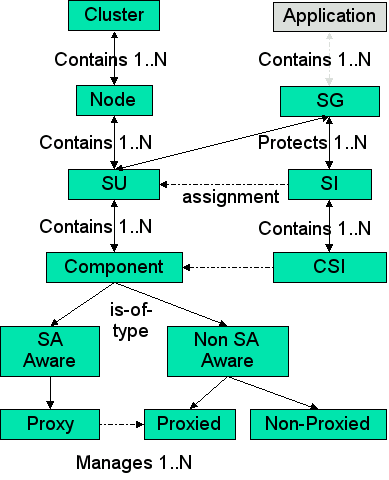
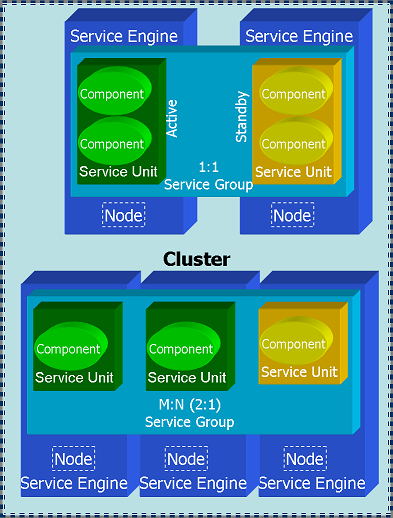
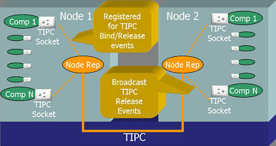
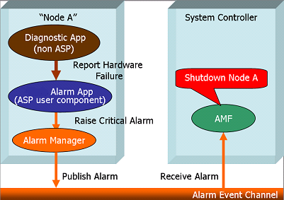
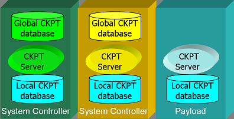
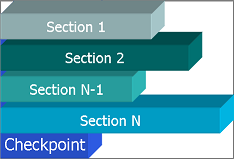

High Availability
=================
High Availability (HA) is used when referring to a system that is capable of providing service "most of the time." High availability 
can be achieved by combining many different design concepts and system characteristics, including hardware and software level 
redundancy, fault detection capabilities, component failover, fault isolation, fault recovery, alarm notification, and so on. This 
chapter provides a short introduction to the key concepts, and presents the relevant features and services of **OpenClovis SAFplus**.

Key Topics:

* HA Concepts, Terms, and Definitions
* SAFplus Platform Features for High Availability
* Availability Management Framework (AMF)
* Fault Detection and Handling
* Checkpointing Service (CPS)
* Group Membership Service (GMS)
* Typical Usage of High Availability

HA Concepts, Terms, and Definitions
-----------------------------------
Availability is a measure of the probability that a service is available for use at any given instant. It allows service failure, 
with the assumption that the service restoration is imminent. The key to high availability is to continue the service without 
significant interruption.

The quantitative definition of availability is:

Availability = MBTF/(MBTF+MTTR) = 0.9xxx

where MTBF is the mean time between failures, and MTTR is the mean time to repair. In layman terms, Availability is simply the 
percentage uptime of the system, that is, the percentage of time the system is providing the given service. As this number is 
typically always below but very close to 1.0 in a highly available system (e.g., 0.999), it is often expressed in terms of "N-nines". 
The table below illustrates the downtime of systems with various "N-nines".

+---------------------+-----------------------------------+
| Availability        | Downtime                          |
+=====================+===================================+
| two-nines (99%)     | ~3.7 days/year (~14 min/day)      |
+---------------------+-----------------------------------+
| three-nines (99.9%) | ~ 8.75 hr/year                    |
+---------------------+-----------------------------------+
| four nines (99.99%) | ~ 1 hr/year                       |
+---------------------+-----------------------------------+
| five nines          | ~ 5.25 min/year                   |
| (99.999%)           |                                   |
+---------------------+-----------------------------------+

.. raw:: html

   

.. rst-class:: center

**Availability and Downtime**

The five key system characteristics contributing to HA are:

* **Failure detection:** how reliably and quickly can failure be detected
* **Failure notification:** how reliably and quickly can the information of the failure be passed to an authority that can decide 
  how to handle the failure
* **Response time:** how long it takes for the failure handling authority to process the information about the failure and come to 
  a decision on how to best handle the failure
* **Repair/replacement time:** how long it takes to repair or replace the failed component
* **Recovery/restart/reboot time:** how long it takes to restore the original system state and hence restore the service.

Each of the above five system characteristics directly contribute to the downtime after a failure, and hence to the availability of 
the system. However, a few design concepts can greatly reduce many of these times and even eliminate the affect of some. These are:

* **Redundant components with failover capabilities:** In a system where the same service can be provided by two or more identical 
  redundant components, the service can be quickly recovered before the failed component is actually repaired or restarted, by 
  switching the service over to a healthy component. This effectively eliminates the repair/replacement time from contributing to 
  the availability. It replaces with a new characteristics, however: the **failover time**. Redundancy can be provided at various 
  levels:

  * Hardware (e.g., redundant hardware elements in an AdvancedTCA chassis
  * Software (e.g., standby software components)

* **Automated failure detection, response, and reconfiguration** By fully automating the entire event flow from fault detection to 
  recovery (and thereby excluding human intervention from the picture), the remaining four factors can be greatly reduced. In modern 
  systems, such as built on OpenClovis SAFplus Platform, the service can be recovered by means of component failover within tens of 
  milliseconds from the time the failure occurred.

OpenClovis SAFplus Platform provides infrastructure for the end-to-end life-cycle of failure handling, including failure detection, 
to policy-based recovery decision making, through failover and fault repair operations. However, for custom software applications to 
be able to quickly fail over without major disturbance to the rest of the system, the applications themselves need to exhibit some 
special characteristics. These include:

* capability to move state data and context among redundant components
* move the service from one component to another in a way that the failover is transparent to the rest of the system

In addition to the above mentioned end-to-end failure handling, OpenClovis SAFplus Platform provides additional services to allow 
application programmers to implement the above characteristics. These include checkpoint service (to save, pass, and restore system 
state) and location-transparent addressing (to hide the failover from other components).

Redundant components providing the same service can be arranged in many relationships. The most common arrangements are:

* 2N (1+1) redundancy: for every active component there is exactly one standby component
* M+N redundancy: for every M active components there are N standby components, any of which is ready to take over the service from 
  any of the active components. (Note that 1+1 is merely a special, but most common, case of M+N.)

Additional models, such as N-Way and N-Way-Active, are also often used. See a more authoritative description in the Application 
Interface Specification (AIS) from the SA Forum.

Before describing the individual models it may be useful to describe the SA Forum HA model and its associated terminology.

The SAF concepts introduced in the figure can be explained as follows:

* **Component:** It is the smallest logical entity on which AMF performs error detection, isolation, recovery, and repair. A 
  component is a single process or multiple processes that AMF manages based on its configured attributes. A component is further 
  classified depending on whether it is an SA-aware or a non SA-aware, whether it is pre-instantiable or not and whether it is a 
  proxy for other components or can be proxied by other components.
  
  A component is a hardware or a software entity or a combination of both. A hardware component is a blade, a standalone PC, a PMC 
  or any entity that can be considered as one distinct unit for the purpose of error isolation, recovery and repair. A software 
  component is realized as a process, a thread, or a collection of processes. Hardware entities are typically viewed as either 
  non-preinstantiable, non-proxied components or proxied components. They are not directly controlled by the HA infrastructure. All 
  interactions with them must go through a software proxy component, which can be directly controlled by the HA infrastructure.
* **Component Service Instance (CSI):** It represents a unit of workload that is assigned to a component. Each CSI has a set of 
  attributes that characterizes the workload assigned to the component. These attributes are not used by AMF and are passed to the 
  components.
* **Service Instance (SI):** It is an aggregation of various CSIs that can be assigned to the components in the SU. These CSIs can 
  be ranked in order or priority.
* **Service Unit (SU):** It is an aggregation of one or more components that are managed together to provide a service. Redundancy 
  is provided to the SU as a whole. This implies that all the processes that are clubbed together with an SU will switchover or 
  failover as a unit.
* **Service Group (SG):** It is a collection of service units (SUs) of the same type that collectively provide service availability 
  for one or more service instances. A redundancy model associated with the service group defines how the service units in the group 
  are used to provide service availability. An SG is defined at run-time and is dynamically populated with the required SUs.
* **Node:** A logical representation of a physical node that houses Service Units and components.
* **Cluster:** It comprises the entire system containing multiple nodes.

OpenClovis SAFplus Platform provides a SA Forum compliant implementation of the 2N and M+N redundancy models. These two models can 
be used to provide Active/Active and N Way Active functionality if desired as well.

The figure shows a SA Forum compliant 1:1 and 2:1 redundancy model applied to a Cluster of Nodes. A Service Engine is interchangeable 
with Node in this dicusssion.

SAFplus Platform Features for High Availability
-----------------------------------------------
OpenClovis SAFplus Platform includes a powerful set of integrated High Availability services that are used to manage resource failures 
without interrupting services. High Availability of services provide software exception handling and recovery mechanisms. OpenClovis 
SAFplus Platform services can identify their failure modes and can implement system-defined mechanisms. The following features are 
supported by SAFplus Platform:

SA Forum Compliant Model and AMF APIs
^^^^^^^^^^^^^^^^^^^^^^^^^^^^^^^^^^^^^
Availability Management Framework (AMF) closely follows the SA Forum AMF specification.

Creation of HA Models
^^^^^^^^^^^^^^^^^^^^^
HA Model definitions and their instantiations are defined prior to runtime. The HA Models can be specified during the modelling phase, 
where the graphical IDE provides convenient UML based icons to specify the HA model desired (including the desired availability model 
of every service group (SG) in the system and the required actions for every component on their failures) and all the corresponding 
fault escalation and recovery policies. This is then converted into a set of XML configuration files that define the type and 
instance information. The XML files can be modified as well prior to starting SAFplus Platform.

Redundancy Models Supported
^^^^^^^^^^^^^^^^^^^^^^^^^^^

* **2N (or 1:1) Redundancy Model:** OpenClovis SAFplus Platform provides a SAF compliant implementation of the 2N redundancy model. 
  2N redundancy model allows N number of Service Groups, each with up to one active and one standby Service Unit (SU) and with 
  arbitrary number of spares. Active components provide service, standbys are prepared to take over the service in case of a 
  component failure. Active and standby components may reside either on the same node or on different nodes. Standbys for multiple 
  actives can reside on the same node. Active and standby can share states using checkpointing (hot/warm standby).

  The traditional rendition of this redundancy model is described in the Figure SA Forum Compliant Redundancy Models. Another 
  feature availbale to the system designer is the concept of Spare SUs that enables design of robust 1:1 protection scheme as 
  described below:

  .. image:: ../../images/sdkguide/Ha_spare.png

  .. rst-class:: center

  **1:1 Redundancy with Spare SU**

  A Spare SU is not activated or given a workload assignment when the Active SU and Standby SU are operational. However if the 
  Active or Standby SU fail, for instance if the Node housing the Active SU becomes inoperational, the Standby SU is made Active 
  and the Spare SU is promoted to Standby Role. If the failed SU is brought back into service, either automatically by the HA 
  infrastructure or manually through administrative interface, it assumes the Spare SU role.

* **M+N Redundancy Model:** The Spare SU concept holds true for the M+N redundancy as well. The variations of M+N supported and 
  tested for by OpenClovis are N:1, N:N and M:N, for instance 3:1 ( 3 Active and 1 Standby), 3:2 (3 Active and 2 standby) 3:3 (3 
  Active and 3 Standby).
* **Active/Active:** The N Way Active redundancy model of which Active/Active is a subset is not explicitly supported by OpenClovis 
  SAFplus Platform, however, this can be achieved effectively in the following manner:

  .. image:: ../../images/sdkguide/Active_active.png

  .. rst-class:: center

  **Using 1:1 redundancy to achieve Active/Active redundancy**

  In the figure above is shown two SGs each identical in definition, but reversed in the order of Active and Standby SUs. When a SU 
  is made Active it is assigned a Component Service Instance (CSI) which defines its work assignment, so that in this example each 
  SU will be given 1/2 (or whatever fraction desired) of the total workload. In the above Figure if the there is a Node 2 fails or 
  the Active SU in Node 2 fails, then Node 1 takes on the entire workload.

Node Type Distinctions
^^^^^^^^^^^^^^^^^^^^^^
An OpenClovis cluster has two classes of nodes:

* System Controller
* Payload (Worker) Node

Only System Controller nodes are allowed to take part in leader election, so that one is elected master, and the other is elected 
deputy. System Controller nodes can run user applications just like any other node in the cluster. In addition there are certain 
processes that only run on the System Controller, they are:

* **Availability Management Framework (AMF):** The availability Management Framework is a single Linux process but contains two 
  distinct logical components. On a Payload Blade the AMS component is inactive and CPM component takes on the CPM-L flavor, however 
  the same physical program runs on both node class types.

  * **Availability Management Service (AMS):** SAF compliant implementation of AMF, that takes care of implementing the policy based 
    HA logic, for instance failover policy. The logic here needs a global view of the cluster in order to make decisions and so by its 
    very nature must be centralized.
  * **Component Manager Global (CPM-G):** The Component Manager controls the lifecyle and monitors all SAFplus Platform components 
    including SAFplus Platform servers. There are Component Managers running on Payload Blades (CPM-L) as well, the difference between 
    the CMP-L and CPM-G is that CPM-L acts under the control of CPM-G.

* **Clovis Object Repository (COR):** This is SAF IMM aligned object repository that is centralized to the active and standby System 
  Controllers. The major reason for keeping this central was due to performance considerations when compared to a distributed Object 
  Repository. It should be pointed out here, that access to COR is distributed so that COR clients on any node in the cluster make the 
  same API calls to access COR.
* **Platform Support Package (PSP):** PSP is integrated with SAF compliant HPI implementations like OpenHPI to communicate with the 
  Shelf Manager of an ATCA chassis to provide platform management. The PSP is an optional package and is tuned to particular ATCA or 
  proprietary chassis.

Fault Management
^^^^^^^^^^^^^^^^
This includes Fault Removal and Failure Forecasting. The system helps in Fault Detection, Fault Isolation, Fault Recovery, Fault 
Repair, Fault Notification, and Prediction.

Checkpointing Service
^^^^^^^^^^^^^^^^^^^^^
The Checkpointing Service allows the applications to save their internal state, and retrieve it later. This enables quick restart. 
Alternatively, the state is retrieved by standby components for very quick failovers.

Availability Management Framework (AMF)
---------------------------------------
The Availability Management Framework (AMF) functions are collectively implemented in the Availability Management Service (AMS) and 
the Component Manager (CPM) software components.

AMS is the primary decision making entity in the system with respect to service availability.

The CPM is the operational manager entity and is responsible for managing the various components through their life cycle, based on 
the configured policy as well as directions from AMS.

AMS and CPM together maintain a view of the system model that describes the various software and hardware components in the system, 
their attributes, dependencies on each other, rules for grouping them together for providing services availability, current state 
and policies to be applied in the event of failure.

CPM-AMS interaction
^^^^^^^^^^^^^^^^^^^
In SAFplus Platform world, the Availability Management Framework is implemented as two entities Availability Management Service (AMS) 
and Component Manager (CPM). Even though both the entities are in the same process, there is a very clear separation of 
functionalities between AMS and CPM.

* AMS is a 'server library' that maintains the (configuration and status) information about the whole cluster, knows the policies that 
  has been configured for different entities, the recovery (or repair) actions to be taken in case of an application failure, based on 
  both the configured policies as well as the current cluster system state. AMS deals only with application components.
* CPM is an operational entity which simply carries out the commands given by the AMS. However, CPM does manage the complete life cycle 
  of the SAFplus Platform components. The recovery policy for the SAFplus Platform components is unlike AMS, very primitive. If an 
  SAFplus Platform component fails, it will be simply restarted. There is a limit to these restart attempts however, after which the 
  node will be shutdown.

Summary of interactions between AMS and CPM
^^^^^^^^^^^^^^^^^^^^^^^^^^^^^^^^^^^^^^^^^^^

* **AMS to CPM:**

  * Call to CPM for managing the life cycle of the component.
  * Call to CPM for assigning (and removing) work to the component.
  * Informing CPM that some node for whom the shutdown request has come can (or cannot) be shutdown.
  * Informing CPM when taking node level recovery actions. (Node failfast and node failover.)

* **CPM to AMS:**

  * Responding to AMS the success/failure of component life cycle or work assignment/removal request.
  * Reporting fault on the component, whenever a failure on that component is detected.
  * Querying AMS about the HA state of the component.
  * Informing to AMS that node is joining the cluster and is ready to provide service.
  * Informing to AMS that some node wants to leave the cluster and so if it is permitted for the node to be shutdown, switchover all 
    the components and do the shutdown.
  * Informing to AMS that some node has exited ungracefully and hence do the failover the components without actually trying to 
    contact the failed node.
  * Informing to AMS about availability/unavailability of some of the SAFplus Platform components.

Architecture of the CPM
^^^^^^^^^^^^^^^^^^^^^^^
In an SAFplus Platform cluster, there is a CPM running on every node, managing the components on that node. This is in contrast to 
the AMS, which will be brought into life by CPM only if that node happens to be a system controller.

Based on whether AMS is initialized by CPM or not there are two types of CPM:

* Local Component Manager. This is also called \b CPM/L (L standing for the local). The node (or blade) where CPM/L is running is 
  called **Worker Blade**. The word **Worker Node** also means the same thing.
* Global Component Manager. This is also called \b CPM/G (G standing for the global). The node (or blade) where CPM/G is running is 
  called **System Controller Blade** or simply **System Controller**.

The terms CPM/G and System Controller, CPM/L and Worker Blade (Worker Node) are used interchangeably, sometimes referring to the CPM 
running on the node as an entity and sometimes referring to the node itself where the particular type of CPM is running.

The differences between CPM/G and CPM/L are :

* The AMS will be running only on System Controller node. The system controller node where AMS is running in active mode is said to 
  have and Active HA state. Similarly the system controller where the AMS is running in standby mode is said to have Standby HA state. There will be no AMS running on a Worker Node however and so worker node does not have any HA state associated with it.
* The CPM/G(Both active and standby) maintains the information about all the nodes (but not the components in those nodes) in the 
  cluster and does the heart beating of all the nodes which are up and running. The CPM/L does not maintain any such information.
* The active CPM/G or active system controller blade is the one where all the HA related activities take place. It is the place to 
  where all the triggers about various events happening in the cluster (e.g. node failure, user component failure, node is ready to 
  provide service etc) will go either directly or indirectly and the corresponding actions are taken.
* On ungraceful termination of any node, CPM/G will publish an event providing information about the failed node.
* The active CPM/G acts as an intermediate entity between AMS and real world. It is the one which brings AMS to life and keeps it 
  informed about the events which are going on in the cluster such as :

  * Node is joining because it is ready to provide service.
  * Node is leaving because shutdown was issued on the node.
  * Node has left the cluster, because it was killed or crashed for some reason (e.g. communication failure, kernel panic etc)

* The active CPM/G is the one which actually carries out various operations specified by the AMS in reaction to the various events

The commonalities between CPM/G and CPM/L are :

* Both types of CPM manage life cycle of the SAFplus Platform components on the local node.
* Heart beating of the components. Both types of the CPMs do heart beating of the local components and take the following actions:

  * If the heart beat loss was for an SAFplus Platform component, then the CPM will restart it. But if this failure happens more than 
    certain number of times within a particular time window, then the node will be shutdown gracefully.
  * If the heart beat loss was for an user defined component, then the CPM will report the failure to AMS via 
    clCpmComponentFailureReport() API.

* On death of any component whether SAFplus Platform or user defined, CPM will publish an event using event management API, providing 
  information about the failed component.

The OpenClovis Availability Management Framework (AMF) is a software entity that is primarily responsible for service recovery. It 
provides a framework for high availability of applications in a system by coordinating with the redundant resources.

It executes pre-configured recovery actions on failure of the application and ensures that no loss of service occurs when components 
are removed from services either due to component failure or any administrative actions. It also escalates the faults to larger scope 
as per the pre-configured escalation rules.

AMF is built with the close association of two OpenClovis SAFplus Platform components, the Component Manager (CPM) and the 
Availability Management Service (AMS). These two components work together as defined by the Service Availability Forum. AMS is the 
primary decision making entity towards service availability in the system. CPM is the operational manager and is responsible for 
actually managing the various components through their lifecycle, depending on the configured policies.

Functions of AMF
^^^^^^^^^^^^^^^^
The main functions provided by AMF are:

* It maintains the view of one logical cluster that comprises several cluster nodes. These nodes host various resources in a 
  distributed computing environment that describes the software and hardware components of the system.
* It stores information about attributes of the resources, their dependencies, rules for grouping them together for providing 
  services, their current state, and the set of policies to apply on failures.
* Using OpenClovis IDE, you can configure the desired availability policies with AMF on how to recover in case of failure of a 
  service.
* AMF handles fault detection, fault isolation, and redundancy wherein constant health monitoring of the components is performed. 
  Fault Manager handles fault recovery and repair actions.

Classification of Components
^^^^^^^^^^^^^^^^^^^^^^^^^^^^
High availability components can be classified based on:

* Integration mechanism with AMF
* Run-time characteristics

Classification Based on Integration Mechanism with AMF
^^^^^^^^^^^^^^^^^^^^^^^^^^^^^^^^^^^^^^^^^^^^^^^^^^^^^^
Depending on the type of integration with AMF, the components are:

SA-Aware Components
"""""""""""""""""""
SA-Aware components contains processes linked to AMF library. The process of registering the component is called **Registered Process** 
with AMF. AMF utilizes this process to handle callbacks.

Non-SA-Aware Components
"""""""""""""""""""""""
There is no registered process for non-SA-aware components. Non-SA-aware components uses proxy components to register with AMF. All 
the available processes are application processes. Examples of non-SA-aware components are scripts for applications, hardware 
specific resources, and so on.

Proxy component
"""""""""""""""
All SA-aware components need to be directly registered with AMF. The proxy component can act as the proxy between AMF and the 
non-SA-aware components. Proxy component registers the non-SA-aware components to AMF, whenever AMF needs to perform an operation 
on proxied component, it will be achieved through a proxy component. These type of components should have a Managed EO. SA-aware 
component which does not proxy any proxied component are called as non-proxy component. The Availability Management Framework uses 
the callback functions for managing the proxied components registered by a proxy component to control the proxy component and the 
proxied components for which the proxy component mediates.

Proxied Component
"""""""""""""""""
There are components, which do not directly register with the AMF, called as non-SA-aware component. These type of components are 
proxied by a SA-aware component and are called as proxied components. This maps to a component that does not have any Managed EO. 
For example, hardware and legacy applications.

Proxy-Proxied Relationship
""""""""""""""""""""""""""
Proxy-Proxied Relationship is a function that facilitates a non-SA-aware Component to be managed by OpenClovis SAFplus Platform. In 
OpenClovis IDE, create a non-SA-aware component by selecting the non SAF Component (proxied) component from the palette in the 
Component Editor. The non-SA-aware component is called as the proxied component and the SA-aware component is called the proxy 
component. The AMF manages the proxied component indirectly via proxy component, by invoking callbacks for the proxied in the context 
of its managing proxy. An indirect process registration occurs between the non-SA-aware component and AMF if using proxy-proxied 
relationship. The proxy component is the mediator between the AMF and the proxied component, there must be sufficient logic in the 
proxy component to mediate the communication between the two entities.

The proxy-proxied relationship is modeled in IDE by creating a SA-aware component and then a non-SA-aware component, which are linked 
by using the auto relation relationship and provides a proxy-proxied relationship between the two components. A proxy component can 
proxy any number of proxied components and the AMF defines the logic for assigning CSI workloads on those proxied components. The 
proxied component does not have any EO properties settings in the IDE. Since SAFplus/AMF does not have a direct control on the 
non-SA-aware component, and eonization is not taking place there, generally a non-SA-aware component will be a legacy application 
that needs to be managed by SAFplus Platform.

* A proxy-proxied relationship can span across different Nodes/SUs/SGs in the Component Editor.
* A directory is not created for a proxied component in <project_area>/<model>/src/app, also the binary is not generated from SAFplus 
  Platform compilation. The application is an external entity. It is linked using the relationship between the proxy and the proxied 
  component.
* The redundancy model of the proxy component can be different from that of its proxied components.
* AMF does not consider the failure of the proxied component to be the failure of the proxy component. Similarly, the failure of the 
  proxy component does not indicate a failure of the proxied components.

Classification Based on Run-time Characteristics
^^^^^^^^^^^^^^^^^^^^^^^^^^^^^^^^^^^^^^^^^^^^^^^^
Depending on the run-time characteristics, the components are classified as:

Pre-Instantiable Components
"""""""""""""""""""""""""""
These components have the ability to stay idle after getting instantiated. They only start to provide a particular service(s) when 
instructed to do so by AMF. All SA-Aware components have to be preinstantiable.

Non-Pre-Instantiable Components
"""""""""""""""""""""""""""""""
These components start providing service as soon as they get instantiated. These type of components cannot be instantiated as a 
spare unit. While instantiating a SU or assigning SI to an SU, AMF looks at the component type. The proxy component is responsible 
for conveying requests made by the AMF to its proxied components. When the proxy component registers with AMF, it decides the proxied 
components that a proxy component is responsible for based on configuration and other factors like availability of components in the 
cluster. AMF conveys this decision to the proxy component by assigning it a workload in the form of a Component Service Instance 
(CSI).

* A single proxy component can mediate between AMF and the multiple proxied components.
* The redundancy model of the proxy component can be different from that of its proxied components.
* The Availability Management Framework does not consider the failure of the proxied component to be the failure of the proxy 
  component. Similarly, the failure of the proxy component does not indicate a failure of the proxied components.

About Availability Management Service (AMS)
^^^^^^^^^^^^^^^^^^^^^^^^^^^^^^^^^^^^^^^^^^^
Availability Management Service (AMS) comes with a default set of policies on how to recover a service. These include restart or 
switchover of services to a standby. The following are the functions of AMS:

* **Defining System Model** - You can define a system model in an xml file and feed it to AMS. This includes configuration of AMS 
  entities, attributes and relationships between the entities. Configuration is statically read at startup time, however, the AMS code 
  can accept new configuration at run-time. The association and containment relationship can be configured and used by AMS.
* **Service Unit and Component Lifecycle Management** - AMS can start and stop the appropriate number of service units as per the 
  rules configured with their service groups. AMS can be configured to retry starting and terminating a component as many times as 
  required before declaring the instantiation or the termination as failed. If a component fails to terminate properly, it is cleaned 
  up as per its configuration.
* **Service Group Management** - AMS supports the following redundancy models:

  * 2N redundancy model
  * M+N redundancy model
  * No redundancy model

* **Best Possible Assignment at Boot-time** - During the system boot-up, the SUs take time to instantiate. If AMS starts assigning 
  SIs to them immediately, the initial assignment of SIs to SUs will not match the required ranking. AMS, therefore, waits for a 
  configurable period of time for an SG to stabilize at boot time before assigning SIs to SUs. Multiple SIs can be assigned to an SU.
* **CSI Assignment** - Multiple CSIs can be assigned to a component based on the components capability. If there are multiple 
  components in an SU that support the same CSI types, the assignment is based on the rank of components in the SU. It requires the 
  ordered list container functions, otherwise the first suitable component found in the list is assigned.
* **Node Management** - Using AMS, you can join the nodes or leave the cluster at any given time.
* **Administrative Control** - AMS provides you with the administrative rights to control the entities using SAFplus Platform Console 
  commands. You can perform various functions on these entities, such as lock, unlock, shutdown, restart, and repair.
* **Fault Recovery** - Faults can be reported on the components as well as the nodes. These faults are handled based on the following 
  rules:

  * Default recovery policy configured for the component to restart the component or the SU, and to cause a failover of the SU or 
    the node.
  * The number of components in an SU that fail after a certain time interval can cause an escalation to restart the SU.
  * The number of SUs in an SG that fail after a certain time interval can cause an escalation to restart the node.
  * The number of node wide SUs that fail after a certain time interval can cause an escalation to failover of the node.

* **Faults at Node** - The faults occurring at a node result in a failover of all the SUs on the node.
* **AMF Client API** - Clients can register with the AMF and CSIs can be assigned to or removed from them using the AMF client API.

About Component Manager (CPM)
^^^^^^^^^^^^^^^^^^^^^^^^^^^^^
The CPM is an operational manager entity, responsible for managing the various Service Units and components through their lifecycle, 
based on configured policy and instructions from the AMS.The following are the functions of CPM:

* **Hierarchical Component Management:** SAFplus Platform deploys node-local Component Managers (CPM/L) as well as a Global Component 
  Manager (CPM/G) supervising the entire system. The latter, typically is located on the system controller card and can have a 
  standby on a standby system controller card. The CPM/Ls are responsible to provide boot management and basic lifecycle management 
  for all components running at the node. CPM/G coordinates the entire system by talking to all CPM/Ls.
* **Boot Management:** SAFplus Platform provides fine-grained control over booting a node and starting SAFplus Platform components 
  and other applications. A deployment configuration file, an XML file generated by IDE, describes all software entities to be 
  started on the node.
* **Basic Component Lifecycle Management:** CPM provides basic component lifecycle management, including health monitoring of each 
  component.
* **Component Health Monitoring:** CPM monitors the health of every local component and can automatically detect the failure of a 
  component. In addition, a component can self-declare a failure to CPM. In addition, CPM/G conducts periodic health check of every 
  CPM/L in the system. CPM/L also pro-actively notifies CPM/G on a failure of any of the local components.
* **Failure Event Generation:** All component failures detected by CPM are posted to a dedicated event channel to which any 
  component in the system can subscribe.
* **Automatic Logging of Health State Changes:** CPM/L can automatically log any changes to the state of any of the supervised 
  components.

Fault Detection and Handling
----------------------------

Software Fault Detection
^^^^^^^^^^^^^^^^^^^^^^^^
Software failure detection is done actively and passively. For passive monitoring OpenClovis SAFplus Platform leverages the high 
performance features of TIPC to detect socket bind and release events and notify other components of this fact. For details on TIPC 
capabilities please refer to TIPC documentation that can be downloaded from `tipc.sourceforge.net <https://tipc.sourceforge.net/>`__

Passive Software Failure Detection
^^^^^^^^^^^^^^^^^^^^^^^^^^^^^^^^^^

Each SAFplus Platform Component has a dedicated IOC port (translates to a TIPC socket) associated with it, and remains open for the 
life of this component. All internal communication and control over this Component is performed via this port and is transparent to 
the user. Building upon this fact a Component arriving will result in a **TIPC socket bind event** and a Component departing will 
result in a **TIPC socket release event**.

TIPC allows any process to subscribe to these events on a cluster wide basis, and on each Node an SAFplus Platform **Node Rep** thread 
subscribes to **TIPC Socket Bind** and **TIPC Socket Release** events for all SAFplus Platform components local to this Node. If a 
Component departs this fact is broadcast to all the other components in this Node, and multicasts a message to all the peer **Node 
Reps** on other Nodes. The **Component Manager Global** (CPM/G) registers this fact on the System Controller and takes appropriate 
recovery and repair action.

Passive Node Departure Detection
^^^^^^^^^^^^^^^^^^^^^^^^^^^^^^^^
The architecture for detecting component arrival and departure is also used to detect Node arrival and departure, since the **Node Reps** 
on each Node open a dedicated IOC port to communicate with each other. The departure of the **Node Rep** will be received by all 
**Node Reps** in the system and is broadcast as a **Node Departure** event locally. Since the **Node Rep** is a thread within the AMF 
Server as described earlier, it effectively represents the Node.

Active Software Failure Detection
^^^^^^^^^^^^^^^^^^^^^^^^^^^^^^^^^
Each SAFplus Platform Component has a heartbeat callback that is invoked periodically to check on the health of the Component. This 
heartbeat interval can be temporarily disabled or scaled back when a Component is under heavy load conditions.

The purpose of this heartbeat is to enable the Component to perform an internal audit and report back success or failure. If a 
failure is reported the AMF can take appropriate recovery and repair action as the policy for the Component.

Hardware Fault Detection
^^^^^^^^^^^^^^^^^^^^^^^^
In an ATCA environemnt OpenCLovis SAFplus Platform relies on the Shelf Manager and the HPI interface to obtain information related to

* **Hot Swap Events:** In this case the AMF takes control of the card from the shelf manager and performs a Node Switchover so that 
  all services are migrated to the standby card. After this all SAFplus Platform Services on the Node are shut down and contol 
  returned to the Shelf Manager to power down the card.
* **Alarms related to hardware failure:** If the alarm is service affecting, then a Node failover action is performed migrating all 
  services running on the affected card to a standby, after which all SAFplus Platform Services on the Node are shut down. Not all 
  hardware is monitored by HPI, and in this user monitoring Components can use the SAFplus Platform Alarm infrastructure to raise a 
  critical alarm to migrate service from the failing hardware to a standby.

In case of application where the HPI interface is not used, however there is some mechanism to

* Detect Hot Swap Events
* Monitor hardware via diagnostic software and raise an Event if a fault is detected.

Managed Hot Swap Events
^^^^^^^^^^^^^^^^^^^^^^^
It is assumed here that a SAFplus Platform user component will receive the **Hot Swap Event**. Once it receives this event it perform a 
Node **shutdown** of the affected Node resulting in the graceful removal of service on the affected Node and a switchover to standby. 
All SAFplus Platform Service on the Node will then be shut down. Please refer to the section related to AMF Administrative API for 
more details.

Diagnostics Driven Fault Event
^^^^^^^^^^^^^^^^^^^^^^^^^^^^^^

The Figure illustrates a solution by which the application that does hardware diagnostics can tie into the OpenClovis SAFplus 
Platform Alarm infrastructure to force a Node **failover** if a service affecting hardware fault is detected.

Fault Escalation
^^^^^^^^^^^^^^^^
OpenClovis AMF provides an extensive fault escalation policy that can be briefly described as follows

* **Component:** Specify number of restarts (N) within a given time period (T) before escalating to SU failure
* **SU:** Specify number of restarts (N) within a given time period (T) before escalating to SU failover
* **Node:** Specify maximum number of SU failovers that can occur within a given time period (T) before escalating to a Node failover

In addtion you can specify that failure of any Component should result in any of the following actions:

* Component restart
* Component failover (SU failover)
* Node switchover
* Node failover
* Node restart

Fault Repair
^^^^^^^^^^^^
The user can specify the following policies for repair action that should be performed by the AMF on failure. This include

* Component restart
* SU restart
* Auto repair on SU failover. All components in the failed SU will be restarted.

In addition custom repair action can be performed using the Fault Management infrastructure. The user can associate a callback API 
that will be invoked after AMF performs the default repair action.

Adminstrative Control
^^^^^^^^^^^^^^^^^^^^^
Please look in the section detailing the AMF Adminsitrative Interface for details on this subject.

Checkpointing Service (CPS)
---------------------------
The OpenClovis Checkpointing Service (CPS) is a high availability infrastructure component that provides synchronization of run-time 
data and context to ensure a seamless failover or switchover of applications.

Features of CPS
^^^^^^^^^^^^^^^
Checkpointing Service provides the following features:

* It allows the application to store its internal state and retrieve the information immediately, at regular intervals or in case of 
  failover, or switchover.
* It provides a facility for processes to record checkpoint data incrementally, which can be used to protect an application against 
  failures. When recovering from failover or switchover situations, the checkpoint data can be retrieved, and execution can be 
  resumed by restoring the checkpointed state recorded before the failure.
* It supports non-transparent mode of checkpointing where an application needs to trigger the checkpoint write and checkpoint read.

A given process can use one or several checkpoints to save its state. To avoid the accumulation of unused checkpoints in the system, 
checkpoints have retention duration. When a checkpoint has not been opened by any process for the retention duration, the CPS 
automatically deletes the checkpoint. If a process terminates abnormally, the CPS automatically closes all of its open checkpoints.

Entities of Checkpointing Service
^^^^^^^^^^^^^^^^^^^^^^^^^^^^^^^^^
The main entities of Checkpointing Service are:

* **Checkpoints:** Checkpoints are cluster-wide entities that are designated by unique names.
* **Sections:** Each checkpoint is structured to hold up to a maximum number of sections. The maximum number of sections is specified 
  when the checkpoint is created. For more details, refer to **clCkptCheckpointOpen** and **clCkptCheckpointOpenAsync** API functions 
  in the OpenClovis API Reference Guide.
* **Checkpoint Replica:** A copy of the data that is stored in a checkpoint is called a checkpoint replica or a replica. It is 
  stored in RAM File System (RAMFS) instead of a disk for performance reasons. A given checkpoint may have several checkpoint 
  replicas (or copies) that reside on different nodes. A checkpoint can be replicated immediately on a different blade and can be 
  stored indefinitely or consumed immediately.
* **Checkpoint Data Access:** A process can use the handle that the Checkpoint Service returned at open time to perform read and 
  write operation. It can access various portions of different sections within a checkpoint simultaneously.

Architecture
^^^^^^^^^^^^
OpenClovis SAFplus Platform provides a high performance distributed checkpoint service, with Checkpoint Servers resident on each 
Node in the Cluster. The basic architecture of the Checkpoint Service can be described as shown below:

The Checkpoint Servers essentially behave as peers, except that the Servers on the System Controllers maintain the Global Checkpoint 
database. This database consists of the the metadata describing each checkpoint, so as to ensure that each checkpoint created in the 
cluster is unique. In addition the Server on the System Controller is also responsible for ensuring that there is at least one 
replica for each checkpoint in the system, so that loss of a Node does not mean that checkpoint data is lost too.

Each checkpoint server maintains a local Checkpoint database as well. This database contains the actual checkpointed data, and the 
location of all replicas of this checkpoint in the cluster. It is the responsibility of the Checkpoint Server to update all replicas 
in the system.

Checkpoint Types
^^^^^^^^^^^^^^^^
OpenClovis SAFplus Platform provides support for two kinds of checkpoints:

* **File based Checkpoints:** Slower in performance since the checkpoint is stored in persistent storage. However checkpoints can 
  survive Node restarts, as well as component failovers and component restarts. This is an enhancement to SAF requirements.
* **Server based Checkpoints:** Higher performance, supports failover and Component restarts.

The rest of this section will deal with Server Based Checkpoints. Server based checkpoints provide support for synchronous and asynchronous checkpoints. The attributes defining a checkpoint are described at creation time.

* **Synchronous Checkpoints:** A checkpoint write here ensures that all replicas of the checkpoint are updated before returning 
  control back to the writer.
* **Asynchronous Checkpoints:** In this case after the active replica is updated, an asynchronous update message is sent to all 
  other replicas in the cluster. The location of the active replica can be controlled by specifying that the asynchronous checkpoint 
  created is:

  * **Collocated:** In the case the active replica is local to checkpoint writer.
  * **Non-collocated:** The checkpoint server determines the Node on which to place the active checkpoint based on load balancing considerations.

A checkpoint consists of multiple sections, where each section can be of arbitrary size. Testing is being performed for checkpoints 
upto 10,000 sections each of 10,000 bytes for a total checkpoint size of 100 Megabytes

Flexibility of Checkpointing Updates
^^^^^^^^^^^^^^^^^^^^^^^^^^^^^^^^^^^^
Requirements regarding the consistency of the various replicas associated to a given checkpoint can have negative effects on the 
performance of checkpoint write operations. To provide flexibility with Checkpoint Service, strong atomicity and strong ordering 
semantics are not required. In particular, if two processes perform a concurrent write to the same portion of a checkpoint, no 
global ordering of replica updates is ensured. After both write operations complete successfully, some replicas may contain data 
written by one process while other replicas contain data written by the other processes.

To accommodate different trade-offs between checkpoint update performance and replica consistency, different options are provided 
when a checkpoint is created. These options are:

* **Synchronous Update:** The write and overwrite calls and calls for the creation and deletion of a section return only when all 
  checkpoint replicas have been updated.
* **Asynchronous Update:** The write and overwrite calls as well as calls for the creation and deletion of a section return 
  immediately when the active checkpoint replica has been updated. Other replicas are updated asynchronously. At any time, there is 
  at most one active replica.

Collocated and Non-Collocated Checkpoints
^^^^^^^^^^^^^^^^^^^^^^^^^^^^^^^^^^^^^^^^^
Management of replicas for Collocated and Non-Collocated Checkpoints.

* **Collocated Checkpoints:** When using a checkpoint with the asynchronous update option, optimal performance for updating the 
  checkpoint is achieved when the active replica is located on the same node as the process accessing the checkpoint. However, 
  because the process accessing the checkpoint can change depending on the role assigned by the Availability Management Framework, 
  optimal performance can be achieved only if the application informs the Checkpoint Service about which replica should be active 
  at a particular time. This can be performed for checkpoints having the collocated attribute. Such a checkpoint is referred as a 
  collocated checkpoint.
* **Non-Collocated Checkpoints:** Checkpoints created without the collocated attribute are called non-collocated checkpoints. The 
  management of replicas of non-collocated checkpoints and whether they are active or not is mainly the duty of the Checkpoint 
  Service. The processes using the Checkpoint Service are not aware of the location of the active replicas.

The Checkpoint Service may create replicas other than the ones that may be created when opening a checkpoint. This can be useful to 
enhance the availability of checkpoints. For example, if there are at a certain point in time two replicas, and the node hosting one 
of these replicas is administratively taken out of service, the Checkpoint Service may allocate another replica on another node while 
this node is not available.

Persistence of Checkpoints
""""""""""""""""""""""""""
As mentioned earlier, Checkpoint Service stores checkpoint data in the RAMFS of the nodes. Irrespective of the retention time, a 
checkpoint and its sections do not exist if the Checkpoint Service stops running on all nodes hosting replicas for this checkpoint. 
This can be caused by administrative actions or node failures.

Prerequisites for Persistence of Checkpoints
""""""""""""""""""""""""""""""""""""""""""""

* The checkpoint data is not persistent across node reboots.
* If a checkpoint is stored in a persistent store such as hard disk or flash drive, it is the system integrators responsibility to 
  ensure that the data is deleted before starting CPS.

Hot Standby Support
^^^^^^^^^^^^^^^^^^^
One of the limitation of SAF checkpoints is the absence of a notification to the reader or consumer of a checkpoint, when the data 
within the checkpoint has been updated. If the designer wants to implement true hot standby capability, it is upto the designer to 
either poll the checkpoint periodically or establish some other means of communication with the active Component to know when the 
checkpoint has been updated.

To remedy this situation OpenClovis Checkpoint Service allows applications to register with the Checkpoint Server for notifications 
related to any checkpoint of interest. During the registration the application specifies a callback API, which gets invoked when a 
checkpoint has been updated. The callback contains the name of the checkpoint being updated and the contents of the checkpoint.

Group Membership Service (GMS)
------------------------------
Group Membership Service (GMS) is OpenClovis SA Forum compliant Cluster Membership Service (CLM). In addition to providing cluster 
membership services, it also provides leader election services to elect Active System Controller and Deputy. It extends the SA Forum 
CLM by providing generalized group membership service, which enables software processes to form Groups.

The OpenClovis Group Membership Service (GMS) provides following services:

* **CLM Functionality:** GMS forms a cluster of nodes that have unique attributes like node name, node id, etc, and that are running 
  SAFplus Platform. It does a leader election on the nodes in the cluster and elects a leader and a deputy node, which act as Active 
  System Controller and Standby System Controller for the given SAFplus Platform cluster. It also provides functionality using which 
  the user can keep track of the changes in the cluster such as node joins, node leaves and leadership changes. Any application or 
  OpenClovis SAFplus Platform service can register with GMS to keep track of the changes in the cluster.
* **Multicast Group Functionality:** GMS with Intelligent Object Communication (IOC) provides multicast messaging capability. GMS 
  provides APIs for user applications to form a multicast group and use IOC multicast capabilities to send the messages to the 
  registered users in a given multicast group. GMS also provides APIs to track the membership of each multicast group for member 
  and non-member applications.

The following sections describe how you can implement these features, it involves understanding the following services:

* **Group Management**
* **Group Addressing and Multicasting using Intelligent Object Communication (IOC)**
* **The Remote Method Dispatch (RMD) Advantage**

One of the guarantees given by GMS is a uniform view of the cluster to be given to each cluster member, for which it relies on the 
Totem protocol. The Totem protocol is a reliable and fault tolerant multicast protocol that deliver messages in total order, also 
referred to as atomic multicast. The protocol is designed to handle processor crash failure and network partitioning.

A side effect of the multicast protocol is that all Nodes within a cluster have to be within a subnet. If you have Nodes in seprate 
subnets that have to be part of the same cluster the subnets can be bridged to form a ring if the router in between is configured 
with a multicast protocol to forward packets from one subnet to other.

The underlying Totem Protocol used by GMS is the same as that used by the openAIS CLM, and the author of this software has the 
following caveat for the use of packet forwarding between subnets: *"The TTL of packets is set to zero. I dont have a router setup 
to test openais in this configuration but it should work assuming the router offers low latency. To ensure it working, the ttl of 
the packets would have to be increased and routing of multicast and udp unicast would have to be enabled on the router."*

Group Management
^^^^^^^^^^^^^^^^
Group Membership Service (GMS) exposes APIs that enable you to manage multicast groups. Group Management involves:

* **Creating/Deleting Groups**
* **Joining Groups**
* **Tracking Groups**
* **Updating Groups**

Creating/Deleting Groups
""""""""""""""""""""""""
You can create a multicast group using the **clGmsGroupCreate** API. GMS generates and returns a unique group ID. Currently, all GMS 
groups are IOC multicast groups. GMS allocates a unique IOCMulticastAddress (MA) to each group. You can delete a group using the 
**clGmsGroupDestroy** API.

Joining Groups
""""""""""""""
A user application or a node can join a multicast group using the **clGmsGroupJoin** API. By joining a group, a node becomes a member of 
that group. Components running on different nodes can join a group. Each component is assigned a member ID based on their compId 
(component ID). A component can receive messages sent to a group, only if it is a member of that group.

A component can leave the group using **clGmsGroupLeave** API. After the component leaves the group, GMS ensures that the component does 
not receive any messages sent to this group.

Tracking Groups
"""""""""""""""
Group Membership Service provides processes to retrieve information about the group nodes and the group membership. The 
**clGmsGroupTrack** API provides the capability to retrieve information regarding the status and the list of nodes within a group. All 
members are informed whenever a member leaves or joins the group. A non-member can also keep track of the events in the group such 
as a node failure or a service failure.

You can retrieve information about a group such as IOC MulticastAddress created by GMS, number of members in a group, and so on 
using **clGmsGetGroupInfo** API.

Updating Groups
"""""""""""""""
If a component or a node fails, GMS deregisters that component or node from the IOCMulticastAddress group. It ensures that the 
failed components are removed from the group and communicates to all the other members about the status of the group.

Group Addressing and Multicasting using Intelligent Object Communication (IOC)
^^^^^^^^^^^^^^^^^^^^^^^^^^^^^^^^^^^^^^^^^^^^^^^^^^^^^^^^^^^^^^^^^^^^^^^^^^^^^^
IOC provides the basic messaging and distribution mechanism to communicate between inter-node and intra-node components. If the 
destination address is a logical address, IOC sends the message to the corresponding physical address. If destination address is of 
a broadcast address type, IOC sends the message to all the existing nodes.

IOC, with the TIPC Linux Kernel module also provides the multicast capability. Multicast is a technique of delivering information 
to a group of members simultaneously.

An application wanting to start a group has to create and join the group using **clIocMulticastRegister** API. For creating a multicast 
address the macro **CL_IOC_MULTICAST_ADDRESS_FORM** should be used. Once the group is created, all the components, which are interested 
in joining the group can join the group using the same API mentioned above. When a component leaves a group, the IOC disassociates 
the member with the multicast/group address.

Group members and non-members can send IOC multicast messages. A component can send a message to a group with destination address 
as group's multicast address in **clIocSend** API. This is an asychronous API. On receiving a send request IOC checks the 
destination-address type and if it is a multicast-address then IOC using the TIPC Linux kernel module sends the message to all the 
member components of the group.

Benefits
""""""""
IOC multicasting uses the broadcast capability of the underlying TIPC Linux kernel transport module and triggers a single message 
send that is sent to all the components in the group. This would help reduce the processing time as opposed to sending it to each 
component separately.

A set of applications that need to share information with each other may form an IOC group and use this mechanism to convey the 
information. They can use GMS generic group membership to keep track of each other and use the GMS join/leave calls to manage the 
IOC group address. Any entity that is not a member of an IOC group can also use the IOC group address to communicate simultaneously 
to all members of that group.

The Remote Method Dispatch (RMD) Advantage
^^^^^^^^^^^^^^^^^^^^^^^^^^^^^^^^^^^^^^^^^^
A broadcast message can be sent to a multicast group synchronously using the **clRmdWithMsg** API that is part of the RMD library. 
This API takes the IOC address where the function is exposed as the parameter. RMD also ensures at-most-once delivery to all members 
of a multicast group. For detailed information about all the APIs and how to use them, refer to **IOC, GMS, and RMD in OpenClovis API 
Reference Guide**.

Typical Usage of High Availability
----------------------------------
Assuming the case of a 2N redundancy model, there are two service units running the same set of services, one of which is an Active 
system, and the other is the stand-by. AMS is responsible for switchover, and contains all the policies. CPM executes the commands 
that are provided by AMS. CPM checks the status of the service provider and informs the status of the provider to AMS. AMS takes a 
decision to either perform a switchover or a re-start of the service provider. CPS checkpoints the completion of an activity and 
starts the standby from the checkpointed state.

Logical Addressing and Location Transparency
^^^^^^^^^^^^^^^^^^^^^^^^^^^^^^^^^^^^^^^^^^^^
The IOC Transparency Layer database is a hashtable that contains the logical addresses of the components received from the Name 
Server. The Name Server contains the mapping information of logical addresses to the physical addresses and the HA states of the 
components.

The location transparency can be achieved as follows:

* The Transparency Layer database is synced up after every 5 seconds through an IOC broadcast to other nodes. It is also synced up 
  when a new entry is either registered or deregistered in the Transparency Layer database.
* When the CSI is assigned to or removed from the component, the component informs the Transparency Layer about its HA state.
* When AMS assigns Active or Standby state to a component through CSI assignment, the component registers itself as active or standby 
  for that logical address. AMS can perform a switchover or a failover of the Active component to a Standby and a new CSI is assigned 
  to the standby but the CSI assigned earlier is not removed. The component must register itself as Active with the Transparency Layer 
  in order to continue receiving messages.
* When a component is terminated or locked, AMS issues instructions for the removal of the CSI for the application. The component 
  must deregister itself from the Transparency Layer for all logical addresses.
* When a message is sent, the Transparency Layer translates the logical address of the component to the physical address. Since the 
  Transparency Layer is part of IOC, the translation is performed effectively.

Usage Scenario
^^^^^^^^^^^^^^
Let us assume the following scenario to understand the concept of logical addressing. COMP A and COMP B are running on Node 1 and 
Node 2 respectively. COMP A is active and COMP B is standby component. The logical address and the physical address mappings of 
COMP A and COMP B on both the nodes is specified in Table Logical to Physical Address Mapping.

+------------------------+-------------------------------------------------------------------------------------------------------------------+
| Nodes : Component :    | Physical Address Mapping                                                                                          |
| Logical Address        |                                                                                                                   |
+========================+===================================================================================================================+
| Node 1 : COMP A : 1    | - [physical address of COMP A, hastate ACTIVE]                                                                    |
|                        |                                                                                                                   |
|                        |   The physical address of COMP A is registered with Transparency Layer when COMP A is started on Node 1.          |
|                        |                                                                                                                   |
|                        | - [physical address of COMP B, hastate STANDBY]                                                                   |
|                        |                                                                                                                   |
|                        |   This entry is synced up when COMP B is started on Node 2.                                                       |
+------------------------+-------------------------------------------------------------------------------------------------------------------+
| Node 2 : COMP B : 1    | - [physical address of COMP B, hastate STANDBY]                                                                   |
|                        |                                                                                                                   |
|                        |   The physical address of COMP B is registered with Transparency Layer when COMP B is started on Node 2.          |
|                        |                                                                                                                   |
|                        | - [physical address of COMP A, hastate ACTIVE]                                                                    |
|                        |                                                                                                                   |
|                        |   This entry is synced up on Node 1 by COMP A when COMP B is started on Node 2.                                   |
+------------------------+-------------------------------------------------------------------------------------------------------------------+

.. rst-class:: center

**Logical to Physical Address Mapping**

Thus, the logical address of both COMP A and COMP B are same. The physical address mappings along with HA state are synced up 
periodically. It is also synced up when the Transparency Layer is registered or deregistered, that is, during the state change of 
the component.

When the active COMP A is terminated, it deregisters its correponding physical address mapping in the IOC Transpancy Layer database. 
This triggers the sync up of the Transparency Layer on the other nodes and deregisters the entry of COMP A. The logical address 1 
obtained from Name Service maps to the physical address of standby COMP B running on Node 2.

When AMS instantiates the standby COMP B and makes it as ACTIVE, the HA state of COMP B in IOC Transparency Layer database is 
changed from STANDBY to ACTIVE and the database is synced up as an IOC level broadcast in the cluster. The logical address 1 maps 
to the physical address of COMP B with ACTIVE HA state in the cluster.

When COMP B is terminated, its physical address mapping is deregistered. Since the database is synced up, database consistency is 
maintained across all nodes. Hence, whenever any component in any node wants to reach COMP A, it requests the logical address of 
COMP A from the Name Server and sends message using the logical address to attain location transparency.

The IOC Transparency Layer searches the database for mapping the logical address 1 of COMP A. This returns the ACTIVE physical 
address of COMP A which is used by the Transparency Layer to communicate with COMP A. Name Server assigns the logical address and 
IOC maps the logical address to the corresponding ACTIVE physical address through the Transparency Layer. The Transparency Layer is 
consistent across the cluster to manage the state change of the node or the component.
