System Management
=================
OpenClovis SAFplus Platform provides a comprehensive platform and system management and component manageablity. It delivers a high 
degree of redundancy, delivering access to key services through highly-resilient traffic handling and system recovery mechanisms. 
The SAFplus Platform manageability infrastructure provides the capability for managing the resources in the system, reporting 
problems happening on those resource and provides infrastructure which can take customized action based on these problems.

Manageability comprises the following components:

* Clovis Object Repository (COR)
* Alarm Manager (AM)
* Fault Manager (FM)
* Transaction Manager (TM)
* Provisioning Library
* Mediation Library
* Simple Network Management Protocol (SNMP)

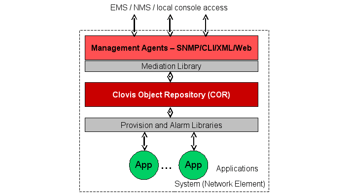

.. raw:: html

   

.. rst-class:: center

**System Management in SAFplus**

This chapter provides information about the various components of mangeability, concepts of managed objects, and using subagents for 
custom MIBs.

**Key Topics:**

* Components of Manageability
* Working with Clovis Object Repository (COR)
* Attributes of Managed Objects
* Developing SNMP Subagent for Custom MIBs
* SAFplus Platform Manageability End to End

OpenClovis Information Model
----------------------------
OpenClovis Information Model is a hierarchical, object-oriented management information model that facilitates the abstraction of all 
physical and logical entities in a managed environment.

Key Topics:

* Introduction to the OpenClovis Information Model
* Building an Information Model Using the OpenClovis IDE

For more information on Information Modeling, please refer to Distributed Management Task Force (DMTF) Common Information Model (CIM) 
available at http://www.dmtf.org.

Introduction to the OpenClovis Information Model
^^^^^^^^^^^^^^^^^^^^^^^^^^^^^^^^^^^^^^^^^^^^^^^^
The OpenClovis Information Model is built on a generic framework that provides a unified view of hardware and software elements and 
the services provided by them. It helps you to define the interdependencies and relationships between the managed objects. It is a 
mechanism to capture the application models and integrate them with OpenClovis SAFplus Platform.

To manage any hardware or software entity, it must be represented as a Resource in the Information Model. Hardware entities include 
chassis, blade, interface port, logical port, logical connections such as ATM VPC, VLAN, and so on. Software entities includes 
software processes, operating system features or application protocols such as OSPF, SS7, and so on.

The OpenClovis IDE helps you to build your Information Model using UML notation. This is accomplished through its editors, namely 
the Resource Editor and the Component Editor. For more information please refer to **OpenClovis IDE User Guide**.

The Information Model allows the definition of managed objects for an OpenClovis SAFplus-based system encapsulating chassis 
management, devices, alarms, faults, component states, and provisioned attributes of OpenClovis SAFplus Platform components and 
customer applications. The model provides support for SNMP MIB import as well as Object ID (OID) to Managed Object ID (MOID) mapping.

Building an Information Model Using the OpenClovis IDE
^^^^^^^^^^^^^^^^^^^^^^^^^^^^^^^^^^^^^^^^^^^^^^^^^^^^^^
The OpenClovis IDE provides a graphical development environment for defining the SAFplus Platform model. Using the OpenClovis IDE 
you can design the model, generate/customize the code, and build the images for your target environment. Building the information 
model involves the following steps:

* Create a project using the OpenClovis IDE.
* Build the resource view in the Resource Editor.
* Define the hardware and software objects of the system and model them as Resources.
* Set the attributes for the resources.
* Create components to manage the resources using the Component Editor and then associate the components with the resources.
* Set the attributes for the components.
* Configure the build-time OpenClovis SAFplus Platform components and save the data as XML files.
* Generate the code representing the defined model.
* Compile the code.
* Create the binary deployment images.

You can compile and link the code to the OpenClovis SAFplus Platform libraries to build the platform software customized for the 
target application. To get started using the OpenClovis IDE and build a sample model see the **OpenClovis Sample Application Tutorial**.

Components of Manageability
---------------------------

Clovis Object Repository (COR)
^^^^^^^^^^^^^^^^^^^^^^^^^^^^^^
Clovis Object Repository (COR) is an in-memory, object-oriented distributed repository service enabled with system modeling constructs. 
It implements data management capabilities like meta-data management as well as data management. Meta-data is expressed as class 
creation, deletion, and attribute definitions.

Data management capabilities include object creation, deletion, query, indexing, and distribution. COR also provides ability to 
implement services associated data definition using transaction, recovery, and so on. COR provides the ability for class inheritance 
and containment.

The Clovis Object repository is updated in the active System Controller instance and an exact replica is maintained (synchronized) 
in the System Controller Standby to provide high availability. In addition COR provides persistence storage of the repository to 
provide HA across restart scenarios. It routes the management stations requests to the user component or the object implementer for 
updating the component managing the hardware or the software resource. The COR supports transient attribute. An object implementer 
keeps track of the latest value of this attribute. Any get operation from the north bound on this attribute will be routed to the 
primary OI and latest value will be returned.

Alarm Manager (AM)
^^^^^^^^^^^^^^^^^^
The OpenClovis Alarm Manager (AM) provides an infrastructure for configuring and handling alarms. It provides support for alarm 
soaking, masking, alarm hierarchies, and correlation of the alarms before publishing. It stores the information for all the alarm 
being published untill it is cleared. The alarm client library attached to the component which is managing the alarm resource always 
sends the request to the alarm manager running on the local node for the processing.

It provides the functionality of reporting the alarm from the south bound entity. It publishes events for all the alarms reported 
or cleared, so somebody interested in this can register for this subscription.

Fault Manager (FM)
^^^^^^^^^^^^^^^^^^
The OpenClovis Fault Manager (FM) infrastructure provides a hierarchical scheme for managing faults in a system and initiating 
actions as configured during the design time. It can handle various user-defined run-time faults, including hardware and software 
faults and can prioritize faults to ensure that the critical faults are addressed before the normal or the low-priority faults.

The alarms are notified by the Fault Manager client library to the Fault Manager server located on the same node. The actions to be 
taken on receiving a fault are controlled by the FM policy associated with the faults.

Transaction Manager (TM)
^^^^^^^^^^^^^^^^^^^^^^^^
The OpenClovis Transaction Manager (TM) is an infrastructure service for providing the 2-phase commit transaction semantics. Along 
with this it provides two libraries the client library and the agent library. The client library is used to submit the transaction 
jobs and also the information about all the participating components. Any component that wishes to be a part of transactions can 
link with the agent library and act as a resource manager.

Features
""""""""

Supports re-startable transactions. For instance, if the Transaction Manager dies, all the pending transactions will be restarted 
when it is coming up again.

How it works
""""""""""""

It tracks the participants and provides ACID semantics to ensure that all the participants are updated properly, or will rollback 
to previous state assuring data integrity despite component failures.

Provisioning Library
^^^^^^^^^^^^^^^^^^^^
The OpenClovis Provisioning Library manages all aspects of the various hardware and software resources on the system.

Provisioning Library:

* Is a client module that is automatically bound to every component that manages a hardware resource or a software resource.
* It keeps track of all the resources being managed which are modeled to be owned by the component. It also keep account for all the 
  runtime creation or deletion of the resource to be managed.
* Propagates the attributes to the corresponding hardware resource, when it is set from the North bound.
* Fetches the value of the runtime attributes from the component when a get operation is done on it from the North bound.

Mediation Library
^^^^^^^^^^^^^^^^^
The OpenClovis Mediation Library acts like a gateway to the OpenClovis SAFplus Platform runtime environment on the system controller. 
It interacts with external management agents like SNMP, CLI, and OpenClovis SAFplus Platform components.

The Mediation Library helps in translating the service requests from the management station into requests pertaining to OpenClovis 
SAFplus Platform runtime environment. The extensible plug-in architecture of Mediation Library allows the external management agents 
to control the configuration and operation of the various managed objects within the system.

Simple Network Management Protocol (SNMP)
^^^^^^^^^^^^^^^^^^^^^^^^^^^^^^^^^^^^^^^^^
The OpenClovis Simple Network Management Protocol (SNMP) sub-agent provides the flexibility to manage both platform and non-platform 
hardware, OpenClovis Information Model, and the alarms present in the system. Using SNMP, you can manage the attributes of an MO 
that includes a get, set, or notification.

Working with Clovis Object Repository (COR)
-------------------------------------------
This section provides information about the value addition that COR provides to an application, and outlines the concepts of managed 
objects, their related databases, and classes. The following topics are discussed in this section:

* Terms and Definitions
* COR: Value-Addition to an Application
* OpenClovis Information Model
* COR Architecture
* COR Functionality

Terms and Definitions
^^^^^^^^^^^^^^^^^^^^^

* **Class** - An individual entity with attributes.
* **MO** - Managed Object provides an abstraction for the manageable properties of a resource in the system. MOs have attributes, 
  support management operations, exhibit behavior and send notifications. Operations on an MO can be Create or Delete Instances; 
  Get or Modify attributes; Action. Notifications emitted by an MO instance are instances that are created/deleted; report attribute 
  change; class specific notification such as alarms.
* **MO Class** - Specifies the containment relationship between classes. For example: chassis/gigeblade/gigeport.
* **MO Class Tree** - Hierarchical representation of the containment relationship between MO classes.
* **MOId** - Unique Identifier of an instance of MO class. It is a hierarchical containment of a resource. MOs have these unique 
  MOIds associated with them within the system. MOIds can be used as the address for MOs. For example: Chassis 0/Gigeblade 1/ 
  Gigeport 2.
* **MO Instance** - Instantiation of MO class. For example, Gigeport 3 is an instance of Gigeport class.
* **MO Instance Tree** - Collection of MO instances with containment relationship specified. For example, in a chassis based system, 
  an instance of a port could be: Chassis (0)/Blade (3)/Port (2).
* **MSO** - Encapsulates the attributes of a Managed Object specific to the particular service they are associated with. (For 
  example, Alarm severity is an attribute related to the alarm service; it is a part of the Alarm MSO associated with any MO 
  desiring an alarm service).

COR: Value-Addition to an Application
^^^^^^^^^^^^^^^^^^^^^^^^^^^^^^^^^^^^^
Almost every telecommunication or data communication system has a managed object database, which captures data pertaining to the 
system as captured in the information model. Following are the different features provided by COR:

* **Creation of classes** - A class is a blueprint of an object. It defines the different attributes of an object. COR provides a 
  capability to inherit one class from another. The inherited class inherits all the attributes of parent class.
* **Definition of attributes in a class** - A class when created is an empty class, meaning that it does not contain any attributes 
  other than those defined for the parent. COR supports addition of attributes into classes through APIs.
* **Creation of MO classes** - The MO classes when created, defines hierarchy (invariably a physical containment hierarchy) between 
  different classes. The MO class hierarchy is blueprint of Object Tree. This is one way by which a Telecommunication Equipment 
  Vendor enforces a hierarchy in which object can be created by system developer.
* **Creation and deletion of Objects** - The Objects can be created in a hierarchical fashion as per blueprint defined by MO class 
  tree. COR provides ability to create/delete objects.
* **Set and Get operation support** - The values of the attributes which were modeled as part of the managed resource class can be 
  changed at runtime using set operation after objects of these managed object are created. The latest values of these attributes 
  can be fetched from COR using the get operations. Both these operations support single and bulk semantics.
* **Object Tree Walk** -The object tree can be navigated using the features provided in the COR. This walk can be restricted to a 
  particular subtree starting from a defined root.
* **Distribution of COR repository** - The COR repository are replicated on the two system controller cards. Exact replica of 
  runtime data and metadata is maintained on both the cards. In case of failure of one card, the data can be obtained from another 
  card.
* **Transaction Support** - COR provides an ability to invoke the Managed Service Providers when a data managed by the Object 
  implementer is changed. This is done through transaction mechanism. The transaction mechanism also ensures atomicity and 
  consistency of an operation. A transaction is started for object creation/deletion and attribute set operation started by a user.
* **Notification Support** - COR provides support for subscription of notification after completion of transaction. A notification 
  is published for object creation/deletion as well as for setting an attribute of an object.

The following diagram depicts the relationship between COR classes, MO classes, and COR objects:

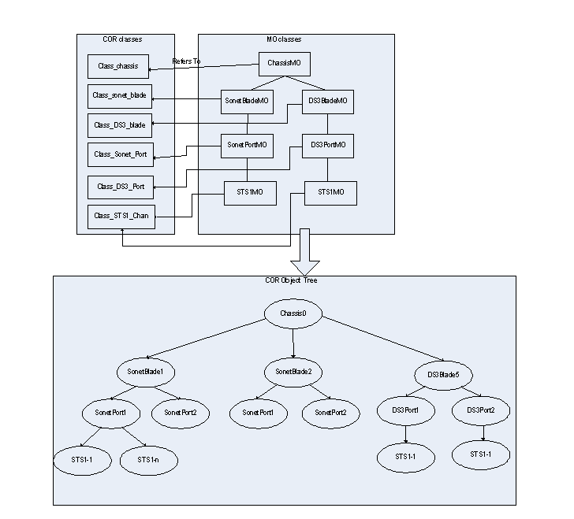

The object creation is performed in three steps. The first two steps are hidden from the user as the information model created using 
IDE is read by COR at the startup. All the defined classes and MO class tree will be created during this time. The object creation 
will start only after these two steps are done. A brief description of these three steps is as follows:

* **Create COR class** - The COR class is created and attributes are added to it. The class represents a resource in a system.
* **Create MO classes** - MO classes are nothing but COR classes arranged in hierarchy. These first two steps define model of a 
  system. These first two steps are performed by COR as a part of Information Model development. A COR class defined in the first 
  step above can be used for multiple MO classes, for example STS1 class can be used for Sonet STS1 as well as DS3 STS1. You need 
  not define a separate COR class for them since attributes of both the STS1 MO classes are the same. An MO class is identified by 
  MO class path which in a string format appears as follows: \chassisMO\SonetBladeMO\SonetPortMO for a sonet port.
* **Create objects** - Objects are created when the system starts running (either during boot-up or dynamically, by the System 
  Developer using a management agent (such as SNMP/TL1 CLI). The objects can be created only according to the blueprint defined in 
  steps 1 and 2 above. For example, the system developer can not create DS3 port under a Sonet card since it is not according to the 
  blueprint.

COR and OpenClovis Information Model
^^^^^^^^^^^^^^^^^^^^^^^^^^^^^^^^^^^^
This section describes the OpenClovis Information Model and how COR is used to capture the Information Model. The following section 
describes a two-step approach towards defining the OpenClovis information model:

* **Metamodel Definition** - Metamodel is a language for specifying an information model. It is the responsibility of OpenClovis 
  SAFplus Platform to define metamodel.
* **Defining System Model** - Using the defined metamodel, the systems vendors define an information model.

Metamodel Definition
""""""""""""""""""""
A metamodel defines language for specifying an information model. The following section describes OpenClovis SAFplus Platform's 
Metamodel and defines different metaobjects used in the metamodel. Example of different metaobjects used in metamodel are class, 
attributes, relationships, and so on.

The following UML diagram captures OpenClovis SAFplus Platform's metamodel:

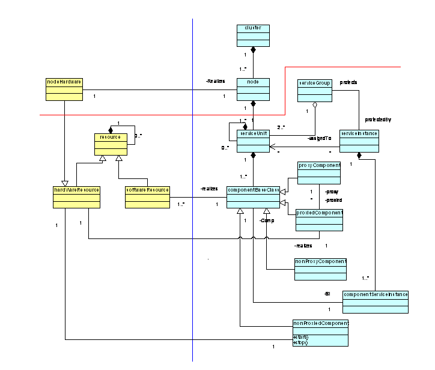

The left hand side model, as demarcated by blue line, represents the physical view or management view of the system. The right hand 
side of the model represents logical view. The physical view defines attributes for hardware and software resources contained in the 
system and the logical view defines metaclasses.

All the metaclasses below the red line are base classes. These classes will not change as we go forward. The classes above red line 
are specialization of the base classes defined below the red line.

Different relationships exist between metaclasses defined in both the physical view and logical view. These relationships are defined 
using standard UML notations.

**Example:** Defining System Model

Figure Instance of OpenClovis SAFplus Platform's Metamodel illustrates an example for OpenClovis SAFplus Platform's Metamodel.

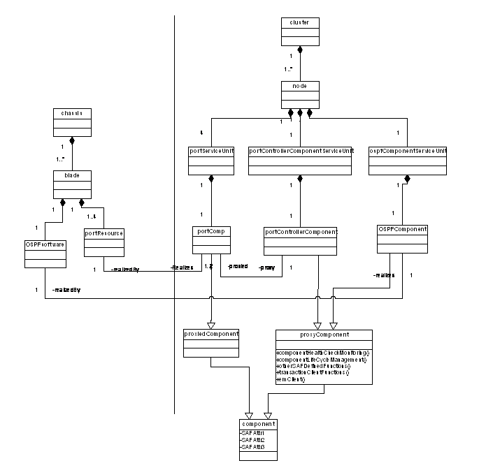

The data present in the information model is captured in COR. The output of information model is captured as user configuration. 
The information model translates in the COR MO class tree. In the information model as defined above two COR MO class trees shall 
be generated, one for resources and other for classes. The classes can be captured in the table format. COR provides utility 
functions to read the table and create COR classes as well as MO classes from it.

COR Architecture
^^^^^^^^^^^^^^^^
COR runs on two redundant system controller cards. This section talks about the network model for COR and provides details of COR 
subcomponents. Figure COR Network Model illustrates the COR network model:

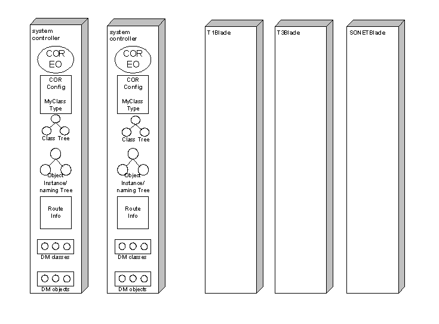

Although distributed databases are complex as opposed to centralized databases, they provide some very important advantages, if 
implemented, such as:

* **Performance** - A proper distribution criterion can ensure that the data is close to the location where it is frequently 
  accessed from.
* **High Availability of Data** - In distributed database, cache of an object can be maintained at multiple locations, making the 
  data available in spite of failure of a location.

COR provides High Availability of data by means of making a replica of it on two redundant controller cards.

COR Functionality
^^^^^^^^^^^^^^^^^
COR provides the following functionalities:

* MO Class Creation.
* MO Instance Tree creation and Navigation
* Atomic Object Manipulation
* Notification Services
* Object Ownership Services

**MO Class Tree Navigation:** Given a class, assigns an API.

**Atomic Object Manipulation:** Provides APIs to create multiple objects. Either the operation suceeds or fails. Manipulation 
includes creation / deletion / modification. For example: In an output, multiple objects can be specified to be created. COR 
ensures that either all are created or deleted. Ownership provides component to be owner of an object. An owner of an object 
participates in the object manipulation operation. The owner provides the three functions:

**Validate:** Output is validated by the object owner. If the validation fails, object manipulation on the whole fails.

**Rollback:** If validation fails, the object owner needs to roll back its state information.

**Commit:** The object owner accepts the creation only if Y is provided in the validate phase. For example: If MTU size of Gigeport 
is set, then the object owner of gigeport will set the MTU size in the gigeport hardware during the Commit phase.

**Notification:** After COR issues notification, this notification is subscribed by components.

Node Independent Managed Objects
""""""""""""""""""""""""""""""""
In a distributed communication system, multiple applications running across multiple nodes can share MOs. Such MOs are not 
specifically bound to any blade or a node. They are owned by one application but the application is implemented by a pair of ACTIVE 
and STANDBY SUs and their software components running on different nodes. The MO can be accessed from the north-bound interface 
irrespective of the location of its owner application. In case of failover, the STANDBY registers the MO without affecting the 
north-bound interface.

OpenClovis IDE enables you to define MOs in OpenClovis MIB that are not related to any physical entity in the system. These MOs 
reside in a logical hierarchy tree attached directly to the root MO. For example, two gigE ports are defined in the Resource Editor 
of IDE with 1+1 redundancy model. These ports are associated with same OI as they collectively provide the gigE service that contains 
its own MO. This is a logical MO and is blade independent. The configuration of this MO is applied to both the ports.

Attributes of Managed Objects
-----------------------------
Clovis Object Registry (COR) is a repository of Managed Objects representing the network element resources in a system. COR provides 
functions that enable read operation on the Managed Objects. These functions are used to access the values of the attributes of an 
object known by its MoID. Once an application discovers the object hierarchy, it can use this interface to retrieve the attribute 
values.

Definitions
^^^^^^^^^^^

* **Management Station:** This is used to view the current status of the managed entity or change its state. This can be any 
  management process for example it can be a SNMP MIB browser, a CLI, web-based application etc.
* **The Object Implementer (OI):** It is a software component which owns the managed resource. There can be multiple OIs for a 
  managed object but out of all of them there can be only one OI which will act as a primary OI. The get request from the management 
  stations lands in the COR and then it contacts the OI(s) of a managed resource. The primary OI holds the latest value of a runtime 
  attribute. For the configuration attribute there are corresponding attributes present at all the OIs. So when any set request is 
  send by north bound, all the OIs are contacted to update their corresponding attribute.
* There are two types of attributes that can be part of a managed resource, one is called configuration and other is runtime or 
  transient attribute. There are certain properties of these attributes called as attribute-flag which are as follows:

  * **Cached** - The attribute which is stored in COR. The latest value of cached attribute is always obtained from COR.
  * **Persistent** - This property of the attribute gives that the attribute value should be stored in a presistent Db file and 
    should be restored in case of restart. Only a cached attribute can be persistent.
  * **Writable** - An attribute which can be changed at runtime is called writable. This shows that it can be settable from the 
    north bound. A initialized attribute is always non-writable.
  * **Initialized** - A key attribute of a class has this property. This attribute is for example a index attribute which can be 
    used to identify a row in a snmp table. The value of this attribute should be supplied while creating the object of this class. 
    These attributes are non-writable at runtime.

Types of Attributes
^^^^^^^^^^^^^^^^^^^
The different types of attributes of an object are:

* **Configuration Attribute** - A configuration attribute is used to store the configuration information about the managed resource. 
  For example the maximum memory size can be a configuration attribute of a process resource. These attributes are always cached and 
  persistent. These attribute are always writable to the north bound unless it is marked as initialized, as a initialized or a key 
  attribute should not be modified at runtime.
* **Runtime Attribute** - This attribute is the property of the managed resource that keeps changing so only the primary object 
  implementer (OI) of this resource manages its latest value. For example - If a component is managing a process running in the 
  system, then information about the current memory used by a process is known only to the component. These attributes are not 
  writable from management station. There is a slight variation of the runtime attribute when it is very slow changing for 
  example - The number of days a process has run. These kind of attributes can be cached in the COR. Whenever it changes, the primary 
  OI can set this attribute. So a runtime attribute is cached or non-cached in COR based on its nature. It can be persistent only 
  when it is cached.

  .. note::
    The runtime cached attribute is writable only from the primary OI. It is non-writable to the north bound agent.

A managed resource can contain both configuration attribute and runtime attribute based on the requirement. The configuration 
attribute will be used to store the configuration information. The runtime attribute is the transient property of the managed 
resource. Normally its value is maintained by the primary OI. But if it is a very slow changing one, it should be stored in COR 
which is updated time to time in COR by the primary OI.

Implementation of Configuration and Runtime Attributes
^^^^^^^^^^^^^^^^^^^^^^^^^^^^^^^^^^^^^^^^^^^^^^^^^^^^^^
For example, COR has objects for every process running in the system. Each process has various attributes associated with it, such 
as name, process Id, memory usage, maximum memory size, maximum number of open files and so on. Whenever a process starts, COR 
creates an object of type process with specific attributes. The objects represented in COR are identified by their MoID. You must 
specify the MoID of an object to perform get and set operations it. When a user queries for a list of all the processes running in 
the system, COR returns the MoIDs for them based on the number of instances of process managed resources created. The northbound 
interface creates a table with the MoIDs of all the process.

Now suppose multiple processes are running on a node. Each process occupies some memory that changes during runtime. These processes 
are treated as managed resources in COR. The management stations can monitor these processes and send requests to know the memory 
usage of every process at a given time. Since the memory occupied by these processes varies at runtime, this data should not be 
stored in COR. This attribute is a candidate of being a runtime attribute of the process MO class.

If a transient property of the managed resource changes very slowly then that attribute can be cached in COR. For example the number 
of hours a process has run. If needed this attribute can also be persistent in COR. The primary OI of the managed resource has to 
update its value in COR whenever it changes.

The configuration attribute is the placeholder for the configuration information of the managed object. It is always cached in COR. 
It can be persistent in COR if required. For example, If the component wants to manage a process running in a system which has an 
attribute which gives the maximum number of open files it can have, then it can be made as a configuration attribute for the process 
managed resource.

Importance of OI for attribute types
^^^^^^^^^^^^^^^^^^^^^^^^^^^^^^^^^^^^
A managed object can contain both configuration and runtime attributes. A managed object is managed by the object implementer. These 
are hidden from the management station. Whenever a request is sent from the north bound interface of a management station, the COR 
takes care of routing the request to the respective OI(s) of the managed object.

The Object Implementer will be involved while doing get operation on a runtime attribute or while performing a set operation on a 
configuration attribute.

When a read operation is done on a runtime or transient attribute, a particular OI is contacted to get the value of the attribute. 
The OI that provides the runtime value of an attribute is the primary OI.

For example in a 2N Redundancy model, one process acts as the ACTIVE and the other as the STANDBY. When you perform a get operation, 
since the ACTIVE process provides the requested value, so it is the primary OI.

For a configuration attribute of a managed resource in COR, there is a corresponding attribute present in the OI. For any set 
operation, all the OIs should be contacted inorder to facilitate the modification of their attribute. The request from the north 
bound first land in COR. It takes care of routing these requests to all the OIs where they can update the respective data bases. 
Also this set operation updates the value of configuration attribute in COR. So it always has the latest value of a configuration 
attribute.

The user can specify a particular OI to act as the Primary OI for a managed resource. Setting a OI as the Primary OI involves some 
restrictions. Please refer the documentation of the API clCorPrimaryOISet in the API reference guide for more information.

Retrieving Values of Attributes
^^^^^^^^^^^^^^^^^^^^^^^^^^^^^^^
The COR provides the mechanism to get the value of the multiple runtime and configuration attributes in one request. This can be 
done using the bundle get feature of COR.

You can retrieve the value of a runtime attribute of an object at a given time in order to know the value of the transient state of 
the managed resource. For example, to know the memory usage of a process, you must communicate with the process that implements the 
object (OI).

A runtime attribute can be stored at the OI if its frequency of change is high. In this case the Primary Object Implementer (OI) is 
a process that is responsible for providing the value of non-cached runtime attributes. When you query for memory usage of a process, 
COR communicates with its primary OI to retrieve the information as shown in Figure Accessing MO Attributes. Depending on the 
frequency of update, the information returned can contains an earlier value.

.. note::
    Only one Primary OI exists for a particular object in the system.

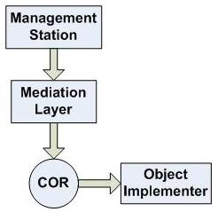

In the other case, if the frequency of change for a runtime attribute is very low, then it can be cached in COR. So COR itself can 
provide its latest value in the case of a get operation. The primary OI has to set the latest value of this attribute in COR whenever 
it is changing.

The COR always stores the latest value of the configuration attribute. So in case of a get operation on this attribute, the COR gives 
its value.

Setting Values of Attributes
^^^^^^^^^^^^^^^^^^^^^^^^^^^^
You can set the values of configuration attributes from the northbound interface. SAFplus Platform provides an efficient way of 
performing and managing set operations on a large number of attributes. The set on the runtime attribute is not allowed from the 
north bound.

Similarly, you can set the values of a common attribute that is shared among multiple processes running in the system, for example 
the max limit of memory of all processes. A common attribute is not contained in a particular object but is centralized in one 
object only. Such attributes are shared by all the process running in the system.

When you modify a configuration attribute of a shared managed resource, all the OIs associated with the process are invoked where 
they can do the respective changes to their attribute. For example : if the configuration attribute corresponding to the maximum 
limit of memory in the "process" managed resource is changed and if it is being managed by multiple Object implementers, then COR 
will route the request to each of the OI where they can change the corresponding parameter for the process they are managing.

.. note::
    When a set operation is performed on more than one process simultaneously, multiple OIs are invoked whereas in a get operation, 
    only one OI is invoked.

Storing Values of Attributes
^^^^^^^^^^^^^^^^^^^^^^^^^^^^
The management station that send requests from the northbound interface are unaware of the OI. It communicates with COR to retrieve 
any information. If the attribute is configured as cached, the information is contained within the object. If the attribute is 
configured as persistent, the information is stored in a file system or a permanent storage disk. The persistent attributes are 
always cached.

By default, the transient attributes are neither cached nor persistent, since COR does not contain its values. But it can be 
configured as cached if its value does not change frequently. The OI updates COR only when the value changes to reduce network 
traffic. If the runtime attribute is cached, the value of the attribute is saved in COR since it changes only periodically. For 
example, you want to know for how many hours a process is run. So, the information is updated once in every hour. If the cached 
runtime attribute is not persistent, COR does not save the data.

The configuration attributes are always cached in COR. These attributes are always persistent.

Raising Alarms
^^^^^^^^^^^^^^
You can configure the process and get the value of runtime attributes from the northbound interface. A process can have its memory 
limits as high, medium and low. When the memory of a process exceeds its max limit, you can configure your application to raise 
alarms. An alarm is a communication medium from the OI to the northbound if an unexpected behavior is observed or a fault condition 
occurs. Currently, the northbound is a "pull" model as it is not informed about any value unless it sends a get request.

Types of Process Classes
^^^^^^^^^^^^^^^^^^^^^^^^
The following are the two types of process classes:

* provClass
* alarmClass

You must specify the service Id to access a process class. You can define the service Id of a class to assign it as either a 
provClass or an alarmClass type. The provClass contains both configuration and runtime attributes.

A node can have multiple process classes running on it. These classes contain various attributes. The hierarchy from the node to the 
attribute is represented by a MO class path. A process running in a system is uniquely identified by its MoId, that is, 
<node_name>.<node_instance>/<process_name>.<process_instance>.

You must specify the MoID of the object from the northbound interface to communicate with COR and retrieve or modify its value. The 
northbound interface is exposed to different management stations such as CLI, SNMP, XML and so on. The requests from the northbound 
interface are passed through a Mediation Layer before it reaches COR. The Mediation Layer translates the requests sent through the 
MIB table from the northbound interface into COR understandable format as shown in Figure Accessing MO Attributes.

To access a particular attribute, you must specify the MoId, the ServiceId and the attributeId. Generally, the configuration from 
the northbound interface is performed as a bulk operation. When a set operation is performed, OI communicates with the COR. You can 
provide a transactionId to apply all the configuration changes in bulk and save them in COR in one transaction. This reduces the 
frequency of communication between COR Server running on the System Controller node and COR client running on worker blades.

For example, you want to change an attribute, such as the max memory limit of all the processes running on a node. An attribute can 
be in the form of an array and can be updated after a certain index. If a get is performed on the transients attribute, and the 
primary OI is not available for a few attributes, it returns only those attributes that are associated with Primary OI.

For example, an object contains memory configuration of all the processes running on a node. When a process is started, it reads 
the object in COR and applies its respective configuration. So every process knows the objects that it belongs to and becomes the 
OI of that object.

Provisioning OI Callbacks
^^^^^^^^^^^^^^^^^^^^^^^^^
This section will describe the flow of OI callbacks which will get called whenever the managed resources are modified in COR and 
also during OI initialization if the resources are already present in COR.

Flow of OI callbacks when the resource is modified in COR
"""""""""""""""""""""""""""""""""""""""""""""""""""""""""
When the resource managed by a OI is modified in COR, a transaction is getting initiated and all the OIs managing that resource will 
be involved in the transaction. The diagrams will show the flow by which the OI's callbacks will get called.

Flow Diagrams
'''''''''''''
These diagrams will show the flow for the following cases:

* **Case 1:** If the transaction contains CREATE jobs.
* **Case 2:** If the transaction contains multiple SET jobs for different MOs.
* **Case 3:** If the transaction contains DELETE jobs.
* **Case 4:** If the transaction contains READ jobs.

**CASE 1:** The Transaction contains CREATE jobs.

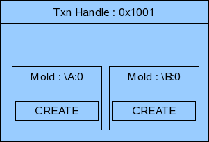

**Txn Cycle:** TXN START -> VALIDATE -> ROLLBACK -> TXN END

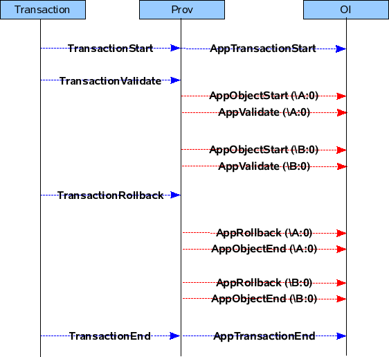

**Txn Cycle:** TXN START -> VALIDATE -> UPDATE -> TXN END

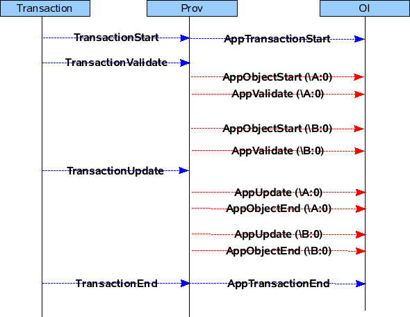

**CASE 2:** Transaction contains multiple SETs for different MOs.

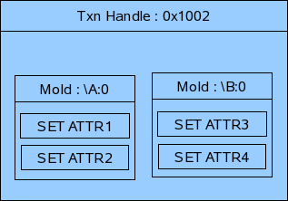

**Txn Cycle:** TXN START -> VALIDATE -> ROLLBACK -> TXN END

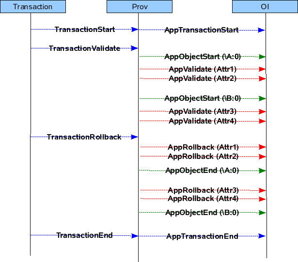

**Txn Cycle:** TXN START -> VALIDATE -> UPDATE -> TXN END

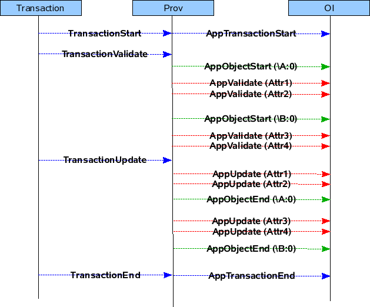

**CASE 3:** Transaction contains a DELETE jobs.

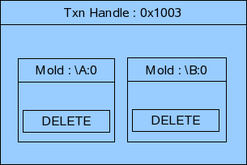

**Txn Cycle:** TXN START -> VALIDATE -> ROLLBACK -> TXN END

**Txn Cycle:** TXN START -> VALIDATE -> UPDATE -> TXN END

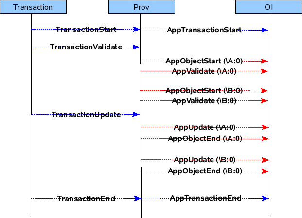

**CASE 4:** Transaction contains READ jobs for a MO

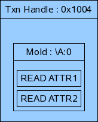

**Txn Phase:** READ

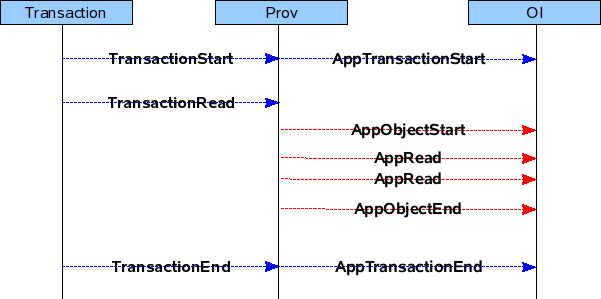

Flow of OI callbacks when it is coming up
"""""""""""""""""""""""""""""""""""""""""
Pre-provisioning is done when the application is coming up. Prov will read the MOs in COR for which the application is interested 
and call the application's callbacks, so that it can know the current values of the Objects in COR.

The below diagrams will show the flow by which the application's callbacks will be called during pre-provisioning.

For example if there are two objects \\A:0 and \\B:0 present in COR which contains the following attributes.

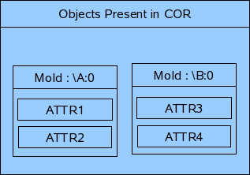

then the pre-provisioning will be done in the following manner.

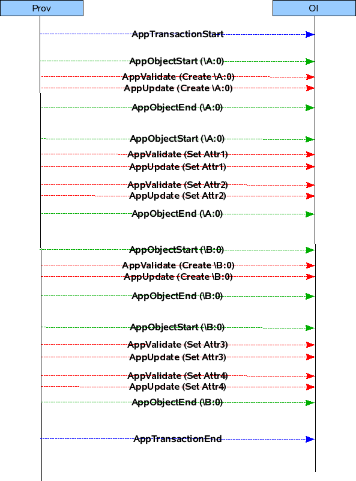

Developing SNMP Subagent for Custom MIBs
----------------------------------------
A Management Information Base (MIB) is a type of database used to manage entities in a communications network. It comprises a 
collection of objects in a (virtual) database which are used to manage entities (such as routers and switches) in a network. A MIB 
defines the attributes/information of resources, but is only a schema of information. This schema is populated to create a custom 
MIB.

A SNMP subagent is a process that handles all set/get operations for the MIB. The subagent registers with the SNMP daemon to inform 
it that all operations for that MIB should be passed on to the subagent. Typically, a SNMP command would come from a monitoring or 
management station to the SNMP daemon. The daemon then passes on the command to the subagent. The subagent communicates to COR 
through a mediation library to set or retrieve the values in COR, and returns the result via the SNMP daemon.

With OpenClovis 3.0, the SNMP subagent can now be automatically generated. This section will walk you through the steps to configure 
and generate the subagent. The OpenClovis IDE is capable of fully generating an SNMP subagent from a MIB or set of MIBs.

Importing a MIB
^^^^^^^^^^^^^^^
From the menu, select **Clovis -> Importing Mib Objects** .... Click on the **Load** button to browse to the location of your MIB file. 
Once the MIB has been loaded, click on the MIB entry in upper box, and its associated MIB objects will appear in the lower box.

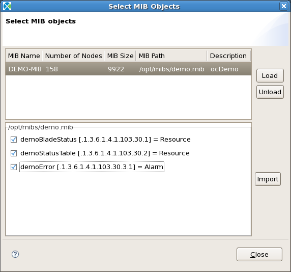

In the example shown in Figure Selecting MIB Objects, DEMO-MIB has three different objects. One is a set of scalars, the other a 
table, and the last is a trap. Select the MIB objects you want to import into your model, and then click on the **Import** button.

If you are importing objects from multiple MIBs, load all the MIB files. Then for each MIB, you will need to select the MIB from 
the upper box, and highlight each MIB object from the lower box and import it.

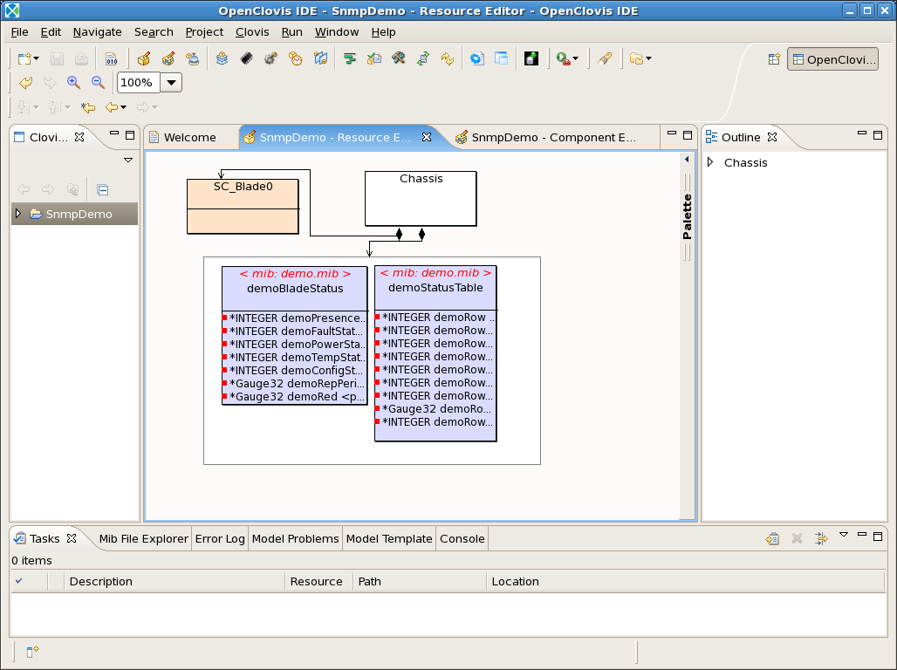

When finished, you should see in the resource editor, something similar to Figure Resource Editor with MIB Objects. You may have 
noted that three MIB objects were listed in the DEMO-MIB example, but only two are present in the resource editor. The third object 
was a trap, which gets imported as an alarm.

In the example shown, there is now an MO called demoStatusTable. In reality, this only represents one row of a table. To increase 
the maximum number of rows in the table, double click on the table. Under the **Resource** options, increase the number of **Maximum 
Instances** to match your needs. In this example shown in Figure below, there are a maximum of 10 rows.

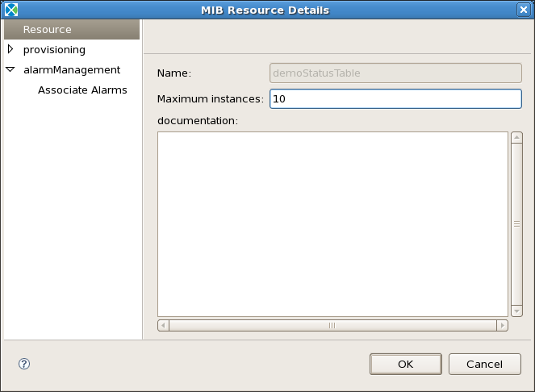

SNMP Traps
^^^^^^^^^^
As mentioned earlier, the trap was imported as an alarm. To adjust the type and severity of an imported alarm, from the menu select 
**Clovis -> Alarm Profile** .... See Chapter Defining Alarm Profiles of the **OpenClovis IDE User Guide** for further information on 
the configuration of alarms.

When your alarm is appropriately configured, you can associate it with a resource. Double-click on the resource you wish to have 
this alarm. Under **alarmManagement**, click on the **Enable** checkbox. Then under Associate Alarms, highlight the alarm(s) and 
click on the **Add** button. See Figures Alarm Management and Associate Alarms.

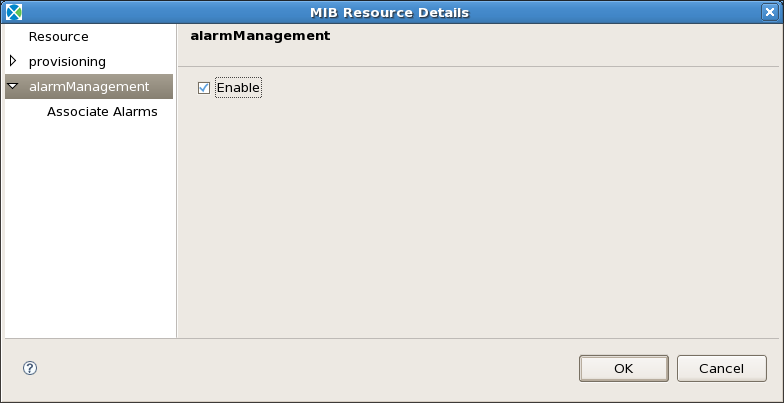

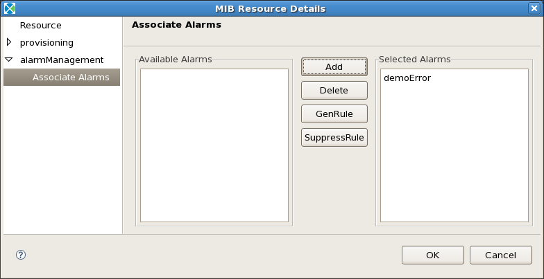

Configuring the Subagent
^^^^^^^^^^^^^^^^^^^^^^^^
The SNMP subagent is a SA Aware Component. To configure a component to be a subagent, you need to do the following steps. First, 
double-click on the component to see the properties, and set **Is SNMP Sub-Agent** to **true** as shown in Figure SNMP Component 
Properties.

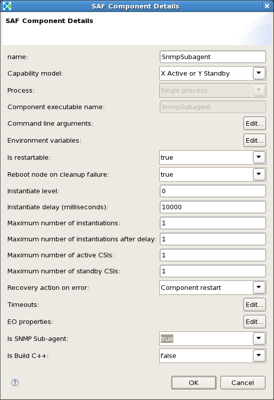

Next, right-click on the component and select **Sub-Agent Properties** from the pop up menu. Here there are two fields that need to 
be filled out. See Figure below.

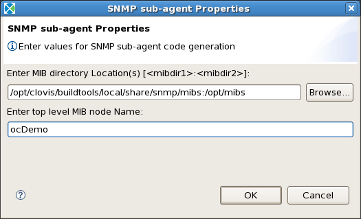

The first field will set SNMP's MIBDIRS environment variable necessary during the the subagent code generation. This is a colon ':' 
separated value containing all the directories to look for MIB files in. For this to work properly, you will need to make sure that 
net-snmp's mibs directory is included, which would be in your clovis installation directory. If you installed the Clovis software 
in the default location, it would be /opt/clovis/buildtools/local/share/snmp/mibs.

The second field would be the top level node name for your MIB. If you just have one MIB, this would be the MODULE-IDENTITY name in 
your MIB file. If you have several MIB files, it would be the MODULE-IDENTITY of the top layer in your MIB tree.

SAFplus Platform Manageability End to End
-----------------------------------------
The SAFplus Platform components which are used for providing the manageability infrastructure are as follows:

* Clovis Object Repository
* SNMP sub agent
* Mediation library
* Provisioning library
* Alarm Management
* Fault Management

This section describes about how these components interact to provide the resource management and fault reporting capability to the 
SAFplus Platform middleware.

North bound Requests
^^^^^^^^^^^^^^^^^^^^
The management station requests - walk, set or get operations - are handled by the SAFplus Platform middleware using some of the 
above mentioned components. These operations can be done from the management station on one table or it can span multiple tables. 
Each table represent one managed entity in COR. The rows of the table maps to different instances of the resource. Each column of 
the table denotes different attributes of the resource. All this information are stored in COR. When the GET, SET or a WALK request 
reaches SNMP sub-agent, it is translated by the mediation library into a COR request and sent to it. This data is also cached in 
the sub-agent which is retrieved from COR based on the expiration of caching frequency time period.

The SET and GET operation can be done in a singular or a bulk manner. The bulk set operation is done using the transaction. The SET 
operation is validated with all the object implementers of the managed resource and only when all of them agrees to the change, then 
only it is updated otherwise the rollback is done on all of them. The Get operation can be done for configuration and transient 
attributes. For configuration information only COR is contacted but for transient attribute the primary OI is contacted to get its 
latest value.

The diagram below shows the SNMP request being processed by the SAFplus Platform. The request is first received by the SNMP sub-agent. 
This request is then translated into a COR based request by the mediation library and sent to it for processing. Based on the type 
of request, COR processes it locally or sends it to the Object implementers. If it is a SET request, COR sends the request to the 
Object implementers where provisioning library attached to it does the job of validating the request and then updating it on their 
end. If it is a GET request or WALK request on a transient attribute, it is sent to the Primary Object Implementer to get the latest 
value of this attribute. If it is a get request or a walk on a cached attribute, the COR will process it locally and send the 
response.

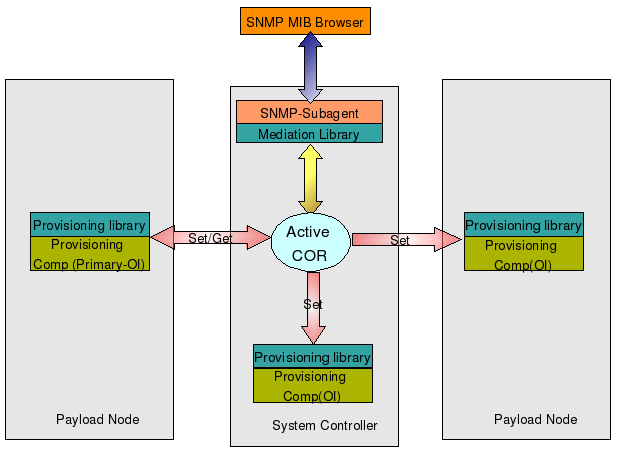

Reporting failures in the system via alarms
^^^^^^^^^^^^^^^^^^^^^^^^^^^^^^^^^^^^^^^^^^^
The asynchronous events happening in the system are reported as alarms. These alarms can be modeled as traps in the MIB. This MIB 
cab be imported using IDE which will take care of configuring the alarms. So whenever these alarms occur in the system, they are 
reported as traps to the north bound interface.

All the alarms modeled in the system can be configured to be raised by some application using the IDE. So a component can be assigned 
the task of raising these alarms based on certain conditions. When these alarms are published, the mediation library along with the 
SNMP-subagent takes care of sending these configured alarms as traps to the north bound entity. The COR server stores the latest 
information about the alarm.

The diagram below shows the trap reporting feature of SAFplus Platform. A component with the alarm client library and having alarm 
configured through IDE, can raise the alarm. This component can run on any node. In the figure it is shown as a part of payload node. 
The SNMP sub-agent can be part of any node. In the diagram it is shown as part of controller node. Once the alarm is raised, the 
alarm server publishes the event. The mediation library attached to the SNMP sub-agent listens for this event. It verifies whether 
the alarm raised is configured to be raised as trap. If it is so, then it forwards the request to the SNMP sub-agent which takes 
care of reporting this alarm as trap to the north bound management station.

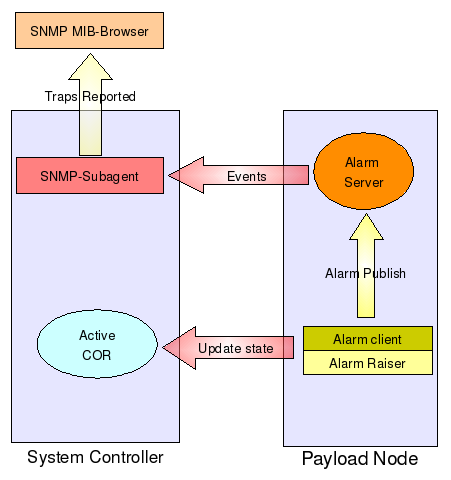

Fault reporting and repair action
^^^^^^^^^^^^^^^^^^^^^^^^^^^^^^^^^
The fault management feature of the manageability infrastructure allows the application to take customized action when the faults 
occur in the system. There are two kinds for fault handling supported by the Fault Manager which are described below.

Fault Reporting
"""""""""""""""
The fault reporting is done for non-service impacting alarms. The non-service impacting alarm are the one with severity less then 
major that is minor, warning and indeterminate. For each alarm category and severity combination, there are five escalation levels 
defined. For each escalation level there can be a callback associated and inside that user defined action can be taken. The fault 
manager calls the callback based on the category + severity + escalation level. The callback on the level one is called if the fault 
occur for the first time. The fault level is escalated, when the frequency of fault is more than the probation period. Both the 
callbacks and the probation period are configurable through IDE.

Fault Repair
""""""""""""
The fault repair can be done by the application which wants to trigger an action based on the service impacting problem happening 
on the managed resource. The managed resource on which repair action need to be done are modeled with an alarm MSO. Whenever a 
problem is detected on such resource, an alarm is reported to the alarm server. The alarm handle obtained after alarm raised or the 
alarm handle obtained in the alarm event delivery is used in the repair action. This is necessary as fault repair action is done only 
on the service impacting alarms. The fault manager on receiving the repair action request calls the callback assigned to the 
resource. This callback function is generated by the IDE for every resource having alarm MSO.

The figure shows the fault reporting and repair action feature of the SAFplus Platform. Whenever an alarm is raised in the system, 
the Alarm Server decides whether it should be reported as fault or not. Only the non-service impacting alarms are reported as fault. 
So for all these alarms, it contacts Fault Manager which takes care of calling the registered callbacks. The figure also describes 
the fault repair actions feature. The component doing the repair action should have the alarm handle corresponding the alarm raised. 
The alarm repair action should be done for service impacting alarms. So a component raising this alarm or listening for the alarm 
events, can trigger the repair action. In the diagram the "Fault Mgmt App" shows as alarm reporter as well alarm listener. There can 
be two different applications doing this job. So a component doing fault repair action can be the one which reports the alarm or the 
one which listens for the alarm notifications.

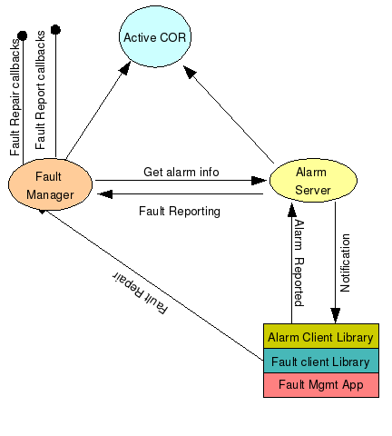
