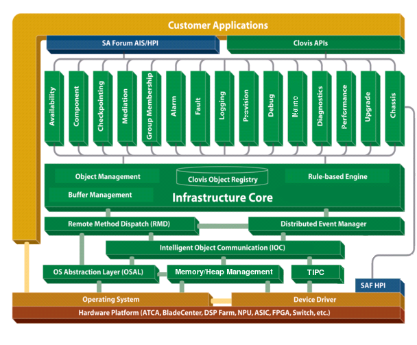
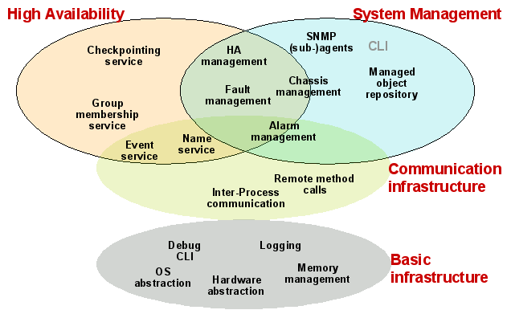

Overview
========
This chapter provides an introduction to OpenClovis SAFplus Platform and IDE, its key features, and the system architecture.

OpenClovis SAFplus Platform and IDE provides a modular, cost-effective application for creating next-generation communication 
systems. OpenClovis SAFplus Platform and IDE is designed for solution integrators, Network Equipment Manufacturers (NEPs), and 
Telecommunication Equipment Manufacturers (TEMs) to facilitate the creation of a broad range of telecommunication devices, including 
routers, switches, media gateways, and wireless infrastructure nodes.

OpenClovis fits seamlessly with various distributions of Linux and hardware platforms such as AdvancedTCA, BladeCenter T, and other 
off-the-shelf hardware.

**OpenClovis Application Service Platform (SAFplus Platform)** is a middleware that offers a comprehensive set of modular, portable, 
reusable software components designed to provide system management and high availability functionality. The OpenClovis SAFplus 
Platform is the run-time part of the OpenClovis offering. It provides run-time services for your value add applications, offering a 
layered, hardware-platform independent application environment.

**OpenClovis Integrated Development Environment (IDE)** is designed to simplify and accelerate the development of application service 
platforms for the telecommunication marketplace. Coupled with the OpenClovis SAFplus Platform, this intuitive software solution 
streamlines the process of specifying the information model, High Availability (HA) aspects and the communication infrastructure of 
a system. OpenClovis IDE stores all information describing a project in well defined XML files that can be modified by the user. 
Modeling of system resources and relationships are specified using a graphical UML editor.

**Key Topics:**

* Benefits of OpenClovis SAFplus Platform and IDE
* Key Features of OpenClovis SAFplus
* Key Features of OpenClovis IDE
* Supported Hardware and Operating Systems
* OpenClovis Architecture

Benefits of OpenClovis SAFplus Platform and IDE
-----------------------------------------------
OpenClovis solution offers the following benefits to its customers

* Enhances developer productivity
* Reduces time-to-market
* Ensures reusability of core development efforts
* Offers platform-independent modeling and implementation
* Increases development process consistency
* Facilitates Platform component integration
* Minimizes software footprint for optimized performance
* Supports a broad range of industry standards such as, Advanced Telecom Computing Architecture (ATCA), Carrier Grade Linux (CGL), 
  and SA Forum Application Interface Specification (AIS)

Key Features of OpenClovis SAFplus Platform
-------------------------------------------
The following are the key features of OpenClovis SAFplus Platform:

* **Distributed:** Most SAFplus Platform components are implemented in a distributed way, instantiated on every node, providing 
  local access to system data and taking care of reliable and consistent data replication across all system nodes.
* **Modular:** The SAFplus Platform infrastructure suite is implemented as many independent SAFplus Platform service components, 
  realized as user space processes and/or client libraries. Only needed components are loaded on a given node, avoiding unnecessary 
  resource tie-down.
* **Open Architecture:** SAFplus Platform components communicate with each other using well-defined, documented APIs. This allows 
  arbitrary user applications to tap into the wide range of basic and advanced infrastructure services provided by SAFplus Platform. 
  It also enables the extension or replacement of selected SAFplus Platform components by other proprietary or 3rd-party components.
* **Standards Compliant:** OpenClovis APIs comply to applicable, available industry standards such as SA Forum AIS and HPI APIs, 
  and IETF protocols like SNMP.
* **Scalable:** Automatic, adaptive data replication across nodes. Single-blade solutions to large systems of chassis and rack-mount 
  servers.
* **Dependable:** SAFplus Platform components are written to be robust and highly available. This is realized by state replication 
  (checkpointing), automatic restart and fault recovery and support for multi-version interoperability. All this minimizes down-time 
  and allows the SAFplus Platform layer to be operational through planned and unplanned down-time, eliminating service interrupts due 
  to single points of failure.
* **Extensible Infrastructure:** All SAFplus Platform components expose open APIs, allowing easy extension of SAFplus Platform 
  functionality. Some components use plug-ins (dynamically loadable modules) that allow for easy extensibility during design and 
  also after deployment.
* **Flexible Application Adaptation:** The OpenClovis infrastructure provides a wide range of options for porting applications. 
  Options range from:

  * No adaptation that is, still utilizing platform management capabilities of SAFplus Platform.
  * Non-intrusive application porting that is, non-intrusive EOnization which requires no or very minimal changes to the existing 
    application.
  * Porting to SAFplus-based application development, when the application directly exploits the services provided by SAFplus 
    Platform using SAFplus Platform APIs.

* **Configuration Flexibility:** Configuration and customization options are available throughout the product life-cycle, 
  specifically at system modeling time, target image build-time, boot-time, and run-time. Configuration and customization options in 
  the system modeling and target image build-time are available only to system designers, while the boot-time and run-time are exposed 
  to the final user who deploys the SAFplus-based system. The deployment configuration files are XML based and the build-time 
  configuration files are C header files. Both types of files are typically generated from OpenClovis IDE.
* **Location Transparency:** SAFplus Platform provides a generic scheme for using distributed resources with location transparency. 
  This is further supported by logical addresses supported by SAFplus Platform communication layer. Refer IOC and TIPC for more 
  details.
* **Service Concurrency:** SAFplus Platform components export resources that can be simultaneously accessed by multiple, distributed 
  clients, yet maintaining the consistency of the shared resources.
* **Portable:** SAFplus Platform is built on a set of adaptation and abstraction layers that minimizes its direct dependency on any 
  given operating system, hardware, or database system. This allows easy porting of both SAFplus Platform and SAFplus-based 
  applications to new platforms.

Key Features of OpenClovis IDE
------------------------------
The following are the key features of OpenClovis IDE:

* **Eclipse based IDE for System and Information Modeling:** Powerful, Eclipse-based graphical user interface for system modeling, 
  information modeling, and SAFplus-based product development.
* **UML Based:** Model components and their relationship such as containment, aggregation, and inheritance, are edited using a 
  graphical UML editor.
* **Projects Based:** Modeling work files are organized into projects. Many model artifacts are reusable across projects.
* **Integrate with other IDE Tools:** Due to its Eclipse based nature, IDE can be integrated with other Eclipse based IDEs.

Supported Hardware and Operating Systems
----------------------------------------
The OpenClovis SDK follows the conventions of embedded system development, where the development host (on which much of the software 
development happens) is different from the actual target host (where SAFplus Platform and SAFplus-based applications run). Therefore, 
the supported hardware and operating systems, and also the environmental requirements are treated separately in the following 
sections. This distinction is not enforced, and the development host can be used also as a target host, or vice versa, as long as 
the same host satisfies both sets of requirements.

.. note::
    Supported systems and system requirements are subject to change without notice. Please consult with the OpenClovis SDK Release 
    Notes for the most up-to-date information on supported systems and their requirements.

Development Host
^^^^^^^^^^^^^^^^
The OpenClovis SDK can be installed and is tested to work on the following systems:

+------------------------+-------------------------------------------------------------+
| Category               | Requirements / Supported Versions                           |
+========================+=============================================================+
| Hardware               | - Intel compatible PC (including CPUs with 64-bit           |
|                        |   extensions)                                               |
+------------------------+-------------------------------------------------------------+
| Linux Distributions    | - Red Hat Enterprise Linux 4                                |
|                        | - Ubuntu 7.04, 7.10 Linux                                   |
|                        | - CentOS 4.x, 5.0                                           |
|                        | - Gentoo Linux                                              |
|                        | - Fedora Linux                                              |
+------------------------+-------------------------------------------------------------+

.. raw:: html

   

.. rst-class:: center

**Supported Development Hosts**

The system requirements for the development host are summarized in Table System Requirements for a Development Host.

.. note::
    During installation the OpenClovis SDK installer can reliably detect if any of the 3rd-party software packages listed below are 
    not present on the development host or if their version do not satisfy the requirements. The installer will then install such 
    packages onto the **OpenClovis installation directory**, satisfying the SDK requirements, but without altering the system-installed 
    software base on the development host. Refer to the OpenClovis Installation Guide for further information.

+------------------------+-------------------------------------------------------------------+
| Requirement Type       | Requirements                                                      |
+========================+===================================================================+
| Hardware               | - Intel Pentium II (or higher) or compatible AMD processors       |
|                        | - Hard Disk - 10 GB (minimum suggested)                           |
|                        | - RAM - 512 MB (minimum suggested)                                |
+------------------------+-------------------------------------------------------------------+
| Linux Distributions    | - See Supported Development Hosts above                           |
+------------------------+-------------------------------------------------------------------+
| Third Party Packages   | - glib-2.0 - 2.6.0                                                |
|                        | - glibc 2.3.2 or later                                            |
|                        | - gcc 3.2.3 or later                                              |
|                        | - beecrypt                                                        |
|                        | - gdbm 1.8.0                                                      |
|                        | - net-snmp 5.4                                                    |
|                        | - openhpi 2.8.1                                                   |
|                        | - openhpi-subagent 2.3.4                                          |
|                        | - Gtk                                                             |
|                        | - Eclipse SDK 3.2.2                                               |
|                        | - EMF SDK 2.2.2                                                   |
|                        | - GEF SDK 3.2.2                                                   |
|                        | - JRE 1.5.0_03                                                    |
|                        | - Python 2.4.1 or later                                           |
+------------------------+-------------------------------------------------------------------+

.. rst-class:: center

**System Requirements for a Development Host**

Target Hosts
^^^^^^^^^^^^
This section lists the supported (certified) target hardware and operating systems for target hosts to run OpenClovis SAFplus. See 
Table System Requirements for the Target Platform below.

+----------------------+-------------------------------------------------------------------------------------------------------------------+
| Requirement Type     | Requirements                                                                                                      |
+======================+===================================================================================================================+
| CPU Types            | - Intel x386 compatible processors: Pentium III, Pentium M, Pentium 4, Xeon, AMD Opteron, and AMD Athlon,         |
|                      |   including processors with AMD64 extensions                                                                      |
|                      | - PowerPC processors: PowerQuicc III, PowerPC G4                                                                  |
+----------------------+-------------------------------------------------------------------------------------------------------------------+
| Hardware platforms   | - AdvancedTCA Chassis                                                                                             |
|                      |                                                                                                                   |
|                      |   - Blades: Intel MPCBL0001, Intel MPCBL0030, Intel MPCBL0040, Intel MPCBL0050                                    |
|                      |   - PowerPC-based base cards and AMC SBCs                                                                         |
|                      |   - Shelf Management: Pigeon Point ShMM500 or Radisys Promentum 2100/2210 switch/shelf manager cards              |
|                      |                                                                                                                   |
|                      | - Rack Mount Servers and Desktop PCs                                                                              |
|                      |                                                                                                                   |
|                      |   - Any PC satisfying the CPU and OS requirements                                                                 |
+----------------------+-------------------------------------------------------------------------------------------------------------------+
| Linux Distributions  | - Wind-River PNE LE 1.2 (2.6.10 kernel)                                                                           |
|                      | - Wind-River PNE LE 1.3 (2.6.14 kernel)                                                                           |
|                      | - Wind-River PNE LE 1.4 (2.6.14 kernel)                                                                           |
|                      | - Red Hat Enterprise Linux 4.0 (2.6.9.5 kernel)                                                                   |
|                      | - Ubuntu 7.04 Linux (i386 and x86_64)                                                                             |
|                      | - CentOS 4.x, 5.0 (i386 and x86_64)                                                                               |
|                      | - Gentoo Linux (i386 and x86_64)                                                                                  |
|                      | - Fedora Linux (i386 and x86_64)                                                                                  |
|                      | - Yellow Dog Linux 4                                                                                              |
+----------------------+-------------------------------------------------------------------------------------------------------------------+

.. rst-class:: center

**System Requirements for the Target Platform**

In case of AdvancedTCA platforms satisfying the above shelf manager requirements is used, OpenClovis SAFplus Platform can be strongly 
integrated with the shelf manager, providing additional features and benefits in the area of system management and high availability. 
Customers wishing to utilize such platform support need to acquire the **OpenClovis Base Platform Support Package for AdvancedTCA** 
platforms. The same benefit is not available for platforms with no shelf management capabilities (unmanaged platforms).

.. note::
    Additional standardized or customer specific hardware platforms can be supported using custom PSPs. Please contact OpenClovis 
    for further information.

OpenClovis Architecture
-----------------------
The OpenClovis architecture comprises an extensive set of high-quality, modular and reusable software components and tools that are 
standards based and hardware and operating system (OS) agnostic. The hardware and software components communicate with each other 
through APIs, client libraries, and user space processes.

The comprehensive set of OpenClovis SAFplus Platform components can be broadly categorized into the following functional domains, as illustrated in Figure Functional Scope of OpenClovis SAFplus:

* High Availability
* System Management
* Communication Infrastructure
* Basic Infrastructure

High Availability Domain
------------------------
Ensuring high availability across the network is a key concern in mission-critical telecom environments. OpenClovis architecture 
delivers a high degree of redundancy, delivering access to key services via three highly-resilient traffic handling and system 
recovery mechanisms.

* Availability Management Framework (AMF) controls the active and standby availability states of components that are providing a given 
  service, and supports automatic failover according to user-configured policies. AMF organizes redundant components in various 
  configurations, such as 1:1 and N+M.
* Checkpointing Service delivers redundant component synchronization of run-time data and context to ensure smooth failover if a fault 
  occurs.
* Group Membership Service assists applications and other OpenClovis components to define, form, manage and monitor service groups.

Refer **Chapter High Availability** for more information.

System Management Domain
------------------------
Another aspect of achieving mission-critical availability is providing comprehensive software and hardware component manageability.

* Provisioning Manager is a client module that is automatically bound to every software component that manages a software and/or 
  hardware resource. Provisioning attributes are created and deleted as components start and terminate service.
* Alarm Manager provides an infrastructure for configuring alarms, and defining the actions to be taken when an alarm is generated.
* Fault Manager offers a hierarchical system for managing both hardware and software faults. Faults can be prioritized to ensure 
  they are responded to in the order of their importance, and associated actions can be specified.
* Component Manager monitors the health and controls the life-cycle of all active service components executing within the system.
* Chassis Manager supervises the components of a chassis field replaceable units (FRUs), such as blades, AMCs, and PMCs. Capable of 
  detecting hot-swapped modules, the system is able to receive instructions from other system resources.
* Mediation Library provides a unified interface to the external management protocols and services (CLI, SNMP) to control the 
  configuration and operation of all managed objects within the system.
* Clovis Object Registry (COR) is a distributed, object-oriented database that captures and stores data on system-managed objects 
  and the relationships between them. COR also manages the object life-cycle, transactions on multiple objects, object change 
  notifications, and object change propagation across all the various distributed MOs.
* Transaction Manager provides an infrastructure library that uses transaction semantics to manage distributed data, enabling 
  components that need to participate in a transaction to act as a resource manager.

Refer **Chapter System Management** for more information.

Communication Infrastructure Domain
-----------------------------------
OpenClovis SAFplus Platform is capable of pulling a cluster of computers together into one homogeneous system. In order to achieve 
this, it relies on numerous communication services, which are implemented as part of SAFplus Platform. These services are also 
offered to the applications that are built on top of SAFplus Platform.

* Event Manager provides a flexible, scalable, distributed service infrastructure for event notification across multiple blades, 
  following a publish-subscribe model, where the publishers of events are unaware of the subscribers, and vice versa. It maintains a 
  copy of the local subscriber database for resilient system recovery in the event of a server failure.
* Name Service provides storage and look-up for one-to-one mappings between the name of a service and its object reference. It 
  replicates the name database across all nodes to allow efficient, scalable lookups between applications and the local name server.
* Remote Method Dispatch (RMD) provides remote function call semantics across application processes and nodes. It allows both 
  synchronous and asynchronous calls, the latter supporting asynchronous message passing programming models. In both cases, 
  marshaling and unmarshaling of C-level user data is provided by an XDR (eXternal Data Representation) layer, which can be 
  autogenerated from Interface Description Language (IDL) files.
* Intelligent Object Communication (IOC) provides efficient transport for communication between Clovis Objects. It supports both 
  reliable and unreliable modes of communication. The IOC layer currently utilizes TIPC as the underlying communication protocol, but 
  it can be ported to other low-level IPC services.

Refer **Chapter Communication Infrastructure** for more information.

Basic Infrastructure Domain
---------------------------
OpenClovis SAFplus Platform consists of (and builds upon) a large number of basic services, all of which are offered to user 
applications. Three categories of basic infrastructure services are:

* Basic Services include logging service, execution object wrapper, OS abstratction layer, handle management, SAFplus Platform debug 
  console, and timer library
* Memory Management includes a feature-reach low-level heap manager, and several higher-level services such as buffer management, 
  queue library, circular list library, and container library
* Data Management comprises the database abstraction layer (DBAL) that provides an implementation agnostic API to access various 
  database managers to store and retrieve data.

Refer **Chapter Basic Infrastructure** for more information.

To summarize, OpenClovis SAFplus Platform provides an extensive set of high-quality, modular, portable, reusable software components 
that enable rapid integration of system management and high availability functionalities into next generation communication platforms. 
The use of these readily available components yields more controlled development risks, drastically reduced development time, and 
lower development costs.

